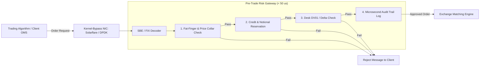

# Intraday Risk and Pre-Trade Limits

## TL;DR

Pre-trade risk controls and real-time intraday position monitoring protect financial institutions from catastrophic execution errors, market manipulation, and credit defaults.
Under regulatory mandates such as SEC Rule 15c3-5 (Market Access Rule) and European MiFID II RTS 6, broker-dealers must enforce automated, non-bypassable pre-trade controls before routing orders to external market centers.
These controls span fat-finger price collars, order size caps, aggregate notional throttles, counterparty credit reservations, and desk-level Greek limits (DV01, CS01, Vega).
In high-frequency flow environments (Equities, FX, Listed Derivatives), checks must execute in under 100 microseconds using kernel-bypass networking and lock-free concurrency structures (such as the LMAX Disruptor).
For complex OTC derivatives, proxy engines evaluate incremental credit and market risk in under 10 milliseconds.
Automated kill switches and intraday position-keeping engines provide real-time circuit breakers when volatility triggers portfolio limit breaches.

## Learning objectives

- Map the regulatory requirements of SEC Rule 15c3-5 and MiFID II RTS 6 onto modern electronic trading gateways.
- Design low-latency, in-line pre-trade risk check architectures operating within strict microsecond and millisecond latency budgets.
- Implement high-concurrency lock-free state management for real-time limit tracking using atomic operations and ring buffers.
- Construct optimistic credit reservation workflows with automatic timeout-release mechanisms to prevent deadlock during fill delays.
- Evaluate real-world algorithmic trading catastrophes (including Knight Capital 2012) and derive mandatory architectural circuit breakers.
- Construct Mermaid sequence, state, and container diagrams for pre-trade gateways and kill switch activation.

## Core concepts

### 1. Regulatory Mandates: SEC Rule 15c3-5 and MiFID II RTS 6

Following rapid growth in algorithmic high-frequency trading, regulators outlawed unfiltered "naked" market access:
- **SEC Rule 15c3-5 (Market Access Rule, 2011):**
  Broker-dealers providing market access must implement pre-set capital thresholds and financial risk controls on a pre-trade basis.
  Controls must prevent the entry of orders exceeding pre-set credit or capital limits, prevent orders with erroneous prices or sizes (fat-finger controls), and block orders violating regulatory short-sale or wash-trade rules.
  Crucially, controls must be under the direct and exclusive control of the broker-dealer (cannot be outsourced to clients).
- **MiFID II RTS 6 (Algorithmic Trading Controls, 2018):**
  Mandates real-time price collars, maximum order value limits, maximum message rates per second, order-to-trade ratios (OTR), and automated emergency kill switches capable of halting trading within milliseconds.

### 2. In-Line Pre-Trade Gateway Architecture



### 3. Check Categories: Microsecond Flow vs. Millisecond OTC

```
+----------------------------------------------------------------------------------------------------+
| Check Category       | Flow Trading (Equities, FX, Futures)       | OTC Derivatives (Swaps, Exotics) |
+----------------------------------------------------------------------------------------------------+
| Latency Budget       | 10 to 100 microseconds                     | 5 to 25 milliseconds             |
| Execution Location   | In-line inside network gateway / FPGA      | Distributed Pre-Trade Microservice|
| Price Collar         | $\pm 2\%$ to $5\%$ of National Best Bid/Offer (NBBO)| Comparison against live mid curve|
| Size / Notional Cap  | Max shares per order / max dollar value    | Max gross notional / maturity cap|
| Credit Verification  | Pre-allocated credit bucket in local RAM   | SA-CCR marginal EAD proxy check  |
| Greek Limits         | Cash Delta, Gross Open Notional            | DV01, CS01, Vega bucketed limits |
| Short-Sale Check     | Locate check (Reg SHO Rule 203)            | Borrow verification for bond short|
+----------------------------------------------------------------------------------------------------+
```

### 4. Concurrency Control: Lock-Free Ring Buffers and Atomic Reservations

In high-concurrency environments processing 100,000 orders/sec across 64 CPU cores, traditional mutex locks cause thread contention and context-switching latency spikes:
- **Lock-Free Ring Buffers (LMAX Disruptor Pattern):**
  Uses a circular array with power-of-two sizing and a monotonically increasing sequence counter.
  Producers claim sequence slots using atomic `compare_and_swap` (CAS) without blocking other threads, and consumer threads process risk updates sequentially with cache-line prefetching.
- **Optimistic Limit Reservation State Machine:**

```mermaid
stateDiagram-v2
    [*] --> Available: Limit Initialized
    Available --> Reserved: Order Inbound (Reserve Notional)
    Reserved --> Released: Order Cancelled / Rejected by Exchange
    Reserved --> Reserved: Timeout (Query Status and Cancel; Await Terminal Reconciliation)
    Reserved --> Committed: Terminal Fill Reconciled (Update Position)
    Reserved --> Released: Rejection or Cancellation Reconciled
    Committed --> Available: Position Settled / Closed Out
    Released --> Available: Capacity Restored
```



## Worked examples

### Example 1: Latency Budget Breakdown of a 25-Microsecond Pre-Trade Flow Gateway

An ultra-low latency gateway evaluates an inbound equity order against SEC Rule 15c3-5 controls:
- Component 1: Physical Network & Kernel Bypass Ingestion (Solarflare Onload / DPDK):
  Packet enters NIC, bypasses Linux kernel network stack, and lands directly in user-space memory: $T_1 = 3.5\text{ microseconds}$.
- Component 2: Simple Binary Encoding (SBE) / FIX Parsing:
  Deserializes order into a C++ struct: $T_2 = 1.2\text{ microseconds}$.
- Component 3: Fat-Finger Price Collar Check:
  Compares order price $P_{\text{order}}$ against current BBO:
  $P_{\text{bid}} \times (1 - 0.03) \le P_{\text{order}} \le P_{\text{ask}} \times (1 + 0.03)$.
  Lookup in L1 CPU cache: $T_3 = 0.4\text{ microseconds}$.
- Component 4: Atomic Credit Limit Reservation:
  Executes an atomic fetch-and-add on the counterparty's allocated credit balance:
  `atomic_fetch_add(&cpty_utilized, order_value)`.
  Cache coherency bus lock: $T_4 = 1.8\text{ microseconds}$.
- Component 5: Desk Net Notional and Short-Sale Check:
  Evaluates desk position boundary: $T_5 = 1.1\text{ microseconds}$.
- Component 6: Lock-Free Audit Trail Logging (Ring Buffer):
  Writes order event to pre-allocated shared memory ring buffer: $T_6 = 0.8\text{ microseconds}$.
- Component 7: Outbound Network Packet Serialization & Transmission:
  Transmits approved order onto exchange fiber link: $T_7 = 4.2\text{ microseconds}$.
- Total End-to-End Gateway Latency:

$$\text{Total Latency} = 3.5 + 1.2 + 0.4 + 1.8 + 1.1 + 0.8 + 4.2 = 13.0\text{ microseconds}$$

The entire pre-trade risk evaluation completes in $13\text{ microseconds}$, satisfying the $< 25\mu s$ high-frequency trading constraint.

### Example 2: Optimistic Credit Reservation with Timeout Release

A prime broker manages a $\$50,000,000$ intraday trading limit for a quantitative hedge fund:
- Current Utilized Credit: $\$44,000,000$. Available Capacity: $\$6,000,000$.
- Order 1 arrives at $t = 0\text{ ms}$: Buy $100,000$ shares of AAPL at $\$200$ (Order Value $= \$20,000,000$).
  - Gateway Check: $\$20,000,000 > \$6,000,000$ available.
  - Action: Immediately rejected ("Credit limit exceeded").
- Order 2 arrives at $t = 5\text{ ms}$: Buy $20,000$ shares of AAPL at $\$200$ (Order Value $= \$4,000,000$).
  - Gateway Check: $\$4,000,000 \le \$6,000,000$ available.
  - Action: Approved. The engine moves $\$4,000,000$ from `Available` to `Reserved`.
  - New Available Capacity: $\$2,000,000$.
- Order 3 arrives at $t = 8\text{ ms}$: Buy $15,000$ shares of AAPL at $\$200$ (Order Value $= \$3,000,000$).
  - Gateway Check: $\$3,000,000 > \$2,000,000$ available.
  - Action: Rejected because Order 2's reservation is pending.
- Scenario Outcome A (Normal Execution):
  At $t = 25\text{ ms}$, the exchange returns an execution report: Order 2 partially filled for $\$3,000,000$, balance cancelled.
  - Reserved $\$4\text{M}$ is cleared: $\$3\text{M}$ is converted to permanent `Committed Position`, and $\$1\text{M}$ unexecuted capacity is returned to `Available`.
  - Final Available: $\$3,000,000$.
- Scenario Outcome B (Network Partition / Timeout):
  If the exchange connection drops and no fill report arrives within $500\text{ ms}$, the reservation remains held while the engine queries order status and requests cancellation.
  It is released only after a definitive terminal status is reconciled; any reported fills are committed before the remaining reservation is returned to available capacity.

### Example 3: Real-World Catastrophe: The Knight Capital Collapse (August 1, 2012)

- **Context:** Knight Capital was the largest market maker in US equities, executing roughly $17\%$ of volume on NYSE and Nasdaq.
- **Architectural Failure:**
  During an overnight deployment of new software for the Retail Member Organization (RMO), an engineer failed to copy the updated code to one of eight production servers.
  The eighth server retained a dormant test code harness known as "SMARS" that repurposed an internal flag.
  When trading opened at 09:30 EST, the rogue server began reading incoming parent retail orders and continuously splitting them into rapid child market orders without checking whether the parent was already filled.
- **Absence of Pre-Trade Risk Controls:**
  The server sent $4,000,000$ execution orders in 45 minutes across 154 stocks, executing $397,000,000$ shares.
  The architecture lacked three fundamental SEC Rule 15c3-5 controls:
  1. No maximum order fill throttle per parent order (the code bought millions of shares against small 100-share retail requests).
  2. No aggregate dollar capital consumption limit at the gateway level.
  3. No automated kill switch: it took technicians 45 minutes to locate and physically shut down the rogue server.
- **Financial Consequence:**
  Knight accumulated $\$7\text{ billion}$ of unwanted long and short equity positions.
  Liquidating these positions into the market realized a net loss of **$\$440\text{ million}$** in 45 minutes, wiping out Knight Capital's equity capital and forcing a distressed merger with Getco.

## Pitfalls

- **Placing Risk Checks Asynchronously Behind the Gateway:** Evaluating limits asynchronously on a separate message queue allows thousands of unauthorized orders to reach the exchange before a violation signal arrives. Pre-trade checks must be strictly in-line.
- **Relying on Single-Key Mutex Locks in Multithreaded Gateways:** Locking an entire counterparty record across multiple worker cores creates thread convoying, spiking 99th-percentile order latency from microseconds to hundreds of milliseconds.
- **Neglecting Unfilled Working Order Commitments:** Calculating available credit using only completed fills while ignoring outstanding working orders in the market allows algorithms to over-commit balance sheet capital during sudden market swings.
- **Omitting Price Collar Bandwidths on Market Orders:** Routing uncollared market orders into thin opening or closing uncrossing auctions causes trades to execute at wild, non-economic prices during liquidity voids.
- **Failing to Automate the Kill Switch:** Requiring a human risk officer to approve a manual kill switch during an algorithmic runaway ensures disaster; kill switches must trip automatically upon exceeding maximum loss velocity thresholds (e.g., $>\$5\text{M}$ loss in 60 seconds).

## Interview questions

> [!question]- sys-08-01 | What is the fundamental mandate of SEC Rule 15c3-5?
> SEC Rule 15c3-5 mandates that broker-dealers with market access must implement pre-set capital thresholds, credit limits, and financial risk controls on an automated, non-bypassable pre-trade basis.
> It explicitly prohibits unfiltered or naked direct market access by clients and requires direct broker-dealer oversight.

> [!question]- sys-08-02 | How does kernel-bypass networking reduce pre-trade gateway latency?
> Traditional networking requires the operating system kernel to handle network interrupts, context switch, and copy packet data from kernel buffers to application memory.
> Kernel-bypass technologies (such as Solarflare Onload or DPDK) map the NIC ring buffer directly into user-space application memory, eliminating context switches and saving 5 to 10 microseconds per packet.

> [!question]- sys-08-03 | What is a "Fat-Finger" control and how is it mathematically defined?
> A fat-finger control prevents orders with erroneous prices or quantities caused by human typing mistakes or software bugs.
> It is defined via price collars (e.g., rejecting orders outside $P_{\text{ref}} \pm X\%$) and quantity/notional caps (e.g., rejecting single orders exceeding $N_{\text{max}}$ shares or $V_{\text{max}}$ dollars).

> [!question]- sys-08-04 | What is the LMAX Disruptor pattern and why is it preferred over concurrent queues?
> The Disruptor is a lock-free, circular ring-buffer architecture for inter-thread messaging.
> It avoids expensive OS mutex locks and cache-line invalidations (false sharing) by using contiguous memory arrays with cache-line padding and sequence counters, achieving millions of operations per second with microsecond latencies.

> [!question]- sys-08-05 | What is an algorithmic Kill Switch and what triggers it?
> A kill switch is an automated circuit breaker that instantly cancels all working orders and blocks new order submissions for a specific trading desk, algorithm, or firm-wide.
> It is triggered when predefined risk thresholds are breached, such as maximum loss per minute, message rate spikes, or repeated exchange reject rates.

> [!question]- sys-08-06 | What is the difference between a Hard Limit and a Soft Limit?
> A Hard Limit is non-bypassable: any order that would breach the limit is immediately rejected by the gateway.
> A Soft Limit acts as an early warning threshold (e.g., at 80% or 90% of the hard limit), triggering automated alerts to traders and risk managers and prompting an electronic approval workflow.

> [!question]- sys-08-07 | How does an optimistic credit reservation prevent double-spending in distributed gateways?
> Before routing an order to an exchange, the gateway reserves the required credit from the counterparty's pool using an atomic operation.
> A fill is committed, and a rejection or cancellation releases the reservation, only after its definitive terminal status is reconciled. A timeout triggers a status query and cancellation request while the reservation remains held.

> [!question]- sys-08-08 | What is Reg SHO Rule 203 (Locate Requirement) in equity pre-trade risk?
> Reg SHO Rule 203 mandates that a broker-dealer cannot execute a short-sale order in an equity security unless it has borrowed the security or has reasonable grounds to believe the security can be borrowed and delivered by settlement date (a verified "locate").
> The pre-trade gateway must verify and decrement an active locate record before allowing the short sale.

> [!question]- sys-08-09 | How does pre-trade risk checking differ between flow cash equities and bilateral OTC swaptions?
> Cash equities require ultra-low latency ($< 50\mu s$) checking simple arithmetic rules (price collar, shares, cash balance).
> Bilateral OTC swaptions tolerate higher latency ($< 15\text{ ms}$) but require complex mathematical evaluations: verifying ISDA master agreements, CSA collateral terms, SA-CCR marginal EAD, and portfolio DV01/Vega shifts.

> [!question]- sys-08-10 | Why did the lack of an order-fill throttle cause the Knight Capital bankruptcy?
> The rogue server continuously submitted child orders to the market without checking whether the total executed quantity had already satisfied the parent order.
> An order-fill throttle would have detected that the parent order was fully filled and automatically shut down further child order generation.

## Further reading

- US Securities and Exchange Commission. *Rule 15c3-5: Risk Management Controls for Broker-Dealers with Market Access*. SEC Release No. 34-63241, 2011.
- European Securities and Markets Authority. *Guidelines on systems and controls in an automated trading environment for trading platforms, investment firms and competent authorities*. ESMA/2012/122.
- Thompson, Martin, Farley, Dave, et al. *Disruptor: High performance alternative to bounded queues for concurrent programming*. LMAX Whitepaper, 2011.
- Securities and Exchange Commission. *SEC Charges Knight Capital With Violating Market Access Rule*. SEC Press Release 2013-222, 2013.
