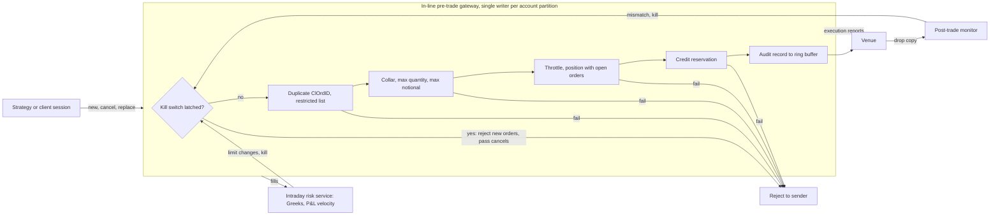
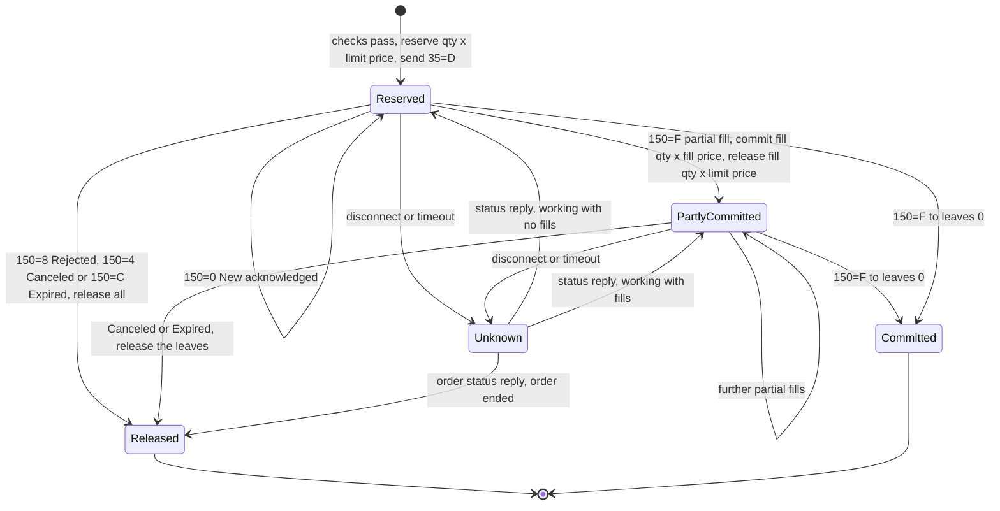

# Intraday Risk and Pre-Trade Limits

## TL;DR

- Pre-trade controls sit in-line between the order source and the venue and reject an order before it leaves; intraday risk monitoring runs beside the flow on fills and positions and can stop it.
- SEC Rule 15c3-5 requires broker-dealers with market access to have controls "reasonably designed" to prevent orders that exceed pre-set credit or capital thresholds and erroneous orders, under their "direct and exclusive control"; MiFID II RTS 6 (Regulation (EU) 2017/589) requires price collars, maximum order value and volume, maximum message limits (Article 15), a kill functionality (Article 12) and real-time alerts within five seconds (Article 16).
- Limits must count working orders, not just fills: reserve credit when an order is sent, convert it to committed exposure on fills, release it only on a terminal FIX state (Canceled, Rejected, Expired, or the leaves of a Filled order), and keep it held while the status is unknown.
- Latency budgets are design choices, not facts: a hypothetical 13.0 microsecond wire-to-wire budget with 5.3 microseconds on the gateway core loads one core to 0.53 at 100,000 orders per second.
- Knight Capital (SEC Release No. 34-70694): on August 1, 2012, 212 parent orders produced more than 4 million executions in 154 stocks in about 45 minutes and a 460 million dollar loss, with capital thresholds that were not linked to order entry.
- Every number on this page is produced and asserted by [sys_intraday_limits.py](code/sys_intraday_limits.py).

## Learning objectives

- Map SEC Rule 15c3-5 and MiFID II RTS 6 onto concrete gateway controls.
- Construct in-line pre-trade check pipelines with explicit latency and capacity budgets.
- Manage limit state with a single writer per partition and lock-free hand-off, and explain where atomics and ring buffers fit.
- Design a credit reservation ledger driven by FIX order states, including partial fills, price improvement and unknown status.
- Explain what the SEC found at Knight Capital (August 1, 2012) and the controls that would have stopped it.
- Size ring buffers and compute order-to-trade ratios under RTS 9.

## Core concepts

### 1. What the rules require

**SEC Rule 15c3-5** (17 CFR 240.15c3-5, adopted by Release No. 34-63241, published at 75 FR 69792 on November 15, 2010, effective 60 days after publication); text checked as of 2026-10, quoted in full in [Risk Checks and Order Management](../12-Quant-Development/13-Risk-Checks-and-Order-Management.md):

- (b) a broker-dealer with market access must "establish, document, and maintain a system of risk management controls and supervisory procedures reasonably designed to manage the financial, regulatory, and other risks" of market access.
- (c)(1)(i) prevent orders that "exceed appropriate pre-set credit or capital thresholds in the aggregate for each customer and the broker or dealer".
- (c)(1)(ii) prevent erroneous orders "that exceed appropriate price or size parameters, on an order-by-order basis or over a short period of time, or that indicate duplicative orders".
- (c)(2) regulatory controls: pre-order-entry regulatory requirements (for example the Regulation SHO locate in Rule 203(b)), restricted persons and securities, access only for authorised persons, and immediate post-trade execution reports to surveillance staff.
- (d) the controls must be "under the direct and exclusive control of the broker or dealer", with a narrow allowance to allocate specific regulatory controls to a broker-dealer customer by written contract.
- (e) regular review, at least annually, and an annual CEO certification.

The rule ended "unfiltered" or "naked" sponsored access, where a customer's orders reached the venue under the broker's identifier without the broker's own pre-trade controls.

**MiFID II RTS 6**, Commission Delegated Regulation (EU) 2017/589 of 19 July 2016 (OJ L 87, 31.3.2017), applicable from 3 January 2018 (Article 29), for investment firms engaged in algorithmic trading:

- Article 12: a kill functionality to "cancel immediately, as an emergency measure, any or all of its unexecuted orders" at any or all venues, including orders from individual traders, desks or clients.
- Article 15(1): pre-trade controls on order entry for all financial instruments: price collars, maximum order values, maximum order volumes and maximum message limits; Article 15(2): every order sent counts immediately in the limits; Article 15(3): repeated automated execution throttles that disable a strategy after a set number of executions until a designated person re-enables it.
- Article 16: real-time monitoring by the trader and by an independent risk function, with real-time alerts "generated within five seconds after the relevant event".
- Article 17: continuous post-trade controls, including monitoring of market and credit risk in terms of effective exposure.

**MiFID II RTS 9**, Commission Delegated Regulation (EU) 2017/566: trading venues (not the firms) calculate, at least at the end of each trading session, each member's ratio of unexecuted orders to transactions per instrument, by number and by volume (Article 3):

$$\text{OTR}_{\text{number}} = \frac{\text{total number of orders}}{\text{total number of transactions}} - 1, \qquad \text{OTR}_{\text{volume}} = \frac{\text{total volume of orders}}{\text{total volume of transactions}} - 1,$$

where an order is every submission, modification and cancellation and a transaction is a totally or partially executed order (Article 1); each venue sets the maximum ratio it enforces.

### 2. Where the controls sit and what each component owns

| Component | Responsibility | State it owns | Interface | Failure behaviour |
| :--- | :--- | :--- | :--- | :--- |
| Order source (strategy, OMS, client session) | decide and assign ClOrdID | its own orders | outbound NewOrderSingle, Cancel, Replace | none of the risk controls live here |
| In-line pre-trade gateway | kill switch, collar, size, notional, duplicates, throttles, credit and position limits | working orders and reservations per account, limits, reference prices | synchronous accept or reject per message | fail closed: missing reference price, missing limit or unknown state rejects new risk; cancels always pass |
| Venue session | FIX or native protocol to the venue | sequence numbers, session state | execution reports back to the gateway | cancel-on-disconnect where the venue offers it |
| Intraday risk service | positions, Greeks (delta, DV01, CS01, vega), P&L velocity, soft and hard desk limits | positions from fills and drop copy, intraday market data | limit updates and kill commands to the gateway | stale inputs raise alerts; a breach can lower limits or engage the kill switch |
| Post-trade monitor | independent reconciliation on the drop copy | positions per account from the venue's view | alerts, kill switch | a mismatch with the gateway's view latches the kill switch |
| Limit administration | set and approve limits, audit changes | limit master with versions | publishes limit versions to the gateway | a limit change is effective only after the gateway acknowledges the version |

### 3. Flow versus OTC checks

The numbers below are labelled-hypothetical design budgets; real figures depend on hardware, protocol and product and are not published in a comparable way.

| Aspect | Flow (cash equities, listed futures, spot FX) | OTC derivatives (swaps, options) |
| :--- | :--- | :--- |
| Budget (hypothetical) | microseconds per order, in-line | milliseconds to seconds, before the quote or the trade is booked |
| Where it runs | gateway process, FPGA or venue-provided risk layer | pre-trade service called by the pricing or RFQ workflow |
| Price check | collar against a trusted reference (NBBO, last trade, settlement) | price against the desk's own model mid and a tolerance |
| Size check | maximum quantity and notional per order | maximum notional and tenor |
| Credit | pre-allocated credit per account, reserved per order | counterparty limits on potential future exposure or SA-CCR-style add-ons, incremental XVA |
| Market risk | gross and net position, cash delta | incremental DV01, CS01, vega by bucket against desk limits |

### 4. Limit state: reservations driven by FIX order states

A limit check on fills alone lets many working orders each pass and then all fill.
The gateway therefore holds a reservation for every working order, sized at the worst price the order can trade at, and moves it through the order's FIX states (ExecType (150) and OrdStatus (39), as in [Risk Checks and Order Management](../12-Quant-Development/13-Risk-Checks-and-Order-Management.md)):

Rules that follow from the FIX races:

- While a cancel is in flight (Pending Cancel) fills can still arrive, so nothing is released until the venue confirms the cancel.
- While a replace is in flight (Pending Replace) either set of terms can execute, so the reservation is the larger of old and new leaves at the worse price.
- Unknown status never releases capacity: the gateway queries order status, sends cancels, and keeps the reservation until a terminal state is reconciled.
- Fills at a better price than the limit return the difference immediately, because the reservation was sized at the limit.

### 5. Concurrency

- Partition limit state by account (or by the limit's scope) and give each partition one writer thread; checks and updates for that partition then run in arrival order with no locks, and a check never sees a half-applied fill.
- Hand messages between threads with bounded single-producer queues; the LMAX Disruptor (Thompson, Farley, Barker, Gee and Stewart, May 2011) is a ring buffer whose size is a power of two so the slot index is a bit mask, with no locks or CAS for a single producer and a CAS on the claim sequence for several producers; its paper warns that independently written variables must not share a cache line (false sharing).
- A limit shared across partitions (a firm-wide gross limit) needs either a further owner thread that grants sub-allocations to partitions, or atomic fetch-and-add with a check of the result; a per-order global lock is the convoy that destroys tail latency.

### 6. Kill switch and limit escalation

- Soft limits (for example at a stated fraction of the hard limit) alert people and may require approval to continue; hard limits reject in the gateway.
- The kill switch is latched: engaged automatically by P&L velocity, message-rate, reject-rate or reconciliation breaches, or by a person, and re-armed only by a person.
- Engaging it blocks new orders and sends cancels for all working orders, which RTS 6 Article 12 requires to be possible immediately; cancels themselves are never throttled.

## Worked examples

All budgets, limits, orders and buffer sizes are labelled-hypothetical design inputs.

### Example 1: latency budget and per-core capacity

| Stage | Budget (microseconds) | On the gateway core |
| :--- | :--- | :--- |
| NIC to user space (kernel bypass) | 3.5 | no |
| Decode order message | 1.2 | yes |
| Price collar and size checks | 0.4 | yes |
| Credit reservation | 1.8 | yes |
| Position and short-sale checks | 1.1 | yes |
| Audit record to ring buffer | 0.8 | yes |
| Encode and send to venue | 4.2 | no |

- Wire-to-wire budget: $13.0$ microseconds; gateway-core service time: $5.3$ microseconds.
- At 100,000 orders per second one core is $0.53$ busy; its ceiling is $188,679$ orders per second.
- Even at 53% load orders queue: for deterministic service and Poisson arrivals (M/D/1) the mean wait is $\rho s / (2(1-\rho)) = 2.99$ microseconds, which is why gateways partition by account across cores well before nominal saturation.

### Example 2: credit reservation ledger

A prime broker gives a client a 50,000,000 dollar intraday limit with 44,000,000 already committed, so 6,000,000 is available.

1. Order 1: buy 100,000 at a 200 limit, 20,000,000; rejected.
2. Order 2: buy 20,000 at 200, 4,000,000; accepted and reserved, leaving 2,000,000 available.
3. Order 3: buy 15,000 at 200, 3,000,000; rejected because order 2's reservation is held.
4. Outcome A: 15,000 shares of order 2 fill at 200 (3,000,000 committed, 1,000,000 still reserved), then the venue cancels the rest; committed becomes 47,000,000 and available 3,000,000.
5. Outcome B: all 20,000 fill at 199.50; committed becomes 47,990,000 and the 10,000 price improvement returns to available.
6. Outcome C: the session drops with order 2 working; available stays at 2,000,000 until an order status reply or cancel confirmation settles it.

The code processes these events through a reservation ledger.
It then replays a seeded random sequence of new orders, fills, cancels and releases through the ledger and through a naive model that recomputes available from the order history, and asserts after every event that the two agree, including on which orders are rejected for exceeding the limit.

### Example 3: what the SEC found at Knight Capital

From SEC Release No. 34-70694 (October 16, 2013):

- Knight's aggregate trading was about 10% of all trading in listed US equities in 2011 and 2012.
- New Retail Liquidity Program code was deployed to seven of eight servers of SMARS, Knight's order router; the eighth still had "Power Peg", a function unused since 2003 whose cumulative-quantity tracking had been moved in 2005, and the new code repurposed the flag that used to activate it.
- On August 1, 2012, the eighth server sent child orders continuously for 212 parent orders without regard to fills: more than 4 million executions in 154 stocks for more than 397 million shares in about 45 minutes, on average at least $1,481.5$ executions per second.
- Knight was left with about 3.5 billion dollars net long in 80 stocks and 3.15 billion net short in 74, $6.65$ billion gross, and realised a 460 million dollar loss; it reported significant net capital problems, and its parent later combined with GETCO to form KCG Holdings on July 1, 2013.
- Control findings: firm-wide capital thresholds were not linked to automated order entry; the main position monitor (PMON) was post-execution, relied on people and showed no limits; position limits did not count outstanding orders; 97 automated "Power Peg disabled" emails before the open were not treated as alerts; there were no written deployment procedures for SMARS or incident-response procedures, and uninstalling the new code from the seven good servers made things worse.
- The SEC found violations of Rule 15c3-5 and Regulation SHO Rules 200(g) and 203(b), and imposed a 12 million dollar civil penalty.

### Example 4: ring buffer sizing and order-to-trade ratio

- A ring of $2^{20} = 1,048,576$ slots of 64 bytes takes $64.0$ MiB; with a power-of-two size, the slot for sequence $n$ is $n \,\&\, (2^{20} - 1)$.
- A member sends 10,000 new orders, 9,000 modifications and 6,000 cancellations ($25,000$ orders under RTS 9) and gets 500 transactions: $\text{OTR}_{\text{number}} = 25,000/500 - 1 = 49.0$.
- By volume, 4,000,000 shares ordered against 250,000 executed gives $\text{OTR}_{\text{volume}} = 15.0$; the venue compares both with its own maximum.

## Pitfalls

- **Checking after routing.** A check on an asynchronous queue after the order has left lets every order through before the breach is seen; pre-trade means in-line and synchronous.
- **Counting fills only.** Working orders can all fill; Knight's position limits did not account for outstanding orders.
- **Releasing on timeout.** A reservation released because no answer arrived lets the same capacity be used twice if the order was in fact live.
- **Monitors that are not controls.** A dashboard that people watch is not a pre-trade control; Knight's PMON showed the positions but could not stop order entry.
- **One lock for a whole account across threads.** Convoys turn microsecond checks into millisecond tails; give each partition one writer instead.
- **Throttling or blocking cancels.** During an incident, cancels reduce risk and must always pass the kill switch and throttles.
- **Collars without a trusted reference.** If the reference price is missing or stale, the check must fail closed, not pass.

## Interview questions

> [!question]- sys-08-01 | What does SEC Rule 15c3-5 require?
> A broker-dealer with market access must have risk management controls and supervisory procedures reasonably designed to manage the risks of that access (paragraph (b)).
> Financial controls must prevent orders that exceed pre-set credit or capital thresholds in the aggregate and erroneous orders that exceed price or size parameters or are duplicative ((c)(1)); regulatory controls cover pre-order-entry requirements, restricted securities, authorised access and immediate post-trade reports ((c)(2)).
> They must be under the broker's direct and exclusive control ((d)), reviewed at least annually and certified by the CEO ((e)); this ended unfiltered "naked" access.

> [!question]- sys-08-02 | How does kernel-bypass networking reduce gateway latency?
> The NIC's receive and transmit rings are mapped into the application's memory and polled by a dedicated thread, so packets skip interrupts, kernel protocol processing, system calls and the copy from kernel to user buffers.
> The saving depends on the NIC, kernel and workload, so quote it from your own measurements, not from a generic number.

> [!question]- sys-08-03 | What is a fat-finger control, formally?
> Reject a buy above $P_{\text{ref}}(1 + c)$ or a sell below $P_{\text{ref}}(1 - c)$ for a collar $c$ around a trusted reference, and reject an order above a maximum quantity or a maximum notional.
> With a 100.00 by 100.05 NBBO and a 3% collar, buys above 103.0515 and sells below 97.00 are rejected.

> [!question]- sys-08-04 | What is the LMAX Disruptor and why use it instead of a locked queue?
> A pre-allocated ring buffer with sequence counters: a single producer claims slots without locks or CAS, several producers use a CAS on the claim sequence, and consumers follow the published sequence; the power-of-two size makes the index a bit mask.
> It avoids lock contention and allocation; the May 2011 LMAX paper reports over 25 million messages per second and a 52 ns mean latency per hop against 32,757 ns for Java's ArrayBlockingQueue on its 2011 test hardware.

> [!question]- sys-08-05 | What is a kill switch and what triggers it?
> A latched control that blocks new orders and cancels all working orders for a scope (strategy, desk, account or firm); RTS 6 Article 12 requires the ability to cancel unexecuted orders immediately as an emergency measure.
> Triggers include P&L velocity, message-rate or reject-rate breaches, reconciliation mismatches against the drop copy, and a human command; re-arming is manual.

> [!question]- sys-08-06 | What is the difference between a hard limit and a soft limit?
> A hard limit is enforced in the gateway: an order that would breach it is rejected.
> A soft limit is a warning level below the hard limit that alerts the trader and risk managers and may require approval to continue.

> [!question]- sys-08-07 | How does credit reservation prevent double-spending?
> The gateway reserves the order's worst-case notional when it sends the order, commits fills as they arrive and releases the rest only on a terminal state (Canceled, Rejected, Expired, or leaves 0).
> On a timeout or disconnect it keeps the reservation, queries status and sends cancels, so the same capacity cannot be granted twice to an order that may still be live.

> [!question]- sys-08-08 | What is the Regulation SHO Rule 203(b) locate requirement and where does it sit?
> A broker-dealer may not accept or effect a short sale in an equity security unless it has borrowed the security, has a bona fide arrangement to borrow it, or has reasonable grounds to believe it can be borrowed for delivery when due, and has documented this.
> It is a pre-order-entry regulatory requirement under 15c3-5 (c)(2)(i), usually implemented as a locate record that the order flow checks and decrements; Knight was also found to have violated Rules 200(g) (marking) and 203(b).

> [!question]- sys-08-09 | How does pre-trade checking differ between cash equities and OTC swaptions?
> Equities need simple in-line arithmetic at very low latency on every order: collar, size, notional, credit, position.
> OTC swaptions are checked once per trade in a pre-trade service with a looser budget but richer analytics: counterparty exposure and incremental XVA, legal and CSA terms, incremental DV01 and vega against bucket limits.

> [!question]- sys-08-10 | What did the SEC find went wrong at Knight Capital, and what would have stopped it?
> Defective code on one of eight servers sent child orders without regard to fills on 212 parent orders, producing more than 4 million executions and a 460 million dollar loss in about 45 minutes.
> Capital thresholds were not linked to automated order entry and position limits ignored outstanding orders; an automated firm-wide credit or capital check in the order path, or a fill-aware throttle per parent order, would have stopped the flow.
> Knight was not made bankrupt: it reported significant net capital problems and its parent later combined with GETCO to form KCG Holdings.

> [!question]- sys-08-11 | Which pre-trade controls does MiFID II RTS 6 Article 15 list?
> Price collars, maximum order values, maximum order volumes and maximum message limits, for all financial instruments; every order sent counts immediately in the limits (15(2)).
> Article 15(3) adds repeated automated execution throttles that disable a strategy after a set number of executions until a designated person re-enables it.

> [!question]- sys-08-12 | Who computes the MiFID II order-to-trade ratio, and how?
> The trading venue, for each member and instrument, at least at the end of every trading session (RTS 9 Article 3): (orders / transactions) - 1 by number and by volume, where orders include submissions, modifications and cancellations.
> 25,000 order messages against 500 transactions give 49.0.

> [!question]- sys-08-13 | A replace is in flight. How much credit should the gateway hold for the order?
> The larger of the old and new leaves quantity at the worse of the two prices, because until the venue confirms the replace either set of terms can execute.
> Release the difference only after the Replaced report (150=5) arrives.

> [!question]- sys-08-14 | One gateway core spends 5.3 microseconds per order. How loaded is it at 100,000 orders per second, and does it matter?
> Utilisation is $100,000 \times 5.3 \times 10^{-6} = 0.53$, with a ceiling of 188,679 orders per second.
> Queueing still adds delay: with deterministic service the mean wait is about 2.99 microseconds, and bursts are far worse than the average, so partition by account well before saturation.

> [!question]- sys-08-15 | How quickly must RTS 6 real-time alerts fire, and who monitors?
> Within five seconds of the relevant event (Article 16(5)).
> Monitoring is by the trader running the algorithm and by the risk management function or an independent risk control function able to challenge the trader (Article 16(2)).

> [!question]- sys-08-16 | Why must a missing reference price block an order rather than skip the collar check?
> A collar with no reference cannot detect an erroneous price, so passing the order means running without the control exactly when the data feed is broken.
> Fail closed: reject new orders for that instrument (cancels still pass) and alert.

## In this repo and SDE-Interview-Prep

- [sys_intraday_limits.py](code/sys_intraday_limits.py) computes, prints and asserts every number on this page; the credit example runs through a reservation ledger, which a random event replay checks against a naive recomputation from the order history.
- [Risk Checks and Order Management](../12-Quant-Development/13-Risk-Checks-and-Order-Management.md) for the full 15c3-5 text, the FIX state machine and a C++ gateway; [Concurrency, Lock-Free and Memory Pools](../12-Quant-Development/04-Concurrency-Lock-Free-and-Memory-Pools.md) for ring buffers.
- [Risk Engine](07-Risk-Engine.md) for the risk numbers intraday limits are set on, [Front-to-Back Architecture](01-Front-to-Back-Architecture.md) for where the gateway sits.
- SDE-Interview-Prep: [Idempotency and Delivery](https://github.com/shreejitverma/SDE-Interview-Prep/blob/main/04-System-Design/00-Concepts/Idempotency-and-Delivery.md).

## Further reading

- 17 CFR 240.15c3-5 and SEC Release No. 34-63241, *Risk Management Controls for Brokers or Dealers with Market Access*, 75 FR 69792, November 15, 2010.
- SEC Release No. 34-70694, *In the Matter of Knight Capital Americas LLC*, File No. 3-15570, October 16, 2013.
- Commission Delegated Regulation (EU) 2017/589 (RTS 6), OJ L 87, 31.3.2017, p. 417.
- Commission Delegated Regulation (EU) 2017/566 (RTS 9) on the ratio of unexecuted orders to transactions.
- Thompson, M., Farley, D., Barker, M., Gee, P. and Stewart, A., *Disruptor: High performance alternative to bounded queues for exchanging data between concurrent threads*, LMAX, May 2011, https://lmax-exchange.github.io/disruptor/disruptor.html.
