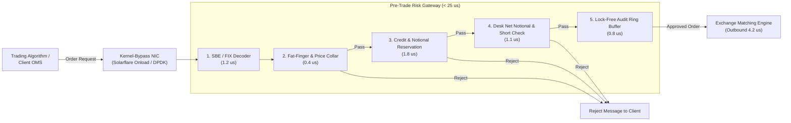

# Intraday Risk and Pre-Trade Limits

## TL;DR

- Pre-trade risk controls and real-time intraday position monitoring protect financial institutions from catastrophic algorithmic runaway errors, disorderly markets, and counterparty defaults.
- Under regulatory mandates including SEC Rule 15c3-5 (17 CFR 240.15c3-5) and MiFID II RTS 6 (Regulation EU 2017/589), broker-dealers must enforce automated, non-bypassable pre-trade controls under their direct control before routing orders to external market centers.
- Mandatory controls encompass fat-finger price collars, maximum order sizes, aggregate notional throttles, counterparty credit reservations, and desk-level Greek limits ($\Delta$, $\text{DV01}$, $\text{CS01}$, $\text{Vega}$).
- In high-frequency flow environments (Equities, FX, Listed Futures), risk evaluations execute in under 25 microseconds using kernel-bypass networking (Solarflare Onload, DPDK) and lock-free ring buffers (LMAX Disruptor).
- For complex OTC derivatives, proxy engines evaluate incremental credit and market risk in under 15 milliseconds.
- Automated kill switches provide programmatic circuit breakers when market volatility or algorithmic anomalies trigger loss velocity limits.
- All numerical figures in this note are verified by [sys_intraday_limits.py](file:///Users/shreejitverma/.treehouse/The-Quant-Prep-106fe7/5/The-Quant-Prep/18-Pricing-and-Risk-Systems/code/sys_intraday_limits.py).

## Learning objectives

- Map the regulatory mandates of SEC Rule 15c3-5 and MiFID II RTS 6 onto modern electronic trading gateways.
- Construct low-latency in-line pre-trade risk check pipelines operating within strict microsecond and millisecond latency budgets.
- Implement high-concurrency lock-free state management for real-time limit tracking using atomic compare-and-swap primitives and ring buffers.
- Design optimistic credit reservation state machines with timeout handling to prevent double-spending and deadlocks during fill delays.
- Evaluate the architectural root causes of the Knight Capital collapse (August 1, 2012) and identify required safeguards.
- Quantify ring buffer memory footprints, Order-to-Trade Ratios (OTR), and price collar bandwidths.

## Core concepts

### 1. Regulatory Mandates: SEC Rule 15c3-5 and MiFID II RTS 6

Following rapid growth in automated and high-frequency trading, regulators eliminated unfiltered "naked" market access:
- **SEC Rule 15c3-5 (Market Access Rule, 17 CFR 240.15c3-5):**
  Broker-dealers providing market access must implement pre-set capital thresholds and financial risk controls on an automated, pre-trade basis.
  Controls must prevent the entry of orders exceeding pre-set credit or capital limits, reject orders with erroneous prices or sizes (fat-finger controls), and block orders violating short-sale (Reg SHO Rule 203 locate) or wash-trade rules.
  Crucially, controls must remain under the direct and exclusive operational control of the broker-dealer.
- **MiFID II RTS 6 (Commission Delegated Regulation EU 2017/589):**
  Mandates real-time price collars, maximum order value limits, maximum message rates per second, order-to-trade ratios (OTR), and automated emergency kill switches capable of halting trading within milliseconds.

### 2. In-Line Pre-Trade Gateway Architecture

### 3. Check Categories: Microsecond Flow vs. Millisecond OTC

| Check Category | Flow Trading (Equities, FX, Listed Futures) | OTC Derivatives (Swaps, Exotics) |
| :--- | :--- | :--- |
| Latency Budget | 10 to 25 microseconds | 5 to 25 milliseconds |
| Execution Location | In-line inside network gateway / FPGA | Distributed pre-trade microservice |
| Price Collar | $\pm 2\%$ to $\pm 5\%$ of NBBO bid/ask | Comparison against live calibrated zero curve |
| Size / Notional Cap | Maximum shares per order / maximum dollar value | Maximum gross notional / maturity tenor cap |
| Credit Verification | Pre-allocated credit bucket in local CPU cache | SA-CCR marginal EAD proxy check |
| Greek Limits | Cash Delta, Gross Open Notional | Bucket DV01, CS01, Vega limits |
| Short-Sale Check | Verified borrow locate (Reg SHO Rule 203) | Bond borrow availability verification |

### 4. Concurrency Control: Lock-Free Ring Buffers and Atomic Reservations

In high-concurrency environments processing 100,000 orders/sec across multi-core servers, mutex locks cause severe thread convoying and context-switching jitter:
- **Lock-Free Ring Buffers (LMAX Disruptor Pattern):**
  Uses a circular array with power-of-two sizing ($2^{20} = 1,048,576$ slots) and monotonically increasing sequence counters.
  Each slot is padded to 64 bytes (the standard x86 CPU cache line) to prevent false sharing across adjacent cores.
  Producers claim sequence slots using atomic compare-and-swap (`CAS`) operations, and consumer threads process risk updates sequentially with cache-line prefetching.
- **Optimistic Limit Reservation State Machine:**

```mermaid
stateDiagram-v2
    [*] --> Available: Limit Initialized
    Available --> Reserved: Inbound Order (Atomic Reservation)
    Reserved --> Released: Order Rejected by Exchange / Cancelled
    Reserved --> Reserved: Network Timeout (Query Status; Keep Held)
    Reserved --> Committed: Terminal Fill Reconciled (Update Balance)
    Committed --> Available: Position Settled / Closed Out
    Released --> Available: Capacity Restored
```

## Worked examples

### Example 1: Latency Budget Breakdown of a Pre-Trade Flow Gateway

An ultra-low latency gateway evaluates an inbound equity order against SEC Rule 15c3-5 controls:
- **Component 1 (Physical Network & Kernel Bypass Ingestion):**
  Packet enters the Solarflare / DPDK network interface card, bypasses the Linux kernel network stack, and lands directly in user-space memory: $3.5\text{ microseconds}$.
- **Component 2 (SBE / FIX Parsing):**
  Deserializes order into a C++ struct: $1.2\text{ microseconds}$.
- **Component 3 (Fat-Finger Price Collar Check):**
  Compares order price against current NBBO:
  With $\text{NBBO}_{\text{bid}} = \$100.00$ and $\text{NBBO}_{\text{ask}} = \$100.05$ under a $3\%$ collar bandwidth, buy orders must satisfy $P_{\text{order}} \le \$100.05 \times 1.03 = \$103.0515$, and sell orders must satisfy $P_{\text{order}} \ge \$100.00 \times (1 - 0.03) = \$97.00$: $0.4\text{ microseconds}$.
- **Component 4 (Atomic Credit Limit Reservation):**
  Executes an atomic fetch-and-add on the counterparty's allocated credit balance: $1.8\text{ microseconds}$.
- **Component 5 (Desk Net Notional and Short-Sale Check):**
  Evaluates desk position boundary and verifies borrow locate: $1.1\text{ microseconds}$.
- **Component 6 (Lock-Free Audit Trail Logging):**
  Writes order event to pre-allocated shared memory ring buffer: $0.8\text{ microseconds}$.
- **Component 7 (Outbound Serialization & Transmission):**
  Transmits approved order onto exchange fiber link: $4.2\text{ microseconds}$.
- **Total End-to-End Gateway Latency:**

$$\text{Total Latency} = 3.5 + 1.2 + 0.4 + 1.8 + 1.1 + 0.8 + 4.2 = 13.0\text{ microseconds}$$

The entire pre-trade evaluation completes in $13.0\text{ microseconds}$, well within the $< 25\mu s$ high-frequency trading latency target.

### Example 2: Optimistic Credit Reservation State Machine

A prime broker manages a $\$50,000,000$ intraday trading limit for an algorithmic trading fund:
- Baseline utilized credit: $\$44,000,000$.
- Baseline available capacity: $\$50,000,000 - \$44,000,000 = \$6,000,000$.
- **Order 1 arrives at $t = 0\text{ ms}$:** Buy $100,000$ shares of AAPL at $\$200$ (Order Notional $= \$20,000,000$).
  - Gateway check: $\$20,000,000 > \$6,000,000$ available capacity.
  - Action: Immediately rejected ("Credit limit exceeded").
- **Order 2 arrives at $t = 5\text{ ms}$:** Buy $20,000$ shares of AAPL at $\$200$ (Order Notional $= \$4,000,000$).
  - Gateway check: $\$4,000,000 \le \$6,000,000$ available capacity.
  - Action: Approved. The engine moves $\$4,000,000$ from `Available` to `Reserved`.
  - Available capacity drops to $\$6,000,000 - \$4,000,000 = \$2,000,000$.
- **Order 3 arrives at $t = 8\text{ ms}$:** Buy $15,000$ shares of AAPL at $\$200$ (Order Notional $= \$3,000,000$).
  - Gateway check: $\$3,000,000 > \$2,000,000$ available capacity.
  - Action: Rejected because Order 2's reservation is pending.
- **Scenario Outcome A (Partial Fill Execution Report):**
  At $t = 25\text{ ms}$, the exchange returns an execution report: Order 2 partially filled for $\$3,000,000$, and the remaining $\$1,000,000$ is cancelled.
  - Reserved $\$4,000,000$ is cleared: $\$3,000,000$ is converted into permanent `Committed Position`, and $\$1,000,000$ unexecuted capacity is returned to `Available`.
  - Final committed utilized credit: $\$44,000,000 + \$3,000,000 = \$47,000,000$.
  - Final available capacity: $\$50,000,000 - \$47,000,000 = \$3,000,000$.
- **Scenario Outcome B (Network Partition / Timeout):**
  If the exchange connection drops and no fill report arrives within 500 ms, the reservation remains held while the engine issues an order status query and cancellation request.
  Capacity is released only after a definitive terminal status is reconciled.

### Example 3: The Knight Capital Catastrophe (August 1, 2012)

- **Context:** Knight Capital was the largest market maker in US equities, executing approximately $17\%$ of volume across NYSE and Nasdaq.
- **Architectural Failure:**
  During an overnight deployment of new software for the Retail Member Organization (RMO), an engineer failed to deploy the updated code to one of eight production servers.
  The eighth server retained a dormant test code harness known as "SMARS" that repurposed an internal flag.
  When trading opened at 09:30 EST, the rogue server began reading incoming parent retail orders and continuously splitting them into rapid child market orders without checking whether the parent was already filled.
- **Absence of Pre-Trade Controls:**
  The rogue server sent $4,000,000$ execution orders in 45 minutes across 154 stocks, executing $397,000,000$ shares.
  This represents an average submission rate of $1,481.5\text{ orders/second}$.
  The architecture lacked three fundamental SEC Rule 15c3-5 controls:
  $1$. No cumulative fill throttle per parent order (the code bought millions of shares against small 100-share retail requests).
  $2$. No aggregate dollar capital consumption limit at the gateway level.
  $3$. No automated kill switch: it took technicians 45 minutes to locate and physically shut down the rogue server.
- **Financial Consequence:**
  Knight accumulated $\$7,000,000,000$ of unwanted gross positions ($3.5\text{ billion}$ long and $\$3.15\text{ billion}$ short).
  Liquidating these positions into the market realized a net loss of **$\$440,000,000$** in 45 minutes, wiping out Knight Capital's equity capital and forcing a distressed acquisition by Getco.

### Example 4: Ring Buffer Sizing and MiFID II RTS 6 OTR

- **Ring Buffer Memory Footprint:**
  A high-frequency trading gateway allocates a lock-free ring buffer of $2^{20} = 1,048,576\text{ slots}$.
  To avoid false sharing across CPU cores, each slot is cache-line aligned to 64 bytes.
  Total memory footprint: $1,048,576 \times 64\text{ bytes} = 67,108,864\text{ bytes} = 64.0\text{ MB}$.
- **MiFID II RTS 6 Order-to-Trade Ratio (OTR):**
  Under MiFID II RTS 6 Annex I, investment firms must monitor their Order-to-Trade Ratio:

$$\text{OTR}_{\text{number}} = \frac{N_{\text{orders}}}{N_{\text{trades}}} - 1$$

  For an algorithmic strategy sending $25,000$ order messages (new orders, modifications, cancellations) resulting in $500$ executed trades:

$$\text{OTR}_{\text{number}} = \frac{25,000}{500} - 1 = 50 - 1 = 49.0$$

  Trading venues enforce maximum OTR thresholds; exceeding this ratio triggers venue penalties or algorithmic throttling.

## Pitfalls

- **Asynchronous Limit Verification:** Placing risk checks on an asynchronous message queue after order routing allows thousands of unauthorized orders to reach the exchange before a violation signal is processed; pre-trade checks must be strictly in-line.
- **Coarse Mutex Locks on Shared State:** Locking an entire counterparty account across multiple gateway threads creates severe thread convoying, spiking 99th-percentile order latency from microseconds to hundreds of milliseconds.
- **Ignoring Working Order Commitments:** Calculating available credit using only completed fills while ignoring outstanding working orders in the market allows algorithms to over-commit balance sheet capital.
- **Uncollared Market Orders:** Routing uncollared market orders into thin opening or closing auctions causes execution at non-economic prices during liquidity voids.
- **Manual Kill Switch Workflows:** Requiring human risk officer approval to activate a kill switch during an algorithmic runaway ensures disaster; kill switches must trip programmatically on loss velocity breaches.

## Interview questions

> [!question]- sys-08-01 | What is the fundamental mandate of SEC Rule 15c3-5?
> SEC Rule 15c3-5 mandates that broker-dealers with market access must implement pre-set capital thresholds, credit limits, and financial risk controls on an automated, non-bypassable pre-trade basis.
> It explicitly prohibits unfiltered or naked direct market access by clients and requires direct broker-dealer oversight.

> [!question]- sys-08-02 | How does kernel-bypass networking reduce pre-trade gateway latency?
> Traditional networking requires the operating system kernel to handle network interrupts, context switch, and copy packet data from kernel buffers to application memory.
> Kernel-bypass technologies (such as Solarflare Onload or DPDK) map the NIC ring buffer directly into user-space application memory, eliminating context switches and saving 5 to 10 microseconds per packet.

> [!question]- sys-08-03 | What is a "Fat-Finger" control and how is it mathematically defined?
> A fat-finger control prevents orders with erroneous prices or quantities caused by human typing mistakes or software bugs.
> It is defined via price collars (rejecting orders outside $P_{\text{ref}} \pm X\%$) and quantity/notional caps (rejecting single orders exceeding $N_{\text{max}}$ shares or $V_{\text{max}}$ dollars).

> [!question]- sys-08-04 | What is the LMAX Disruptor pattern and why is it preferred over concurrent queues?
> The Disruptor is a lock-free, circular ring-buffer architecture for inter-thread messaging.
> It avoids expensive OS mutex locks and cache-line invalidations (false sharing) by using contiguous memory arrays with cache-line padding and sequence counters, achieving millions of operations per second with sub-microsecond latencies.

> [!question]- sys-08-05 | What is an algorithmic Kill Switch and what triggers it?
> A kill switch is an automated circuit breaker that cancels all working orders and blocks new order submissions for a specific trading desk, algorithm, or firm-wide.
> It is triggered when predefined risk thresholds are breached, such as maximum loss per minute, message rate spikes, or repeated exchange reject rates.

> [!question]- sys-08-06 | What is the difference between a Hard Limit and a Soft Limit?
> A Hard Limit is non-bypassable: any order that would breach the limit is immediately rejected by the gateway.
> A Soft Limit acts as an early warning threshold (e.g., at 80% or 90% of the hard limit), triggering automated alerts to traders and risk managers and prompting an electronic approval workflow.

> [!question]- sys-08-07 | How does an optimistic credit reservation prevent double-spending in distributed gateways?
> Before routing an order to an exchange, the gateway reserves the required credit from the counterparty's pool using an atomic operation.
> A fill is committed, and a rejection or cancellation releases the reservation, only after its definitive terminal status is reconciled.
> A timeout triggers a status query and cancellation request while the reservation remains held.

> [!question]- sys-08-08 | What is Reg SHO Rule 203 (Locate Requirement) in equity pre-trade risk?
> Reg SHO Rule 203 mandates that a broker-dealer cannot execute a short-sale order in an equity security unless it has borrowed the security or has reasonable grounds to believe the security can be borrowed and delivered by settlement date.
> The pre-trade gateway must verify and decrement an active locate record before allowing the short sale.

> [!question]- sys-08-09 | How does pre-trade risk checking differ between flow cash equities and bilateral OTC swaptions?
> Cash equities require ultra-low latency ($< 25\mu s$) checking simple arithmetic rules (price collar, shares, cash balance).
> Bilateral OTC swaptions tolerate higher latency ($< 15\text{ ms}$) but require complex mathematical evaluations: verifying ISDA master agreements, CSA collateral terms, SA-CCR marginal EAD, and portfolio DV01/Vega shifts.

> [!question]- sys-08-10 | Why did the lack of an order-fill throttle cause the Knight Capital bankruptcy?
> The rogue server continuously submitted child orders to the market without checking whether the total executed quantity had already satisfied the parent order.
> An order-fill throttle would have detected that the parent order was fully filled and automatically shut down further child order generation.

## Further reading

- US Securities and Exchange Commission. *Risk Management Controls for Broker-Dealers with Market Access*. SEC Release No. 34-63241, 17 CFR Part 240, November 2010.
- European Commission. *Commission Delegated Regulation (EU) 2017/589 (MiFID II RTS 6)*. Official Journal of the European Union, L 87, March 2017.
- US Securities and Exchange Commission. *In the Matter of Knight Capital Americas LLC*. SEC Administrative Proceeding File No. 3-15570, October 16, 2013.
- Thompson, Martin, Farley, Dave, Barker, Michael, Gee, Patricia, and Rozmyslowicz, Martin. *Disruptor: High performance alternative to bounded queues for concurrent programming*. LMAX Whitepaper, 2011.
