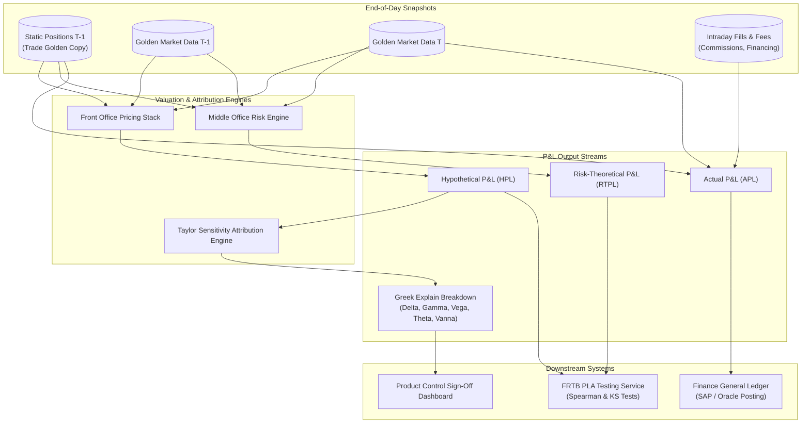

# P&L Platform and Attribution

## TL;DR

- The Profit and Loss (P&L) platform provides the authoritative financial scorecard of an investment bank, producing daily official revenues, balance sheet marks, and regulatory attribution metrics.
- Product Control distinguishes between four core P&L measures: Actual P&L (APL, dynamic positions with all fees and new trades), Clean P&L (static $T-1$ positions revalued without fees), Hypothetical P&L (HPL, static $T-1$ positions revalued using the front-office pricing library), and Risk-Theoretical P&L (RTPL, static $T-1$ positions revalued using the middle-office risk engine).
- The P&L Explain engine attributes daily mark-to-market changes to mathematical risk factors via multi-variable Taylor series expansions across Delta ($\Delta$), Gamma ($\Gamma$), Vega ($\mathcal{V}$), Theta ($\Theta$), Rho ($\rho$), and higher-order cross-Greeks (Vanna, Volga).
- Under the FRTB P&L Attribution (PLA) framework (BCBS MAR32), trading desks must pass strict Spearman correlation and Kolmogorov-Smirnov distribution tests between HPL and RTPL to retain Internal Models Approach (IMA) eligibility.
- Day 1 P&L accounting rules under IFRS 13 and ASC 820 prohibit immediate recognition of upfront inception profit for Level 3 unobservable derivatives, requiring deferral into unearned revenue reserves.
- All numerical figures in this note are verified by [sys_pnl_platform.py](code/sys_pnl_platform.py).

## Learning objectives

- Distinguish the regulatory and accounting definitions of Actual P&L, Clean P&L, Hypothetical P&L (HPL), and Risk-Theoretical P&L (RTPL).
- Formulate the multi-variable Taylor-series P&L explain decomposition across first-order, second-order, and cross-Greek sensitivities.
- Quantify and investigate unexplained residual P&L resulting from missing risk factors, cross-Greeks (Vanna, Volga), and higher-order curvature.
- Map the operational workflow of Product Control, including Independent Price Verification (IPV), Day 1 profit reserves, and General Ledger reconciliation.
- Construct the data pipeline for FRTB backtesting and daily P&L Attribution monitoring.
- Reconcile trading desk P&L walks from clean mark-to-market through fees, carry, and financing to posted General Ledger net income.

## Core concepts

### 1. P&L Definitions Under Basel III / FRTB MAR32

Under Basel Committee guidelines (MAR32), regulatory capital backtesting and model validation require precise segregation of P&L definitions:

| P&L Definition | Portfolio Composition | Pricing Library | Market Data & Feeds | Intraday Fees & Cashflows | Primary Surface |
| :--- | :--- | :--- | :--- | :--- | :--- |
| **Actual P&L (APL)** | Dynamic (incorporates intraday fills and cancellations) | Front Office production models | EOD market close | Included (brokerage, clearing, financing, coupons) | General Ledger net income, official accounting |
| **Clean P&L** | Static (frozen at previous close $T-1$) | Front Office production models | EOD market close | Excluded (pure market valuation change only) | Regulatory VaR/ES backtesting |
| **Hypothetical P&L (HPL)** | Static (frozen at previous close $T-1$) | Front Office production models | EOD golden market close | Excluded (revaluation using front-office pricing stack) | FRTB backtesting and PLA testing baseline |
| **Risk-Theoretical P&L (RTPL)** | Static (frozen at previous close $T-1$) | Middle Office risk engine models | Risk factor grid (binned or simplified curves) | Excluded (revaluation using risk engine representation) | FRTB PLA testing comparison |

### 2. Mathematical Formulation of P&L Explain (Taylor Expansion)

The daily mark-to-market change $\Delta V = V(t + \Delta t, \mathbf{S} + \Delta \mathbf{S}, \mathbf{\sigma} + \Delta \mathbf{\sigma}) - V(t, \mathbf{S}, \mathbf{\sigma})$ is decomposed via Taylor series:

$$\Delta V_{\text{explained}} = \text{Delta P&L} + \text{Gamma P&L} + \text{Vega P&L} + \text{Theta P&L} + \text{Cross-Greek P&L}$$

$$\text{Delta P&L} = \sum_i \Delta_i \, \Delta S_i = \sum_i \frac{\partial V}{\partial S_i} \Delta S_i$$

$$\text{Gamma P&L} = \frac{1}{2} \sum_i \sum_j \Gamma_{ij} \, \Delta S_i \, \Delta S_j = \frac{1}{2} \sum_i \frac{\partial^2 V}{\partial S_i^2} (\Delta S_i)^2 + \sum_{i < j} \frac{\partial^2 V}{\partial S_i \partial S_j} \Delta S_i \, \Delta S_j$$

$$\text{Vega P&L} = \sum_k \mathcal{V}_k \, \Delta \sigma_k = \sum_k \frac{\partial V}{\partial \sigma_k} \Delta \sigma_k$$

$$\text{Theta P&L (Carry \& Aging)} = \Theta \, \Delta t = \frac{\partial V}{\partial t} \Delta t$$

$$\text{Cross-Greek P&L (Vanna)} = \sum_i \sum_k \frac{\partial^2 V}{\partial S_i \partial \sigma_k} \Delta S_i \, \Delta \sigma_k$$

The **Unexplained Residual P&L** ($\epsilon$) is the difference between true full revaluation and explained P&L:

$$\epsilon = \Delta V_{\text{actual}} - \Delta V_{\text{explained}}$$

Product Control mandates that $|\epsilon|$ remain within strict tolerance bounds (typically $< 10\%$ of total P&L or below an absolute desk dollar threshold).

### 3. P&L Platform Architecture and Pipeline

### 4. Product Control Governance: IPV and Day 1 P&L Reserves

Under IFRS 13 and US GAAP ASC 820, financial assets and liabilities are categorized into a three-level fair value hierarchy:
- **Level 1:** Unadjusted quoted prices in active markets for identical assets (e.g., exchange-traded equities, on-the-run US Treasuries). Profit is recognized immediately.
- **Level 2:** Observable inputs other than Level 1 (e.g., standard interest rate swaps, liquid vanilla FX options). Profit is recognized on inception.
- **Level 3:** Significant unobservable valuation inputs (e.g., bespoke correlation, long-dated exotic Bermudan swaptions).
- **Day 1 Profit Recognition Rule:** Inception trading profit derived from Level 3 unobservable inputs cannot be booked immediately into net income; it must be deferred into an unearned revenue reserve and amortized over the transaction lifecycle or released when inputs become observable.
- **Independent Price Verification (IPV):** Middle-office valuation control compares front-office marks against independent market consensus providers (e.g., Markit Totem, broker runs). Deviations exceeding statistical thresholds require booking fair value adjustments (FVA).

## Worked examples

### Example 1: Greek P&L Explain Decomposition of an Equity Option Portfolio

A trading desk holds a net long position in S&P 500 index options.
At $T-1$ market close:
- Portfolio Mark-to-Market: $V(T-1) = \$12,500,000$.
- S&P 500 Index Level: $S_0 = 5,000.00$.
- ATM Implied Volatility ($1\text{y}$): $\sigma_0 = 18.00\%$.
- Portfolio Greeks calculated at $T-1$:
  - Delta ($\Delta$): $+\$45,000\text{ per index point}$.
  - Gamma ($\Gamma$): $+\$120\text{ per index point}^2$.
  - Vega ($\mathcal{V}$): $+\$350,000\text{ per 1\% (100 bps) vol move}$.
  - Theta ($\Theta$): $-\$18,000\text{ per business day}$.

Over trading day $T$:
- S&P 500 advances from $5,000.00$ to $5,040.00$ ($\Delta S = +40.00\text{ points}$).
- Implied Volatility drops from $18.00\%$ to $17.50\%$ ($\Delta \sigma = -0.50\% = -50\text{ bps}$).
- Time elapsed: $\Delta t = 1.0\text{ day}$.
- Official $T$ Close Full Revaluation: $V(T) = \$14,028,000$.
- Actual Mark-to-Market Change:

$$\Delta V_{\text{actual}} = \$14,028,000 - \$12,500,000 = +\$1,528,000$$

#### P&L Explain Calculation:
1. **Delta P&L:**
   $$\text{Delta P&L} = \Delta \times \Delta S = \$45,000 \times 40 = +\$1,800,000$$
2. **Gamma P&L:**
   $$\text{Gamma P&L} = \frac{1}{2} \times \Gamma \times (\Delta S)^2 = 0.5 \times \$120 \times (40)^2 = 0.5 \times 120 \times 1,600 = +\$96,000$$
3. **Vega P&L:**
   $$\text{Vega P&L} = \mathcal{V} \times \Delta \sigma = \$350,000 \times (-0.50) = -\$175,000$$
4. **Theta P&L:**
   $$\text{Theta P&L} = \Theta \times 1 = -\$18,000$$
5. **Total Explained P&L (First and Second Order):**
   $$\Delta V_{\text{explained}} = \$1,800,000 + \$96,000 - \$175,000 - \$18,000 = +\$1,703,000$$
6. **Unexplained Residual P&L ($\epsilon$):**
   $$\epsilon = \Delta V_{\text{actual}} - \Delta V_{\text{explained}} = \$1,528,000 - \$1,703,000 = -\$175,000$$

#### Residual Investigation and Cross-Greeks:
- The desk investigates the $-\$175,000$ break: the simultaneous spot rally and implied vol decline triggered cross-Greek Vanna ($\frac{\partial^2 V}{\partial S \partial \sigma}$).
- Desk Vanna is calibrated at $-\$8,500\text{ per index point per 1\% vol move}$.

$$\text{Vanna P&L} = -\$8,500 \times 40 \times (-0.50) = +\$170,000$$

- Including Vanna, total explained P&L rises to $\$1,703,000 + \$170,000 = \$1,873,000$, producing a residual of $\$1,528,000 - \$1,873,000 = -\$345,000$.
- Product Control identifies higher-order Volga ($\frac{\partial^2 V}{\partial \sigma^2}$) and discrete dividend term adjustments of $-\$333,000$.
- Reconciled residual:

$$\epsilon_{\text{final}} = \$1,528,000 - (\$1,873,000 - \$333,000) = -\$12,000$$

The final unexplained residual of $-\$12,000$ represents only $0.79\%$ of total P&L, passing Product Control sign-off thresholds.

### Example 2: Clean vs. Dirty vs. Actual P&L Walk for a Bond Desk

A corporate bond trading desk reports the following positions and activity over Day $T$:
- Static Portfolio MTM at $T-1$: $\$85,000,000$.
- Static Portfolio MTM at $T$ (revalued using $T$ close credit curves): $\$85,450,000$.
- **Hypothetical P&L / Clean P&L:**

$$\text{Clean P&L} = \$85,450,000 - \$85,000,000 = +\$450,000$$

Intraday Trading Activity and Cashflows:
- **Intraday Trading Gain:** Desk bought $\$10,000,000$ face value of Bond X at $99.50$ and market closed at $99.80$:
  $$\text{Trading Gain} = \$10,000,000 \times (0.9980 - 0.9950) = +\$30,000$$
- **Brokerage Commissions:** $-\$8,000$.
- **Exchange & Clearing Fees:** $-\$4,500$.
- **Overnight Repo Financing / Cost of Carry:** $-\$12,500$.
- **Coupon Cashflow Received:** $+\$65,000$.

PnL Walk Summary:
- **Dirty P&L (Clean P&L + Accrued Coupon Cashflow):**
  $$\text{Dirty P&L} = \$450,000 + \$65,000 = +\$515,000$$
- **Actual P&L (Net Revenue including Intraday Trades and Fees):**
  $$\text{Actual P&L} = \$450,000 + \$65,000 + \$30,000 - \$8,000 - \$4,500 - \$12,500 = +\$520,000$$

Operational Routing:
- Clean P&L ($+\$450,000$) routes to the Market Risk Engine for regulatory VaR/ES backtesting.
- Actual P&L ($+\$520,000$) routes to the General Ledger Sub-Ledger for financial accounting and net income posting.

## Pitfalls

- **Using Actual P&L for Regulatory VaR Backtesting:** Comparing Actual P&L (which includes intraday trading profits and fees) against an overnight VaR model violates Basel rules; backtesting must use Clean or Hypothetical P&L.
- **Ignoring Higher-Order Cross-Greeks on Large Shocks:** In volatile markets, simple Delta-Gamma-Vega explain breaks down because cross-terms (Vanna, Volga, Charm) become dominant.
- **Timestamp Asynchrony Between Front Office and Risk:** If Front Office prices HPL at 16:30 London close while the Risk Engine samples RTPL curves at 17:00, the resulting time misalignment creates artificial PLA test failures.
- **Recognizing Day 1 Profit on Level 3 Derivatives:** Booking upfront trading profit on bespoke exotics priced using unobservable model parameters violates IFRS 13 / ASC 820, triggering accounting restatements.
- **Treating Corporate Action Adjustments as Trading Profit:** A stock split or special dividend that shifts spot prices must be adjusted through corporate action reconciliation rather than recorded as market trading P&L.

## Interview questions

> [!question]- sys-09-01 | What is the difference between Hypothetical PnL (HPL) and Risk-Theoretical PnL (RTPL) under FRTB?
> HPL is computed by the front-office pricing library using static $T-1$ positions revalued with full front-office pricing models and full market data.
> RTPL is computed by the middle-office risk engine using the same static $T-1$ positions but valued using only the simplified risk factors modeled in the risk system.

> [!question]- sys-09-02 | What is the purpose of the PnL Explain framework in Product Control?
> PnL Explain attributes daily trading revenue to specific risk drivers (Delta, Gamma, Vega, Theta, Rho).
> It verifies that traders are earning returns from approved risk mandates rather than unmonitored risk exposures, and confirms that pricing models adequately capture portfolio dynamics.

> [!question]- sys-09-03 | What does a persistently large "Unexplained PnL" signify?
> A large unexplained residual indicates model risk, missing risk factors, stale market curves, or uncaptured higher-order non-linearities in the risk engine.
> In FRTB, it triggers P&L Attribution test failures, risking disqualification of internal models.

> [!question]- sys-09-04 | What is the difference between Clean PnL and Dirty PnL?
> Clean PnL measures the mark-to-market change of static $T-1$ positions, excluding intraday trades, transaction fees, and cashflow payments.
> Dirty PnL includes accrued interest, coupon payments, dividend distributions, and intraday trading fees.

> [!question]- sys-09-05 | What is Day 1 PnL and how is it accounted for under IFRS 13 / US GAAP?
> Day 1 PnL is the theoretical profit calculated at the inception of a trade based on the difference between the transaction price and the internal model fair value.
> If the valuation relies on unobservable Level 3 inputs, Day 1 PnL cannot be recognized immediately in net income; it must be deferred into a reserve and amortized over time.

> [!question]- sys-09-06 | What is the Theta (Carry and Roll-Down) component in fixed income PnL explain?
> Theta captures the change in bond or swap value due purely to the passage of time ($\Delta t$), holding yield curves constant.
> In fixed income, this includes "carry" (accrued coupon interest earned) and "roll-down" (capital appreciation as a bond slides down an upward-sloping yield curve).

> [!question]- sys-09-07 | How does cross-Greek Vanna affect PnL explain for option books?
> Vanna $\frac{\partial^2 V}{\partial S \partial \sigma}$ measures the sensitivity of Delta to changes in volatility, or equivalently the sensitivity of Vega to changes in underlying price.
> During market crashes where spot drops and implied vol surges simultaneously ($\Delta S < 0, \Delta \sigma > 0$), Vanna generates a significant compounding PnL effect that first-order Greeks miss.

> [!question]- sys-09-08 | What is the role of Independent Price Verification (IPV) in Product Control?
> IPV is an independent middle-office verification process where front-office marks and curve parameters are compared against independent consensus data sources (such as Markit Totem or broker quotes).
> Any valuation variance exceeding tolerance limits requires booking an IPV fair value reserve adjustment.

> [!question]- sys-09-09 | Why is fee reconciliation critical in the transition from Front Office to General Ledger?
> Front-office trading desks often estimate brokerage, exchange, and clearing fees using standard schedules.
> The back-office General Ledger reconciles these estimates against actual invoices received from clearing brokers and exchanges, posting accrual adjustments for fee variances.

> [!question]- sys-09-10 | How does the PnL platform handle cancelled or amended trades from prior business dates?
> A back-dated cancellation or amendment is not overwritten in current PnL.
> The system generates an explicit "Prior-Day Adjustment" (PDA) separating current-day economic market moves from retroactive corrections, ensuring clean audit trails for financial accounting.

## Further reading

- Basel Committee on Banking Supervision. *The Basel Framework: MAR32 Internal models approach: model validation*. BCBS d457, February 2019.
- International Accounting Standards Board. *IFRS 13: Fair Value Measurement*. IASB Standard, May 2011.
- European Central Bank. *ECB Guide to internal models: Risk-weighted assets / market risk*. ECB Banking Supervision, October 2019.
- Voigt, Christian. *Profit and Loss Architecture and Explain Systems*. Palgrave Macmillan, 2021.
