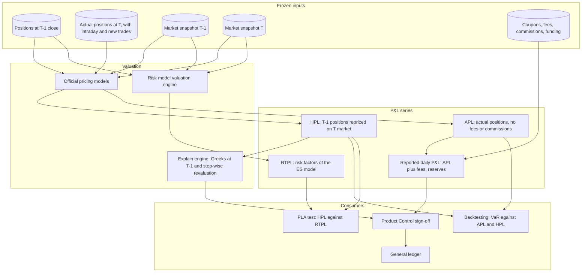

# P&L Platform and Attribution

## TL;DR

- The P&L platform produces the official daily P&L that Product Control signs off and Finance posts to the ledger, and the regulatory P&L series (actual, hypothetical, risk-theoretical) that market risk backtesting and the FRTB P&L attribution test consume.
- Basel definitions (MAR32): hypothetical P&L (HPL) revalues the previous day's positions on today's market (MAR32.25); actual P&L (APL) also includes intraday trading and new or modified deals; both exclude fees and commissions (MAR32.26); risk-theoretical P&L (RTPL) is what the risk model's own valuation engine produces on its own risk factors (MAR32.22).
- Backtesting compares one-day VaR with both APL and HPL (MAR32.4); the PLA test compares HPL with RTPL using Spearman correlation and a Kolmogorov-Smirnov statistic (MAR32.34 to MAR32.42).
- P&L explain attributes the change in value to theta, delta, gamma, vega and cross terms; on a long index call book a 40-point rally with a half-point vol fall left 4,138 dollars unexplained after first order, 760 after gamma and 148 after vanna and volga.
- Day-one gains on trades valued with significant unobservable inputs are deferred under IFRS 9 (B5.1.2A), while US GAAP (ASC 820-10-30-6) generally recognises them unless another topic says otherwise.
- Every number on this page is produced and asserted by [sys_pnl_platform.py](code/sys_pnl_platform.py).

## Learning objectives

- Distinguish actual, hypothetical and risk-theoretical P&L as Basel defines them, and the accounting daily P&L that Product Control reports.
- Formulate the Taylor-series P&L explain across first-order, second-order and cross-Greek terms and say what the residual means.
- Investigate unexplained P&L from missing risk factors, cross-Greeks, higher-order curvature and data mismatches.
- Map Product Control's workflow: independent price verification (IPV), valuation reserves, day-one deferrals and ledger reconciliation.
- Build the data pipeline that feeds backtesting and P&L attribution, with aligned snapshots and positions.
- Walk a desk's P&L from static revaluation through new trades, funding, fees and coupons to the reported figure.

## Core concepts

### 1. Which P&L is which

| Measure | Positions | Valuation | Fees and commissions | Time effects (theta, carry, funding) | Used for |
| :--- | :--- | :--- | :--- | :--- | :--- |
| Reported daily P&L (accounting) | actual, including new, amended and intraday trades | front-office models, after valuation adjustments and reserves | included | included | Product Control sign-off, general ledger |
| Actual P&L, APL (MAR32) | actual, including intraday trading and new or modified deals | the same pricing models as reported P&L (MAR32.29) | excluded (MAR32.26) | included (MAR32.27) | backtesting |
| Hypothetical P&L, HPL (MAR32.25) | static: positions at the end of the previous day | the same pricing models as reported P&L | excluded | treated consistently with RTPL | backtesting and the PLA test |
| Risk-theoretical P&L, RTPL (MAR32.22) | static, as HPL | the risk model's valuation engine on the risk factors in the ES model and the NMRFs | excluded | consistent with HPL | the PLA test |

Further rules the platform must implement:

- Valuation adjustments that have their own capital treatment (CVA and its eligible hedges) or are deducted from CET1 (the DVA component) are excluded from APL and HPL (MAR32.26).
- Other market-risk valuation adjustments go into APL whatever their update frequency, and into HPL only if updated daily; smoothing adjustments that are not computed daily is not allowed (MAR32.27).
- APL and HPL must use the same pricing models, configurations, market data and systems as the reported daily P&L (MAR32.29); RTPL may align its input data to HPL's only under the documented conditions of MAR32.30 to MAR32.33, including snapshot-time alignment for desks in other time zones (MAR32.31 FAQ1), but never the other way round.
- "Clean" and "dirty" P&L are internal terms whose meaning varies by bank; define them in the platform's data dictionary rather than assuming a market-wide meaning.

### 2. P&L explain

The change in value $\Delta V = V(t + \Delta t, \mathbf{S} + \Delta \mathbf{S}, \boldsymbol{\sigma} + \Delta \boldsymbol{\sigma}) - V(t, \mathbf{S}, \boldsymbol{\sigma})$ is expanded to second order:

$$\Delta V \approx \Theta\,\Delta t + \sum_i \Delta_i \Delta S_i + \frac{1}{2}\sum_{i,j} \Gamma_{ij} \Delta S_i \Delta S_j + \sum_k \mathcal{V}_k \Delta\sigma_k + \sum_{i,k} \frac{\partial^2 V}{\partial S_i \partial \sigma_k} \Delta S_i \Delta\sigma_k + \frac{1}{2}\sum_{k,l} \frac{\partial^2 V}{\partial \sigma_k \partial \sigma_l} \Delta\sigma_k \Delta\sigma_l$$

The mixed spot-vol term (vanna) has coefficient 1, because the full double sum over the combined variables counts it twice with weight one half; the pure vol term (volga) keeps the one half.
The unexplained P&L is $\epsilon = \Delta V_{\text{full}} - \Delta V_{\text{explained}}$.
A small residual says the risk system's sensitivities describe what actually happened; a persistent residual points to missing risk factors (a basis, a dividend, a correlation), stale or inconsistent market data, higher-order effects in large moves, booking errors, or a model difference between the explain and the official valuation.
Thresholds are set per desk by Product Control as an absolute amount and a fraction of P&L; there is no regulatory number for them.

Two ways to compute explain:

- Sensitivity-based: Greeks at $T-1$ times the observed moves, as above; cheap, but every unexplained piece is mixed into one residual.
- Step-wise revaluation: reprice moving one group of inputs at a time (time first, then rates, then spot, then vol), so the steps add exactly to the full P&L and the "residual" becomes the ordering-dependent interaction; banks fix the order and document it.

### 3. Platform components and data flow

| Component | Responsibility | Inputs | Outputs | Failure to design for |
| :--- | :--- | :--- | :--- | :--- |
| Position service | static $T-1$ positions and today's actual positions, bitemporal | trade store | position set ids for HPL and APL | a late trade booked into yesterday's position set after HPL ran |
| Valuation service | prices on $T-1$ and $T$ snapshots with the official models | position sets, market snapshots, model versions | trade-level values and Greeks | missing price silently treated as unchanged value |
| Cash and fee service | coupons, dividends, fees, commissions, funding | settlement and fee systems | cash events by trade and date | estimated fees not trued up to invoices |
| Explain engine | Greek and step-wise attribution | Greeks at $T-1$, market moves | explain by risk factor and residual | Greeks from a different snapshot than the valuation |
| Adjustment and reserve service | IPV adjustments, bid-offer and model reserves, day-one deferrals | Product Control decisions | adjustments by book with approval trail | adjustments booked off-system |
| Regulatory P&L service | APL, HPL and RTPL series per desk | the above and the risk engine's RTPL | daily series to backtesting and PLA | HPL and RTPL from different positions or snapshot times |
| Sign-off and ledger feed | desk sign-off, prior-day adjustments, general ledger posting | official P&L | journal entries | changing a signed-off day in place |

A correction to a past day is posted as a prior-day adjustment on the day it is found, with a reference to the original date and reason, so the signed-off history stays reproducible and the regulatory series records the restated value with an audit trail.

### 4. Product Control: fair value hierarchy, IPV and day-one P&L

- IFRS 13 (and ASC 820) classify fair value measurements by the lowest level input significant to the whole measurement: Level 1 unadjusted quoted prices for identical items in active markets, Level 2 other observable inputs, Level 3 significant unobservable inputs.
- Day-one P&L under IFRS: if fair value at initial recognition is not evidenced by a Level 1 price or by a valuation using only observable market data, the difference between fair value and transaction price is deferred and recognised later only to the extent it arises from a change in a factor, including time, that market participants would consider (IFRS 9 B5.1.2A); straight-line release over the life and release when inputs become observable are common policies, and the policy must be stated.
- Day-one P&L under US GAAP: when another topic requires initial fair value measurement and the transaction price differs, the gain or loss is recognised in earnings unless that topic specifies otherwise (ASC 820-10-30-6); there is no general Level 3 deferral.
- Independent price verification: Product Control (independent of the desk) compares the desk's marks and model inputs with independent sources (broker quotes, consensus services, exchange settlements) and books IPV adjustments where they differ beyond tolerance; separately, prudent valuation for regulatory capital (CAP50) can require additional valuation adjustments deducted from CET1.
  Avoid the abbreviation FVA here: in derivatives it means funding valuation adjustment.

## Worked examples

All books, market moves, trades, fees and policies are labelled-hypothetical inputs.

### Example 1: Greek explain against full revaluation

A long position in one-year at-the-money calls on 10,000 units of an equity index: $S = 5,000$, $K = 5,000$, $r = 4\%$, no dividends, implied vol $18\%$.
At $T-1$ the book is worth $4,581,801$ with delta $6,226$ dollars per index point, gamma $4.22$ per point squared, vega $189,982$ per vol point, theta $-7,594$ per calendar day, vanna $-27.91$ per point per vol point and volga $435.72$ per vol point squared (all analytic, checked by finite differences).
Over one calendar day the index rises 40 points to $5,040$ and vol falls half a point to $17.5\%$; full revaluation gives $4,732,380$, a P&L of $150,579$.

| Term | P&L |
| :--- | :--- |
| Theta, $\Theta\,\Delta t$ | $-7,594$ |
| Delta, $\Delta \cdot 40$ | $249,026$ |
| Vega, $\mathcal{V} \cdot (-0.5)$ | $-94,991$ |
| Unexplained after first order | $4,138$ |
| Gamma, $\tfrac12 \Gamma \cdot 40^2$ | $3,377$ |
| Unexplained after gamma | $760$ |
| Vanna, $\partial^2V/\partial S\partial\sigma \cdot 40 \cdot (-0.5)$ | $558$ |
| Volga, $\tfrac12 \partial^2V/\partial\sigma^2 \cdot 0.25$ | $54.47$ |
| Unexplained after vanna and volga | $148$, or $0.10\%$ of the P&L |

The residual shrinks with each order, which is what a healthy explain looks like; the last 148 dollars are third-order terms and the interaction of time decay with the market move.
A step-wise revaluation that moves time first gives $-7,597$ for time alone and $158,176$ for the market move at the new time, adding exactly to $150,579$.

### Example 2: bond desk P&L walk

A desk holds 10,000,000 face of a 5% annual-coupon bond with five coupons left, the next due tomorrow, at a 4.50% yield (annual compounding).

- Dirty value at $T-1$: $10,678,088$.
- Day $T$: the coupon of $500,000$ is paid and the yield falls to 4.47%; the ex-coupon dirty value is $10,190,272$.
- HPL $= 10,190,272 + 500,000 - 10,678,088 = 12,184$, of which $1,288$ is time at an unchanged yield and $10,896$ the 3 bp yield fall.
- Adding the coupon a second time, as a walk that treats "clean P&L plus coupon" as dirty P&L would if its clean P&L were already on dirty values, gives $512,184$: the dirty value already fell by the coupon, so the cash is counted once.
- New trade: 5,000,000 face bought at 99.50 and marked at 99.80 at the close, $15,000$.
- Funding cost of $-12,500$ is a time effect and belongs in APL (MAR32.27); APL $= 12,184 + 15,000 - 12,500 = 14,684$.
- Commissions of $8,000$ and clearing fees of $4,500$ are excluded from APL and HPL (MAR32.26) but are part of reported P&L: $14,684 - 12,500 = 2,184$.

The code checks the walk against an independent account: starting value, ending positions, coupon received, purchase cash, funding and fees.

### Example 3: deferring a day-one gain

A bespoke trade is executed at a price that gives a 1,200,000 dollar day-one gain against a model whose key input is unobservable.
Under IFRS the gain is deferred; with a straight-line policy over four years, $300,000$ is released each year, and if the input becomes observable after one year the remaining $900,000$ is recognised then.
Under US GAAP the same gain would generally be recognised on day one (ASC 820-10-30-6), so the platform must support both treatments by legal entity.

## Pitfalls

- **Thinking backtesting uses only one P&L.** Basel backtesting compares VaR with both APL and HPL and counts exceptions separately, taking the larger count (MAR32.4, MAR32.5); the PLA test uses HPL against RTPL.
- **Fees in APL or HPL.** Fees and commissions are excluded from both (MAR32.26); including them creates spurious backtesting exceptions or hides real ones.
- **Different snapshots for HPL and RTPL.** A front-office close at one time and a risk snapshot at another creates PLA failures that have nothing to do with the model; align snapshots where MAR32.31 allows, and never align HPL to RTPL.
- **Explaining with stale Greeks.** Greeks from a run on a different snapshot or position set leave a residual that is a data error, not model risk.
- **Double counting cash flows.** If positions are valued dirty, a coupon or dividend payment lowers the value by the amount received; add the cash once.
- **Assuming one day-one rule.** IFRS defers Level 3 day-one gains, US GAAP generally does not; the reserve logic depends on the reporting entity's framework.
- **Corporate actions as trading P&L.** A split or special dividend changes the reference price; adjust positions and prices through corporate-action processing, or the explain shows a large false delta P&L.
- **Changing signed-off history.** Corrections are prior-day adjustments on the day found, not edits to signed-off days.

## Interview questions

> [!question]- sys-09-01 | What is the difference between hypothetical P&L and risk-theoretical P&L under FRTB?
> HPL revalues the previous day's positions on today's market with the bank's official pricing models and data (MAR32.25, MAR32.29).
> RTPL is the P&L produced by the desk's risk management model on its own risk factors: those in the ES model plus the non-modellable ones, and nothing the model does not include (MAR32.22).
> The PLA test measures how far RTPL departs from HPL.

> [!question]- sys-09-02 | What is P&L explain for in Product Control?
> It attributes the day's P&L to risk drivers (theta, delta, gamma, vega, cross terms) so Product Control can see whether the P&L is consistent with the risk the desk reported.
> A large or persistent unexplained amount points to missing risk factors, booking or data errors, or model differences, and is investigated before sign-off.

> [!question]- sys-09-03 | What does a persistently large unexplained P&L signify?
> The risk system's sensitivities do not describe what actually moves the book: a missing risk factor, stale or inconsistent market data, higher-order effects, booking errors, or a different model in the explain than in the official valuation.
> If the same gap exists between HPL and RTPL, the desk is likely to fail the PLA test and lose IMA eligibility.

> [!question]- sys-09-04 | What do "clean" and "dirty" P&L mean, and why be careful?
> They are internal terms: commonly clean P&L is the market move on static positions, and dirty P&L adds new trades, cash flows and fees, but banks define them differently.
> State the definition in the data dictionary; for regulation use the defined terms APL, HPL and RTPL, and with dirty valuations count coupons once.

> [!question]- sys-09-05 | What is day-one P&L and how is it accounted for?
> The difference at inception between the transaction price and fair value from a model.
> Under IFRS 9 B5.1.2A it is deferred unless fair value is evidenced by a Level 1 price or a valuation using only observable data, and recognised later as factors including time change; under US GAAP ASC 820-10-30-6 it is generally recognised unless another topic says otherwise.

> [!question]- sys-09-06 | What is the time component of a fixed income P&L explain?
> The change in value from the passage of time at unchanged market data: coupon accrual (carry, net of funding) and roll-down along the curve.
> In Example 2 the bond earned 1,288 dollars from one day at an unchanged yield; Basel requires time effects in APL and consistent treatment in HPL and RTPL (MAR32.27).

> [!question]- sys-09-07 | How does vanna enter P&L explain for an option book?
> Vanna, $\partial^2 V / \partial S \partial \sigma$, is the change of delta with vol; its P&L is vanna times the spot move times the vol move, with coefficient 1.
> It matters when spot and vol move together, as in a sell-off with rising vol; in Example 1 (spot up 40, vol down half a point) it contributed 558 dollars of the 760 left after gamma.

> [!question]- sys-09-08 | What is independent price verification?
> A control function independent of the desk compares the desk's marks and model inputs with independent evidence (broker quotes, consensus services, exchange settlements) and books adjustments where they differ beyond tolerance.
> It is separate from prudent valuation for regulatory capital (CAP50), whose additional valuation adjustments reduce CET1.

> [!question]- sys-09-09 | Why must fees be reconciled between the front office and the ledger?
> Desks accrue fees from schedules; brokers, exchanges and clearing houses invoice actual amounts, and the ledger must reflect the actual cost.
> The platform trues up accruals to invoices and keeps fees out of APL and HPL, where Basel excludes them (MAR32.26).

> [!question]- sys-09-10 | How does the P&L platform handle cancelled or amended trades from prior dates?
> It does not rewrite signed-off days: the correction is posted as a prior-day adjustment on the day it is found, referencing the original date and reason.
> Positions and P&L are bitemporal, so both "what we reported" and "what was true" can be reproduced.

> [!question]- sys-09-11 | Which P&L series does Basel backtesting use, and how are exceptions counted?
> One-day VaR is compared with both APL and HPL over the prior 12 months (MAR32.4); exceptions against each are counted separately and the overall count is the larger (MAR32.5, MAR32.18).
> A missing P&L or VaR value counts as an exception.

> [!question]- sys-09-12 | A desk's explain leaves 4,138 dollars after theta, delta and vega on a 150,579 dollar day. What do you add next?
> Second-order terms: gamma (3,377 here) brings it to 760, then vanna (558) and volga (54) leave 148, about 0.10% of the P&L.
> If adding the obvious Greeks does not shrink the residual, look for a missing factor or a data mismatch instead.

> [!question]- sys-09-13 | Why may RTPL inputs be aligned to HPL but not the reverse?
> HPL must be the official P&L built from the reported valuation (MAR32.29); RTPL may borrow HPL's input data where the difference is only provider, snapshot time or transformation, under documented conditions (MAR32.30 to MAR32.32).
> Aligning HPL to RTPL would hide exactly the model simplifications the PLA test exists to measure (MAR32.33).

> [!question]- sys-09-14 | Which valuation adjustments go into APL and HPL?
> Exclude those with their own capital treatment (CVA and its eligible hedges) and those deducted from CET1 (the own-credit DVA component) (MAR32.26).
> Include other market-risk valuation adjustments in APL whatever their frequency, and in HPL only those updated daily (MAR32.27).

> [!question]- sys-09-15 | Why can step-wise revaluation explain add up exactly when Greek explain does not?
> Each step reprices with one more group of inputs moved, so the steps telescope to the full P&L; in Example 1 time alone gives -7,597 and the market move at the new time 158,176, summing to 150,579.
> The price is that the attribution depends on the order of the steps, which must be fixed and documented.

> [!question]- sys-09-16 | A bond position is valued dirty and pays a 500,000 coupon today. How does the coupon enter the P&L?
> Once: the dirty value falls by the coupon and the cash rises by it, so P&L is the change in dirty value plus the coupon cash, 12,184 dollars in Example 2.
> Adding the coupon on top of a dirty-value change that already included it gives 512,184, a 500,000 dollar error.

## In this repo and SDE-Interview-Prep

- [sys_pnl_platform.py](code/sys_pnl_platform.py) computes, prints and asserts every number on this page; Greeks are checked against finite differences and the bond walk against an independent cash account.
- [P&L Attribution and Greek Risk](../11-Risk-and-Trading/06-PnL-Attribution-and-Greek-Risk.md) for explain theory; [FRTB Backtesting and PLA Testing](../17-Regulatory-Capital-Basel-and-FRTB/12-FRTB-Backtesting-and-PLA-Testing.md) for the tests the regulatory series feed.
- [FRTB Engine](10-FRTB-Engine.md) for how the PLA results drive desk eligibility, [Risk Engine](07-Risk-Engine.md) for the VaR being backtested, [Trade Representation and Lifecycle](02-Trade-Representation-and-Lifecycle.md) for bitemporal positions.

## Further reading

- Basel Committee on Banking Supervision, Basel Framework, MAR32 (backtesting and P&L attribution test requirements) and CAP50 (prudent valuation guidance).
- IFRS 13 *Fair Value Measurement*, IASB, 2011.
- IFRS 9 *Financial Instruments*, IASB, application guidance B5.1.2A.
- FASB Accounting Standards Codification 820-10-30-6.
