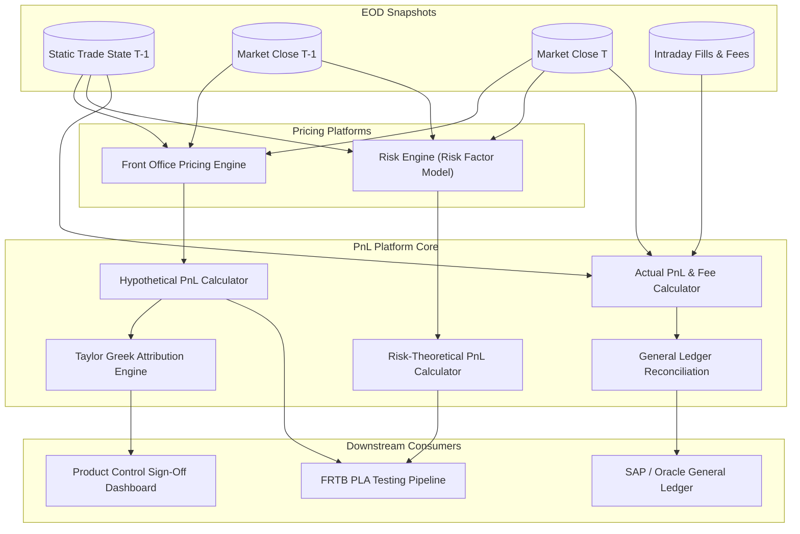

# P&L Platform and Attribution

## TL;DR

The Profit and Loss (PnL) platform provides the official financial and economic scorecard of a trading institution.
Product Control and risk departments distinguish between multiple definitions of daily PnL: Actual PnL (all cashflows, new deals, and intraday trading fees), Clean PnL (static overnight positions revalued against current market close), Hypothetical PnL (HPL, static positions revalued using the front-office pricing library), and Risk-Theoretical PnL (RTPL, static positions revalued using the risk engine's simplified risk factors).
A core function of the platform is the **PnL Explain Engine**, which decomposes daily market valuation changes into Greek sensitivities: Delta, Gamma, Vega, Theta (carry and roll-down), Rho, and higher-order cross-effects.
Under the FRTB P&L Attribution (PLA) framework, desks must maintain strict alignment between HPL and RTPL to avoid failing supervisory tests and being disqualified from the Internal Models Approach.

## Learning objectives

- Distinguish the regulatory and accounting definitions of Actual PnL, Clean PnL, Hypothetical PnL (HPL), and Risk-Theoretical PnL (RTPL).
- Formulate the mathematical Taylor-series PnL explain decomposition across Delta, Gamma, Vega, Theta, and Cross-Greek terms.
- Quantify and investigate the causes of Unexplained PnL (model basis, stale market data, higher-order non-linearities).
- Map the operational workflow of Product Control, including Independent Price Verification (IPV), Day 1 PnL reserves, and General Ledger reconciliation.
- Design the FRTB HPL and RTPL data generation pipeline for daily backtesting and PLA monitoring.
- Construct comprehensive Mermaid sequence, data-flow, and container diagrams for enterprise PnL reporting.

## Core concepts

### 1. PnL Definitions Under Basel III / FRTB MAR32

```
+----------------------------------------------------------------------------------------------------+
| PnL Type            | Portfolio Composition      | Pricing Engine Used       | Included Cashflows  |
+----------------------------------------------------------------------------------------------------+
| Actual PnL (APL)    | Dynamic (includes intraday)| Front Office Production   | Execution fees, new |
|                     | trades & modifications     | Models & Curves           | trades, commissions |
+---------------------+----------------------------+---------------------------+---------------------+
| Clean PnL           | Static (positions frozen   | Front Office Production   | Excludes intraday   |
|                     | at previous EOD $T-1$)     | Models & Curves           | fees and new trades |
+---------------------+----------------------------+---------------------------+---------------------+
| Hypothetical (HPL)  | Static (positions frozen   | Front Office Production   | Pure mark-to-market |
|                     | at previous EOD $T-1$)     | Models & Curves           | revaluation only    |
+---------------------+----------------------------+---------------------------+---------------------+
| Risk-Theoretical    | Static (positions frozen   | Middle Office Risk Engine | Simplified risk     |
| (RTPL)              | at previous EOD $T-1$)     | Model (risk factors only) | factor representation|
+----------------------------------------------------------------------------------------------------+
```

### 2. Mathematical Formulation of PnL Explain (Taylor Expansion)

The daily change in mark-to-market value $\Delta V = V(t + \Delta t, \mathbf{S} + \Delta \mathbf{S}, \mathbf{\sigma} + \Delta \mathbf{\sigma}) - V(t, \mathbf{S}, \mathbf{\sigma})$ is decomposed via multi-variable Taylor series:

$$\Delta V_{\text{explained}} = \text{Delta PnL} + \text{Gamma PnL} + \text{Vega PnL} + \text{Theta PnL} + \text{Cross-Term PnL}$$

$$\text{Delta PnL} = \sum_i \Delta_i \, \Delta S_i = \sum_i \frac{\partial V}{\partial S_i} \Delta S_i$$

$$\text{Gamma PnL} = \frac{1}{2} \sum_i \sum_j \Gamma_{ij} \, \Delta S_i \, \Delta S_j = \frac{1}{2} \sum_i \frac{\partial^2 V}{\partial S_i^2} (\Delta S_i)^2 + \sum_{i < j} \frac{\partial^2 V}{\partial S_i \partial S_j} \Delta S_i \, \Delta S_j$$

$$\text{Vega PnL} = \sum_k \mathcal{V}_k \, \Delta \sigma_k = \sum_k \frac{\partial V}{\partial \sigma_k} \Delta \sigma_k$$

$$\text{Theta PnL (Carry \& Roll)} = \Theta \, \Delta t = \frac{\partial V}{\partial t} \Delta t$$

The **Unexplained PnL** ($\epsilon$) is the residual between the true full revaluation and the Greek explain:

$$\epsilon = \Delta V_{\text{actual}} - \Delta V_{\text{explained}}$$

Product Control mandates that $|\epsilon|$ remain within tight statistical bounds (typically $< 10\%$ of total PnL or below a fixed dollar threshold).

### 3. PnL Platform Component Architecture



### 4. Product Control Governance and Day 1 PnL Reserves

Under IFRS 13 and US GAAP (ASC 820), financial instruments are classified into Fair Value Hierarchies:
- **Level 1:** Quoted prices in active markets for identical assets (e.g., listed equities, Treasury bonds). Immediate PnL recognition.
- **Level 2:** Observable inputs other than Level 1 (e.g., standard swaps, vanilla options).
- **Level 3:** Significant unobservable inputs (e.g., bespoke correlation, long-dated exotic vol).
- **Day 1 PnL Rule:** If a trade is priced using Level 3 unobservable inputs, the accounting standards prohibit recognizing upfront trading profit ("Day 1 PnL") on the execution date.
  The profit must be deferred into an unearned revenue reserve and amortized over the life of the trade or released when observable market inputs emerge.

## Worked examples

### Example 1: Full Greek PnL Explain Decomposition of an Equity Option Portfolio

A trading desk holds a net long position in S&P 500 index options.
At $T-1$ market close:
- Portfolio Mark-to-Market: $V(T-1) = \$12,500,000$.
- Current S&P 500 Index Level: $S_0 = 5,000.00$.
- Implied Volatility ($1\text{y}$ ATM): $\sigma_0 = 18.00\%$.
- Portfolio Sensitivities computed at $T-1$:
  - Delta ($\Delta$): $+\$45,000\text{ per index point}$ ($\frac{\partial V}{\partial S}$).
  - Gamma ($\Gamma$): $+\$120\text{ per index point}^2$ ($\frac{\partial^2 V}{\partial S^2}$).
  - Vega ($\mathcal{V}$): $+\$350,000\text{ per 1\% (100 bps) vol shift}$ ($\$3,500\text{ per bp}$).
  - Theta ($\Theta$): $-\$18,000\text{ per day}$ (time decay).

Over the trading day $T$:
- S&P 500 moves from $5,000.00$ to $5,040.00$ ($\Delta S = +40.00\text{ points}$).
- Implied Volatility drops from $18.00\%$ to $17.50\%$ ($\Delta \sigma = -0.50\% = -50\text{ bps}$).
- Time elapsed: $\Delta t = 1\text{ day}$.
- Official $T$ Close Full Revaluation: $V(T) = \$14,028,000$.
- Actual Mark-to-Market Change:

$$\Delta V_{\text{actual}} = \$14,028,000 - \$12,500,000 = +\$1,528,000$$

#### PnL Explain Calculation:
1. Delta PnL:
   $$\text{Delta PnL} = \Delta \times \Delta S = \$45,000 \times 40 = +\$1,800,000$$
2. Gamma PnL:
   $$\text{Gamma PnL} = \frac{1}{2} \times \Gamma \times (\Delta S)^2 = 0.5 \times \$120 \times (40)^2 = 0.5 \times 120 \times 1,600 = +\$96,000$$
3. Vega PnL:
   $$\text{Vega PnL} = \mathcal{V} \times \Delta \sigma = \$350,000 \times (-0.50) = -\$175,000$$
4. Theta PnL:
   $$\text{Theta PnL} = \Theta \times 1 = -\$18,000$$
5. Total Explained PnL:
   $$\Delta V_{\text{explained}} = 1,800,000 + 96,000 - 175,000 - 18,000 = +\$1,703,000$$
6. Unexplained Residual PnL ($\epsilon$):
   $$\epsilon = \Delta V_{\text{actual}} - \Delta V_{\text{explained}} = \$1,528,000 - \$1,703,000 = -\$175,000$$

Investigation of the $-\$175,000$ Residual:
- The desk investigates the break: S&P 500 experienced an intraday Vanna effect (cross-derivative $\frac{\partial^2 V}{\partial S \partial \sigma} = \frac{\partial \Delta}{\partial \sigma}$).
- Cross-Greek Vanna is estimated as $-\$8,500\text{ per point per 1\% vol}$.
  $$\text{Vanna PnL} = -\$8,500 \times 40 \times (-0.50) = +\$170,000$$
- Including Vanna, explained PnL is $1,873,000$ and the residual is $1,528,000 - 1,873,000 = -345,000$.
- Product Control determines that Volga and discrete dividend adjustments reduce explained PnL by $333,000$, leaving a reconciled residual of $1,528,000 - (1,873,000 - 333,000) = -12,000$.

### Example 2: Clean vs. Dirty vs. Actual PnL Walk

A corporate bond trading desk reports the following activity over Day $T$:
- Static Portfolio MTM at $T-1$: $\$85,000,000$.
- Static Portfolio MTM at $T$ (using $T$ curves): $\$85,450,000$.
- Hypothetical PnL (HPL):

$$\text{HPL} = \$85,450,000 - \$85,000,000 = +\$450,000$$

Intraday Transactions during Day $T$:
- New Trade 1: Bought $\$10,000,000$ face value of Bond X at price $99.50$. End-of-day price closes at $99.80$.
  - Intraday Trading Gain: $10,000,000 \times (0.9980 - 0.9950) = +\$30,000$.
- Brokerage Commissions paid on executions: $-\$8,000$.
- Exchange Execution and Clearing Fees: $-\$4,500$.
- Overnight Funding / Cost of Carry (repo funding interest): $-\$12,500$.
- Coupon cash received on static holding: $+\$65,000$.

PnL Walk:
- Clean PnL (Static Portfolio market move, excluding fees and cashflows):

$$\text{Clean PnL} = +\$450,000$$

- Dirty PnL (Clean PnL + accrued coupon cashflows):

$$\text{Dirty PnL} = \$450,000 + \$65,000 = +\$515,000$$

- Actual PnL (All trading gains, fees, and funding costs):

$$\text{Actual PnL} = \text{Clean PnL} + \text{Coupon} + \text{Intraday Gain} - \text{Commissions} - \text{Fees} - \text{Funding}$$
$$\text{Actual PnL} = 450,000 + 65,000 + 30,000 - 8,000 - 4,500 - 12,500 = +\$520,000$$

Comparison Summary:
- Clean PnL: $+\$450,000$ (Used for regulatory backtesting against VaR).
- Actual PnL: $+\$520,000$ (Posted to Finance General Ledger for accounting net income).

## Pitfalls

- **Using Actual PnL for Regulatory VaR Backtesting:** Comparing Actual PnL (which contains intraday trading profits and fees) against an overnight VaR model violates Basel rules; backtesting must use Clean or Hypothetical PnL.
- **Ignoring Higher-Order Cross-Greeks on Large Market Shocks:** In volatile markets, simple Delta-Gamma-Vega explain breaks down because cross-terms (Vanna, Volga, Charm) become dominant.
- **Failing to Align EOD Snap Times Between Front Office and Risk:** If Front Office prices HPL at 16:30 London close while the Risk Engine samples RTPL curves at 17:00, the resulting time misalignment creates artificial PLA test failures.
- **Recognizing Day 1 Profit on Level 3 Derivatives:** Booking upfront trading profit on bespoke exotics priced using unobservable model parameters violates IFRS 13 / ASC 820, triggering accounting restatements.
- **Treating Corporate Action Adjustments as Trading Profit:** A stock split or special dividend that shifts spot prices must be adjusted through corporate action reconciliation rather than recorded as market trading PnL.

## Interview questions

> [!question]- sys-09-01 | What is the difference between Hypothetical PnL (HPL) and Risk-Theoretical PnL (RTPL) under FRTB?
> HPL is computed by the front-office pricing library using static $T-1$ positions revalued with full front-office pricing models and full market data.
> RTPL is computed by the middle-office risk engine using the same static $T-1$ positions but valued using only the simplified risk factors modeled in the risk system.

> [!question]- sys-09-02 | What is the purpose of the PnL Explain framework in Product Control?
> PnL Explain attributes daily trading revenue to specific risk drivers (Delta, Gamma, Vega, Theta, Rho).
> It verifies that traders are earning returns from approved risk mandates rather than unmonitored risk exposures, and confirms that pricing models adequately capture portfolio dynamics.

> [!question]- sys-09-03 | What does a persistently large "Unexplained PnL" signify?
> A large unexplained residual indicates model risk, missing risk factors, stale market curves, or uncaptured higher-order non-linearities in the risk engine.
> In FRTB, it triggers P&L Attribution test failures, risking disqualification of internal models.

> [!question]- sys-09-04 | What is the difference between Clean PnL and Dirty PnL?
> Clean PnL measures the mark-to-market change of static $T-1$ positions, excluding intraday trades, transaction fees, and cashflow payments.
> Dirty PnL includes accrued interest, coupon payments, dividend distributions, and intraday trading fees.

> [!question]- sys-09-05 | What is Day 1 PnL and how is it accounted for under IFRS 13 / US GAAP?
> Day 1 PnL is the theoretical profit calculated at the inception of a trade based on the difference between the transaction price and the internal model fair value.
> If the valuation relies on unobservable Level 3 inputs, Day 1 PnL cannot be recognized immediately in net income; it must be deferred into a reserve and amortized over time.

> [!question]- sys-09-06 | What is the Theta (Carry and Roll-Down) component in fixed income PnL explain?
> Theta captures the change in bond or swap value due purely to the passage of time ($\Delta t$), holding yield curves constant.
> In fixed income, this includes "carry" (accrued coupon interest earned) and "roll-down" (capital appreciation as a bond slides down an upward-sloping yield curve).

> [!question]- sys-09-07 | How does cross-Greek Vanna affect PnL explain for option books?
> Vanna $\frac{\partial^2 V}{\partial S \partial \sigma}$ measures the sensitivity of Delta to changes in volatility, or equivalently the sensitivity of Vega to changes in underlying price.
> During market crashes where spot drops and implied vol surges simultaneously ($\Delta S < 0, \Delta \sigma > 0$), Vanna generates a significant compounding PnL effect that first-order Greeks miss.

> [!question]- sys-09-08 | What is the role of Independent Price Verification (IPV) in Product Control?
> IPV is an independent middle-office verification process where front-office marks and curve parameters are compared against independent consensus data sources (e.g., Markit Totem, broker runs).
> Any valuation variance exceeding tolerance limits requires booking an IPV fair value reserve adjustment.

> [!question]- sys-09-09 | Why is fee reconciliation critical in the transition from Front Office to General Ledger?
> Front-office trading desks often estimate brokerage, exchange, and clearing fees using standard schedules.
> The back-office General Ledger reconciles these estimates against actual invoices received from clearing brokers and exchanges, posting accrual adjustments for fee variances.

> [!question]- sys-09-10 | How does the PnL platform handle cancelled or amended trades from prior business dates?
> A back-dated cancellation or amendment is not overwritten in current PnL.
> The system generates an explicit "Prior-Day Adjustment" (PDA) separating current-day economic market moves from retroactive corrections, ensuring clean audit trails for financial accounting.

## Further reading

- Basel Committee on Banking Supervision. *Minimum capital requirements for market risk*. BIS d457, 2019.
- European Central Bank. *ECB Guide to internal models: Risk-weighted assets / market risk*. ECB Banking Supervision, 2019.
- Hull, John C. *Options, Futures, and Other Derivatives*. 11th Edition, Pearson, 2021.
- International Accounting Standards Board. *IFRS 13: Fair Value Measurement*. IFRS Foundation Standard.
