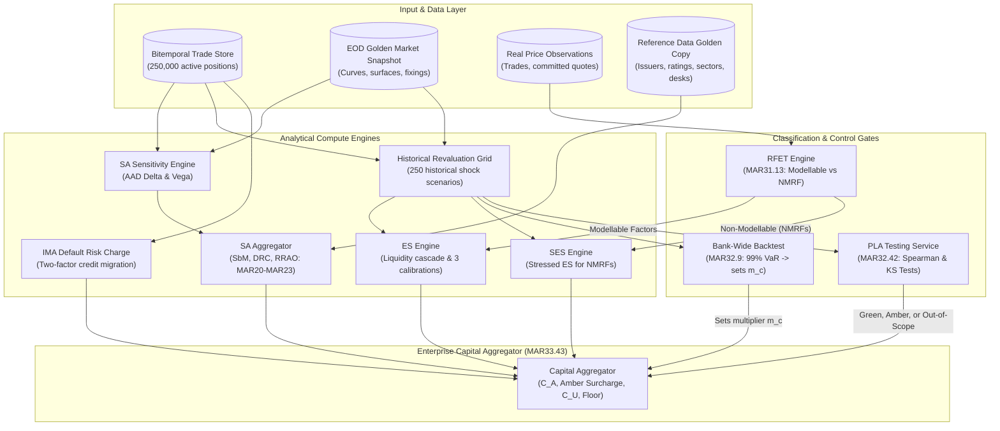
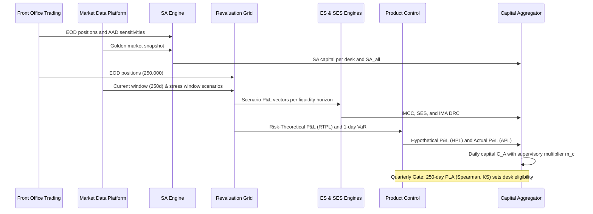
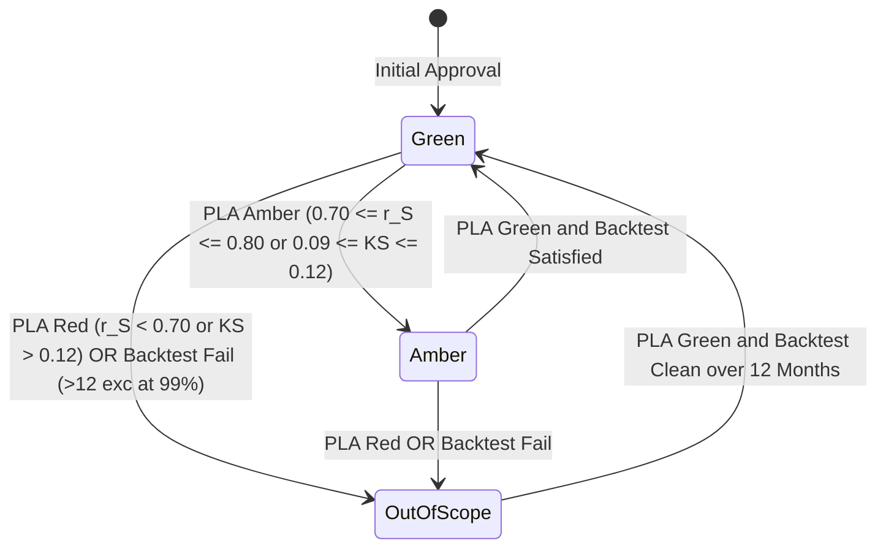

# FRTB Engine Architecture

## TL;DR

- An enterprise Fundamental Review of the Trading Book (FRTB) engine executes two parallel capital tracks nightly: the Standardised Approach (SA, comprising SbM, DRC, and RRAO under MAR20) for all trading desks, and the Internal Models Approach (IMA, comprising Expected Shortfall with liquidity horizons, SES for non-modellable factors, and an internal default risk charge under MAR33) for accredited desks.
- The Standardised Approach is a sensitivity aggregator across seven risk classes, three correlation scenarios (Medium, High, Low), a jump-to-default engine, and residual risk add-ons; the IMA is a distributed historical simulation revaluation grid evaluated across nested liquidity horizons and stress calibrations.
- Desk eligibility is governed by quarterly control gates: the Risk Factor Eligibility Test (RFET under MAR31) classifies risk factors as modellable or non-modellable (NMRFs), while P&L Attribution (PLA) Spearman and Kolmogorov-Smirnov statistical tests decide whether a desk retains internal model approval.
- Bank-level capital aggregation enforces the floor mechanism: $ACR_{\text{total}} = \min(IMA_{G,A} + \text{surcharge} + C_U, SA_{\text{all}}) + \max(0, IMA_{G,A} - SA_{G,A})$ (MAR33.43), requiring daily SA computation for every desk even when internal models are fully approved.
- The dominant engineering bottlenecks are data lineage (reconciling front-office HPL and risk-theoretical RTPL pipelines) and distributed compute scale (executing nearly a billion scenario revaluations during a tight overnight batch window).
- All numerical figures in this note are verified by [sys_frtb_engine.py](file:///Users/shreejitverma/.treehouse/The-Quant-Prep-106fe7/5/The-Quant-Prep/18-Pricing-and-Risk-Systems/code/sys_frtb_engine.py).

## Learning objectives

- Construct the end-to-end FRTB architectural topology and map input streams, valuation engines, control gates, and capital aggregators.
- Formalize the data model linking trades, sensitivities, risk factors, liquidity horizons, scenarios, desks, and regulatory capital results.
- Quantify the compute grid capacity and CPU core sizing required to complete nightly IMA and SA batch runs within stated latency windows.
- Implement the quarterly PLA testing state machine (Spearman rank correlation and Kolmogorov-Smirnov tests) and desk transition rules.
- Derive bank-wide capital aggregation across approved green/amber desks, non-modellable risk factors, and fallback standardised charges under MAR33.

## Core concepts

### 1. FRTB Architectural Topology

### 2. The Daily and Quarterly Operational Cycle

### 3. Standardised Approach (SA) Formulation

The Standardised Approach aggregates three distinct risk components (MAR20.4):

$$K_{\text{SA}} = K_{\text{SbM}} + K_{\text{DRC}} + K_{\text{RRAO}}$$

1. **Sensitivities-Based Method ($K_{\text{SbM}}$):**
   - Evaluated across seven regulatory risk classes: GIRR, CSR (non-sec), CSR (sec-ctp), CSR (sec-non-ctp), Equity, Commodity, and FX.
   - For each risk class and sensitivity type (Delta, Vega, Curvature), bucket-level capital is computed:

$$K_b = \sqrt{\max\left(0, \sum_k WS_k^2 + \sum_k \sum_{l \ne k} \rho_{kl} WS_k WS_l\right)}$$

   - Bucket charges are aggregated across buckets using regulatory correlation $\gamma_{bc}$:

$$K_{\text{class}} = \sqrt{\sum_b K_b^2 + \sum_b \sum_{c \ne b} \gamma_{bc} S_b S_c}$$

   - Evaluated across three correlation scenarios (Medium, High $\min(1.25\rho, 1)$, Low $\max(2\rho - 1, 0.75\rho)$); SbM is the maximum total across scenarios:

$$K_{\text{SbM}} = \max_{s \in \{\text{medium}, \text{high}, \text{low}\}} \sum_{\text{risk classes}} (\Delta_s + \mathcal{V}_s + \mathcal{C}_s)$$

2. **Default Risk Charge ($K_{\text{DRC}}$):**
   - Position-level Jump-to-Default ($JTD = LGD \times \text{Notional} + \text{MtM}$).
   - Short positions offset longs of equal or greater seniority within identical obligor buckets.
3. **Residual Risk Add-On ($K_{\text{RRAO}}$):**
   - $1.0\%$ of gross notional for exotic underlyings (such as longevity or weather derivatives).
   - $0.1\%$ of gross notional for instruments with other residual risks (such as multi-asset barrier options).

### 4. Internal Models Approach (IMA) Formulation

Under MAR33.4, Expected Shortfall at $97.5\%$ incorporates the liquidity horizon cascade:

$$ES = \sqrt{ES_T(P)^2 + \sum_{j \ge 2} \left(ES_T(P, j) \sqrt{\frac{LH_j - LH_{j-1}}{T}}\right)^2}, \quad T = 10\text{ days}$$

Liquidity horizons $LH \in \{10, 20, 40, 60, 120\text{ days}\}$:
- $10\text{ days}$: Major currency GIRR, large-cap equity prices, specified major FX pairs.
- $20\text{ days}$: Small-cap equity prices, energy commodities.
- $40\text{ days}$: Investment-grade corporate credit spreads, FX volatility.
- $60\text{ days}$: High-yield corporate credit spreads, interest rate swaption volatility.
- $120\text{ days}$: Credit spread index tranches, exotic commodity volatility.

Stress calibration scales the current full-factor ES by a historical stress ratio evaluated on a reduced risk factor set $R$ (MAR33.5):

$$ES = ES_{R,S} \times \frac{ES_{F,C}}{ES_{R,C}}, \quad \text{with} \quad \frac{ES_{F,C}}{ES_{R,C}} \ge 1.0$$

The reduced set $R$ must explain at least $75\%$ of the full-set current ES over a trailing 12-week average.

### 5. Eligibility Logic: RFET and PLA Testing

| Test | Unit | Frequency | Evaluation Window | Pass Criteria | Failure Consequence |
| :--- | :--- | :--- | :--- | :--- | :--- |
| **RFET (MAR31.13)** | Individual Risk Factor | Quarterly, monitored monthly | Trailing 12 months | $\ge 24$ verifiable prices/year (min 4 per 90d), or $\ge 100$ prices/year | Factor classified as Non-Modellable (NMRF); capitalized via SES |
| **Bank-Wide Backtest (MAR32.9)** | Entire Institution | Daily | Trailing 250 business days | 99% 1-day VaR vs APL and HPL | Green (0-4 exceptions: $m_c = 1.50$), Amber (5-9: $m_c = 1.70-1.92$), Red ($\ge 10$: $m_c = 2.00$) |
| **Desk Backtest (MAR32.19)** | Trading Desk | Quarterly | Trailing 250 business days | $\le 12$ exceptions at 99%, $\le 30$ at 97.5% | Desk demoted immediately to Fallback Standardised Approach ($C_U$) |
| **PLA Testing (MAR32.42)** | Trading Desk | Quarterly | Trailing 250 business days | Spearman $r_S > 0.80$ and KS statistic $< 0.09$ (Green Zone) | Red ($r_S < 0.70$ or $KS > 0.12$) forces demotion to SA ($C_U$); Amber triggers capital surcharge |

### 6. Bank-Wide Capital Aggregation (MAR33.43)

Approved desk capital combines IMCC, SES, and the IMA default risk charge:

$$C_A = \max\left(IMCC_{t-1} + SES_{t-1}, \, m_c \cdot IMCC_{\text{avg}} + SES_{\text{avg}}\right)$$

$$IMA_{G,A} = C_A + \max\left(DRC_{\text{latest}}, \, DRC_{\text{avg}}\right)$$

Total Aggregate Capital Requirement ($ACR_{\text{total}}$):

$$ACR_{\text{total}} = \min\left(IMA_{G,A} + \text{Surcharge} + C_U, \, SA_{\text{all}}\right) + \max\left(0, \, IMA_{G,A} - SA_{G,A}\right)$$

Where $C_U$ is the SA capital of out-of-scope desks, and Surcharge is $k \max(0, SA_{G,A} - IMA_{G,A})$ with $k = 0.5 \sum_{\text{amber}} SA_i / \sum_{\text{green, amber}} SA_i$.

## Worked examples

### Example 1: Sizing the Nightly FRTB Compute Grid

An investment bank sizes its overnight compute grid across an active trading portfolio:
- Active positions: $250,000$.
- Historical scenarios per ES window: $250$.
- Liquidity horizon nested subsets: $5$.
- ES calibrations ($ES_{F,C}$, $ES_{R,C}$, $ES_{R,S}$): $3$.
- Non-Modellable Risk Factors (NMRFs): $3,500$ factors evaluated over $250$ stress scenarios.
- Standardised Approach sensitivities: $250,000$ positions evaluated via Adjoint Algorithmic Differentiation (AAD) at a computational cost equivalent to $4$ base valuations per position.
- Curvature risk: $50,000$ option positions depending on an average of $1.5$ curvature factors, requiring $2$ revaluations per factor (upward and downward shocks).
- Single position pricing evaluation latency: $0.5\text{ ms} = 0.0005\text{ seconds}$.

Revaluation breakdown:
- ES revaluations: $250,000 \times 250 \times 5 \times 3 = 937,500,000\text{ evaluations}$.
- SES factor-scenario evaluations: $3,500 \times 250 = 875,000\text{ evaluations}$.
- SA sensitivity AAD evaluations: $250,000 \times 4 = 1,000,000\text{ evaluations}$.
- SA curvature revaluations: $50,000 \times 1.5 \times 2 = 150,000\text{ evaluations}$.
- **Total nightly revaluations:**

$$\text{Total Evaluations} = 937,500,000 + 875,000 + 1,000,000 + 150,000 = 939,525,000$$

Compute duration and core sizing:
- Serial CPU execution time:

$$\text{Serial CPU Time} = 939,525,000 \times 0.0005\text{ s} = 469,762.5\text{ seconds} = 130.5\text{ CPU hours}$$

- Target overnight batch window: $2.0\text{ hours} = 7,200\text{ seconds}$.
- Minimum parallel CPU cores required:

$$\text{Cores Required} = \frac{469,762.5\text{ s}}{7,200\text{ s}} = 65.24 \implies \ge 66\text{ dedicated cores}$$

Adding a $50\%$ operational headroom buffer for cluster skew, network I/O, and batch reruns requires provisioning at least $100$ compute nodes.

### Example 2: Quarterly PLA Testing Evaluation

An FX options desk generates 250 business days of HPL and RTPL.
Because each sample contains $N = 250$ observations, the empirical cumulative distribution functions move in discrete steps:

$$\text{Step Size} = \frac{1}{250} = 0.004$$

- The maximum vertical distance between empirical CDFs is observed at $16\text{ steps}$:

$$KS = 16 \times 0.004 = 0.064$$

- The Spearman rank correlation of daily P&L values is computed:

$$r_S = 0.885$$

- Evaluating regulatory thresholds under MAR32.42:
  - $KS = 0.064 < 0.09$ (Passes KS Green Zone).
  - $r_S = 0.885 > 0.80$ (Passes Spearman Green Zone).
  - Outcome: The desk achieves **Green Zone** classification, maintaining full IMA status without capital surcharges.

### Example 3: Capital Walk When a Trading Desk Leaves the IMA

A desk operates under internal models with 60-day averages matching latest values:
- Desk IMCC: $\$18.0\text{M}$.
- Desk SES (Non-Modellable risk charge): $\$6.0\text{M}$.
- Bank multiplier: $m_c = 1.50$.
- Desk IMA Default Risk Charge: $\$7.0\text{M}$.
- **Desk IMA Capital:**

$$\text{IMA Capital} = 1.50 \times \$18.0\text{M} + \$6.0\text{M} + \$7.0\text{M} = \$40.0\text{M}$$
$$\text{Desk IMA RWA} = \$40.0\text{M} \times 12.5 = \$500.0\text{M}$$

During the next quarter, an uncoordinated pricing library upgrade causes front-office HPL and risk RTPL curves to diverge:
- Desk PLA test degrades: Spearman $r_S = 0.620$ ($< 0.70$) and $KS = 0.148$ ($= 37 \times 0.004 > 0.12$).
- Outcome: Desk breaches the Red Zone and is immediately demoted to the Fallback Standardised Approach ($C_U$).
- **Desk Standalone Standardised Approach Evaluation:**
  - Sensitivities-Based Method ($K_{\text{SbM}}$): $\$35.0\text{M}$.
  - Default Risk Charge ($K_{\text{DRC}}$): $\$8.0\text{M}$.
  - Residual Risk Add-On ($K_{\text{RRAO}}$): $0.1\%$ on $\$2,000\text{M}$ ($2\text{ billion}$) gross notional of exotic basket options:

$$K_{\text{RRAO}} = 0.001 \times \$2,000\text{M} = \$2.0\text{M}$$

$$\text{Total Standalone SA Capital} = \$35.0\text{M} + \$8.0\text{M} + \$2.0\text{M} = \$45.0\text{M}$$
$$\text{Desk SA RWA} = \$45.0\text{M} \times 12.5 = \$562.5\text{M}$$

- **Capital Impact:**
  - Standalone capital increases by $\$45.0\text{M} - \$40.0\text{M} = +\$5.0\text{M}$ ($+12.5\%$).
  - Standalone RWA increases by $\$562.5\text{M} - \$500.0\text{M} = +\$62.5\text{M}$.
  - In addition, the desk loses diversification inside bank-level IMA aggregation, increasing total firm capital.

## Pitfalls

- **P&L Pipeline Asynchrony:** Generating HPL using front-office market curves while RTPL uses middle-office risk factors with different interpolation methods is the single largest cause of artificial PLA test failures.
- **Reporting Inadmissible KS Statistics:** In a 250-day PLA window, the KS statistic must be an exact multiple of $1/250 = 0.004$; reporting arbitrary decimals indicates data omissions or unequal sample sizes.
- **Point-in-Time RFET Assessment:** Real price observation eligibility requires 24 observations annually with at least 4 in every 90-day window, or 100 observations; it must be monitored continuously rather than checked once at year-end.
- **Confusing Bank-Wide and Desk Backtesting:** Bank-wide backtesting failures adjust the supervisory multiplier $m_c$ ($1.50$ to $2.00$); individual desk backtesting failures demote the desk directly to $C_U$ under the Standardised Approach.
- **Omitting the IMA DRC:** Comparing IMA capital against SA without including the IMA default risk charge ($IMA_{G,A} = C_A + DRC$) severely underestimates internal model capital requirements.

## Interview questions

> [!question]- sys-10-01 | What are the three core capital components of the FRTB Standardised Approach?
> The Standardised Approach combines the Sensitivities-Based Method ($K_{\text{SbM}}$ across Delta, Vega, and Curvature), the Default Risk Charge ($K_{\text{DRC}}$ for jump-to-default risk), and the Residual Risk Add-On ($K_{\text{RRAO}}$ for non-linear exotic risks).
> Capital requirements are directly summed: $K_{\text{SA}} = K_{\text{SbM}} + K_{\text{DRC}} + K_{\text{RRAO}}$, and RWA is $12.5 \times K_{\text{SA}}$.

> [!question]- sys-10-02 | Why must the SbM capital charge be evaluated across three correlation scenarios (Medium, High, Low)?
> Correlations are unstable during market stress and can either spike toward unity or collapse.
> Evaluating across Medium ($\rho$), High ($\min(1.25\rho, 1)$), and Low ($\max(2\rho - 1, 0.75\rho)$) correlations and taking the maximum total capital across scenarios protects against correlation breakdowns in hedged books and correlation spikes in directional books.

> [!question]- sys-10-03 | What is the Risk Factor Eligibility Test (RFET) for FRTB internal models?
> RFET classifies risk factors as either modellable or non-modellable (NMRFs) based on real price observations.
> A factor passes if it has at least 24 verifiable price observations in a year with no fewer than 4 in any 90-day period, or at least 100 observations over 12 months.
> Non-modellable factors cannot enter the core Expected Shortfall model and must be capitalized via Stressed Expected Shortfall (SES).

> [!question]- sys-10-04 | How is capital calculated for Non-Modellable Risk Factors (NMRFs)?
> Each NMRF is evaluated via Stressed Expected Shortfall ($SES$) over a liquidity horizon of at least 20 days calibrated to a historical stress period.
> Factors are aggregated using a formula that allows zero correlation for verified idiosyncratic equity and credit factors, and a one-factor model with $0.6$ correlation for systematic factors.
> SES enters bank capital directly without the supervisory multiplier $m_c$.

> [!question]- sys-10-05 | What is the difference between the Kolmogorov-Smirnov test and the Spearman correlation test in FRTB PLA testing?
> The Kolmogorov-Smirnov test measures the maximum distance between the empirical cumulative distribution functions of HPL and RTPL, detecting scale or variance mismatches.
> The Spearman rank correlation measures whether the two series rank daily P&L in the same ordinal sequence, detecting attribution mismatches.
> Desks must satisfy both thresholds ($r_S > 0.80$ and $KS < 0.09$) to remain in the Green Zone.

> [!question]- sys-10-06 | What happens when a trading desk falls into the Amber Zone in PLA testing?
> The desk remains in the Internal Models Approach, but the bank must pay a capital surcharge: $k \max(0, SA_{G,A} - IMA_{G,A})$, where $k = 0.5 \sum_{\text{amber}} SA_i / \sum_{\text{green, amber}} SA_i$.
> The desk returns to the Green Zone only after achieving green test statistics in a subsequent quarterly review.

> [!question]- sys-10-07 | What triggers immediate demotion of a trading desk to the Fallback Standardised Approach?
> A desk is demoted to the Standardised Approach ($C_U$) if it breaches the PLA Red Zone ($r_S < 0.70$ or $KS > 0.12$) or if it fails desk-level backtesting ($\ge 12$ exceptions at 99% VaR or $\ge 30$ exceptions at 97.5% VaR over 250 days).
> It must remain in the Standardised Approach for at least 12 months before re-applying for IMA approval.

> [!question]- sys-10-08 | How does the liquidity horizon cascade operate in FRTB Expected Shortfall?
> Risk factors are mapped to liquidity horizons of 10, 20, 40, 60, or 120 days based on asset class liquidity.
> Expected Shortfall is evaluated across nested risk factor subsets, scaling each incremental subset by the square root of horizon duration: $ES = \sqrt{ES_T(P)^2 + \sum_{j \ge 2} (ES_T(P, j) \sqrt{(LH_j - LH_{j-1})/T})^2}$, ensuring illiquid factors are penalized.

> [!question]- sys-10-09 | What is the purpose of the reduced set of risk factors in IMA Expected Shortfall calibration?
> Full historical market data over a 10-year period is rarely available for every active risk factor.
> The bank identifies a reduced set $R$ of liquid factors that explains at least $75\%$ of full-set current ES, evaluates $R$ during the historical stress period ($ES_{R,S}$), and scales by the current full-to-reduced ratio: $ES = ES_{R,S} \times (ES_{F,C} / ES_{R,C})$.

> [!question]- sys-10-10 | Why is Curvature risk in SbM non-linear, and how is it calculated?
> Curvature risk captures non-linear price movement not explained by linear Delta.
> For each curvature factor, the engine applies upward and downward shocks ($RW_k$) and subtracts the linear Delta prediction: $CVR_k^+ = -[V(x_k^+) - V(x_k) - RW_k \cdot s_k]$.
> The bucket capital takes the worst-case scenario between upward and downward moves: $K_b = \max(K_b^+, K_b^-)$.

> [!question]- sys-10-11 | Which daily SA numbers does an IMA bank's FRTB engine need, and why?
> The engine must compute SA capital for all desks ($SA_{\text{all}}$), approved desks ($SA_{G,A}$), amber desks ($SA_{\text{amber}}$), and out-of-scope desks ($C_U$).
> These values are required to evaluate the aggregate capital requirement floor ($ACR_{\text{total}}$), compute the amber surcharge factor $k$, and capitalize out-of-scope portfolios.

> [!question]- sys-10-12 | What steps can the KS statistic take in a 250-day PLA test, and why does it matter for engineering?
> With 250 daily observations, the empirical CDF moves in discrete steps of $1/250 = 0.004$.
> A reported KS statistic that is not a multiple of $0.004$ indicates missing days or sample misalignment bugs.
> The regulatory thresholds ($0.09$ and $0.12$) sit between attainable step values, preventing boundary ties.

> [!question]- sys-10-13 | In a desk's standalone IMA versus SA comparison, which IMA component is most often forgotten?
> The IMA Default Risk Charge ($DRC$).
> Total approved desk capital is $IMA_{G,A} = C_A + DRC$.
> Omitting the internal default risk charge makes internal models appear artificially cheap and miscalculates the true capital impact of regulatory demotion.

## Further reading

- Basel Committee on Banking Supervision. *The Basel Framework: Minimum capital requirements for market risk*. BCBS d457, February 2019.
- European Central Bank. *ECB Guide to internal models: Risk-weighted assets / market risk*. ECB Banking Supervision, October 2019.
- Savine, Antoine. *Modern Computational Finance: AAD and Parallel Simulations*. John Wiley & Sons, 2018.
- Gregory, Jon. *The xVA Challenge: Counterparty Credit Risk, Funding, Collateral, and Capital*. 4th Edition, John Wiley & Sons, 2020.
