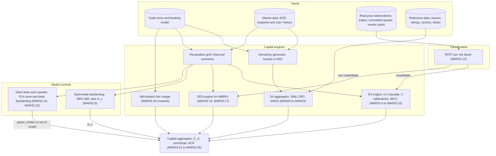
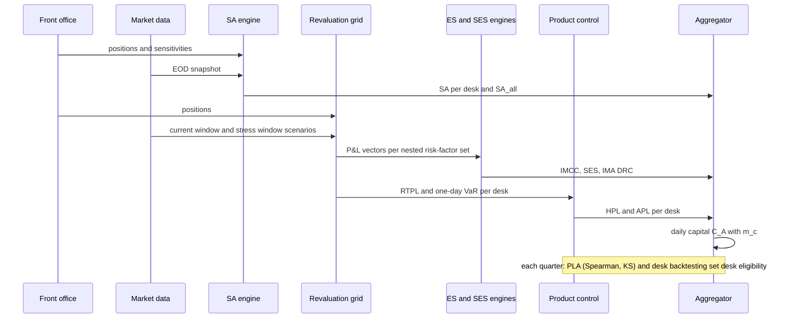
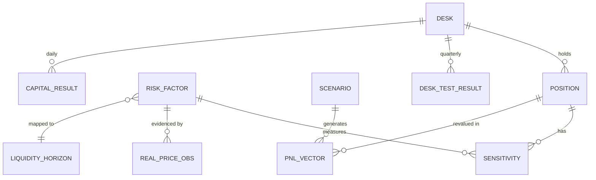
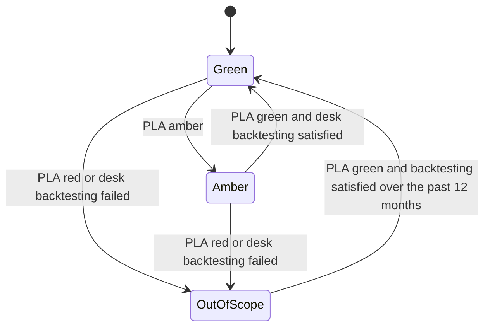

# FRTB Engine Architecture

> [!info] Draft
> Regulatory content is verified against the Basel Framework text; the sizing figures are stated assumptions, not measurements.

## TL;DR

- An FRTB engine runs two capital tracks every day: the standardised approach (SA = SbM + DRC + RRAO, MAR20.4) for every desk, and the internal models approach (ES with liquidity horizons, SES for non-modellable factors, a default risk charge) for approved desks (MAR33).
- The SA is a sensitivity aggregator plus a position-level JTD engine; the IMA is a historical-simulation revaluation grid over nested risk-factor subsets, three calibrations and up to 63 ES runs a day (MAR33.4 to MAR33.15).
- Eligibility is a separate control loop: risk factors are classified by the RFET, and desks by quarterly PLA tests and desk-level backtesting, while bank-wide backtesting sets the multiplier $m_c$ (MAR31.13, MAR32.9, MAR32.19, MAR32.42 to MAR32.45).
- Capital aggregation is $\min(IMA_{G,A} + \text{surcharge} + C_U,\ SA_{all}) + \max(0,\ IMA_{G,A} - SA_{G,A})$, so the engine must produce SA for every desk even when it models them (MAR33.43).
- The dominant engineering problems are data (real-price observations, P&L lineage between front office and risk) and compute (hundreds of millions of revaluations a night), not the formulas.

## Learning objectives

- Draw the end-to-end FRTB architecture and explain each component's inputs, outputs and control role.
- Specify the data model that links positions, risk factors, scenarios, desks and capital.
- Size the nightly IMA and SA compute from stated assumptions.
- Implement the PLA test and desk state machine correctly, including strict thresholds and trailing windows.
- Explain how desk outcomes flow into bank-level capital through MAR33.41 to MAR33.45.

## Core concepts

### 1. Architecture

Two control signals reach the aggregator and must not be confused: bank-wide backtesting changes the multiplier $m_c$ (green 1.50, amber 1.70 to 1.92, red 2.00, MAR32.9), while desk outcomes decide which desks are in $IMA_{G,A}$ and drive the amber surcharge.

### 2. The daily and quarterly cycle

Bank-wide backtesting uses the trailing 250 days of exceptions of 99% one-day VaR against both actual and hypothetical P&L (MAR32.9); PLA compares HPL with RTPL over 250 days at each quarter end (MAR32.38 to MAR32.42).

### 3. Data model

Every record carries an as-of date, a market data snapshot id and a model version, because capital must be reproducible for any past date and PLA failures are investigated by replaying both P&L chains.

### 4. SA engine

The SA engine is a sensitivity aggregator (SbM) plus a position-level JTD engine (DRC) plus a product-taxonomy lookup (RRAO):

$$K_{\text{SA}} = K_{\text{SbM}} + K_{\text{DRC}} + K_{\text{RRAO}}$$

- Per risk class and measure: $K_b = \sqrt{\max\left(0, \sum_{k} WS_k^2 + \sum_{k}\sum_{l \ne k} \rho_{kl} WS_k WS_l\right)}$, then the risk-class charge $\sqrt{\sum_b K_b^2 + \sum_b \sum_{c \ne b} \gamma_{bc} S_b S_c}$ (MAR21.4).
- If that radicand is negative, $S_b$ is clamped to $[-K_b, K_b]$ (MAR21.4(5)(b)); the prescribed CSR and equity $\gamma$ matrices are not always PSD, so the engine must still guard the square root (see [SbM Delta](../17-Regulatory-Capital-Basel-and-FRTB/07-FRTB-Sensitivities-Based-Method-Delta.md)).
- Three correlation scenarios (MAR21.6): medium as specified, high $\min(1.25\rho, 1)$, low $\max(2\rho - 1, 0.75\rho)$; within each scenario delta, vega and curvature are summed over all risk classes, and SbM is the largest scenario total (MAR21.7):

$$K_{\text{SbM}} = \max_{s \in \{\text{medium}, \text{high}, \text{low}\}} \sum_{\text{risk classes}} \left(\Delta_s + \mathcal{V}_s + \mathcal{C}_s\right)$$

- DRC: $JTD = LGD \times N + P\&L$ (floored or capped at zero by direction), LGD 100%, 75% or 25% (MAR22.11, MAR22.12), maturity scaling with a three-month floor (MAR22.15, MAR22.18), offsetting where the short is equally or more junior (MAR22.19), then the hedge benefit ratio and a zero floor per bucket (MAR22.23, MAR22.25); details in [DRC and RRAO](../17-Regulatory-Capital-Basel-and-FRTB/09-FRTB-Default-Risk-Charge-and-Residual-Risk-Add-On.md).
- RRAO: 1.0% of gross notional for exotic underlyings and 0.1% for other residual risks (MAR23.8); excluded are exact back-to-back trades and, for other residual risks only, listed or centrally clearable instruments (MAR23.7); cheapest-to-deliver, smile, vanilla multi-underlying correlation, dividend and index risks do not by themselves trigger it (MAR23.6).

Curvature is the SA's only revaluation step: two revaluations per instrument per curvature risk factor it depends on, where a GIRR curvature factor is a whole currency and an equity factor is one issuer (MAR21.5, MAR21.8 to MAR21.14).

### 5. IMA engine

Expected shortfall at 97.5% with the liquidity-horizon cascade (MAR33.4):

$$ES = \sqrt{ES_T(P)^2 + \sum_{j \ge 2} \left(ES_T(P, j)\sqrt{\frac{LH_j - LH_{j-1}}{T}}\right)^2}, \qquad T = 10, \quad LH \in \{10, 20, 40, 60, 120\}$$

where $ES_T(P, j)$ shocks only the risk factors whose horizon is at least $LH_j$.
Examples of horizons (MAR33.12): specified-currency rates, large-cap equity prices and specified FX pairs 10 days; small-cap equity prices and energy prices 20; IG corporate spreads and FX volatility 40; HY corporate spreads and interest rate volatility 60; credit spread volatility and other commodity volatility 120; the full table is in [Internal Model Approach: ES](../17-Regulatory-Capital-Basel-and-FRTB/10-FRTB-Internal-Model-Approach-ES.md).

Stress calibration uses a reduced set of risk factors $R$ (MAR33.5, MAR33.6):

$$ES = ES_{R,S} \times \frac{ES_{F,C}}{ES_{R,C}}, \qquad \frac{ES_{F,C}}{ES_{R,C}} \ge 1$$

The reduced set exists because long histories are not available for every risk factor, not because full ES is too slow: $R$ must explain at least 75% of the full-set current ES, measured on a 12-week average (MAR33.5(2)).

### 6. Eligibility logic

| Test | Unit | Frequency | Outcomes |
| :--- | :--- | :--- | :--- |
| RFET (MAR31.13) | risk factor | quarterly, monitored monthly | modellable or NMRF |
| Bank-wide backtesting, 99% one-day VaR, 250 days (MAR32.9) | bank | daily update | green 0 to 4 exceptions ($m_c = 1.50$), amber 5 to 9 ($m_c$ 1.70 to 1.92), red 10 or more ($m_c = 2.00$, model may be disallowed) |
| Desk backtesting (MAR32.19) | desk | quarterly | fail if more than 12 exceptions at 99% or more than 30 at 97.5% in 12 months |
| PLA (MAR32.42) | desk | quarterly | green if $r_S > 0.80$ and $KS < 0.09$; red if $r_S < 0.70$ or $KS > 0.12$; amber otherwise |

An out-of-scope desk is capitalised under the SA inside $C_U$ (MAR32.43, MAR33.40).
Amber desks stay in the IMA and drive the bank-level surcharge $k \max\{0, SA_{G,A} - IMA_{G,A}\}$ with $k = 0.5 \sum_{amber} SA_i / \sum_{green, amber} SA_i$ (MAR33.45); they do not change $m_c$.
Details are in [Backtesting and PLA Testing](../17-Regulatory-Capital-Basel-and-FRTB/12-FRTB-Backtesting-and-PLA-Testing.md).

### 7. Aggregation

$$C_A = \max\left(IMCC_{t-1} + SES_{t-1},\ m_c \cdot IMCC_{avg} + SES_{avg}\right)$$

with 60-day averages (MAR33.41); $IMA_{G,A} = C_A + DRC$, the IMA default risk charge taken as the greater of its 12-week average and latest value (MAR33.22); and

$$ACR_{total} = \min\left(IMA_{G,A} + \text{surcharge} + C_U,\ SA_{all}\right) + \max\left(0,\ IMA_{G,A} - SA_{G,A}\right)$$

(MAR33.43).
The engine therefore needs four SA numbers every day: SA for all desks, for approved desks, for amber desks, and for out-of-scope desks.

## Worked examples

### Example 1: sizing the nightly run

Assumptions (illustrative, not measured): 250,000 positions; 250 scenarios per ES window; five liquidity-horizon subsets; three calibrations ($ES_{F,C}$, $ES_{R,C}$, $ES_{R,S}$); 3,500 NMRFs each stressed over 250 days; SA sensitivities by AAD at an assumed cost of four base valuations per position; 50,000 positions with optionality depending on 1.5 curvature factors on average; 0.5 ms per position valuation.

| Component | Count |
| :--- | ---: |
| ES revaluations: $250{,}000 \times 250 \times 5 \times 3$ | 937,500,000 |
| SES factor-scenario evaluations: $3{,}500 \times 250$ | 875,000 |
| SA sensitivities: $250{,}000 \times 4$ | 1,000,000 |
| SA curvature revaluations: $50{,}000 \times 1.5 \times 2$ | 150,000 |
| Total | 939,525,000 |

Serial CPU time is $939{,}525{,}000 \times 0.0005 = 469{,}762.5$ seconds, about 130.5 CPU hours; finishing in a two-hour window needs $469{,}762.5 / 7{,}200 = 65.2$, so at least 66 cores before headroom for reruns, skew and failures.
The ES grid dominates by three orders of magnitude, which is why banks invest in scenario-level caching, sensitivity-based approximations validated against full revaluation, and incremental reruns.
Counting only whole-book subsets understates the work: IMCC also needs the risk-class-level ES terms (MAR33.14), which is how the MAR33.15 FAQ arrives at up to 63 ES calculations, although each position only enters the sets of its own risk class.

### Example 2: a PLA run

Over 250 days an FX options desk produces HPL and RTPL.
The KS statistic is the largest gap between the two empirical distribution functions; with 250 observations each it moves in steps of $1/250 = 0.004$ (MAR32.39, MAR32.40).
A result of $KS = 0.064$ is below 0.09 and a Spearman correlation of 0.885 is above 0.80, so the desk is green on both metrics (MAR32.42; both thresholds are strict).
Spearman should be computed as the Pearson correlation of ranks with average ranks for ties; the shortcut $1 - 6\sum d_i^2 / (n(n^2-1))$ is exact only without ties.

### Example 3: a desk leaves the IMA

A desk's IMA figures, with averages equal to the latest values: $IMCC = 18$m, $SES = 6$m, $m_c = 1.5$, IMA default risk charge 7m.
Its IMA capital is $1.5 \times 18 + 6 + 7 = 40$m (RWA 500m).
A front-office model change that is not replicated in the risk engine drives its Spearman correlation to 0.62 and its KS to 0.148 (a reachable value, $37/250$), so it is red at the next quarter end (MAR32.43).
Its standalone SA is SbM 35m, DRC 8m and RRAO 2m (0.1% of 2bn of basket-option gross notional, MAR23.5(2)), so 45m (RWA 562.5m).
On a standalone basis the move costs $45 - 40 = 5$m of capital, +12.5%, and 62.5m of RWA.
The bank-level effect is not this difference: the desk moves from $IMA_{G,A}$ and $SA_{G,A}$ into $C_U$, it loses diversification inside the IMA, and the surcharge and the min and max terms of MAR33.43 all change.

## Pitfalls

- Using one P&L chain for HPL and another, differently configured, for RTPL; differences in curve interpolation or volatility surfaces between front office and risk are the most common cause of PLA failure.
- Applying PLA thresholds non-strictly ($\ge 0.80$, $\le 0.09$) or reporting KS values that cannot occur on 250 observations.
- Treating RFET as point-in-time: it needs 24 observations a year with at least four in every 90-day period, or 100 observations, at most one counted per day, monitored monthly (MAR31.13).
- Classifying desks daily: desk eligibility is assessed quarterly; only bank-wide backtesting moves daily with the exception count.
- Mixing bank-wide and desk outcomes: bank-wide backtesting sets $m_c$; desk failure moves the desk to $C_U$.
- Omitting the IMA default risk charge when comparing IMA and SA for a desk.
- Assuming the ACR caps capital at SA: the second term adds back IMA in excess of SA on approved desks.
- Using the low scenario as $2\rho - 1$ everywhere: it is $\max(2\rho - 1, 0.75\rho)$.
- Losing lineage: without snapshot ids and model versions, a PLA failure or an exception cannot be explained after the fact.

## Interview questions

> [!question]- sys-10-01 | What are the three core capital components of the FRTB Standardised Approach?
> The sensitivities-based method (delta, vega and curvature across seven risk classes and three correlation scenarios), the default risk charge (jump-to-default) and the residual risk add-on (MAR20.4).
> They are simply added, and RWA is 12.5 times the sum (MAR20.1).
> The SbM is sensitivity-based, the DRC position-based and the RRAO notional-based, so the engine has three different input shapes.

> [!question]- sys-10-02 | Why must the SbM capital charge be evaluated across three correlation scenarios (Medium, High, Low)?
> Correlations are unstable in stress and can rise or fall.
> Evaluating across medium ($\rho$), high ($\min(1.25\rho, 1)$) and low ($\max(2\rho - 1, 0.75\rho)$) correlations, summing all risk classes within each scenario and taking the largest total (MAR21.6, MAR21.7), covers both correlation spikes (bad for directional books) and breakdowns (bad for hedged books).

> [!question]- sys-10-03 | What is the Risk Factor Eligibility Test (RFET) for FRTB internal models?
> The test that classifies each risk factor as modellable or non-modellable from real-price observations (MAR31.13).
> Criterion 1 uses the ES calibration period for its observation rate and the previous 12 months for its 90-day test; criterion 2 uses 100 observations over the previous 12 months, with at most one observation per day.
> See [Non-Modellable Risk Factors](../17-Regulatory-Capital-Basel-and-FRTB/11-FRTB-Non-Modellable-Risk-Factors.md) for the RFET window rules and footnote 301 alternative.
> Failing factors are capitalised through SES instead of the ES model.

> [!question]- sys-10-04 | How is capital calculated for Non-Modellable Risk Factors (NMRFs)?
> Each NMRF gets a stressed expected shortfall over a horizon of at least 20 days, calibrated to a stress period (MAR33.16).
> They aggregate as $\sqrt{\sum ISES_i^2} + \sqrt{\sum ISES_j^2} + \sqrt{(0.6\sum SES_k)^2 + 0.64\sum SES_k^2}$: zero correlation only for idiosyncratic credit and equity NMRFs shown to be independent, and a one-factor model with loading 0.6 for all others (MAR33.17).
> SES enters $C_A$ without the multiplier $m_c$ (MAR33.41).

> [!question]- sys-10-05 | What is the difference between the Kolmogorov-Smirnov test and the Spearman correlation test in FRTB PLA testing?
> KS compares the whole distributions of HPL and RTPL (largest gap between empirical CDFs), so it catches a model with the right ranking but the wrong scale.
> Spearman measures whether the two series rank the days the same way, so it catches a model with the right distribution but the wrong daily attribution.
> A desk needs both to be green: $r_S > 0.80$ and $KS < 0.09$ (MAR32.42).

> [!question]- sys-10-06 | What happens when a trading desk falls into the Amber Zone in PLA testing?
> It stays in the IMA, but while any desk is amber the bank adds the surcharge $k\max\{0, SA_{G,A} - IMA_{G,A}\}$ with $k = 0.5\sum_{amber}SA_i/\sum_{green,amber}SA_i$ (MAR33.45).
> The desk returns to green only after a green PLA result with backtesting satisfied (MAR32.44).
> Amber does not change $m_c$, which is driven by bank-wide backtesting.

> [!question]- sys-10-07 | What triggers immediate demotion of a trading desk to the Fallback Standardised Approach?
> A PLA red zone ($r_S < 0.70$ or $KS > 0.12$, MAR32.43) or desk-level backtesting failure: more than 12 exceptions of 99% one-day VaR or more than 30 of 97.5% one-day VaR in the most recent 12 months (MAR32.19).
> The desk then sits in $C_U$ under the SA until it is green on PLA and has satisfied backtesting over the past 12 months.
> Bank-wide red backtesting is different: it sets $m_c = 2.00$ and may lead the supervisor to disallow the model.

> [!question]- sys-10-08 | How does the liquidity horizon cascade operate in FRTB Expected Shortfall?
> Each risk factor is mapped to a horizon of 10, 20, 40, 60 or 120 days (MAR33.12), and ES is computed on nested subsets: all factors, then those with horizon at least 20, at least 40, and so on.
> The pieces combine as $ES = \sqrt{ES_T(P)^2 + \sum_{j \ge 2} \left(ES_T(P,j)\sqrt{(LH_j - LH_{j-1})/T}\right)^2}$ with $T = 10$ (MAR33.4).
> Less liquid factors keep contributing over longer horizons, scaled by square-root-of-time.

> [!question]- sys-10-09 | What is the purpose of the reduced set of risk factors in IMA Expected Shortfall calibration?
> To calibrate to a stress period for which full risk-factor history does not exist: the bank computes ES on a reduced set $R$ in the stress period and scales by the current full-to-reduced ratio, $ES = ES_{R,S} \times ES_{F,C}/ES_{R,C}$, with the ratio floored at 1 (MAR33.5, MAR33.6).
> $R$ must explain at least 75% of the current full-set ES, measured on a 12-week average (MAR33.5(2)).
> The reduced set is a data-availability device, not a compute shortcut.

> [!question]- sys-10-10 | Why is Curvature risk in SbM non-linear, and how is it calculated?
> Curvature captures the non-linear price risk of options beyond delta.
> For each curvature factor it applies an upward and a downward shock and subtracts the delta prediction: $CVR_k^+ = -\left[ V(x_k^{+}) - V(x_k) - RW_k \, s_k \right]$ (MAR21.5).
> Within each bucket the engine takes $K_b = \max(K_b^+, K_b^-)$, using squared delta correlations and the $\psi$ indicator that drops cross terms between two negative CVRs (MAR21.5, MAR21.100).

> [!question]- sys-10-11 | Which daily SA numbers does an IMA bank's FRTB engine need, and why?
> SA for all desks, SA for the approved desks, SA for the amber desks and SA for the out-of-scope desks.
> $SA_{all}$ and $SA_{G,A}$ enter the ACR formula, the amber SA enters the surcharge factor $k$, and out-of-scope desks are capitalised as $C_U$ under the SA (MAR33.40, MAR33.43, MAR33.45).
> So the SA engine runs on the whole book every day even when every desk is modelled.

> [!question]- sys-10-12 | What steps can the KS statistic take in a 250-day PLA test, and why does it matter for engineering?
> With 250 observations in each sample, the empirical CDFs move in steps of $1/250$, so KS is a multiple of 0.004 (MAR32.39, MAR32.40).
> A reported value that is not a multiple of 0.004 signals a bug, such as missing days or a different sample size in one series.
> The thresholds 0.09 and 0.12 therefore sit between attainable values, so ties at the threshold cannot occur.

> [!question]- sys-10-13 | In a desk's standalone IMA versus SA comparison, which IMA component is most often forgotten?
> The IMA default risk charge: $IMA_{G,A} = C_A + DRC$ (MAR33.43), where the IMA DRC is the greater of its 12-week average and latest value (MAR33.22).
> Leaving it out makes the IMA look cheaper and overstates the cost of losing approval.
> The true bank-level cost also runs through the min and max terms of the ACR formula and the surcharge.

## Further reading

- Basel Committee on Banking Supervision, Basel Framework, MAR20 to MAR23, MAR30 to MAR33 and MAR99 (bis.org/basel_framework).
- ECB Banking Supervision, *ECB guide to internal models*, market risk chapter.
- Antoine Savine, *Modern Computational Finance: AAD and Parallel Simulations*, Wiley, 2018.

## In this repo and SDE-Interview-Prep

- [FRTB: SbM Delta](../17-Regulatory-Capital-Basel-and-FRTB/07-FRTB-Sensitivities-Based-Method-Delta.md), [Vega and Curvature](../17-Regulatory-Capital-Basel-and-FRTB/08-FRTB-Sensitivities-Based-Method-Vega-and-Curvature.md), [DRC and RRAO](../17-Regulatory-Capital-Basel-and-FRTB/09-FRTB-Default-Risk-Charge-and-Residual-Risk-Add-On.md).
- [Internal Model Approach: ES](../17-Regulatory-Capital-Basel-and-FRTB/10-FRTB-Internal-Model-Approach-ES.md), [NMRF](../17-Regulatory-Capital-Basel-and-FRTB/11-FRTB-Non-Modellable-Risk-Factors.md), [Backtesting and PLA](../17-Regulatory-Capital-Basel-and-FRTB/12-FRTB-Backtesting-and-PLA-Testing.md).
- [code/frtb_sbm.py](../17-Regulatory-Capital-Basel-and-FRTB/code/frtb_sbm.py) and [code/frtb_ima.py](../17-Regulatory-Capital-Basel-and-FRTB/code/frtb_ima.py) - reference implementations of the formulas this engine runs at scale.
- [PnL Platform](09-PnL-Platform.md), [Risk Engine](07-Risk-Engine.md) and [EOD Risk Batch](13-EOD-Risk-Batch.md) - the upstream systems.
