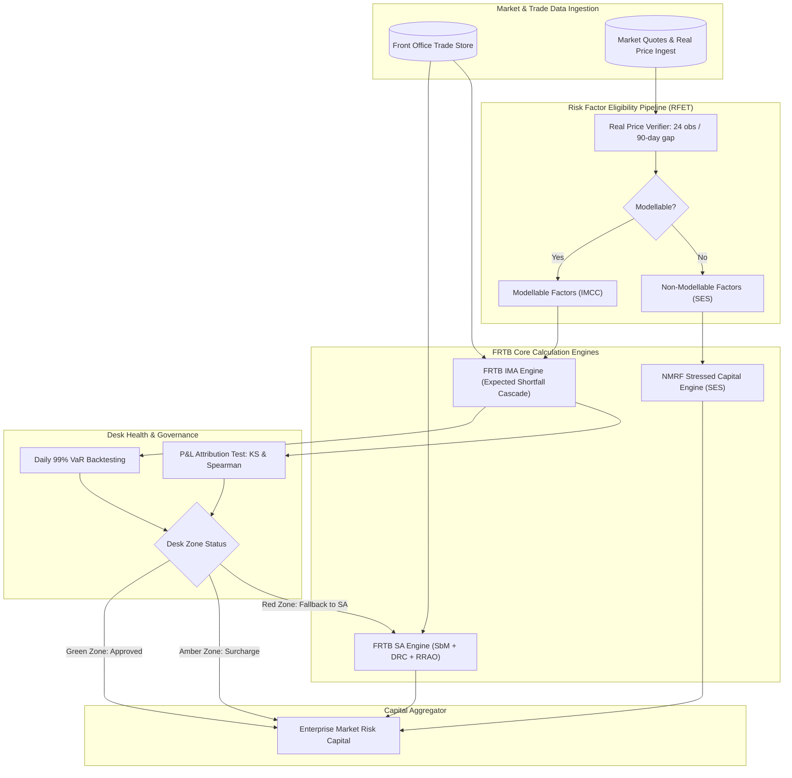

# FRTB Engine Architecture

## TL;DR

The Fundamental Review of the Trading Book (FRTB, BCBS 239/d457) represents the most computationally demanding regulatory framework ever imposed on capital markets technology.
An enterprise FRTB engine must support dual tracks: the Standardised Approach (SA) and the Internal Models Approach (IMA).
The SA engine automates the Sensitivities-Based Method (SbM), aggregating Delta, Vega, and Curvature across seven asset classes and three correlation scenarios (Medium, High, Low), compounded by Default Risk Charges (DRC) and Residual Risk Add-Ons (RRAO).
The IMA engine evaluates Expected Shortfall across a five-tier liquidity horizon cascade (10, 20, 40, 60, 120 days) scaled by reduced-set stress ratios.
Crucially, trading desks earn and maintain IMA eligibility only by continuously passing two automated middle-office pipelines: the Risk Factor Eligibility Test (RFET) for Non-Modellable Risk Factors (NMRF) and the daily P&L Attribution (PLA) / Backtesting framework.
A failure in PLA testing demotes the desk to the fallback Standardised Approach, triggering massive capital surcharges.

## Learning objectives

- Map the end-to-end computational pipeline of an enterprise FRTB engine spanning SA, IMA, NMRF, and PLA testing.
- Design the Sensitivities-Based Method (SbM) aggregation engine across all 7 asset classes and 3 correlation regimes.
- Formulate the IMA Expected Shortfall liquidity-horizon cascade and reduced-set calibration algorithms.
- Architect the automated Risk Factor Eligibility Test (RFET) pipeline to classify modellable versus non-modellable risk factors.
- Implement automated P&L Attribution (PLA) engines evaluating Kolmogorov-Smirnov and Spearman rank correlation metrics.
- Calculate the total compute budget ($\text{Positions} \times \text{Risk Factors} \times \text{Scenarios} \times \text{Horizons}$) and size distributed cluster resources.

## Core concepts

### 1. Dual-Track FRTB Engine Architecture



### 2. Standardised Approach (SA) Engine: SbM, DRC, and RRAO

The SA engine computes three discrete capital components:

$$K_{\text{SA}} = K_{\text{SbM}} + K_{\text{DRC}} + K_{\text{RRAO}}$$

#### 1. Sensitivities-Based Method ($K_{\text{SbM}}$):
- Computed for Delta, Vega, and Curvature across 7 risk classes: GIRR, CSR non-sec, CSR sec-ctp, CSR sec non-ctp, Equity, Commodity, FX.
- Sensitivity weighting: $WS_k = RW_k \times s_k$.
- Bucket-level aggregation:

$$K_b = \sqrt{ \sum_{k \in b} WS_k^2 + \sum_{k \in b} \sum_{l \neq k, l \in b} \rho_{kl} WS_k WS_l }$$

- Across-bucket aggregation across all buckets $b$:

$$K_{\text{SbM}} = \sqrt{ \sum_b K_b^2 + \sum_b \sum_{c \neq b} \gamma_{bc} S_b S_c }$$

- Evaluated across three correlation scenarios: Medium ($\rho, \gamma$), High ($1.25\rho, 1.25\gamma$), Low ($2\rho - 1, 2\gamma - 1$).
  The capital charge is the maximum across the three regimes:

$$K = \max\left( K_{\text{Medium}}, K_{\text{High}}, K_{\text{Low}} \right)$$

#### 2. Default Risk Charge ($K_{\text{DRC}}$):
- Evaluates Jump-to-Default (JTD) across debt and equity positions:

$$\text{JTD}_{\text{long}} = \max\left(LGD \times \text{Notional} + \text{MtM}, 0\right)$$

- Netting across long and short positions within the same obligor and seniority, scaled by the Weighted To Reference ($WTR$) hedging ratio.

#### 3. Residual Risk Add-On ($K_{\text{RRAO}}$):
- Applied to complex or path-dependent instruments (e.g., barrier options, multi-underlying basket options, correlation swaps).
- Capital surcharge: $1.0\%$ of gross notional for exotic instruments, $0.1\%$ for instruments with residual risks in underlying parameters.

### 3. IMA Expected Shortfall with Liquidity Horizons

Under the Internal Models Approach, Expected Shortfall is evaluated across a 5-tier cascade of liquidity horizons ($LH$):

$$\text{ES} = \sqrt{ (\text{ES}_1)^2 + \sum_{j=2}^5 (\text{ES}_j)^2 \frac{LH_j - LH_{j-1}}{10} }$$

Where:
- $LH_1 = 10\text{ days}$ (All risk factors)
- $LH_2 = 20\text{ days}$ (Excludes liquid FX and large-cap equities)
- $LH_3 = 40\text{ days}$ (Excludes interest rate tenors)
- $LH_4 = 60\text{ days}$ (Credit spreads and small-cap equities)
- $LH_5 = 120\text{ days}$ (Credit exotics, illiquid commodities, exotic volatility)

To incorporate historical stress without running full portfolios across decades, the calibrated ES is scaled via a reduced set ($R$) of liquid risk factors:

$$\text{ES}_{\text{calibrated}} = \text{ES}_{R,S} \times \frac{\text{ES}_{F,C}}{\text{ES}_{R,C}}$$

Where $S$ denotes the 12-month historical stress period, $C$ denotes the current 12-month period, $F$ is the full risk factor set, and $R$ is the reduced set.

### 4. Desk Eligibility Traffic Light Matrix (Backtesting & PLA)

```
+----------------------------------------------------------------------------------------------------+
| Desk Status Zone    | 1-Day 99% VaR Exceptions   | Spearman Correlation ($r_s$) | KS Statistic ($KS$) | IMA Status & Penalty |
+----------------------------------------------------------------------------------------------------+
| Green Zone          | 0 to 4 exceptions          | $r_s \ge 0.80$               | $KS \le 0.09$       | Eligible; No penalty |
| Amber Zone          | 5 to 9 exceptions          | $0.70 \le r_s < 0.80$        | $0.09 < KS \le 0.12$| Eligible; Capital add-on|
| Red Zone            | 10+ exceptions             | $r_s < 0.70$                 | $KS > 0.12$         | Disqualified; Must use SA|
+----------------------------------------------------------------------------------------------------+
```

## Worked examples

### Example 1: FRTB Compute Budget Sizing for a Tier-1 Trading Book

A global bank designs the hardware and grid capacity for its internal models FRTB engine:
- Portfolio Scope: $P = 250,000$ active trading book positions across 30 trading desks.
- Number of Modellable Risk Factors (MRFs): $N_{\text{MRF}} = 15,000$.
- Number of Non-Modellable Risk Factors (NMRFs): $N_{\text{NMRF}} = 3,500$.
- Historical Scenario Sample: $S = 250$ business days.
- Liquidity Horizon Sub-portfolios: 5 liquidity subsets ($LH_1 \dots LH_5$).
- Reduced Sets: 2 sets (Full set $F$, Reduced set $R$) across Current ($C$) and Stressed ($S$) windows.

Compute Breakdown for Overnight IMA Run:
1. Expected Shortfall Simulation:
   - 250 scenario valuations $\times$ 5 liquidity horizon passes $\times$ 2 sets ($F, R$) $= 2,500$ portfolio revaluation passes.
   - Total Position Valuations: $250,000\text{ positions} \times 2,500\text{ passes} = 625,000,000\text{ valuations}$.
2. NMRF Stressed Expected Shortfall ($SES$):
   - 3,500 NMRFs evaluated under extreme stress scenarios (250 days):
   - Total NMRF evaluations: $3,500 \times 250 = 875,000\text{ factor-scenario evaluations}$.
3. Standardised Approach Backup Run (Mandatory benchmark):
   - Delta, Vega, and Curvature across 15,000 risk factors:
   - Using AAD, Greek generation takes $4\times$ base evaluation: $250,000 \times 4 = 1,000,000\text{ valuations}$.
   - Curvature up/down shocks ($2 \times 15,000\text{ pillars}$): evaluated analytically or via grid proxies.

Total Daily Compute Budget:

$$\text{Total Daily Evaluations} \approx 625,000,000 + 875,000 + 1,000,000 \approx 626,875,000\text{ evaluations}$$

Grid Sizing:
- Average valuation latency across mixed portfolio (swaps, bonds, exotics): $0.5\text{ milliseconds}$ per position evaluation.
- Total Serial CPU Time: $688.5 \times 10^6 \times 0.0005\text{ s} = 344,250\text{ CPU seconds} \approx 95.6\text{ CPU hours}$.
- To finish within a $2\text{-hour}$ ($7,200\text{ seconds}$) batch window:

$$N_{\text{cores}} = \frac{344,250}{7,200} \approx 47.8 \implies 64\text{ modern dedicated CPU cores}$$

With GPU acceleration for Monte Carlo contracts, this entire workload executes on a single 8-GPU server chassis in under 15 minutes.

### Example 2: PLA Test Automation: Spearman and Kolmogorov-Smirnov Calculation

Over a 250-day observation window, Product Control generates daily Hypothetical PnL ($\mathbf{HPL}$) and Risk-Theoretical PnL ($\mathbf{RTPL}$) for a FX Options Desk:
- Step 1: Kolmogorov-Smirnov Distance ($KS$):
  - Form the empirical cumulative distribution functions $F_{\text{HPL}}(x)$ and $F_{\text{RTPL}}(x)$.
  - Find the maximum vertical divergence:

$$KS = \max_x \left| F_{\text{HPL}}(x) - F_{\text{RTPL}}(x) \right|$$

  - If $KS = 0.065 \le 0.090 \implies$ **Green Zone**.
- Step 2: Spearman Rank Correlation ($r_s$):
  - Assign ranks $R(\text{HPL}_i)$ and $R(\text{RTPL}_i)$ from 1 to 250.
  - Compute rank differences $d_i = R(\text{HPL}_i) - R(\text{RTPL}_i)$.
  - Spearman formula:

$$r_s = 1 - \frac{6 \sum_{i=1}^{250} d_i^2}{250 \times (250^2 - 1)}$$

  - If $r_s = 0.885 \ge 0.800 \implies$ **Green Zone**.
- Outcome: The desk achieves Green Zone status on both metrics, maintaining full IMA eligibility with zero capital surcharge.

### Example 3: Capital Impact of Desk Demotion from IMA to Fallback SA

A desk trading exotic equity baskets manages $\$500,000,000$ of positions:
- While in Green Zone (IMA Model):
  - Calibrated Expected Shortfall ($\text{IMCC}$): $\$18,000,000$.
  - NMRF Stressed Capital ($\text{SES}$): $\$6,000,000$.
  - Total IMA Capital Charge: $\$18,000,000 + \$6,000,000 = \$24,000,000$.
  - Associated RWA ($12.5 \times K$): $\$300,000,000$.
- The desk updates its pricing model without updating the middle-office risk factor engine. Over the next quarter, uncaptured model basis causes $r_s$ to fall to $0.62$ ($< 0.70$) and $KS$ to rise to $0.15$ ($> 0.12$).
- The supervisor forces immediate demotion to the **Red Zone**:
  - The desk loses IMA eligibility and must calculate capital under the Standardised Approach ($K_{\text{SA}}$).
  - Standalone SbM Delta, Vega, and Curvature: $\$35,000,000$.
  - Default Risk Charge (DRC): $\$8,000,000$.
  - Residual Risk Add-On (RRAO on exotic baskets): $\$15,000,000$.
  - Total SA Capital Charge: $\$35,000,000 + \$8,000,000 + \$15,000,000 = \$58,000,000$.
  - Associated RWA: $12.5 \times \$58,000,000 = \$725,000,000$.
- Capital Impact:
  $$\Delta K = \$58,000,000 - \$24,000,000 = +\$34,000,000\text{ (+141.7\% increase)}$$
  $$\Delta\text{RWA} = \$725,000,000 - \$300,000,000 = +\$425,000,000$$
The desk's return on equity collapses, forcing the bank to shut down the exotic basket trading strategy.

## Pitfalls

- **Neglecting the Low Correlation Scenario in SbM Aggregation:** Assuming the Medium correlation scenario is always binding causes massive capital shortfalls; curve-hedged portfolios often bind under the Low correlation regime ($2\rho - 1$) because offsetting hedges decouple.
- **Treating RFET Real Price Verification as a Point-in-Time Check:** The 24-observation rule requires continuous monitoring; if an asset class suffers a 91-day gap without verifiable trades or committed quotes, it instantly flips to NMRF status, triggering severe SES capital spikes.
- **Ignoring Model Differences in PLA Testing:** Using different yield curve interpolation methods (e.g., cubic spline in Front Office vs linear discount factors in Risk) introduces artificial basis that causes PLA test failure even when underlying economic pricing matches.
- **Underestimating Curvature Calculation Overhead:** Curvature requires two full revaluations (up-shock and down-shock) for every single risk factor. Without analytic shortcuts or parallel grids, curvature alone can consume 80% of total SbM runtime.
- **Failing to Track Desk-Level Carve-Outs:** When a desk fails PLA testing and reverts to SA, the bank cannot cherry-pick: the entire desk must be carved out of the IMA aggregation, and cross-desk diversification benefits between that desk and surviving IMA desks are lost.

## Interview questions

> [!question]- sys-10-01 | What are the three core capital components of the FRTB Standardised Approach?
> The three components are:
> 1. Sensitivities-Based Method (SbM): Capital for Delta, Vega, and Curvature across 7 risk classes.
> 2. Default Risk Charge (DRC): Capital for jump-to-default risk in credit and equity trading positions.
> 3. Residual Risk Add-On (RRAO): Capital surcharge for complex and path-dependent instruments with exotic risks.

> [!question]- sys-10-02 | Why must the SbM capital charge be evaluated across three correlation scenarios (Medium, High, Low)?
> Correlations between risk factors are unstable during market crises.
> Offsetting positions that hedge each other under normal correlations can diverge under stress.
> Evaluating across Medium ($1.0\rho$), High ($1.25\rho$), and Low ($2\rho - 1$) ensures desks hold sufficient capital regardless of whether correlations increase or break down.

> [!question]- sys-10-03 | What is the Risk Factor Eligibility Test (RFET) for FRTB internal models?
> RFET is a data-driven test determining whether a risk factor is modellable (MRF) or non-modellable (NMRF).
> A risk factor is modellable if it has at least 24 verifiable real price observations (trades or committed quotes) over the past 12 months with no continuous period of 90 days having fewer than 4 observations.

> [!question]- sys-10-04 | How is capital calculated for Non-Modellable Risk Factors (NMRFs)?
> Each NMRF is capitalized using a stressed Expected Shortfall measure ($SES$) calibrated to an extreme historical stress period.
> Individual $SES$ charges are aggregated using a formula that treats idiosyncratic risk as orthogonal (sum of squares) and systematic risk as linearly additive.

> [!question]- sys-10-05 | What is the difference between the Kolmogorov-Smirnov test and the Spearman correlation test in FRTB PLA testing?
> The Kolmogorov-Smirnov ($KS$) test evaluates whether the empirical probability distributions of HPL and RTPL match across their entire shape (mean, variance, skewness).
> The Spearman rank correlation test ($r_s$) evaluates whether the directional daily movements of HPL and RTPL are monotonic and correlated in rank order.

> [!question]- sys-10-06 | What happens when a trading desk falls into the Amber Zone in PLA testing?
> An Amber Zone desk remains eligible for the Internal Models Approach but incurs a progressive capital surcharge (a multiplier applied to its capital charge).
> The bank must submit a formal remediation plan to the supervisor explaining the modeling discrepancies.

> [!question]- sys-10-07 | What triggers immediate demotion of a trading desk to the Fallback Standardised Approach?
> A desk is demoted to the Fallback SA if it enters the Red Zone in PLA testing ($KS > 0.12$ or $r_s < 0.70$) or accumulates 10 or more 1-day 99% VaR backtesting exceptions over a 250-day window.

> [!question]- sys-10-08 | How does the liquidity horizon cascade operate in FRTB Expected Shortfall?
> Risk factors are mapped to five liquidity horizons: 10, 20, 40, 60, and 120 days based on asset liquidity.
> Expected Shortfall is evaluated across incremental horizon buckets: $\sqrt{(\text{ES}_1)^2 + \sum_{j=2}^5 (\text{ES}_j)^2 \frac{LH_j - LH_{j-1}}{10}}$, ensuring less liquid positions are held against longer holding periods.

> [!question]- sys-10-09 | What is the purpose of the reduced set of risk factors in IMA Expected Shortfall calibration?
> Calculating full-portfolio Expected Shortfall across decades of historical market data is computationally impossible.
> Banks calibrate a reduced set of liquid risk factors ($R$) that explains at least 75% of portfolio variance over both the current window and the historical stress window, scaling the full-set current ES by the stress ratio: $\text{ES} = \text{ES}_{R,S} \times \frac{\text{ES}_{F,C}}{\text{ES}_{R,C}}$.

> [!question]- sys-10-10 | Why is Curvature risk in SbM non-linear, and how is it calculated?
> Curvature captures option Gamma and Vega non-linearities not captured by linear Delta.
> It is calculated by applying upward and downward supervisory shocks to the risk factor, subtracting the linear Delta move: $CVR_k^+ = -\left[ V(S_k + RW_k) - V(S_k) - RW_k \times s_k \right]$.
> The net curvature risk is the worst-case loss between the up-shock and down-shock.

## Further reading

- Basel Committee on Banking Supervision. *Minimum capital requirements for market risk*. BIS d457, 2019.
- European Banking Authority. *Regulatory Technical Standards on the P&L attribution test*. EBA/RTS/2021/04, 2021.
- International Swaps and Derivatives Association. *FRTB Implementation Guide: Practical Steps and Industry Best Practice*. ISDA, 2020.
- European Central Bank. *ECB Guide to internal models: Market risk chapter*. ECB Banking Supervision, 2019.
