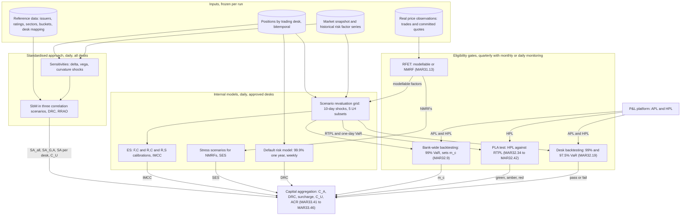
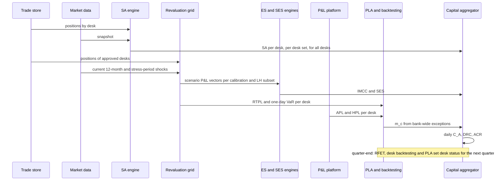
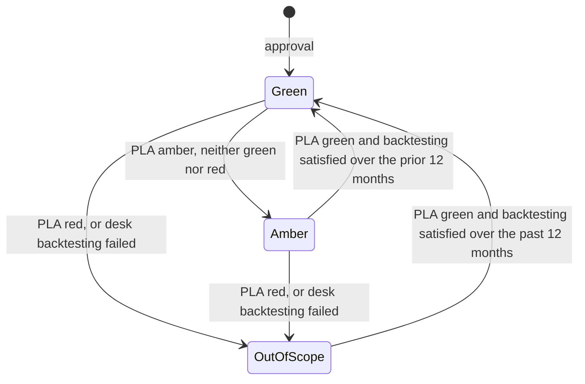

# FRTB Engine Architecture

## TL;DR

- An FRTB engine runs the standardised approach (SA: sensitivities-based method, default risk charge and residual risk add-on, MAR20.4) for every desk every day, and for internally modelled desks also the ES with liquidity horizons and stress calibration (MAR33.4 to MAR33.6), the stressed capital for non-modellable risk factors (MAR33.16, MAR33.17) and the internal default risk model (MAR33.18 to MAR33.39).
- Quarterly gates decide what may be modelled: the risk factor eligibility test (MAR31.13), desk backtesting (more than 12 exceptions at 99% or 30 at 97.5% sends a desk to SA, MAR32.19) and the P&L attribution test (green needs Spearman above 0.80 and KS below 0.09; red is Spearman below 0.70 or KS above 0.12, MAR32.42).
- Bank capital is $ACR_{total} = \min(IMA_{G,A} + \text{surcharge} + C_U, SA_{all}) + \max(0, IMA_{G,A} - SA_{G,A})$ (MAR33.43), so SA must be computed daily for all desks, for the approved desks together and for each desk standalone (for the amber surcharge factor).
- Compute is dominated by ES revaluations: 15 scenario vectors per position per day (3 calibrations by 5 liquidity-horizon subsets) gave about 1.0 billion valuations for a hypothetical 250,000-position bank, 105 cores for a 2-hour window at 0.5 ms each with 50% headroom.
- Data alignment between front-office HPL and risk-engine RTPL decides PLA outcomes: in the simulated desks an RTPL that under-scales vega P&L by half pushed KS to 0.116 (amber) with Spearman still at 0.846.
- Every number on this page is produced and asserted by [sys_frtb_engine.py](code/sys_frtb_engine.py).

## Learning objectives

- Construct the end-to-end FRTB architecture and map inputs, valuation engines, eligibility gates and capital aggregation.
- Formalise the data model linking trades, sensitivities, risk factors, liquidity horizons, scenarios, desks and capital results.
- Size the compute grid for nightly IMA and SA runs, and say which calculations may run weekly or quarterly.
- Implement the PLA test (Spearman and KS on 250 days) and the desk state transitions, with independent checks of the statistics.
- Aggregate bank capital across green, amber and out-of-scope desks under MAR33.41 to MAR33.45.

## Core concepts

### 1. Architecture

Component contracts:

| Component | Owns | Key output | Consistency requirement |
| :--- | :--- | :--- | :--- |
| Desk master | the regulatory desk structure (MAR12) and each desk's status | desk id, status (green, amber, out of scope) and effective date | status changes only at quarter-end test dates (MAR33.44) |
| Risk factor master | risk factor definitions, buckets, liquidity horizons (MAR33.12), modellability | factor id, LH, bucket, RFET result | RTPL, ES and RFET use the same factor definitions (MAR31.16) |
| SA engine | sensitivities, SbM, DRC, RRAO | SA per desk, per set of desks, for all desks | computed on the aggregated positions of each set, not summed from desks |
| ES engine | scenario P&L vectors per calibration and LH subset | IMCC(C), IMCC(C_i), IMCC | the stress period is the same for the bank-wide and risk-class ES (MAR33.15) |
| SES engine | NMRF stress scenarios | SES aggregated per MAR33.17 | stress period common within each risk class (MAR33.16) |
| PLA and backtesting | the 250-day series | statistics, zones, exception counts | HPL identical to the HPL used for backtesting (MAR32.24) |
| Aggregator | averages and the ACR formula | ACR and RWA | 60-day averages for IMCC and SES, 12-week average for DRC (MAR33.41, MAR33.22) |

### 2. Daily and quarterly cycle

### 3. Standardised approach

$K_{SA} = K_{SbM} + K_{DRC} + K_{RRAO}$ (MAR20.4), with RWA $= 12.5 \times K$.

- SbM, per risk class (GIRR, CSR non-securitisation, CSR securitisation non-CTP, CSR CTP, equity, commodity, FX) and per sensitivity type (delta, vega, curvature):

$$K_b = \sqrt{\max\Big(0, \sum_k WS_k^2 + \sum_k \sum_{l \ne k} \rho_{kl} WS_k WS_l\Big)}, \qquad K = \sqrt{\sum_b K_b^2 + \sum_b \sum_{c \ne b} \gamma_{bc} S_b S_c},$$

  where $S_b = \sum_k WS_k$, replaced by $\max(\min(\sum_k WS_k, K_b), -K_b)$ if the sum under the square root is negative (the details are in [FRTB SbM Delta](../17-Regulatory-Capital-Basel-and-FRTB/07-FRTB-Sensitivities-Based-Method-Delta.md)).
- Three correlation scenarios (MAR21.6): medium (the prescribed $\rho$, $\gamma$), high $\min(1.25\rho, 1)$ and low $\max(2\rho - 1, 0.75\rho)$; each scenario total is summed across risk classes and sensitivity types, and SbM is the largest scenario total (MAR21.7).
- Curvature: for each factor, $CVR_k^{\pm} = -\big(V(x_k^{RW\pm}) - V(x_k) \mp RW_k^{curv} s_k\big)$, the loss beyond the delta prediction under an up and a down shock; the bucket takes the worse of the up and down aggregations (MAR21.5).
- DRC: gross jump-to-default $\max(LGD \cdot N + P\&L, 0)$ for longs and $\min(LGD \cdot N + P\&L, 0)$ for shorts (MAR22.11), maturity-scaled below one year, netted per obligor only where the short is as junior as or more junior than the long, then risk-weighted by rating with a hedge benefit ratio (MAR22.15 to MAR22.24; see [DRC and RRAO](../17-Regulatory-Capital-Basel-and-FRTB/09-FRTB-Default-Risk-Charge-and-Residual-Risk-Add-On.md)).
- RRAO: gross notional times 1.0% for exotic underlyings (longevity, weather, natural disasters, future realised volatility) and 0.1% for other residual risks (gap risk, correlation risk in best-of or spread options, behavioural risk) (MAR23.3 to MAR23.8).

### 4. Internal models approach

- ES at 97.5% (MAR33.3) on a 10-day base horizon with liquidity-horizon scaling (MAR33.4):

$$ES = \sqrt{ES_T(P)^2 + \sum_{j \ge 2} \left(ES_T(P, j) \sqrt{\frac{LH_j - LH_{j-1}}{T}}\right)^2}, \qquad T = 10, \quad LH_j \in \{10, 20, 40, 60, 120\},$$

  where $ES_T(P, j)$ shocks only the factors whose liquidity horizon is at least $LH_j$.
  Examples from MAR33.12: 10 days for specified-currency interest rates, large-cap equity prices and specified FX pairs; 20 for small-cap equity prices and energy prices; 40 for IG corporate credit spreads and FX volatility; 60 for HY corporate spreads and interest rate volatility; 120 for credit spread volatility and other commodity price volatility.
- Stress calibration (MAR33.5, MAR33.6): $ES = ES_{R,S} \times ES_{F,C} / ES_{R,C}$, with the ratio floored at 1, where the reduced factor set $R$ must explain at least 75% of the full model on average over the preceding 12 weeks, and the stress period is the most severe 12 months in a history going back at least to 2007 (MAR33.7).
- IMCC blends the unconstrained ES with the sum of risk-class ES: $IMCC = \rho\, IMCC(C) + (1 - \rho) \sum_i IMCC(C_i)$ with $\rho = 0.5$ (MAR33.15); the FAQ to MAR33.15 notes this could need up to 63 daily ES calculations and allows the undiversified-to-diversified ratio to be updated weekly while $ES_{R,S}$, $ES_{F,C}$ and $ES_{R,C}$ stay daily.
- SES: each NMRF gets a stress scenario at least as prudent as the ES calibration, with liquidity horizon the larger of its MAR33.12 horizon and 20 days; idiosyncratic credit and equity NMRFs may be aggregated with zero correlation when justified, the rest with $\rho = 0.6$ (MAR33.16, MAR33.17).
- DRC model: a two-type systematic factor default simulation, 99.9% one-year VaR computed weekly, PDs floored at 0.03% (MAR33.20, MAR33.24); the requirement is the larger of the latest and the 12-week average (MAR33.22).
- Approved-desk capital: $C_A = \max(IMCC_{t-1} + SES_{t-1},\ m_c\,IMCC_{avg} + SES_{avg})$ with 60-day averages and $m_c = 1.5$ plus a backtesting add-on of 0 to 0.5 (MAR33.41, MAR33.42); $IMA_{G,A} = C_A + DRC$ (MAR33.43).

### 5. Gates

| Test | Unit | Frequency | Window | Pass | Consequence |
| :--- | :--- | :--- | :--- | :--- | :--- |
| RFET (MAR31.13) | risk factor | assessed quarterly, criterion 1 monitored monthly | 12 months | at least 24 real price observations a year with no 90-day period under 4, or at least 100 in 12 months, at most one counted per day | non-modellable factors go to SES |
| Bank-wide backtesting (MAR32.5, MAR32.9) | bank | daily | 250 days | exceptions of 99% one-day VaR against APL and HPL, larger count | $m_c$ 1.50 for 0 to 4 exceptions, 1.70 to 1.92 for 5 to 9, 2.00 for 10 or more |
| Desk backtesting (MAR32.16 to MAR32.19) | desk | daily, applied to desk status quarterly (MAR33.44) | 12 months | at most 12 exceptions at 99% and at most 30 at 97.5% (the text: "more than 12 exceptions at the 99th percentile or 30 exceptions at the 97.5th percentile") | desk capitalised under SA |
| PLA (MAR32.35 to MAR32.44) | desk | quarterly (MAR33.44) | 250 days | green: Spearman above 0.80 and KS below 0.09 | amber: surcharge; red: desk goes to SA ($C_U$) |

The PLA statistics (MAR32.36 to MAR32.41): Spearman correlation of the rank series of HPL and RTPL, and the KS statistic, the largest absolute difference between the two empirical CDFs, each defined as $0.004$ times the count of observations at or below a value.
With 250 observations in each series, KS is always a whole multiple of $0.004$; $0.09$ is $22.5$ steps and cannot be hit exactly, but $0.12$ is exactly $30$ steps, so a KS of $0.12$ is attainable and, because red requires KS above 0.12, it is amber.
MAR32.42 quotes p-values of 0.264 and 0.055 for the two KS thresholds; the asymptotic two-sample formula gives 0.2634 and 0.0546.

### 6. Capital aggregation

$$ACR_{total} = \min\left(IMA_{G,A} + \text{surcharge} + C_U,\ SA_{all}\right) + \max\left(0,\ IMA_{G,A} - SA_{G,A}\right)$$

$$\text{surcharge} = k \max(0, SA_{G,A} - IMA_{G,A}), \qquad k = 0.5 \frac{\sum_{i \in \text{amber}} SA_i}{\sum_{i \in \text{green, amber}} SA_i}$$

where $C_U$ is SA on the positions of out-of-scope and ineligible desks (MAR33.40), $SA_{G,A}$ and $SA_{all}$ are SA computed on the combined positions of the approved desks and of all desks, and $SA_i$ is each approved desk's standalone SA (MAR33.43, MAR33.45).
At least 10% of the bank's aggregate market risk capital must come from desks that qualify for the internal model, assessed quarterly (MAR32.2).
RWA is $12.5 \times ACR_{total}$ (MAR33.46).

## Worked examples

All positions, unit costs, desk series and capital inputs are labelled-hypothetical.

### Example 1: sizing the nightly run

Inputs: 250,000 positions on approved desks, 250 scenarios per ES window, 0.5 ms per valuation.

- ES: 3 calibrations ($F,C$, $R,C$, $R,S$) by 5 liquidity-horizon subsets is $15$ scenario vectors per position, $937,500,000$ revaluations a day (an upper bound: a position has no factors in some subsets).
- One-day VaR on current data for desk and bank backtesting: $62,500,000$; RTPL: one revaluation per position.
- SA: adjoint sensitivities at a hypothetical cost of 4 valuations per position, $1,000,000$; curvature for 50,000 options with 1.5 factors and two shocks each, $150,000$.
- NMRF stress scenarios: 3,500 scenarios each revaluing 40 exposed positions up and down, $280,000$.
- Total $1,001,680,000$ valuations: $139.1$ CPU hours, $69.6$ cores for a 2-hour window, $105$ cores with 50% headroom.
- Risk-class partial ES may move to a weekly cycle (MAR33.15 FAQ): only positions exposed to more than one risk class need extra revaluations; if 20% of positions span two classes, that is $375,000,000$ revaluations a week.

The lesson for design: the ES vectors dominate, so the grid's unit of work is (position block, scenario set, LH subset), results are written as vectors keyed by those ids, and everything else (SA, NMRF, backtesting) is small beside it.

### Example 2: the PLA test on three desks

Each desk has 250 days of HPL and RTPL generated with a fixed seed; the RTPL misses a basis factor and, for two desks, mis-scales vega P&L.

| Desk | What RTPL gets wrong | Spearman | KS (steps of 0.004) | Zone |
| :--- | :--- | :--- | :--- | :--- |
| Rates | small missing basis | $0.981$ | $0.060$ (15) | green |
| FX options | basis plus vega P&L at half size | $0.846$ | $0.116$ (29) | amber |
| Credit | large missing basis plus vega P&L at 40% | $0.707$ | $0.136$ (34) | red |

Spearman is computed both from the rank-difference formula and as Pearson correlation of the ranks; KS both by a merge of the sorted series and by evaluating the MAR32.39 definition at every observation.
The FX desk shows why both metrics exist: the ranks still agree (0.846) but the distributions differ in scale, which KS catches.
The credit desk fails on KS alone; Spearman 0.707 is just above the red threshold.

### Example 3: capital through three quarters

Inputs in millions of dollars; standalone SA of the approved desks: rates 120, FX 45, credit 35.

1. Quarter 1, all green: $IMCC_{t-1} = 40$, $IMCC_{avg} = 38$, $SES_{t-1} = 8$, $SES_{avg} = 7.5$, $m_c = 1.5$, so $C_A = \max(48, 64.5) = 64.5$; DRC $\max(12, 11) = 12$; $IMA_{G,A} = 76.5$.
   With $SA_{G,A} = 190$, $SA_{all} = 235$ and an out-of-scope desk $C_U = 50$: $ACR = \min(76.5 + 0 + 50, 235) + 0 = 126.5$, RWA $1,581.25$.
2. Quarter 2, FX options amber (as in Example 2): $k = 0.5 \times 45/200 = 0.1125$, surcharge $0.1125 \times (190 - 76.5) = 12.77$, $ACR = 139.27$.
3. Quarter 3, credit red: its positions join $C_U$, recomputed on the combined out-of-scope positions as 82 (not $50 + 35$: SA is not additive); the internal model is rerun on rates and FX: $C_A = \max(40, 55.0) = 55.0$, DRC 6, $IMA_{G,A} = 61.0$; $SA_{G,A} = 160$; $k = 0.5 \times 45/165 = 0.1364$; surcharge $13.50$; $ACR = \min(61 + 13.5 + 82, 235) = 156.50$, $30.00$ above quarter 1.
4. The two edges of the formula: with $IMA_{G,A} = 155$ the first term would be $237.68$ and is capped at $SA_{all} = 235.0$; with $IMA_{G,A} = 170$ above $SA_{G,A} = 160$, the surcharge is zero and the excess is added back, $235 + 10 = 245.0$.

## Pitfalls

- **Summing desk SA.** $SA_{G,A}$, $SA_{all}$ and $C_U$ are SA computed on combined positions; diversification inside SbM and DRC netting make them different from sums of desk figures.
- **HPL and RTPL from different snapshots or positions.** This is the commonest cause of artificial PLA failures; align RTPL input data to HPL where MAR32.30 to MAR32.32 allow, never the reverse.
- **KS values that are not multiples of 0.004.** With two 250-day series that means missing or duplicated days or unequal samples.
- **Treating KS 0.12 as red.** Red is strictly above 0.12, and 0.12 is attainable (30 steps).
- **Point-in-time RFET.** Observation counts must be tracked continuously (monthly monitoring) so a factor's status does not flip unexpectedly at quarter-end.
- **Confusing the two backtests.** Bank-wide exceptions set $m_c$; desk-level failures move the desk to SA.
- **Forgetting DRC in IMA.** $IMA_{G,A} = C_A + DRC$; comparing $C_A$ alone with SA understates internal capital.
- **One stress period per engine.** The risk-class ES must use the same stress period as the bank-wide ES (MAR33.15), so the stress-period search and the reduced factor set are bank-level reference data, updated at least quarterly (MAR33.7, MAR33.44).

## Interview questions

> [!question]- sys-10-01 | What are the components of the FRTB standardised approach?
> The sensitivities-based method (delta, vega and curvature across seven risk classes), the default risk charge and the residual risk add-on, summed: $K_{SA} = K_{SbM} + K_{DRC} + K_{RRAO}$ (MAR20.4).
> RWA is $12.5 \times K_{SA}$.

> [!question]- sys-10-02 | Why is SbM computed under three correlation scenarios?
> Correlations estimated in normal markets are unreliable in stress, and a hedged book is hurt by falling correlations while a directional book is hurt by rising ones.
> SbM is computed with medium (prescribed), high $\min(1.25\rho, 1)$ and low $\max(2\rho - 1, 0.75\rho)$ correlations, each summed across risk classes, and the largest total is the charge (MAR21.6, MAR21.7).

> [!question]- sys-10-03 | What is the risk factor eligibility test?
> A risk factor is modellable if it has at least 24 real price observations a year with no 90-day period with fewer than 4, or at least 100 observations in 12 months, counting at most one a day (MAR31.13).
> Factors that fail are non-modellable: they leave the ES model and are capitalised through stress scenarios (SES).

> [!question]- sys-10-04 | How are non-modellable risk factors capitalised?
> Each NMRF gets a stress scenario at least as prudent as the ES calibration, with a liquidity horizon of at least 20 days (MAR33.16).
> Idiosyncratic credit and equity NMRFs may be aggregated with zero correlation when the bank shows that is appropriate; the rest aggregate with $\rho = 0.6$ (MAR33.17).
> SES enters $C_A$ alongside IMCC but is not multiplied by $m_c$.

> [!question]- sys-10-05 | What do the Spearman and KS metrics in the PLA test each detect?
> Spearman, the correlation of the rank series of HPL and RTPL, detects whether the risk model orders days the same way, that is whether it captures the right drivers.
> KS, the largest gap between the two empirical CDFs, detects whether the distributions agree, including scale; in Example 2 the FX desk kept Spearman at 0.846 but KS reached 0.116.
> Green needs both: Spearman above 0.80 and KS below 0.09 (MAR32.42).

> [!question]- sys-10-06 | What happens when a desk is in the PLA amber zone?
> It stays on the internal model, but the bank pays a surcharge $k \max(0, SA_{G,A} - IMA_{G,A})$ with $k = 0.5 \sum_{amber} SA_i / \sum_{green, amber} SA_i$ (MAR33.45).
> It returns to green only after a green PLA result and satisfactory backtesting over the prior 12 months (MAR32.44).

> [!question]- sys-10-07 | What sends a desk from the internal model to the standardised approach?
> A PLA red result (Spearman below 0.70 or KS above 0.12, MAR32.43), or desk backtesting with more than 12 exceptions at 99% or 30 at 97.5% in the last 12 months (MAR32.19).
> It stays out of scope until it produces a green PLA result and has satisfied backtesting over the past 12 months (MAR32.43).

> [!question]- sys-10-08 | How does the liquidity-horizon cascade work in FRTB ES?
> Each risk factor gets a liquidity horizon of 10, 20, 40, 60 or 120 days (MAR33.12); $ES_T(P, j)$ shocks only factors with horizon at least $LH_j$ over a 10-day base.
> $ES = \sqrt{ES_T(P)^2 + \sum_{j \ge 2} (ES_T(P, j)\sqrt{(LH_j - LH_{j-1})/10})^2}$, so longer-horizon factors are counted again with weight growing with the extra time (MAR33.4).

> [!question]- sys-10-09 | Why use a reduced set of risk factors for the stress calibration?
> The stress period must be found in a history going back at least to 2007 (MAR33.7), and many current factors have no data that far back.
> The bank computes ES on a reduced set $R$ over the stress period and scales by the current full-to-reduced ratio, floored at 1: $ES = ES_{R,S} \times ES_{F,C}/ES_{R,C}$; $R$ must explain at least 75% of the full ES on average over the preceding 12 weeks (MAR33.5, MAR33.6).

> [!question]- sys-10-10 | How is SbM curvature computed?
> For each factor, apply the curvature risk weight up and down and subtract the delta prediction: $CVR_k^{\pm} = -(V(x_k^{RW\pm}) - V(x_k) \mp RW_k s_k)$, the loss beyond what delta explains.
> Aggregate within the bucket separately for up and down shocks and take the worse (MAR21.5); it costs two revaluations per curvature factor.

> [!question]- sys-10-11 | Which SA numbers must an IMA bank compute daily, and why?
> SA for all desks ($SA_{all}$), for the approved desks together ($SA_{G,A}$), for the out-of-scope desks ($C_U$), and for each approved desk standalone ($SA_i$).
> The ACR formula needs the first three, the amber surcharge factor $k$ needs the standalone figures, and each is computed on the combined positions of its set, not summed.

> [!question]- sys-10-12 | What values can the KS statistic take in a 250-day PLA test, and why does it matter?
> Each empirical CDF moves in steps of $1/250 = 0.004$, so KS is a whole number of steps; a value that is not means missing, duplicated or misaligned days.
> 0.09 is 22.5 steps and cannot occur, but 0.12 is exactly 30 steps and can; since red requires KS above 0.12, a KS of exactly 0.12 is amber.

> [!question]- sys-10-13 | When comparing a desk's IMA and SA capital, which IMA component is most often forgotten?
> The default risk charge from the internal DRC model: approved-desk capital is $IMA_{G,A} = C_A + DRC$ (MAR33.43).
> Leaving it out makes the internal model look cheaper than it is.

> [!question]- sys-10-14 | Size the daily ES revaluations for 250,000 positions with 250 scenarios.
> Three calibrations ($F,C$; $R,C$; $R,S$) times five liquidity-horizon subsets is 15 scenario vectors per position, so $250,000 \times 250 \times 15 = 937.5$ million revaluations a day, an upper bound because some subsets are empty for a given position.
> At 0.5 ms each, with backtesting VaR, SA and NMRFs added, that is 139.1 CPU hours, 69.6 cores for a 2-hour window.

> [!question]- sys-10-15 | A desk moves from green to amber. Walk through the capital effect.
> Nothing changes in $IMA_{G,A}$, but the surcharge appears: with standalone SA of 120, 45 and 35 and the 45 desk amber, $k = 0.5 \times 45/200 = 0.1125$; with $SA_{G,A} = 190$ and $IMA_{G,A} = 76.5$ the surcharge is 12.77 and ACR rises from 126.5 to 139.27.
> The min with $SA_{all}$ caps the effect at SA for all desks.

> [!question]- sys-10-16 | Which IMCC inputs must be daily and which may be weekly?
> $ES_{R,S}$, $ES_{F,C}$ and $ES_{R,C}$ for the bank-wide model are daily; the ratio of the undiversified sum of risk-class ES to the diversified ES may be updated weekly under controls that prevent systematic underestimation (MAR33.15 FAQ1).
> The DRC model is computed weekly (MAR33.20), and the 60-day and 12-week averages only need computing at quarter-end for the capital figure (MAR33.44).

## In this repo and SDE-Interview-Prep

- [sys_frtb_engine.py](code/sys_frtb_engine.py) computes, prints and asserts every number on this page, with Spearman and KS each computed two independent ways.
- The rules in depth: [FRTB SbM Delta](../17-Regulatory-Capital-Basel-and-FRTB/07-FRTB-Sensitivities-Based-Method-Delta.md), [SbM Vega and Curvature](../17-Regulatory-Capital-Basel-and-FRTB/08-FRTB-Sensitivities-Based-Method-Vega-and-Curvature.md), [DRC and RRAO](../17-Regulatory-Capital-Basel-and-FRTB/09-FRTB-Default-Risk-Charge-and-Residual-Risk-Add-On.md), [IMA ES](../17-Regulatory-Capital-Basel-and-FRTB/10-FRTB-Internal-Model-Approach-ES.md), [NMRFs](../17-Regulatory-Capital-Basel-and-FRTB/11-FRTB-Non-Modellable-Risk-Factors.md), [Backtesting and PLA](../17-Regulatory-Capital-Basel-and-FRTB/12-FRTB-Backtesting-and-PLA-Testing.md).
- [P&L Platform](09-PnL-Platform.md) for HPL and APL, [Pricing at Scale](06-Pricing-at-Scale.md) for the grid, [EOD Risk Batch](13-EOD-Risk-Batch.md) for scheduling.

## Further reading

- Basel Committee on Banking Supervision, Basel Framework, MAR20 to MAR23 (standardised approach) and MAR30 to MAR33 (internal models approach), version effective 1 January 2023.
- Basel Committee on Banking Supervision, *Minimum capital requirements for market risk*, d457, 14 January 2019, corrected version 25 February 2019.
- Savine, A., *Modern Computational Finance: AAD and Parallel Simulations*, Wiley, 2018.
