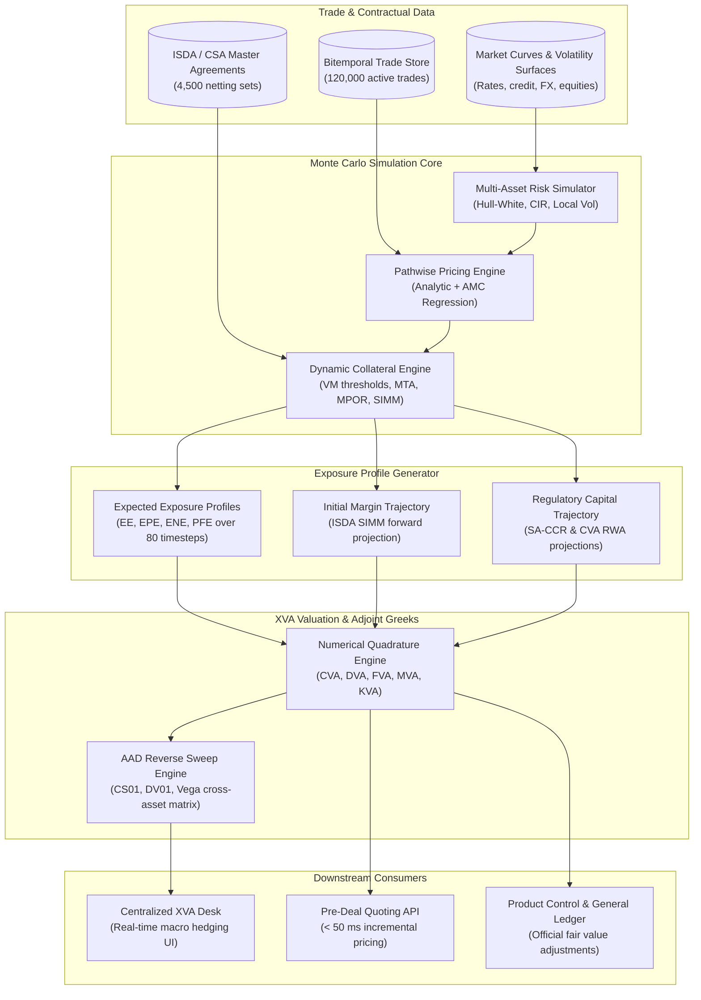

# XVA Engine Architecture

## TL;DR

- The enterprise XVA engine calculates balance sheet valuation adjustments for counterparty credit, funding, and capital across bilateral and cleared derivative portfolios: Credit Valuation Adjustment (CVA), Debit Valuation Adjustment (DVA), Funding Valuation Adjustment (FVA), Margin Valuation Adjustment (MVA), and Capital Valuation Adjustment (KVA).
- Unlike single-trade valuation, XVA must be evaluated across entire netting sets governed by ISDA Master Agreements and Credit Support Annexes (CSAs), accounting for contractual close-out netting, collateral thresholds, minimum transfer amounts, and Margin Period of Risk (MPOR) liquidation lags.
- The simulation architecture combines multi-asset Monte Carlo path generation with forward portfolio revaluations using analytical formulas and American Monte Carlo (AMC / Longstaff-Schwartz) cross-sectional regressions.
- Streaming aggregation reduces raw Monte Carlo trade valuation grids from hundreds of gigabytes down to compact megabyte-scale Expected Exposure vectors in resident memory.
- Centralized XVA desks actively manage macro hedges (CDS indices, interest rate swaps, cross-currency basis) using Adjoint Algorithmic Differentiation (AAD) to extract thousands of cross-asset Greeks in a single reverse sweep.
- All numerical figures in this note are verified by [sys_xva_engine.py](code/sys_xva_engine.py).

## Learning objectives

- Design an enterprise XVA simulation architecture integrating multi-asset Monte Carlo engines, dynamic CSA collateral logic, and regulatory capital models.
- Implement pathwise portfolio revaluation using American Monte Carlo (AMC / Longstaff-Schwartz) regression to avoid nested simulation explosions.
- Model realistic bilateral collateral cashflows incorporating Variation Margin (VM) thresholds, minimum transfer amounts, and Margin Period of Risk (MPOR) gap risk.
- Formulate continuous and discrete numerical quadrature algorithms for CVA, DVA, FVA, MVA, and KVA.
- Quantify compute grid requirements, pathwise memory footprints, and streaming aggregation savings across institutional netting set populations.
- Implement Adjoint Algorithmic Differentiation (AAD) pipelines to compute real-time cross-asset sensitivity matrices for active XVA hedging.

## Core concepts

### 1. The XVA Family of Valuation Adjustments

XVA encompasses the financial adjustments required to bridge idealized Black-Scholes risk-free pricing with real-world balance sheet realities:

| Valuation Adjustment | Economic Driver | Primary Cashflow / Exposure Basis | Primary Hedge Instruments |
| :--- | :--- | :--- | :--- |
| **CVA (Credit)** | Counterparty default risk | Expected Positive Exposure ($EPE$) | Single-name CDS, CDX / iTraxx indices |
| **DVA (Debit)** | Own bank default risk (own credit benefit) | Expected Negative Exposure ($ENE$) | Bank's own debt buybacks (unhedgeable) |
| **FVA (Funding)** | Uncollateralized borrowing and lending costs | Net funding balance $\times$ funding spread | Cross-currency basis swaps, repo financing |
| **MVA (Margin)** | Financing cost of posting Initial Margin (IM) | Projected ISDA SIMM profile | Short-term financing, collateral optimization |
| **KVA (Capital)** | Cost of holding regulatory capital (Basel RWA) | Projected regulatory RWA (SA-CCR / CVA) | Capital relief trades, synthetic securitizations |

### 2. XVA Engine Architecture

### 3. Mathematical Formulation of CVA, DVA, and FVA

#### Bilateral Credit Valuation Adjustment (CVA)
Under independent default assumptions:

$$\text{CVA} = (1 - R_{\text{cpty}}) \int_0^T D(0, t) \, \mathbb{E}^{\mathbb{Q}}\left[ (V(t) - C(t))^+ \right] dPD_{\text{cpty}}(t)$$

Where:
- $R_{\text{cpty}}$ is the counterparty recovery rate ($1 - R_{\text{cpty}} = \text{LGD}$).
- $D(0, t) = e^{-\int_0^t r(s) ds}$ is the risk-free discount factor.
- $\text{EE}^*(t) = \mathbb{E}^{\mathbb{Q}}[(V(t) - C(t))^+]$ is the Expected Positive Exposure accounting for collateral $C(t)$.
- $dPD_{\text{cpty}}(t) = \lambda_C(t) e^{-\int_0^t \lambda_C(s) ds} dt$ is the marginal probability of counterparty default.

#### Funding Valuation Adjustment (FVA)
Decomposed into Funding Cost Adjustment (FCA) and Funding Benefit Adjustment (FBA):

$$\text{FVA} = \int_0^T D(0, t) \left( s_{\text{borrow}}(t) \mathbb{E}^{\mathbb{Q}}[(V(t) - C(t))^+] - s_{\text{lend}}(t) \mathbb{E}^{\mathbb{Q}}[(C(t) - V(t))^+] \right) dt$$

Under standard asymmetric funding conventions, excess cash earns the risk-free collateral rate ($s_{\text{lend}} = 0$), setting FBA to zero.

### 4. American Monte Carlo (AMC) for Path-Dependent Portfolios

Pricing early-exercise contracts (Bermudan swaptions, barrier options) at future simulation nodes $t_k$:
- **Nested Monte Carlo (Brute Force):** Simulating $10,000$ secondary sub-paths from each of the $10,000$ primary nodes requires $10,000 \times 10,000 = 100,000,000$ valuations per timestep, which is computationally intractable.
- **American Monte Carlo (Longstaff-Schwartz Regression):**
  At each future time step $t_k$, the continuation value $C(t_k)$ is estimated across all simulation paths simultaneously by projecting realized discounted future cashflows onto a basis of cross-sectional state variables $\mathbf{X}_k$:

$$\mathbb{E}\left[ V(t_{k+1}) \mid \mathbf{X}_k \right] \approx \sum_{m=1}^M \beta_m \, \psi_m(\mathbf{X}_k)$$

Regression coefficients $\mathbf{\beta}$ are solved via Ordinary Least Squares (OLS) in $O(M^2 N)$ time, enabling pathwise portfolio revaluation at full Monte Carlo scale.

## Worked examples

### Example 1: Simulation Grid Sizing and Streaming Memory Optimization

An enterprise XVA engine sizes its compute grid and memory architecture for a global dealer:
- Total derivative portfolio: $120,000\text{ active trades}$.
- Netting sets: $4,500\text{ legal agreements}$.
- Monte Carlo paths: $10,000\text{ paths}$.
- Time grid: $80\text{ discrete time buckets}$ spanning 30 years.

Grid Dimensions and Raw Trade Memory:
- Number of simulated path-time points: $10,000 \times 80 = 800,000\text{ scenario points}$.
- Storing raw trade mark-to-market values in double precision (`float64`, 8 bytes):

$$\text{Raw Trade Data} = 120,000 \times 800,000 \times 8\text{ bytes} = 768,000,000,000\text{ bytes} \approx 768.0\text{ GB}$$

Streaming Aggregation Memory Optimization:
- To eliminate the need for $768\text{ GB}$ of distributed memory, trades are partitioned by netting set:
  $1$. Trade mark-to-market values are evaluated for netting set $k$.
  $2$. Values are summed across trades within the netting set on-the-fly.
  $3$. Dynamic CSA collateral rules ($C(t)$) are evaluated.
  $4$. The netting set uncollateralized exposure array ($10,000\text{ paths} \times 80\text{ timesteps} \times 8\text{ bytes} = 6.4\text{ MB}$) is averaged across paths to generate a single scalar Expected Exposure vector ($80\text{ floats} = 640\text{ bytes}$).
  $5$. Intermediate path matrices are immediately freed from RAM.
- Total resident memory across all 4,500 netting sets:

$$\text{Optimized Resident Memory} = 4,500 \times 640\text{ bytes} = 2,880,000\text{ bytes} \approx 2.88\text{ MB}$$

Streaming aggregation achieves a $266,666\times$ memory reduction, allowing the enterprise exposure database to fit in CPU cache.

### Example 2: Bilateral CVA Calculation with Flat Hazard Rate

A bank holds an uncollateralized interest rate swap with a corporate counterparty:
- Netting set maturity: $T = 3\text{ years}$.
- Counterparty credit rating: BBB ($R_{\text{cpty}} = 40\% \implies \text{LGD} = 60\% = 0.60$).
- Constant CDS spread: $S_{\text{cds}} = 150\text{ bps} = 0.0150$.
- Implied hazard rate ($\lambda$):

$$\lambda = \frac{S_{\text{cds}}}{1 - R} = \frac{0.0150}{0.60} = 0.0250\text{ per year (2.50\%)}$$

- Risk-free discount rate: flat $r = 4.0\%$.
- The Monte Carlo engine evaluates Expected Exposure $\text{EE}(t)$ across 3 annual buckets:

| Year ($t_i$) | Discount Factor $D(0, t_i)$ | Expected Exposure $\text{EE}(t_i)$ | Marginal Default Prob $\Delta PD(t_i)$ | Discounted Expected Loss |
| :--- | :--- | :--- | :--- | :--- |
| **Year 1** | $e^{-0.04 \times 1} \approx 0.9608$ | $\$1,200,000$ | $1 - e^{-0.025 \times 1} \approx 0.02469$ | $0.60 \times e^{-0.04} \times 1,200,000 \times (1 - e^{-0.025}) = \$17,079.82$ |
| **Year 2** | $e^{-0.04 \times 2} \approx 0.9231$ | $\$1,800,000$ | $e^{-0.025} - e^{-0.050} \approx 0.02408$ | $0.60 \times e^{-0.08} \times 1,800,000 \times (e^{-0.025} - e^{-0.050}) = \$24,007.42$ |
| **Year 3** | $e^{-0.04 \times 3} \approx 0.8869$ | $\$950,000$ | $e^{-0.050} - e^{-0.075} \approx 0.02349$ | $0.60 \times e^{-0.12} \times 950,000 \times (e^{-0.050} - e^{-0.075}) = \$11,873.19$ |

Total Portfolio CVA:

$$\text{CVA} = \$17,079.82 + \$24,007.42 + \$11,873.19 = \$52,960.43$$

At trade execution, the sales desk charges the client an upfront CVA fee of $\$52,960.43$ (or widens the swap fixed rate) to compensate for default risk.

### Example 3: MVA Calculation for Uncleared Swaps under ISDA SIMM

A dealer executes an uncleared derivative subject to mandatory bilateral Initial Margin under Uncleared Margin Rules (UMR):
- The bank must post bilateral Initial Margin (IM) calculated via the ISDA SIMM model over the 5-year trade lifespan.
- Bank's unsecured funding spread for high-quality liquid assets (HQLA) posted as margin: $s_{\text{margin}} = 75\text{ bps} = 0.0075$ per year.
- Projected Initial Margin trajectory $\mathbb{E}[\text{IM}(t_i)]$ across annual timesteps:
  - Year 1: $\$5,000,000$
  - Year 2: $\$4,200,000$
  - Year 3: $\$3,100,000$
  - Year 4: $\$1,800,000$
  - Year 5: $\$600,000$
- Discount factors: $D = [0.9608, 0.9231, 0.8869, 0.8521, 0.8187]$.

Discrete MVA Formulation:

$$\text{MVA} = \sum_{i=1}^5 D(0, t_i) \, s_{\text{margin}} \, \mathbb{E}[\text{IM}(t_i)] \, \Delta t_i$$

Component breakdown:
- Year 1: $0.9608 \times 0.0075 \times \$5,000,000 = \$36,030.00$.
- Year 2: $0.9231 \times 0.0075 \times \$4,200,000 = \$29,077.65$.
- Year 3: $0.8869 \times 0.0075 \times \$3,100,000 = \$20,620.42$.
- Year 4: $0.8521 \times 0.0075 \times \$1,800,000 = \$11,503.35$.
- Year 5: $0.8187 \times 0.0075 \times \$600,000 = \$3,684.15$.

Total Margin Valuation Adjustment (MVA):

$$\text{MVA} = \$36,030.00 + \$29,077.65 + \$20,620.42 + \$11,503.35 + \$3,684.15 = \$100,915.57$$

Even though the counterparty exchanges daily Variation Margin (making CVA negligible), the segregated Initial Margin imposes $\$100,915.57$ in funding drag over the life of the swap.

## Pitfalls

- **Neglecting Wrong-Way Risk (WWR):** Assuming independence between counterparty default probability and portfolio exposure severely underestimates CVA; buying protection on subprime mortgages from a monoline insurer creates massive specific WWR.
- **Ignoring Margin Period of Risk (MPOR):** Assuming collateral completely eliminates exposure ignores the liquidation window; during the 10-to-20 business day MPOR, market prices continue to move while margin calls go unheeded.
- **Double Counting DVA and Own Funding Benefits:** Booking positive DVA as distributable trading profit allows banks to report accounting profits when their own credit rating is downgraded; regulators strictly deduct DVA equity gains from Common Equity Tier 1 capital.
- **Using Brute-Force Finite Differences for XVA Greeks:** Bumping thousands of market risk factors across full Monte Carlo XVA simulations is computationally impossible; engines must use AAD to extract the full sensitivity matrix in a single reverse sweep.
- **Overlooking Rehypothecation Rules:** If a CSA permits rehypothecating client collateral, the bank can use received variation margin to fund outgoing margin calls, reducing FVA; assuming zero rehypothecation when legally permitted overstates funding costs.

## Interview questions

> [!question]- sys-11-01 | What is the fundamental difference between CVA and DVA?
> CVA is the expected cost of default losses caused by a counterparty defaulting while the portfolio is in-the-money to the bank.
> DVA is the mirror image: the economic value to the bank of defaulting on its own obligations while the portfolio is out-of-the-money (in-the-money to the counterparty).

> [!question]- sys-11-02 | How does American Monte Carlo (Longstaff-Schwartz) overcome the computational intractability of pricing Bermudan options inside XVA?
> Nested Monte Carlo requires simulating paths within paths at every time step ($O(N^2)$), which is computationally impossible for portfolios.
> Longstaff-Schwartz uses cross-sectional Ordinary Least Squares (OLS) regression across all existing paths to estimate conditional continuation values, reducing complexity to $O(N)$.

> [!question]- sys-11-03 | What is Margin Period of Risk (MPOR) and why is it critical in collateralized CVA?
> MPOR is the time elapsed between the last successful collateral exchange and the final close-out and re-hedging of defaulting contracts (typically 10 to 20 business days).
> It captures the uncollateralized market risk exposure that accumulates during default notice periods, legal grace periods, and market liquidation.

> [!question]- sys-11-04 | What is Margin Valuation Adjustment (MVA)?
> MVA is the expected funding cost of posting bilateral Initial Margin (IM) required under Uncleared Margin Rules (UMR) or central clearing over the life of a transaction.
> Because IM is segregated and cannot be rehypothecated, it creates an ongoing funding drag equal to the bank's unsecured spread.

> [!question]- sys-11-05 | What is Wrong-Way Risk (WWR) versus Right-Way Risk (RWR)?
> Wrong-Way Risk occurs when exposure to a counterparty is positively correlated with the counterparty's probability of default (e.g., buying equity puts from an issuer on its own stock).
> Right-Way Risk occurs when exposure is negatively correlated with default risk (e.g., selling oil protection to an oil producer).

> [!question]- sys-11-06 | Why do banks operate a centralized XVA trading desk?
> Flow trading desks specialize in specific assets (rates, equities, FX) and cannot manage cross-asset counterparty credit and funding risks effectively.
> A centralized XVA desk aggregates netting sets firm-wide, prices incremental XVA to sales desks, and executes macro hedges (CDS indices, interest rate swaps) to neutralize firm-wide balance sheet drag.

> [!question]- sys-11-07 | How does Adjoint Algorithmic Differentiation (AAD) enable active CVA hedging?
> CVA depends on hundreds of risk factors across credit curves, yield curves, and volatility surfaces.
> AAD computes sensitivities to all inputs in a single reverse sweep across the simulation paths, allowing the XVA desk to observe intraday Greeks and rebalance hedges in real time.

> [!question]- sys-11-08 | What is the relationship between FVA and DVA in asymmetric funding models?
> If a bank can fund itself at its own credit spread, FVA and DVA partially offset.
> However, under the asymmetric funding convention used here, the bank pays an unsecured borrowing spread ($s_{\text{borrow}} > 0$) on positive funding needs (FCA) and earns only risk-free rates on excess cash ($s_{\text{lend}} = 0$), so there is no spread-based FBA to offset DVA.

> [!question]- sys-11-09 | What is the ISDA Standard Initial Margin Model (SIMM)?
> ISDA SIMM is a standardized, sensitivity-based mathematical methodology used across global financial institutions to calculate bilateral Initial Margin for uncleared derivatives.
> It aggregates Delta, Vega, and Curvature across asset classes using prescribed supervisory correlation matrices.

> [!question]- sys-11-10 | Why is DVA excluded from regulatory Common Equity Tier 1 (CET1) capital?
> When a bank's own credit spread widens (its default probability rises), the accounting value of its liabilities falls, generating an accounting gain via DVA.
> Regulators require deducting this gain from CET1 capital because a distressed bank cannot monetize its own credit deterioration to pay depositors or absorb losses as a going concern.

## Further reading

- Green, Andrew. *XVA: Credit, Funding and Capital Valuation Adjustments*. John Wiley & Sons, 2015.
- Gregory, Jon. *The xVA Challenge: Counterparty Risk, Funding, Collateral, Capital and Initial Margin*. 4th Edition, John Wiley & Sons, 2020.
- Longstaff, Francis A. and Schwartz, Eduardo S. *Valuing American Options by Simulation: A Simple Least-Squares Approach*. The Review of Financial Studies, 2001.
- Brigo, Damiano, Morini, Massimo, and Pallavicini, Andrea. *Counterparty Credit Risk, Collateral and Funding: With Pricing Cases for All Asset Classes*. John Wiley & Sons, 2013.
