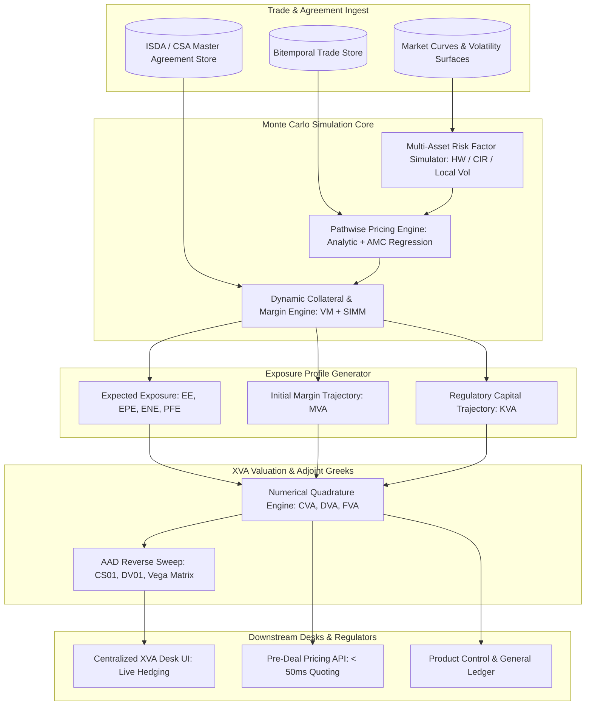

# XVA Engine Architecture

## TL;DR

The XVA engine is the valuation and risk management platform responsible for calculating portfolio-level adjustments to derivative contracts: Credit Valuation Adjustment (CVA), Debit Valuation Adjustment (DVA), Funding Valuation Adjustment (FVA), Margin Valuation Adjustment (MVA), and Capital Valuation Adjustment (KVA).
Unlike standalone trade pricing, XVA must be evaluated across entire netting sets governed by ISDA Master Agreements and Credit Support Annexes (CSAs).
The core computational engine generates joint multi-asset market risk paths, evaluates future portfolio mark-to-market distributions forward in time (using analytical formulas or American Monte Carlo regression), models dynamic collateral exchanges with Margin Period of Risk (MPOR) lags, and numerically integrates expected exposure against default hazard rates.
To manage the resulting balance sheet volatility, modern investment banks establish a centralized XVA trading desk that prices pre-deal charges to flow desks and actively macro-hedges counterparty credit spreads, funding costs, and market Greeks using Adjoint Algorithmic Differentiation (AAD).

## Learning objectives

- Design an enterprise XVA architecture integrating netting sets, multi-asset Monte Carlo simulation, and dynamic CSA collateral rules.
- Implement pathwise portfolio revaluation using American Monte Carlo (AMC / Longstaff-Schwartz) regression techniques.
- Model realistic collateral cashflows incorporating thresholds ($\text{TH}$), minimum transfer amounts ($\text{MTA}$), margin call frequencies, and Margin Period of Risk ($\text{MPOR}$) lags.
- Formulate the integral equations for CVA, DVA, FVA, MVA, and KVA across continuous and discrete simulation grids.
- Architect high-throughput AAD sensitivity pipelines to compute cross-asset Greeks (CS01, DV01, Vega) for active XVA desk hedging.
- Quantify compute grid requirements, pathwise memory footprints, and pre-deal quoting SLA budgets.

## Core concepts

### 1. The XVA Ecosystem and Metric Decomposition

XVA encompasses the financial adjustments required to bridge idealized Black-Scholes risk-free pricing with real-world balance sheet realities:

```
+----------------------------------------------------------------------------------------------------+
| Valuation Adjustment| Economic Driver                            | Cashflow / Exposure Basis       |
+----------------------------------------------------------------------------------------------------+
| CVA (Credit)        | Counterparty default risk                  | Expected Positive Exposure (EPE)|
| DVA (Debit)         | Own bank default risk (own credit benefit) | Expected Negative Exposure (ENE)|
| FVA (Funding)       | Cost of funding uncollateralized VM        | Net funding balance $\times$ spread|
| MVA (Margin)        | Cost of funding dynamic Initial Margin (IM)| Projected ISDA SIMM profile     |
| KVA (Capital)       | Cost of holding regulatory capital (Basel) | Projected RWA (SA-CCR / CVA)    |
+----------------------------------------------------------------------------------------------------+
```

### 2. XVA Engine Architecture



### 3. Mathematical Formulation of CVA, DVA, and FVA

#### Bilateral Credit Valuation Adjustment (CVA)
Under independent default assumptions:

$$\text{CVA} = (1 - R_{\text{cpty}}) \int_0^T D(0, t) \, \mathbb{E}^{\mathbb{Q}}\left[ \left( V(t) - C(t) \right)^+ \right] dPD_{\text{cpty}}(t)$$

Where:
- $R_{\text{cpty}}$ is the counterparty recovery rate.
- $D(0, t) = e^{-\int_0^t r(s) ds}$ is the risk-free discount factor.
- $\text{EE}^*(t) = \mathbb{E}^{\mathbb{Q}}\left[ \left( V(t) - C(t) \right)^+ \right]$ is the discounted Expected Exposure taking into account collateral $C(t)$.
- $dPD_{\text{cpty}}(t) = \lambda_C(t) e^{-\int_0^t \lambda_C(s) ds} dt$ is the marginal probability of counterparty default.

#### Funding Valuation Adjustment (FVA)
Decomposed into Funding Cost Adjustment (FCA) and Funding Benefit Adjustment (FBA):

$$\text{FVA} = \int_0^T D(0, t) \, \left( s_{\text{borrow}}(t) \, \mathbb{E}^{\mathbb{Q}}\left[ (V(t) - C(t))^+ \right] - s_{\text{lend}}(t) \, \mathbb{E}^{\mathbb{Q}}\left[ (C(t) - V(t))^+ \right] \right) dt$$

Here $s_{\text{borrow}}$ is the unsecured borrowing spread and $s_{\text{lend}}$ is the excess-cash lending spread, both relative to the collateral discount rate. Under the asymmetric convention used here, excess cash earns only the risk-free rate, so $s_{\text{lend}} = 0$ and the FBA term is zero.

### 4. American Monte Carlo (AMC) for Path-Dependent Contracts

Exotic contracts (such as Bermudan swaptions or early-exercise FX options) cannot be priced analytically at future simulation nodes $t_k$:
- **Nested Monte Carlo (Naive):** Simulating 10,000 future paths from each of the 10,000 primary simulation nodes requires $10,000 \times 10,000 = 100,000,000$ valuations per timestep, which is computationally impossible.
- **American Monte Carlo (Longstaff-Schwartz Regression):**
  At each future time step $t_k$, the continuation value of the contract $C(t_k)$ is approximated across all simulation paths simultaneously by projecting realized discounted future cashflows onto a basis of cross-sectional state variables $\mathbf{X}_k$:

$$\mathbb{E}\left[ V(t_{k+1}) \mid \mathbf{X}_k \right] \approx \sum_{m=1}^M \beta_m \, \psi_m(\mathbf{X}_k)$$

Where $\psi_m$ are polynomial basis functions (monomials, Laguerre, or Chebyshev polynomials).
The regression coefficients $\mathbf{\beta}$ are solved via Ordinary Least Squares (OLS) in $O(M^2 N)$ time, enabling pathwise portfolio revaluations at full Monte Carlo scale.

## Worked examples

### Example 1: Full Simulation Grid Sizing and Memory Footprint

An enterprise XVA engine sizes its compute and RAM architecture for a global dealer:
- Total derivative portfolio: $P = 120,000\text{ active trades}$.
- Netting sets: $K = 4,500\text{ legal netting agreements}$.
- Monte Carlo paths: $N = 10,000\text{ paths}$.
- Time grid: $M = 80\text{ discrete time buckets}$ spanning 30 years (daily for 2 weeks, weekly for 3 months, monthly to 2 years, quarterly to 10 years, annually to 30 years).

Grid Dimension:
- Number of simulated path-time nodes: $N \times M = 10,000 \times 80 = 800,000\text{ scenario points}$.
- If the engine stores raw trade mark-to-market values (double precision float, 8 bytes):

$$\text{Raw Trade Data} = 120,000 \times 800,000 \times 8\text{ bytes} = 768,000,000,000\text{ bytes} \approx 768\text{ GB}$$

RAM Optimization via Streaming Aggregation:
- Storing $768\text{ GB}$ in memory per batch run is costly.
- The engine groups trades by netting set:
  1. Trade values are simulated for netting set $k$.
  2. Cashflows are summed across trades within the netting set on-the-fly.
  3. Dynamic CSA collateral rules ($C(t)$) are evaluated.
  4. The netting set uncollateralized exposure array ($10,000\text{ paths} \times 80\text{ timesteps} \times 8\text{ bytes} = 6.4\text{ MB}$) is reduced across paths to generate the single scalar Expected Exposure vector $\mathbf{EE}_k(t_m)$ ($80\text{ floats} = 640\text{ bytes}$).
  5. Raw trade path matrices are immediately freed from RAM.
- Total resident memory across all 4,500 netting sets:

$$\text{Optimized Memory Footprint} = 4,500 \times 640\text{ bytes} \approx 2.88\text{ MB}$$

This reduction enables the entire enterprise XVA exposure database to reside in L1/L2 server cache.

### Example 2: Bilateral CVA Calculation with Flat Hazard Rate

A bank holds an uncollateralized interest rate swap with a corporate counterparty:
- Netting Set Maturity: $T = 3\text{ years}$.
- Counterparty Credit Rating: BBB ($R_{\text{cpty}} = 40\% \implies \text{LGD} = 60\%$).
- Constant CDS spread: $S_{\text{cds}} = 150\text{ bps} = 0.0150$.
- Implied Hazard Rate ($\lambda$):

$$\lambda = \frac{S_{\text{cds}}}{1 - R} = \frac{0.0150}{0.60} = 0.0250\text{ per year (2.50\%)}$$

- Risk-free discount rate: flat $r = 4.0\%$.
- The Monte Carlo engine simulates Expected Exposure $\text{EE}(t)$ across 3 annual buckets:

| Year ($t_i$) | Discount Factor $D(0, t_i)$ | Expected Exposure $\text{EE}(t_i)$ | Marginal Default Prob $\Delta PD(t_i)$ | Discounted Expected Loss |
| :--- | :--- | :--- | :--- | :--- |
| **Year 1** | $e^{-0.04 \times 1} = 0.9608$ | $\$1,200,000$ | $1 - e^{-0.025 \times 1} = 0.02469$ | $0.60 \times 0.9608 \times 1,200,000 \times 0.02469 = \$17,078.69$ |
| **Year 2** | $e^{-0.04 \times 2} = 0.9231$ | $\$1,800,000$ | $e^{-0.025} - e^{-0.050} = 0.02408$ | $0.60 \times 0.9231 \times 1,800,000 \times 0.02408 = \$24,007.49$ |
| **Year 3** | $e^{-0.04 \times 3} = 0.8869$ | $\$950,000$ | $e^{-0.050} - e^{-0.075} = 0.02349$ | $0.60 \times 0.8869 \times 950,000 \times 0.02349 = \$11,875.05$ |

Total Portfolio CVA:

$$\text{CVA} = \$17,078.69 + \$24,007.49 + \$11,875.05 = \$52,961.23$$

At trade execution, the sales desk must charge the client an upfront fee of at least $\$52,961.23$ (or widen the swap spread) to compensate the XVA desk for credit default risk.

### Example 3: MVA Calculation for Centrally Cleared Swaps under ISDA SIMM

A dealer executes an uncleared derivative subject to mandatory bilateral Initial Margin (UMR - Uncleared Margin Rules):
- The bank must post dynamic bilateral Initial Margin (IM) calculated via the ISDA SIMM model over the 5-year life of the trade.
- Bank's unsecured funding cost for posting high-quality liquid assets (HQLA) as initial margin: $s_{\text{margin}} = 75\text{ bps} = 0.0075$ per year.
- Projected average Initial Margin trajectory $\mathbb{E}[\text{IM}(t_i)]$ across annual timesteps:
  - Year 1: $\$5,000,000$
  - Year 2: $\$4,200,000$
  - Year 3: $\$3,100,000$
  - Year 4: $\$1,800,000$
  - Year 5: $\$600,000$
- Discount factors: $D = [0.9608, 0.9231, 0.8869, 0.8521, 0.8187]$.

Discrete MVA Formulation:

$$\text{MVA} = \sum_{i=1}^5 D(0, t_i) \, s_{\text{margin}} \, \mathbb{E}[\text{IM}(t_i)] \, \Delta t_i$$

Calculations:
- Year 1: $0.9608 \times 0.0075 \times 5,000,000 = \$36,030.00$
- Year 2: $0.9231 \times 0.0075 \times 4,200,000 = \$29,077.65$
- Year 3: $0.8869 \times 0.0075 \times 3,100,000 = \$20,620.43$
- Year 4: $0.8521 \times 0.0075 \times 1,800,000 = \$11,503.35$
- Year 5: $0.8187 \times 0.0075 \times 600,000 = \$3,684.15$

Total Margin Valuation Adjustment (MVA):

$$\text{MVA} = 36,030.00 + 29,077.65 + 20,620.43 + 11,503.35 + 3,684.15 = \$100,915.58$$

Even though the counterparty is fully collateralized with daily Variation Margin (making CVA negligible), the locked-up Initial Margin consumes $\$100,915.58$ in funding drag over the contract's lifespan.

## Pitfalls

- **Neglecting Wrong-Way Risk (WWR):** Assuming independence between counterparty default probability and market exposure severely underestimates CVA. If a bank buys credit protection from a monoliner on mortgage bonds, the exposure spikes exactly when the guarantor defaults (severe specific WWR).
- **Ignoring Margin Period of Risk (MPOR) Dynamics:** Assuming collateral perfectly eliminates exposure ignores the liquidation window. During the 10-to-20 day MPOR, margin calls are unheeded while market prices continue to move, exposing the bank to substantial uncollateralized gap risk.
- **Double Counting DVA and Own Funding Benefits:** Booking positive DVA as distributable trading profit allows banks to report accounting profits when their own credit rating is downgraded. Regulators strictly strip DVA equity gains out of Tier 1 capital.
- **Using Brute-Force Finite Differences for XVA Greeks:** Bumping thousands of market risk factors across full Monte Carlo XVA simulations is computationally impossible. Engines must use AAD to extract the full sensitivity matrix in a single reverse pass.
- **Overlooking Rehypothecation Rules:** If a CSA permits rehypothecating client collateral, the bank can use received variation margin to fund outgoing margin calls, reducing FVA. Assuming zero rehypothecation when allowed overstates funding costs.

## Interview questions

> [!question]- sys-11-01 | What is the fundamental difference between CVA and DVA?
> CVA is the expected cost of default losses caused by a counterparty defaulting while the portfolio is in-the-money to the bank.
> DVA is the mirror image: the economic value to the bank of defaulting on its own obligations while the portfolio is out-of-the-money (in-the-money to the counterparty).

> [!question]- sys-11-02 | How does American Monte Carlo (Longstaff-Schwartz) overcome the computational intractability of pricing Bermudan options inside XVA?
> Nested Monte Carlo requires simulating paths within paths at every time step ($O(N^2)$), which is computationally impossible for portfolios.
> Longstaff-Schwartz uses cross-sectional Ordinary Least Squares (OLS) regression across all existing paths to estimate conditional continuation values, reducing complexity to $O(N)$.

> [!question]- sys-11-03 | What is Margin Period of Risk (MPOR) and why is it critical in collateralized CVA?
> MPOR is the time elapsed between the last successful collateral exchange and the final close-out and re-hedging of defaulting contracts (typically 10 to 20 business days).
> It captures the uncollateralized market risk exposure that accumulates during default notice periods, legal grace periods, and market liquidation.

> [!question]- sys-11-04 | What is Margin Valuation Adjustment (MVA)?
> MVA is the expected funding cost of posting bilateral Initial Margin (IM) required under Uncleared Margin Rules (UMR) or central clearing over the life of a transaction.
> Because IM is segregated and cannot be rehypothecated, it creates an ongoing funding drag equal to the bank's unsecured spread.

> [!question]- sys-11-05 | What is Wrong-Way Risk (WWR) versus Right-Way Risk (RWR)?
> Wrong-Way Risk occurs when exposure to a counterparty is positively correlated with the counterparty's probability of default (e.g., buying equity puts from an issuer on its own stock).
> Right-Way Risk occurs when exposure is negatively correlated with default risk (e.g., selling oil protection to an oil producer).

> [!question]- sys-11-06 | Why do banks operate a centralized XVA trading desk?
> Flow trading desks specialize in specific assets (rates, equities, FX) and cannot manage cross-asset counterparty credit and funding risks effectively.
> A centralized XVA desk aggregates netting sets firm-wide, prices incremental XVA to sales desks, and executes macro hedges (CDS indices, interest rate swaps) to neutralize firm-wide balance sheet drag.

> [!question]- sys-11-07 | How does Adjoint Algorithmic Differentiation (AAD) enable active CVA hedging?
> CVA depends on hundreds of risk factors across credit curves, yield curves, and volatility surfaces.
> AAD computes sensitivities to all inputs in a single reverse sweep across the simulation paths, allowing the XVA desk to observe intraday Greeks and rebalance hedges in real time.

> [!question]- sys-11-08 | What is the relationship between FVA and DVA in asymmetric funding models?
> If a bank can fund itself at its own credit spread, FVA and DVA partially offset.
> However, under the asymmetric funding convention used here, the bank pays an unsecured borrowing spread ($s_{\text{borrow}} > 0$) on positive funding needs (FCA) and earns only risk-free rates on excess cash ($s_{\text{lend}} = 0$), so there is no spread-based FBA to offset DVA.

> [!question]- sys-11-09 | What is the ISDA Standard Initial Margin Model (SIMM)?
> ISDA SIMM is a standardized, sensitivity-based mathematical methodology used across global financial institutions to calculate bilateral Initial Margin for uncleared derivatives.
> It aggregates Delta, Vega, and Curvature across asset classes using prescribed supervisory correlation matrices.

> [!question]- sys-11-10 | Why is DVA excluded from regulatory Common Equity Tier 1 (CET1) capital?
> When a bank's own credit spread widens (its default probability rises), the accounting value of its liabilities falls, generating an accounting gain via DVA.
> Regulators require deducting this gain from CET1 capital because a distressed bank cannot monetize its own credit deterioration to pay depositors or absorb losses as a going concern.

## Further reading

- Green, Andrew. *XVA: Credit, Funding and Capital Valuation Adjustments*. Wiley Finance, 2015.
- Gregory, Jon. *The xVA Challenge: Counterparty Risk, Funding, Collateral, Capital and Initial Margin*. 4th Edition, Wiley, 2020.
- Longstaff, Francis A. and Schwartz, Eduardo S. *Valuing American Options by Simulation: A Simple Least-Squares Approach*. The Review of Financial Studies, 2001.
- Brigo, Damiano, Morini, Massimo, and Pallavicini, Andrea. *Counterparty Credit Risk, Collateral and Funding: With Pricing Cases for All Asset Classes*. Wiley, 2013.
