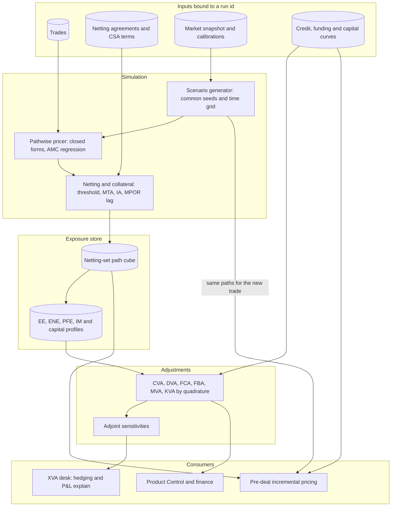

# XVA Engine Architecture

## TL;DR

- An XVA engine simulates market factors on a time grid, prices every trade on every path and date, nets by legal netting set, applies the collateral agreement, and integrates the resulting exposure profiles against default, funding, margin and capital curves: $V = V_{\text{rf}} - \text{CVA} + \text{DVA} - \text{FVA} - \text{MVA} - \text{KVA}$, with $\text{FVA} = \text{FCA} - \text{FBA}$ (the convention of [XVA](../11-Risk-and-Trading/15-XVA.md)).
- The netting set, not the trade, is the unit of exposure: an engine that keeps only EE profiles cannot price a new trade incrementally, so production engines keep the netting-set path cube (28.8 GB in the hypothetical example) and throw away trade-level paths (768 GB).
- In the simulated example a hedging trade with a standalone CVA of about 17,440 dollars reduced its netting set's CVA by about 7,440: incremental, not standalone, XVA is the price.
- Discretisation is a convention to state: putting exposure and discounting at year end gave CVA 52,960.43, the exact integral with exposure constant within each year 54,038.41.
- Callable and path-dependent trades are priced on paths by regression (American Monte Carlo, Longstaff and Schwartz 2001) rather than nested simulation, and sensitivities for hedging come from adjoint differentiation (Savine 2018).
- Every number on this page is produced and asserted by [sys_xva_engine.py](code/sys_xva_engine.py).

## Learning objectives

- Design an XVA simulation architecture: scenario generation, pathwise pricing, netting and collateral, exposure aggregation, adjustment calculators and sensitivities.
- Price early-exercise and path-dependent trades on simulation paths with American Monte Carlo regression instead of nested simulation.
- Model collateral with thresholds, minimum transfer amounts, independent amounts and the margin period of risk.
- Compute CVA, DVA, FVA, MVA and KVA by numerical quadrature and state the discretisation convention.
- Size storage and compute for the trade, netting-set and profile tiers, and explain which tier incremental pricing needs.
- Explain how adjoint differentiation produces the sensitivities an XVA desk hedges.

## Core concepts

### 1. The adjustments

| Adjustment | What it prices | Exposure input | Typical hedge or management |
| :--- | :--- | :--- | :--- |
| CVA | expected loss from counterparty default | discounted EE profile | single-name CDS, indices, market risk hedges of the exposure |
| DVA | the mirror for own default | discounted ENE profile | largely unhedgeable; derecognised from CET1 (CAP30.15) |
| FCA, FBA | funding uncollateralised exposure or the margin on collateralised hedges | discounted EE (FCA) and ENE (FBA) | treasury funding policy |
| MVA | funding initial margin posted | expected IM profile | margin optimisation: compression, clearing choice, collateral choice |
| KVA | return required on regulatory capital held | expected capital profile | capital relief: netting, clearing, hedges that reduce capital |

CVA and DVA are fair value adjustments under IFRS 13; whether FVA enters fair value is an accounting policy choice; KVA is a pricing and performance charge, not a market price ([XVA](../11-Risk-and-Trading/15-XVA.md)).

Unilateral CVA with independence between exposure and default:

$$\text{CVA} = \text{LGD} \int_0^T D(0, t)\, \text{EE}(t)\, dPD(t), \qquad \text{EE}(t) = \mathbb{E}^{\mathbb{Q}}\big[(V(t) - C(t))^+\big],$$

where $V(t)$ is the netting set's value, $C(t)$ the collateral held, and $dPD(t) = \lambda(t) e^{-\int_0^t \lambda(s) ds} dt$.
Funding, margin and capital (with spreads $s_b$, $s_l$, $s_{IM}$ and hurdle $h$; optionally weighted by both parties' survival):

$$\text{FCA} = \int_0^T s_b\, D\, \text{EE}\, dt, \quad \text{FBA} = \int_0^T s_l\, D\, \text{ENE}\, dt, \quad \text{MVA} = \int_0^T s_{IM}\, D\, \mathbb{E}[\text{IM}]\, dt, \quad \text{KVA} = \int_0^T h\, D\, \mathbb{E}[K]\, dt.$$

If the bank's lending spread is its own credit spread and FBA is weighted by own survival, FBA equals DVA, so booking both counts the same benefit twice ([XVA](../11-Risk-and-Trading/15-XVA.md)).
Banks differ on whether they give credit for FBA at all; the engine must support both and the policy must be stated.

Regulatory exposure measures use the same simulation: Effective EE is the running maximum of EE, Effective EPE its average over the first year, and IMM EAD is $1.4 \times$ Effective EPE (CRE53.11 to CRE53.14); see [Counterparty Credit Risk Analytics](../11-Risk-and-Trading/14-Counterparty-Credit-Risk-Analytics.md).

### 2. Architecture and data contracts

| Component | Responsibility | Key data contract | Failure to design for |
| :--- | :--- | :--- | :--- |
| Calibration and scenario generator | joint simulation of rates, FX, credit, equity, commodities on a time grid | run id binding market snapshot, calibrations, correlation matrix, time grid and random seeds | a recalibration between the base run and an incremental request |
| Pathwise pricer | value of each trade on each path and date (closed forms, regression for callables) | (run id, trade id) to a paths-by-dates block | a trade type with no pathwise pricer silently dropped |
| Netting and collateral engine | sum trades by legal netting set; apply CSA threshold, minimum transfer amount, independent amount and the margin period of risk lag | netting set id from the legal agreement store; CSA terms versioned | a trade with no netting set mapping (it must be flagged and treated as its own set, never dropped) |
| Exposure store | netting-set path cube and EE, ENE, PFE profiles | (run id, netting set id) to paths-by-dates values | profiles kept without paths, which blocks incremental pricing |
| Initial margin and capital projector | IM (a SIMM-style sensitivity formula) and capital (SA-CCR, CVA capital) on paths | sensitivities or regression proxies per path and date | nested simulation cost explosion |
| XVA calculators | quadrature against credit, funding and hurdle curves | adjustment by netting set and counterparty | inconsistent survival weighting across adjustments |
| Sensitivities | adjoint or bump sensitivities of each adjustment to curves and vols | sensitivity by risk factor for the XVA desk | bump noise from re-drawn random numbers |
| Incremental pricing service | price a proposed trade against the stored netting set | same run id, same seeds, same paths as the stored cube | pricing on different paths, which mixes simulation noise into the price |

### 3. Collateral and the margin period of risk

- With a CSA the collateral held at $t$ reflects the portfolio value at $t - \delta$, where $\delta$ is the margin period of risk: the time from the last successful margin call to close-out and re-hedging after a default.
  Exposure is then roughly $\max(V(t) - V(t - \delta) + \text{threshold effects}, 0)$, a gap risk that grows like $\sqrt{\delta}$.
- Regulatory MPOR floors under the internal models method: at least 5 business days for netting sets of only repo-style transactions and 10 for other netting sets with daily margining, 20 for netting sets above 5,000 trades or with illiquid collateral or hard-to-replace OTC derivatives, doubled after repeated margin disputes (CRE53.24, CRE53.25), plus $N - 1$ days when margining every $N$ days (CRE53.26).
- Initial margin collected under the non-centrally cleared margin rules must not be rehypothecated, re-pledged or re-used except under the narrow conditions of MGN20.42 (MGN20.41), so posted IM must be funded: that is MVA.
- Wrong-way risk (exposure rising as the counterparty weakens) breaks the independence assumption in the CVA formula; the engine needs either a joint model of exposure and default or a stressed add-on, and specific wrong-way trades are taken out of their netting set for regulatory exposure (CRE53.47, CRE53.48).

### 4. American Monte Carlo

- Nested simulation (an inner Monte Carlo at each outer node to value a callable trade) costs outer paths times inner paths per date: $10,000 \times 10,000 = 10^8$ valuations per date.
- Longstaff and Schwartz (2001) regress discounted future cash flows on functions of the current state across all outer paths: $\mathbb{E}[V(t_{k+1}) \mid X_k] \approx \sum_{m=1}^M \beta_m \psi_m(X_k)$, an ordinary least squares fit costing $O(M^2 N)$ per date for $N$ paths and $M$ basis functions.
- In XVA the same regression gives the trade's value on each path and date, so callables, Bermudans and path-dependent trades get exposures at roughly the cost of a forward simulation.
- Regression values are biased and noisy at the tails of the state distribution; validate against nested simulation on a sample and watch for exposure profiles that are not smooth in time.

### 5. Sensitivities and hedging

- CVA depends on every curve and volatility that moves any trade in the netting set and on the counterparty's credit curve, often thousands of inputs.
- Bump-and-revalue needs one or two full simulations per input with the same random numbers; adjoint algorithmic differentiation computes all first-order sensitivities of one output for a small constant multiple of one simulation's cost (Savine 2018), which is why XVA desks rely on it.
- The XVA desk hedges credit with CDS and indices and the market risk of the exposure with swaps, FX and options; the regulatory CVA capital framework (MAR50) recognises eligible hedges, which ties the desk's hedging to capital.

## Worked examples

All portfolio sizes, profiles, spreads and hurdles are labelled-hypothetical.

### Example 1: storage tiers

A dealer with 120,000 trades in 4,500 netting sets simulates 10,000 paths on 80 dates (800,000 path-date points).

| Tier | Size (float64) | Kept? |
| :--- | :--- | :--- |
| Trade-level values | $768.0$ GB | no: summed into the netting set as each trade is priced |
| Netting-set path cube | $28.8$ GB ($14.4$ GB in float32) | yes: needed for incremental pricing, collateral changes and PFE quantiles |
| One netting set's paths while it is processed | $6.4$ MB | in memory per worker |
| EE and ENE profiles for all netting sets | $5.76$ MB | yes: reporting and quadrature |

The ratio of the first two tiers is the average number of trades per netting set, $26.67$.
A design that keeps only profiles saves 28.8 GB but forces a full rerun for every pre-deal quote.

### Example 2: CVA on annual buckets

An uncollateralised 3-year swap; LGD 60%, CDS spread 150 bp, so $\lambda \approx 0.0150/0.60 = 2.50\%$ (the credit-triangle approximation for a flat curve); $r = 4\%$; EE of 1,200,000, 1,800,000 and 950,000 at the ends of years 1, 2 and 3.

| Year | $D(0, t)$ | Default probability in the year | CVA contribution |
| :--- | :--- | :--- | :--- |
| 1 | $0.9608$ | $1 - e^{-0.025} = 0.02469$ | $17,079.82$ |
| 2 | $0.9231$ | $e^{-0.025} - e^{-0.05} = 0.02408$ | $24,007.42$ |
| 3 | $0.8869$ | $e^{-0.05} - e^{-0.075} = 0.02349$ | $11,873.19$ |

CVA with exposure and discounting at each year end is $52,960.43$.
Holding EE constant within each year but integrating discounting and default exactly gives $54,038.41$, $1,077.98$ more, because defaults early in the year are discounted less; the code checks the exact integral numerically.
Neither is "right": the time grid and the convention are model choices that must be stated and kept fixed for P&L explain.

### Example 3: FVA, MVA and KVA

- With ENE of 400,000, 600,000 and 300,000 and an 80 bp funding spread both ways: FCA $29,257.05$, FBA $9,634.09$, FVA $19,622.96$; if excess cash earns no spread, FVA is the full FCA, $29,257.05$.
- An uncleared trade with expected IM of 5.0m, 4.2m, 3.1m, 1.8m and 0.6m over five years and a 75 bp funding spread net of what posted IM earns: MVA $100,916.90$ (IM for each year discounted from its end).
- Capital of 600,000, 450,000 and 200,000 at a 10% hurdle: KVA $116,926.01$, larger than the CVA here, as capital also dominates the swap example in [XVA](../11-Risk-and-Trading/15-XVA.md).

### Example 4: incremental CVA needs the netting set's paths

An existing netting set worth $500,000 + 1,000,000\, W_1(t)$ and a proposed trade worth $800,000\,(\rho W_1(t) + \sqrt{1 - \rho^2} W_2(t))$ with $\rho = -0.8$; LGD 60%, hazard 2.5%, annual buckets, 20,000 paths (seed 2026).
The simulated EE of the existing set is within three standard errors of its closed form $a\Phi(a/\sigma_t) + \sigma_t\phi(a/\sigma_t)$ at each date.

- CVA of the existing netting set: about $33,140$.
- Standalone CVA of the new trade: about $17,440$.
- CVA of the netting set with the new trade: about $25,700$.
- Incremental CVA: about $-7,440$; the client should get a benefit, not a charge, because the trade offsets existing exposure.

The incremental price must use the same paths as the stored cube: pricing the new trade on fresh random numbers adds simulation noise of the size of the whole netting set's error to a small difference.

## Pitfalls

- **Pricing XVA trade by trade.** Exposure is non-linear in the netting set's value; standalone CVA overstates the charge for risk-reducing trades and understates it for concentrating ones.
- **Keeping only profiles.** EE vectors cannot be re-aggregated with a new trade; keep the netting-set path cube for the run.
- **Ignoring the margin period of risk.** Collateralised exposure is a gap risk over the MPOR, scaling roughly with $\sqrt{\delta}$; regulatory floors are 5, 10 or 20 business days and double after disputes (CRE53.24, CRE53.25).
- **Wrong-way risk.** Independence between exposure and default understates CVA when the two move together, for example protection bought from a seller whose credit is tied to the reference entity.
- **Booking FBA and DVA together.** When the funding spread is own credit, they are the same benefit.
- **Bumping with new random numbers.** Finite-difference sensitivities on independent simulations are dominated by noise; use common random numbers or adjoint differentiation.
- **Unmapped netting sets.** A trade without a legal agreement mapping must be treated as its own netting set and flagged; dropping it understates exposure and treating it as netted without legal support overstates the benefit.
- **Rehypothecation assumptions.** Variation margin received may be reusable under the CSA, which reduces funding cost; initial margin collected under the margin rules may not be re-used except under MGN20.42.

## Interview questions

> [!question]- sys-11-01 | What is the difference between CVA and DVA?
> CVA is the expected discounted loss from the counterparty defaulting while the netting set is worth something to the bank, integrated against the counterparty's default density.
> DVA is the mirror: the value to the bank of its own default while it owes the counterparty, computed from ENE and the bank's own default density.
> DVA gains from own credit deterioration are derecognised from CET1 (CAP30.15).

> [!question]- sys-11-02 | How does American Monte Carlo avoid nested simulation for callable trades in XVA?
> Instead of an inner simulation at every outer node ($10,000 \times 10,000 = 10^8$ valuations per date), it regresses discounted future cash flows on basis functions of the current state across all outer paths (Longstaff and Schwartz 2001).
> Each date costs one least-squares fit, $O(M^2 N)$ for $N$ paths and $M$ basis functions, so exposure for callables costs roughly a forward simulation.

> [!question]- sys-11-03 | What is the margin period of risk and why does it matter for collateralised CVA?
> The time from the last successful margin call to close-out and re-hedging after a default, during which the portfolio moves but collateral does not.
> Collateralised exposure is a gap risk over that period, scaling roughly with its square root; IMM floors are 5 business days for repo-only sets, 10 for other daily-margined sets and 20 for large or illiquid sets, doubled after repeated disputes (CRE53.24, CRE53.25).

> [!question]- sys-11-04 | What is MVA?
> The cost of funding initial margin posted over the life of the trade: $\int s_{IM} D\, \mathbb{E}[\text{IM}]\, dt$ with $s_{IM}$ the funding spread net of what posted IM earns.
> IM collected under the margin rules cannot be re-used except under MGN20.42 (MGN20.41), so it must be funded; in Example 3 a 5.0m to 0.6m IM profile at 75 bp gave MVA of 100,916.90.

> [!question]- sys-11-05 | What are wrong-way and right-way risk?
> Wrong-way risk: exposure tends to rise when the counterparty's credit worsens, for example buying protection from a seller whose own credit is linked to the reference entity, or a put on a company's shares bought from that company.
> Right-way risk: exposure tends to fall as credit worsens, for example a hedge with a producer that owes the bank most when the commodity price, and so the producer's health, is high.
> Both break the independence assumption behind the simple CVA integral.

> [!question]- sys-11-06 | Why do banks run a central XVA desk?
> Counterparty, funding and capital risks are properties of netting sets and the whole balance sheet, not of single trades or asset-class desks.
> A central desk prices incremental XVA to sales, manages the aggregated credit and market sensitivities of the adjustments, and owns the XVA P&L and its explain.

> [!question]- sys-11-07 | How does adjoint algorithmic differentiation help XVA hedging?
> An XVA number depends on thousands of curve, volatility and credit inputs; bump-and-revalue needs one or two full simulations per input.
> AAD computes all first-order sensitivities of one output for a small constant multiple of a single simulation's cost, with no bump noise, so the desk gets a full sensitivity set in time to hedge.

> [!question]- sys-11-08 | How do FVA and DVA relate?
> If the bank's lending spread equals its own credit spread and FBA is weighted by own survival, FBA and DVA are the same integral, so booking both double counts.
> Banks either give no FBA credit (asymmetric funding: FVA equals FCA, 29,257.05 instead of 19,622.96 in Example 3) or adjust so the overlap is counted once, and must state which.

> [!question]- sys-11-09 | What is ISDA SIMM?
> The Standard Initial Margin Model is ISDA's industry methodology for calculating bilateral initial margin on uncleared derivatives from risk sensitivities (delta, vega, curvature, plus base correlation), with risk weights and correlations calibrated and published by ISDA.
> Supervisory rules (MGN20) allow either a standardised schedule or an approved model such as SIMM; projecting SIMM along simulation paths is what makes MVA expensive.

> [!question]- sys-11-10 | Why is DVA excluded from CET1?
> When the bank's own credit worsens, the fair value of its liabilities falls and DVA produces a gain, but a weakening bank cannot use that gain to absorb losses.
> CAP30.15 derecognises from CET1 all unrealised gains and losses from own-credit changes on fair-valued liabilities and all own-credit valuation adjustments on derivative liabilities, with no offset against CVA.

> [!question]- sys-11-11 | Why must an XVA engine keep netting-set paths and not just EE profiles?
> CVA of a netting set with a new trade depends on $\mathbb{E}[(V_{\text{set}}(t) + V_{\text{new}}(t))^+]$, which needs the joint paths; EE profiles of the set and the trade cannot be combined.
> In Example 1 that costs 28.8 GB against 768 GB for trade-level paths and 5.76 MB for profiles.

> [!question]- sys-11-12 | A hedge has standalone CVA of 17,440 dollars. Should the client be charged that?
> No: the price is the incremental CVA of the netting set, about -7,440 in Example 4, a benefit, because the trade offsets existing exposure.
> Standalone pricing would overcharge risk-reducing trades and undercharge concentrating ones.

> [!question]- sys-11-13 | Why must incremental XVA use the same random numbers as the stored run?
> The incremental amount is a small difference of two large simulated numbers; with common random numbers their errors largely cancel, with fresh ones the difference carries the full simulation error of the netting set.
> The run id therefore binds seeds, time grid and calibrations, and a recalibration invalidates the stored cube for incremental use.

> [!question]- sys-11-14 | Your CVA changes by 2.0% when you move from year-end exposure points to an exact integral. Is one of them wrong?
> No: it is a discretisation convention (52,960.43 against 54,038.41 in Example 2); both converge as the time grid is refined.
> Choose the grid and the convention, document them, and keep them fixed so that day-on-day changes reflect markets and trades, not numerics.

> [!question]- sys-11-15 | A trade arrives with no netting agreement mapping. What should the engine do?
> Treat it as its own netting set (no netting benefit), flag it, and route it to the legal data owners; never drop it and never assume it nets with the counterparty's other trades.
> Netting without legal support overstates the benefit; dropping the trade understates exposure.

> [!question]- sys-11-16 | What is Effective EPE and how does it relate to the XVA simulation?
> Effective EE is the running maximum of the EE profile and Effective EPE its average over the first year (or the maturity if shorter); IMM EAD is 1.4 times Effective EPE (CRE53.11 to CRE53.14).
> The same simulated netting-set exposures feed both CVA and regulatory exposure, although the measure (risk-neutral or real-world) may differ and must be documented.

## In this repo and SDE-Interview-Prep

- [sys_xva_engine.py](code/sys_xva_engine.py) computes, prints and asserts every number on this page, with the exact CVA integral checked numerically and simulated exposure checked against its closed form.
- [XVA](../11-Risk-and-Trading/15-XVA.md) for the adjustments in depth and [Counterparty Credit Risk Analytics](../11-Risk-and-Trading/14-Counterparty-Credit-Risk-Analytics.md) for exposure, collateral and CRE53.
- [Pricing Library Architecture](05-Pricing-Library-Architecture.md) for AAD, [Pricing at Scale](06-Pricing-at-Scale.md) for the grid, [Regulatory Reporting Pipeline](12-Regulatory-Reporting-Pipeline.md) for SA-CCR.

## Further reading

- Gregory, J., *The xVA Challenge: Counterparty Risk, Funding, Collateral, Capital and Initial Margin*, 4th edition, Wiley, 2020.
- Green, A., *XVA: Credit, Funding and Capital Valuation Adjustments*, Wiley, 2015.
- Longstaff, F. A. and Schwartz, E. S., "Valuing American Options by Simulation: A Simple Least-Squares Approach", *Review of Financial Studies* 14(1), 2001.
- Brigo, D., Morini, M. and Pallavicini, A., *Counterparty Credit Risk, Collateral and Funding: With Pricing Cases for All Asset Classes*, Wiley, 2013.
- Savine, A., *Modern Computational Finance: AAD and Parallel Simulations*, Wiley, 2018.
