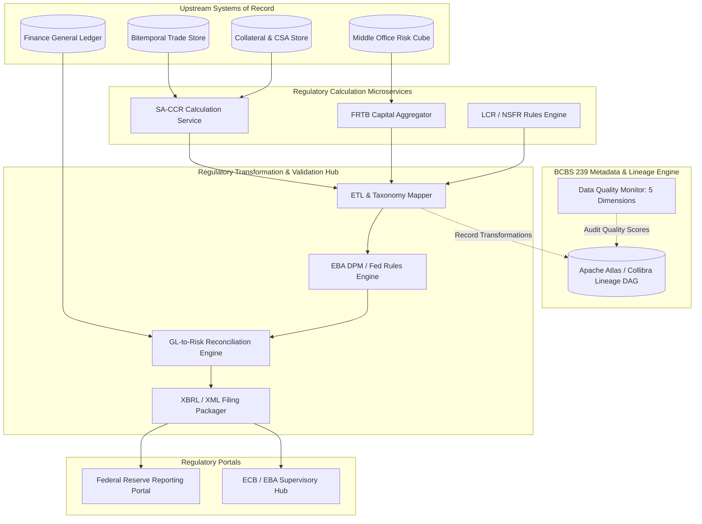

# Regulatory Reporting Pipeline

## TL;DR

Regulatory reporting is the legal bridge between an investment bank's internal trading systems and financial supervisory authorities.
Failing to submit accurate, validated regulatory returns results in severe supervisory sanctions, public enforcement orders, and punitive Pillar 2 capital add-ons.
Modern architectures encapsulate regulatory computations into specialized microservices, such as an enterprise SA-CCR calculation service that computes Exposure at Default (EAD) across millions of derivative contracts.
The reporting pipeline ingests multi-asset transaction feeds, translates risk metrics into standardized regulatory taxonomies (European COREP/FINREP under the EBA Data Point Model, US FR Y-9C and FFIEC 101, and granular FR 2052a liquidity reports), and enforces automated reconciliation against the General Ledger.
Under BCBS 239, every aggregated metric submitted in an XBRL regulatory filing must have automated, verifiable end-to-end data lineage back to the originating front-office trade execution.

## Learning objectives

- Design an enterprise regulatory reporting pipeline meeting BCBS 239 data governance, accuracy, and auditability mandates.
- Implement an automated SA-CCR calculation service computing replacement cost, potential future exposure, and multi-asset add-ons.
- Map internal trade attributes and risk measures to supervisory taxonomies: European COREP (XBRL/DPM) and US Fed Form FR Y-9C / FFIEC 101.
- Formulate automated reconciliation rules between front-office risk engine outputs and back-office General Ledger balances.
- Construct pre-submission validation engines executing cross-table consistency checks, boundary conditions, and filing rules.
- Design Mermaid container, sequence, and data lineage diagrams for regulatory filing engines.

## Core concepts

### 1. The Regulatory Reporting Landscape

Global banking organizations report across multiple distinct regulatory axes:

```
+----------------------------------------------------------------------------------------------------+
| Regulatory Domain    | US Framework (Federal Reserve / OCC)       | European Framework (EBA / ECB) |
+----------------------------------------------------------------------------------------------------+
| Capital Adequacy     | FR Y-9C (Schedule HC-R), FFIEC 101        | COREP (Common Reporting: CA, CR)|
| Financial Statements | FR Y-9C (Balance Sheet / Income Statement) | FINREP (Financial Reporting)   |
| Counterparty Risk    | FFIEC 101 (Schedule D: SA-CCR / IMM)      | COREP C 34.02 (CCR by Approach)|
| Liquidity Monitoring | FR 2052a (Complex Liquidity Monitoring)   | EBA LCR and NSFR Templates     |
| Large Exposures      | Federal Reserve Regulation YY (SCCL)       | COREP LE (Large Exposures)     |
| Transaction Repos    | Dodd-Frank Title VII (CFTC / SEC SDR)     | EMIR / MiFIR Transaction Report|
+----------------------------------------------------------------------------------------------------+
```

### 2. Regulatory Reporting Architecture and Lineage



### 3. Enterprise SA-CCR Microservice Architecture

Counterparty Credit Risk under Basel III finalisation mandates SA-CCR:

$$\text{EAD} = 1.4 \times (\text{RC} + \text{PFE})$$

The calculation service exposes a low-latency gRPC / JSON interface:
- **Input:** Legal netting set ID, list of trades (notional, maturity, underlying asset class, direction), and collateral details ($V, C, \text{TH}, \text{MTA}, \text{NICA}, \text{MPOR}$).
- **Processing:**
  1. Partitions trades into 5 asset classes: Interest Rate, Foreign Exchange, Credit, Equity, Commodity.
  2. Applies supervisory delta ($\delta_i$) and supervisory duration ($SD_i$).
  3. Computes maturity-bucketed effective notionals and aggregates within hedging sets using supervisory correlation parameters.
  4. Applies supervisory factors ($SF$) to compute Add-Ons: $\text{AddOn}_{\text{total}} = \sum_a \text{AddOn}^{(a)}$.
  5. Evaluates the replacement cost ($\text{RC}$) and PFE multiplier:

$$\text{Multiplier} = \min\left(1.0, 0.05 + 0.95 \times \exp\left( \frac{V - C}{2 \times 0.95 \times \text{AddOn}_{\text{total}}} \right)\right)$$

- **Output:** Netting set EAD, Asset-class Add-on breakdown, Multiplier, and Risk-Weighted Assets ($\text{RWA} = 12.5 \times \text{EAD} \times RW_{\text{cpty}}$).

### 4. BCBS 239 End-to-End Data Lineage Requirements

To fulfill Principle 3 (Accuracy) and Principle 4 (Completeness):
- Every cell in a COREP or FR Y-9C filing must maintain a deterministic backward lineage trace to the underlying transaction rows in the trade store.
- **Lineage Metadata Schema:**
  - `report_id`: `COREP_C_07_00`
  - `cell_coordinate`: `{row: 010, col: 020}`
  - `transformation_rule`: `SUM(trade.ead * cpty.risk_weight)`
  - `source_system`: `MUREX_FO_NY`
  - `extraction_timestamp`: `2026-10-15T22:00:00Z`
  - `reconciliation_status`: `RECONCILED_TO_GL`

## Worked examples

### Example 1: SA-CCR Service Request and Multi-Asset EAD Calculation

A client invokes the SA-CCR microservice for an unmargined netting set ($C = 0$) containing two trades with a corporate counterparty:
- Trade 1: 5-year USD IRS, Notional $\$100,000,000$, $\text{MtM} = +\$1,500,000$, Payer swap ($\delta = +1$).
  - Supervisory Duration: $SD = \frac{1 - e^{-0.05 \times 5}}{0.05} = 4.4240$.
  - Effective Notional: $D_1 = +1 \times 100\text{M} \times 4.4240 = +\$442,400,000$.
  - Asset Class: Interest Rate ($SF = 0.5\%$).
  - Add-On: $\text{AddOn}_{\text{IR}} = 0.005 \times 442,400,000 = \$2,212,000$.
- Trade 2: 1-year EUR/USD FX forward, Notional EUR $50,000,000$ (EUR/USD $= 1.10 \implies \$55,000,000$), $\text{MtM} = -\$300,000$, Long EUR ($\delta = +1$).
  - Maturity Factor ($1\text{y}$ unmargined): $MF = \sqrt{\min(1.0, 1.0)} = 1.0$.
  - Asset Class: FX ($SF = 4.0\%$).
  - Effective Notional: $D_2 = \$55,000,000$.
  - Add-On: $\text{AddOn}_{\text{FX}} = 0.04 \times 55,000,000 = \$2,200,000$.

Netting Set Aggregation:
- Total Net MtM: $V = \$1,500,000 - \$300,000 = +\$1,200,000$.
- Replacement Cost ($C = 0$):

$$\text{RC} = \max(V - C, 0) = \max(\$1,200,000, 0) = \$1,200,000$$

- Total Add-On:

$$\text{AddOn}_{\text{total}} = \text{AddOn}_{\text{IR}} + \text{AddOn}_{\text{FX}} = \$2,212,000 + \$2,200,000 = \$4,412,000$$

- PFE Multiplier:

$$\text{Multiplier} = \min\left(1.0, 0.05 + 0.95 \times \exp\left( \frac{1,200,000}{2 \times 0.95 \times 4,412,000} \right)\right)$$
$$\text{Exponent} = \frac{1,200,000}{8,382,800} = 0.14315 \implies \exp(0.14315) = 1.1539$$
$$\text{Multiplier} = \min(1.0, 0.05 + 0.95 \times 1.1539) = \min(1.0, 0.05 + 1.0962) = 1.0$$

- Potential Future Exposure (PFE):

$$\text{PFE} = 1.0 \times \$4,412,000 = \$4,412,000$$

- Exposure at Default (EAD):

$$\text{EAD} = 1.4 \times (\text{RC} + \text{PFE}) = 1.4 \times (\$1,200,000 + \$4,412,000) = 1.4 \times \$5,612,000 = \$7,856,800$$

If the corporate counterparty has a supervisory risk weight of $100\%$, the resulting RWA reported in COREP C 34.02 is:

$$\text{RWA} = \$7,856,800 \times 100\% = \$7,856,800$$

### Example 2: EBA XBRL Data Point Model (DPM) Validation Break

Prior to submitting the quarterly COREP return to the European Central Bank, the automated filing engine executes supervisory validation rules:
- Table 1: Own Funds (`C 01.00`, Row 010, Col 010 - Total Common Equity Tier 1 Capital):
  Value reported: $€45,250,000,000$.
- Table 2: Capital Ratios (`C 02.00`, Row 010, Col 010 - Total Risk Exposure Amount / RWA):
  Value reported: $€380,000,000,000$.
- Table 3: Capital Ratio Check (`C 03.00`, Row 010, Col 010 - Reported CET1 Ratio):
  Value reported: $11.85\%$.

Validation Rule `v0841_m` Check:

$$\left| \text{Reported Ratio} - \frac{\text{CET1 Capital}}{\text{Total RWA}} \right| \le 0.0001$$

Evaluation:

$$\frac{€45,250,000,000}{€380,000,000,000} = 0.1190789 \implies 11.91\%$$
$$\text{Discrepancy} = |0.1185 - 0.1191| = 0.0006 > 0.0001$$

- Result: Rule `v0841_m` fails!
- Root Cause Investigation:
  A credit risk team applied an unapproved manual adjustment subtracting $€2,100,000,000$ of RWA in an offline spreadsheet without updating the master RWA aggregation table.
- System Action:
  The filing engine rejects the submission package, flags the line-item break in the audit dashboard, and blocks submission until the underlying database is reconciled.

### Example 3: General Ledger to Risk Engine Reconciliation Break

At month-end, Product Control reconciles the derivative fair value asset balance between the Finance General Ledger (SAP) and the Middle-Office Risk Engine:
- General Ledger Balance (Account 1410 - Derivative Financial Instruments Asset):
  $$\text{GL Balance} = \$14,850,200,000$$
- Risk Engine Sum of Mark-to-Market Values ($\sum \max(V_i, 0)$):
  $$\text{Risk Sum} = \$14,620,000,000$$
- Reconciliation Variance:
  $$\Delta = \$14,850,200,000 - \$14,620,000,000 = \$230,200,000\text{ (GL is higher)}$$
- Investigation:
  Automated reconciliation scripts match trades by unique trade ID across both systems:
  - 98.4% of trades match perfectly.
  - Break identified: 45 cross-currency swap contracts executed in the Tokyo branch on the last business day were booked in the local back-office booking system (feeding GL) but failed to replicate to the central risk engine due to a message queue serialization error.
- Resolution: The message queue was replayed, the 45 trades were ingested, and the risk balance updated to $\$14,850,150,000$, bringing the final variance to $\$50,000$ (well within the $\$1\text{M}$ materiality threshold).

## Pitfalls

- **Permitting Manual Spreadsheet Adjustments in Regulatory Returns:** Overwriting regulatory line items in Excel before submitting filings directly violates BCBS 239 Principle 3, inviting regulatory scrutiny and audit penalties.
- **Failing to Reconcile Risk Metrics Against Accounting Ledgers:** Submitting regulatory capital figures that do not tie back to audited financial balance sheets causes immediate regulatory inquiry and rejection of supervisory models.
- **Ignoring Netting Set Identifier Harmonization:** Using different counterparty identifiers across trades belonging to the same legal netting set prevents the SA-CCR engine from recognizing netting benefits, grossly inflating reported EAD.
- **Neglecting Filing Calendar Cutoffs and Timezone Discrepancies:** Submitting cross-border regulatory returns without accounting for home-host supervisory calendar differences (e.g., UK vs US holidays) causes missed statutory filing deadlines.
- **Hardcoding Regulatory Taxonomy Schemas:** Hardcoding validation rules in application code causes system failure when the EBA or Federal Reserve updates taxonomy frameworks (e.g., EBA DPM 3.2 to 3.3). Engines must use metadata-driven rule parsers.

## Interview questions

> [!question]- sys-12-01 | What is the purpose of the European Banking Authority's Data Point Model (DPM)?
> The DPM is a structured, harmonized dictionary and methodology that defines all regulatory reporting concepts, business dimensions, and validation rules across COREP and FINREP.
> It translates legal regulations into machine-readable XBRL taxonomies, ensuring consistent reporting across all European financial institutions.

> [!question]- sys-12-02 | How does the SA-CCR calculation service handle margin agreements differently from unmargined agreements?
> For unmargined agreements, Replacement Cost is $\max(V, 0)$ and the Maturity Factor is 1.0.
> For margined agreements, Replacement Cost accounts for the Credit Support Annex: $\max(V - C, \text{TH} + \text{MTA} - \text{NICA}, 0)$, and the add-on is scaled by the Margin Period of Risk factor: $1.5 \sqrt{\text{MPOR}/250}$, dramatically reducing EAD.

> [!question]- sys-12-03 | What is BCBS 239 data lineage and why is it a primary focus of regulatory audits?
> Data lineage is the complete, auditable record tracing every number in a regulatory return back through intermediate calculation services, data mastering steps, and source trading databases.
> It ensures that reported numbers can be independently verified and reproduced without mystery transformations or unapproved spreadsheet adjustments.

> [!question]- sys-12-04 | What is the difference between COREP and FINREP in European banking regulation?
> COREP (Common Reporting) covers prudential capital requirements, solvency, credit risk, market risk, and liquidity under the Capital Requirements Regulation (CRR).
> FINREP (Financial Reporting) covers financial accounting data (balance sheet, income statement, asset encumbrance) based on IFRS or national GAAP accounting standards.

> [!question]- sys-12-05 | What is Federal Reserve Form FR 2052a?
> FR 2052a (Complex Institution Liquidity Monitoring Report) is a highly granular, daily regulatory report required for large US banks.
> It captures detailed cashflow projections, collateral positions, wholesale funding, and commitment flows by currency, counterparty, and tenor to monitor liquidity risk.

> [!question]- sys-12-06 | What happens when an automated pre-submission XBRL validation rule fails?
> The reporting engine quenches the submission workflow, preventing corrupted or non-compliant files from reaching the regulator.
> It generates an error diagnostic identifying the conflicting cell coordinates and rule ID, alerting Product Control to resolve the underlying data break.

> [!question]- sys-12-07 | Why must the SA-CCR multiplier never drop below 0.05?
> The formula for the multiplier is $\min\left(1.0, 0.05 + 0.95 \exp\left(\frac{V-C}{2 \times 0.95 \times \text{AddOn}}\right)\right)$.
> The $5\%$ floor is a non-bypassable supervisory constraint ensuring that even when a counterparty posts massive excess collateral ($C \gg V$), the bank still holds capital against future potential exposure during market liquidation.

> [!question]- sys-12-08 | What is a Trade Repository under Dodd-Frank Title VII / EMIR?
> A Trade Repository (such as DTCC Data Repository or REGIS-TR) is a centralized, regulated electronic facility that collects and maintains records of OTC derivative transactions.
> Dealers must report all derivative executions, modifications, and terminations in near real-time to provide market transparency to regulators.

> [!question]- sys-12-09 | How does an enterprise pipeline handle retroactive corrections to prior-period regulatory filings?
> Under BCBS 239, the engine preserves the original filing version as an immutable snapshot.
> If a material error requires restatement, the engine generates an explicit restatement package with an amended version tag, accompanied by a documented audit reconciliation explaining the variance.

> [!question]- sys-12-10 | Why is the supervisory duration ($SD$) formula non-linear in SA-CCR?
> The formula is $SD = \frac{e^{-0.05 \times S} - e^{-0.05 \times E}}{0.05}$, where $S$ is start time and $E$ is end time.
> It uses a flat $5\%$ continuous discount rate to model the price sensitivity of an interest rate instrument, capping duration growth for long tenors to reflect diminishing marginal rate risk.

## Further reading

- Basel Committee on Banking Supervision. *The standardised approach for measuring counterparty credit risk exposures*. BIS BCBS 279, 2014.
- European Banking Authority. *EBA Data Point Model (DPM) and XBRL Filing Rules*. EBA Reporting Guidelines, 2023.
- Federal Reserve Board. *Instructions for the Preparation of Consolidated Financial Statements for Holding Companies (FR Y-9C)*. Federal Reserve Reporting Instructions.
- Basel Committee on Banking Supervision. *Principles for effective risk data aggregation and risk reporting*. BIS BCBS 239, 2013.
