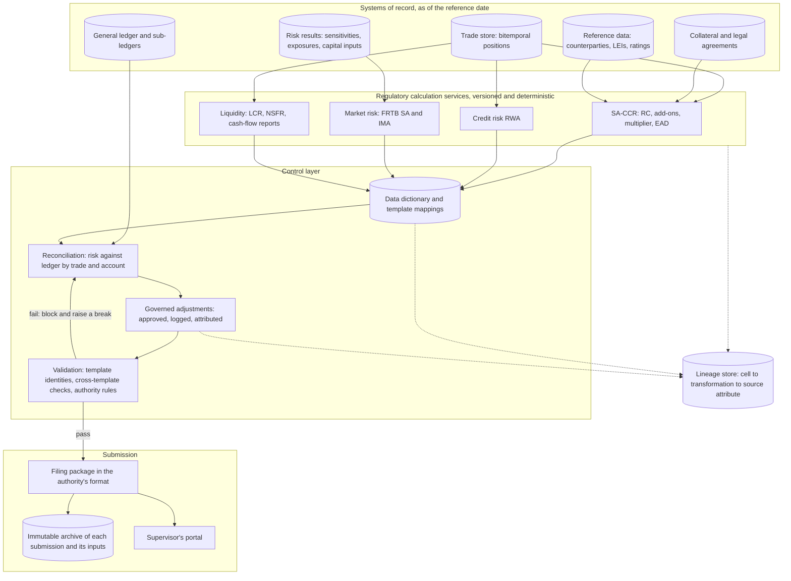

# Regulatory Reporting Pipeline

## TL;DR

- A regulatory reporting pipeline turns trade, risk and ledger data as of a reference date into supervisory returns (in the EU, COREP and FINREP; in the US, FR Y-9C, FFIEC 101, FR Y-14 and FR 2052a among others), with every reported cell traceable to its sources and reconciled to the accounts.
- BCBS 239 (January 2013) sets 14 principles for risk data aggregation and reporting, expected of G-SIBs from January 2016; it asks for largely automated aggregation, a data dictionary, reconciliation with accounting data and effective controls around any manual or spreadsheet steps (Principle 3); the ECB's May 2024 guide extends the expectations explicitly to supervisory reports such as FINREP and COREP and asks for attribute-level data lineage.
- Calculation services such as SA-CCR are deterministic functions of versioned inputs: for an unmargined swap and FX forward the example gives an aggregate add-on of 4,411,992 dollars and EAD of 7,856,789, and the PFE multiplier only falls below 1 when the netting set is out of the money, and never below 5%.
- Pre-submission checks recompute identities from the reported components (a CET1 ratio 5.8 bp away from its own numerator and denominator stops the filing) and reconcile risk to the general ledger by trade id, so that every break has a cause.
- Every number on this page is produced and asserted by [sys_regulatory_reporting.py](code/sys_regulatory_reporting.py).

## Learning objectives

- Design a regulatory reporting architecture that meets BCBS 239 and supervisors' data lineage expectations.
- Implement an SA-CCR calculation service: replacement cost, supervisory duration, add-ons, the PFE multiplier and EAD.
- Map internal data to supervisory templates (EU COREP and FINREP; US FR Y-9C, FFIEC 101, FR Y-14, FR 2052a) through a versioned data dictionary.
- Build reconciliations between risk measures and the general ledger that explain every break.
- Implement pre-submission validation of template identities and cross-template consistency.
- Maintain lineage from front-office capture to the submitted cell, including manual adjustments and resubmissions.

## Core concepts

### 1. What gets reported

The returns below are the main prudential ones for a large bank; each regulator publishes the forms, instructions and validation rules, and they change, so the pipeline treats them as versioned reference data (facts as of 2026-10).

| Return | Authority | Content | Frequency |
| :--- | :--- | :--- | :--- |
| COREP | EU supervisory reporting ITS, Commission Implementing Regulation (EU) 2024/3117 | own funds and requirements: C 01.00 own funds (row 0020 CET1), C 02.00 own funds requirements (row 0010 total risk exposure amount), C 03.00 capital ratios; credit, counterparty, market and operational risk detail; large exposures, leverage, liquidity | mostly quarterly, liquidity monthly |
| FINREP | same ITS | balance sheet, income statement and breakdowns on IFRS or national GAAP | quarterly, some parts semi-annual or annual |
| FR Y-9C | Federal Reserve | consolidated financial statements of holding companies with 3 billion dollars or more of total consolidated assets (and certain others), including Schedule HC-R regulatory capital | quarterly |
| FFIEC 101 | Federal Reserve and other US agencies | regulatory capital under the advanced approaches | quarterly |
| FR Y-14Q, FR Y-14M (and FR Y-14A) | Federal Reserve | capital assessments and stress testing data for holding companies with 100 billion dollars or more of assets: Y-14Q quarterly, Y-14M monthly loan-level data for first-lien mortgages, home equity and credit cards | quarterly, monthly (Y-14A annual) |
| FR 2052a | Federal Reserve | complex institution liquidity monitoring: granular cash flows, collateral and funding | daily for US G-SIBs, Category II firms and Category III firms with 75 billion dollars or more of weighted short-term wholesale funding (and the equivalent foreign banking organisations); monthly for other Category III and Category IV firms |

The EU reporting ITS replaces Implementing Regulation (EU) 2021/451; its transitional provisions have been amended, so the dates from which each template version applies should be taken from the current consolidated text.

### 2. Architecture

| Component | Responsibility | Contract | Failure to design for |
| :--- | :--- | :--- | :--- |
| Source extraction | snapshot every source as of the reference date | snapshot id per source, with knowledge time, so a rerun reproduces the same inputs | late bookings changing a submitted period without a trace |
| Calculation services | CRE, MAR, LCR and other rule sets as code | (inputs snapshot, rule version) to results; rule versions follow the authority's effective dates | a rule change applied to a period before its effective date |
| Data dictionary and mapping | one definition per concept, mapped to template cells | versioned mapping table: template, row, column to source attributes and transformation | template changes hard-coded in application logic |
| Reconciliation | compare risk and finance views by trade and account | break records with category, owner and age | breaks netted away inside a total |
| Adjustments | the only route for manual changes | approved, logged entries with reason and approver, visible in lineage | changes typed into a spreadsheet copy of the template |
| Validation | identities within and across templates, the authority's published rules | pass or a list of failures by cell | submitting with known failures |
| Archive and resubmission | keep each submitted version immutable | resubmissions carry a new version with the reason and the differences | overwriting what was filed |

### 3. BCBS 239 and supervisory expectations

- The 14 principles cover governance and infrastructure (1 and 2), risk data aggregation (3 accuracy and integrity, 4 completeness, 5 timeliness, 6 adaptability), risk reporting (7 to 11) and supervisory review (12 to 14); supervisors may use a range of tools, including Pillar 2, to require remediation (Principle 13).
- Principle 3 (paragraph 36): risk data controls as robust as those for accounting data; effective mitigants such as end-user computing policies where a bank relies on spreadsheets and other desktop tools; reconciliation of risk data with the bank's sources, including accounting data; a single authoritative source per risk type where possible; and a data dictionary (paragraph 37).
- Scope: the principles apply to group risk management processes, and banks "may also benefit" from applying them to supervisory reporting (paragraph 18); G-SIBs were expected to comply by January 2016 and D-SIBs three years after designation.
- The ECB guide (May 2024) puts FINREP and COREP, stress test submissions and Pillar 3 disclosures inside the scope it expects, asks for complete and up-to-date lineage at the data attribute level from capture through extraction, transformation and loading, and says persistent shortcomings can escalate to enforcement measures, sanctions and capital add-ons.

### 4. SA-CCR as a service

$$\text{EAD} = \alpha\,(\text{RC} + \text{PFE}), \qquad \alpha = 1.4$$

- RC: $\max(V - C, 0)$ unmargined (CRE52.10); $\max(V - C, TH + MTA - NICA, 0)$ margined (CRE52.18).
- Add-ons by asset class (interest rate, FX, credit, equity, commodity), summed to the aggregate add-on (CRE52.24); interest rate adjusted notional is notional times supervisory duration $SD = (e^{-0.05 S} - e^{-0.05 E})/0.05$ (CRE52.34); supervisory factors 0.5% for interest rates and 4% for FX (CRE52.72); maturity factor $\sqrt{\min(M, 1)}$ unmargined and $1.5\sqrt{MPOR/250}$ margined, MPOR in business days (CRE52.48, CRE52.52).
- PFE multiplier $\min\big(1, 0.05 + 0.95\, e^{(V - C)/(2 \times 0.95 \times \text{AddOn})}\big)$ (CRE52.23): it recognises excess collateral and negative value but, "for prudential reasons", never below 5% of the add-on (CRE52.22).
- Service contract: input is a netting set id plus snapshot ids for trades, collateral and legal terms; output is EAD with RC, each add-on, the multiplier and the rule version, so a reviewer can trace and recompute it; [Counterparty Credit Risk: SA-CCR](../17-Regulatory-Capital-Basel-and-FRTB/04-Counterparty-Credit-Risk-SA-CCR.md) covers the rules in full.

## Worked examples

All trades, balances, tolerances and data sets are labelled-hypothetical inputs.

### Example 1: an SA-CCR request

An unmargined netting set with a corporate counterparty and no collateral:

- Trade 1: 5-year USD payer swap, notional 100,000,000, value $+1,500,000$, supervisory delta $+1$, $S = 0$, $E = 5$.
  $SD = (1 - e^{-0.25})/0.05 = 4.4240$; adjusted notional $442,398,434$; maturity factor 1; IR add-on $0.005 \times 442,398,434 = 2,211,992$.
- Trade 2: 1-year EUR/USD forward, long EUR 50,000,000 at 1.10, so 55,000,000 dollars, value $-300,000$; FX add-on $0.04 \times 55,000,000 = 2,200,000$.
- Net value $V = 1,200,000$, so $RC = 1,200,000$; aggregate add-on $4,411,992$; the exponent is positive, so the multiplier is $1.0000$.
- EAD $= 1.4 \times (1,200,000 + 4,411,992) = 7,856,789$; at a 100% counterparty risk weight, RWA $7,856,789$.
- If the swap were worth $-1,700,000$ instead (net value $-2,000,000$), RC would be 0 and the multiplier $0.7984$, giving EAD $4,931,272$.

The code computes this from CRE52 and checks both cases against the independently written SA-CCR implementation in the regulatory capital section.

### Example 2: a pre-submission ratio check

A bank's COREP draft reports CET1 of EUR 45.25bn in C 01.00, a total risk exposure amount of EUR 380bn in C 02.00 and a CET1 ratio of 11.85% in C 03.00.

- The ratio implied by the reported components is $45.25/380 = 11.91\%$, $5.8$ bp from the reported figure, above a hypothetical 1 bp tolerance, so the filing is blocked.
- An 11.85% ratio corresponds to a TREA of EUR $381.86$bn: the ratio was computed on EUR $1.86$bn more RWA than the template carries, the signature of an adjustment applied outside the governed adjustment process.
- The fix is to route the adjustment through the adjustment service (or remove it) so that every template is generated from the same data, then rerun validation; editing the ratio cell would hide the inconsistency.

### Example 3: a reconciliation that explains every break

At month end, derivative asset fair values for 2,000 trades are reconciled between the ledger and the risk store by trade id (synthetic data, seed 239).

- Ledger total $6,706.95$m; risk total $6,553.83$m; gap $153.12$m.
- Matching by trade id finds $45$ trades in the ledger but not in risk, worth $153.11$m: a feed failure for one booking location, fixed by replaying the feed, not by a top-side adjustment.
- Of the matched trades, $3$ differ by more than a 1,000 dollar per-trade tolerance (together $10,112$) and $7$ differ by less, all from a different FX fixing used in risk.
- After the missing trades are replayed, the residual is $12,507$, every dollar of it attributed to named trades and a named cause.

The code's matching function keys trades on trimmed, upper-cased ids and compares values in whole cents, and reports missing, extra and duplicated trades and value breaks above and within tolerance.
It is tested on five separately generated data sets with planted faults it never sees: ids differing only in case or whitespace (must match), duplicated rows (must be reported as duplicates, not value breaks), differences one cent inside, exactly at and one cent outside the tolerance, float noise on small values (must not break), and trades present only in risk; its output must equal the ground truth each fault was built to produce.
A reconciliation that leaves an unexplained residual has not finished.

## Pitfalls

- **Spreadsheet edits to returns.** BCBS 239 does not ban spreadsheets, but requires effective controls around them; edits to a template outside the governed adjustment process break lineage and, as in Example 2, internal consistency.
- **Totals-only reconciliation.** A small net difference can hide large offsetting breaks; reconcile by trade and account, then aggregate.
- **Inconsistent counterparty and netting set identifiers.** Trades of one legal netting set booked under different identifiers lose netting in SA-CCR and inflate EAD.
- **Rule versions out of step with effective dates.** Templates and validation rules change on announced dates; a pipeline must select the version by reference date, including for resubmissions of old periods.
- **Overwriting a submission.** Keep each filed version immutable and file corrections as a new version with the reason and differences.
- **Calendars.** Reference dates, remittance deadlines and holidays differ by authority and country; schedule from each authority's calendar.
- **Hard-coded mappings.** Template changes then require code releases; keep mappings and validation rules as versioned metadata.

## Interview questions

> [!question]- sys-12-01 | What is the EBA's Data Point Model for?
> It is the EBA's structured dictionary of the reporting requirements: every reportable data point is defined by its concept and dimensions, from which the templates, validation rules and machine-readable formats are generated.
> For a pipeline it is the target data model: map internal attributes to data points once, and template layouts follow.

> [!question]- sys-12-02 | How does SA-CCR treat margined netting sets differently from unmargined ones?
> Replacement cost becomes $\max(V - C, TH + MTA - NICA, 0)$, so the threshold and minimum transfer amount set a floor on current exposure (CRE52.18), with C including net variation margin.
> The maturity factor becomes $1.5\sqrt{MPOR/250}$ instead of $\sqrt{\min(M, 1)}$ (CRE52.52), which for a 10-day MPOR is $0.3$ against 1 for trades of a year or more.

> [!question]- sys-12-03 | What is data lineage and why do supervisors focus on it?
> The record of how each reported value moved and was transformed from capture through extraction, transformation and loading into the return.
> It lets the bank and the supervisor reproduce a number, locate the source of a data quality incident and check that controls sit at the right points; the ECB's May 2024 guide expects it at the data attribute level.

> [!question]- sys-12-04 | What is the difference between COREP and FINREP?
> COREP is the prudential part of EU supervisory reporting: own funds and requirements for credit, counterparty, market and operational risk, plus large exposures, leverage and liquidity templates.
> FINREP is the financial information part: balance sheet, income statement and breakdowns on IFRS or national GAAP; both are laid down in the reporting ITS, currently Implementing Regulation (EU) 2024/3117.

> [!question]- sys-12-05 | What is the Federal Reserve's FR 2052a?
> The Complex Institution Liquidity Monitoring Report: granular cash flow, funding and collateral data by product, counterparty, currency and maturity.
> US G-SIBs, Category II firms and Category III firms with 75 billion dollars or more of weighted short-term wholesale funding (and equivalent foreign banking organisations) file daily; other Category III and Category IV firms file monthly.

> [!question]- sys-12-06 | What should the pipeline do when a pre-submission validation fails?
> Block the submission, record the failure against the cells and rule involved, and route it to the data owner as a break.
> The fix happens at the source or through the governed adjustment process, then the whole package is regenerated and revalidated, so all templates stay consistent.

> [!question]- sys-12-07 | Why is the SA-CCR PFE multiplier floored at 5%?
> The multiplier recognises excess collateral and negative mark-to-market by shrinking PFE, but the Basel Committee floored it at 5% of the add-on "for prudential reasons" so that it never reaches zero (CRE52.22, CRE52.23).
> In Example 1 a net value of -2,000,000 against an add-on of 4,411,992 gives a multiplier of 0.7984.

> [!question]- sys-12-08 | What is a trade repository in derivatives reporting?
> A registered entity that collects and keeps records of derivative transactions reported under regimes such as EMIR in the EU or the CFTC's swap data rules in the US (where they are swap data repositories).
> Counterparties report new trades, modifications and terminations; supervisors use the data for transparency and systemic risk monitoring, separately from prudential returns.

> [!question]- sys-12-09 | How should corrections to a prior period's return be handled?
> Keep the original filing immutable, produce a resubmission as a new version from corrected sources using the rule versions of the original reference date, and document the reason and the cell-level differences.
> Whether and how to resubmit follows the authority's own rules, so the materiality decision is recorded too.

> [!question]- sys-12-10 | What is the SA-CCR supervisory duration and why that form?
> $SD = (e^{-0.05 S} - e^{-0.05 E})/0.05$ (CRE52.34): the duration of a continuous annuity from $S$ to $E$ discounted at a flat 5%, so the adjusted notional approximates a rate sensitivity rather than a raw notional.
> It grows less than linearly with maturity and is bounded by 20; a 5-year swap from today has 4.4240.

> [!question]- sys-12-11 | Do the BCBS 239 principles apply to regulatory returns?
> The principles apply to group risk management processes, and BCBS 239 says banks may also benefit from applying them to supervisory reporting (paragraph 18).
> The ECB's May 2024 guide goes further and includes FINREP, COREP, stress test submissions and Pillar 3 disclosures in the scope it expects for significant institutions.

> [!question]- sys-12-12 | A reported CET1 ratio is 11.85%, but CET1 and TREA in the same filing give 11.91%. What happened, and what do you do?
> The ratio was computed on a TREA of 381.86bn instead of the 380bn in the template, a 1.86bn difference typical of an adjustment applied outside the governed process.
> Block the filing, find the adjustment, route it through the adjustment service or remove it, regenerate every template from the same data and revalidate.

> [!question]- sys-12-13 | Why reconcile risk to the ledger by trade id rather than by total?
> Offsetting breaks cancel in a total, so a small net difference can hide large errors; matching by trade id gives each break a category, owner and cause.
> In Example 3 the 153.12m gap was 45 missing trades worth 153.11m plus FX-fixing differences, and the matching function was tested against separately generated data sets with planted faults.

> [!question]- sys-12-14 | How should an SA-CCR calculation service be designed so that results are auditable?
> Make it a deterministic function of a netting set id, snapshot ids for trades, collateral and legal terms, and a rule version; return RC, every add-on, the multiplier and EAD, not just EAD.
> Then any reported EAD can be recomputed and traced, and a rule change is a new version selected by reference date.

> [!question]- sys-12-15 | What does the FR Y-14 collect?
> Capital assessment and stress testing data for holding companies with 100 billion dollars or more of total consolidated assets: FR Y-14A annually, FR Y-14Q quarterly (including trading and counterparty schedules) and FR Y-14M monthly loan-level data for first-lien mortgages, home equity and credit cards.
> It feeds the Federal Reserve's supervisory stress test models.

> [!question]- sys-12-16 | What does BCBS 239 Principle 3 actually require on spreadsheets?
> Not a ban: where a bank relies on manual processes and desktop applications such as spreadsheets, it must have effective mitigants (for example end-user computing policies) and consistently applied controls (paragraph 36(b)).
> Manual workarounds must be documented with their criticality and plans to reduce them (paragraph 39), and aggregation should be largely automated.

## In this repo and SDE-Interview-Prep

- [sys_regulatory_reporting.py](code/sys_regulatory_reporting.py) computes, prints and asserts every number on this page; SA-CCR is cross-checked against [basel_credit_saccr.py](../17-Regulatory-Capital-Basel-and-FRTB/code/basel_credit_saccr.py), and the reconciliation's matching function is tested against planted faults it never sees.
- [Counterparty Credit Risk: SA-CCR](../17-Regulatory-Capital-Basel-and-FRTB/04-Counterparty-Credit-Risk-SA-CCR.md) and [BCBS 239 Risk Data Aggregation](../17-Regulatory-Capital-Basel-and-FRTB/18-BCBS-239-Risk-Data-Aggregation.md) for the rules.
- [Front-to-Back Architecture](01-Front-to-Back-Architecture.md) for transaction and trade reporting, [FRTB Engine](10-FRTB-Engine.md) and [XVA Engine](11-XVA-Engine.md) for the calculation services that feed returns.
- SDE-Interview-Prep: [Idempotency and Delivery](https://github.com/shreejitverma/SDE-Interview-Prep/blob/main/04-System-Design/00-Concepts/Idempotency-and-Delivery.md).

## Further reading

- Basel Committee on Banking Supervision, *Principles for effective risk data aggregation and risk reporting* (BCBS 239), January 2013.
- European Central Bank, *Guide on effective risk data aggregation and risk reporting*, May 2024.
- Basel Committee on Banking Supervision, Basel Framework, CRE52 (standardised approach to counterparty credit risk).
- Commission Implementing Regulation (EU) 2024/3117 of 29 November 2024 on supervisory reporting of institutions.
- Board of Governors of the Federal Reserve System, reporting forms FR Y-9C, FFIEC 101, FR Y-14A, FR Y-14Q, FR Y-14M and FR 2052a, https://www.federalreserve.gov/apps/reportingforms.
