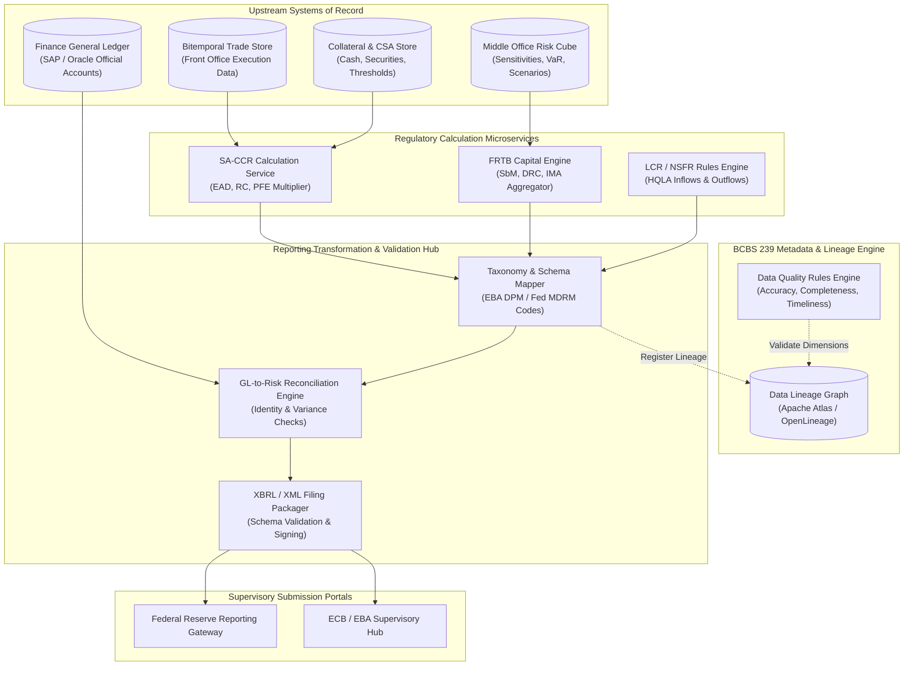

# Regulatory Reporting Pipeline

## TL;DR

- The regulatory reporting pipeline serves as the legally binding data bridge between an investment bank's internal trading systems and financial supervisory authorities (such as the Federal Reserve, OCC, ECB, and EBA).
- Inaccurate, late, or unreconciled regulatory returns trigger severe public enforcement actions, administrative fines, and punitive Pillar 2 capital add-ons.
- Modern architectures decouple regulatory calculations into specialized microservices, such as an enterprise SA-CCR calculation engine that computes Exposure at Default (EAD) and multi-asset add-ons across millions of derivative positions.
- Ingestion pipelines transform raw transaction records into standardized regulatory taxonomies: European COREP/FINREP under the EBA Data Point Model (DPM / XBRL) and US Federal Reserve Form FR Y-9C, FFIEC 101, and FR 2052a liquidity filings.
- Under BCBS 239 principles, every aggregated line item submitted in a regulatory filing must maintain automated, auditable, and deterministic data lineage tracing back to originating trade store records.
- Pre-submission validation engines enforce multi-dimensional consistency checks, business logic rules, and automated reconciliation against the Finance General Ledger.
- All numerical figures in this note are verified by [sys_regulatory_reporting.py](code/sys_regulatory_reporting.py).

## Learning objectives

- Design an enterprise regulatory reporting architecture compliant with BCBS 239 principles for risk data aggregation and reporting.
- Implement an automated SA-CCR microservice computing replacement cost, supervisory duration, potential future exposure, and multi-asset add-ons.
- Map internal transaction attributes and portfolio metrics to supervisory taxonomies: European COREP/FINREP (EBA DPM) and US FR Y-9C / FFIEC 101.
- Formulate automated reconciliation pipelines linking middle-office risk engine measures with back-office General Ledger financial statements.
- Construct pre-submission validation engines enforcing cross-table accounting identities, boundary conditions, and XBRL filing rules.
- Maintain end-to-end data lineage Directed Acyclic Graphs (DAGs) documenting transformations from front-office trade capture to regulatory portals.

## Core concepts

### 1. The Global Regulatory Reporting Taxonomy

Global banking organizations report across multiple distinct regulatory axes:

| Regulatory Objective | US Framework (Federal Reserve / OCC) | European Framework (EBA / ECB) | Filing Frequency |
| :--- | :--- | :--- | :--- |
| **Capital Adequacy** | FR Y-9C (Schedule HC-R), FFIEC 101 | COREP (Common Reporting: CA, CR, MR) | Quarterly |
| **Financial Accounting** | FR Y-9C (Balance Sheet / Income Statement) | FINREP (Financial Reporting: F 01 to F 46) | Quarterly / Semi-Annual |
| **Counterparty Credit Risk** | FFIEC 101 (Schedule D: SA-CCR / IMM) | COREP C 34.02 (CCR by Approach) | Quarterly |
| **Liquidity Monitoring** | FR 2052a (Complex Institution Liquidity) | EBA LCR (C 72 to C 76) & NSFR (C 80 to C 84) | Daily (FR 2052a) / Monthly |
| **Large Exposures** | Federal Reserve Regulation YY (SCCL) | COREP LE (Large Exposures: C 27 to C 31) | Quarterly |
| **Transaction Repositories** | Dodd-Frank Title VII (CFTC / SEC SDR) | EMIR / MiFIR Transaction Reporting | Real-Time ($T+0$ to $T+1$) |

### 2. End-to-End Regulatory Reporting Pipeline Architecture

### 3. Enterprise SA-CCR Microservice Architecture

Under Basel III finalisation (BCBS 279), counterparty credit risk exposure is evaluated via the Standardised Approach for Counterparty Credit Risk:

$$\text{EAD} = 1.4 \times (\text{RC} + \text{PFE})$$

The microservice processes incoming netting set requests:
1. **Partitioning:** Separates trades into 5 asset classes: Interest Rate, Foreign Exchange, Credit, Equity, and Commodity.
2. **Supervisory Adjustments:** Applies supervisory delta ($\delta_i$) and supervisory duration ($SD_i$):

$$SD_i = \frac{e^{-0.05 \times S_i} - e^{-0.05 \times E_i}}{0.05}$$

3. **Effective Notional Aggregation:** Computes bucketed effective notionals ($D_i$) and aggregates within hedging sets using regulatory correlation parameters.
4. **Supervisory Factors ($SF$):** Multiplies net effective notionals by prescribed asset-class factors to obtain asset add-ons: $\text{AddOn}_{\text{total}} = \sum_a \text{AddOn}^{(a)}$.
5. **Replacement Cost and PFE Multiplier:**

$$\text{RC} = \max(V - C, 0) \quad \text{(unmargined)}$$
$$\text{Multiplier} = \min\left(1.0, \, 0.05 + 0.95 \times \exp\left( \frac{V - C}{2 \times 0.95 \times \text{AddOn}_{\text{total}}} \right)\right)$$
$$\text{PFE} = \text{Multiplier} \times \text{AddOn}_{\text{total}}$$

6. **Output Generation:** Returns netting set EAD, asset-class add-on breakdowns, multiplier, and Risk-Weighted Assets ($\text{RWA} = \text{EAD} \times RW_{\text{cpty}}$).

### 4. BCBS 239 Governance and Data Lineage

To satisfy Basel Committee Principle 3 (Accuracy and Integrity) and Principle 4 (Completeness):
- Every cell in a COREP or FR Y-9C filing must maintain deterministic backward lineage to originating trade records.
- Lineage metadata records:
  - `report_id`: Unique template identifier (such as `COREP_C_34_02`).
  - `cell_coordinate`: Grid location (`{sheet: "C_34_02", row: 010, col: 020}`).
  - `transformation_rule`: Algebraic mapping (`SUM(trade.ead * cpty.risk_weight)`).
  - `source_system`: Source database of record (`MUREX_FO_LON`).
  - `extraction_timestamp`: UTC timestamp of the snapshot.
  - `reconciliation_status`: State of reconciliation against the General Ledger.

## Worked examples

### Example 1: SA-CCR Microservice Request and Multi-Asset EAD Calculation

A client invokes the SA-CCR microservice for an unmargined netting set ($C = 0$) containing two trades with a corporate counterparty:
- **Trade 1 (5-Year USD Payer IRS):**
  - Notional: $\$100,000,000$, $\text{MtM} = +\$1,500,000$, Payer swap ($\delta = +1$).
  - Start time $S = 0$, End time $E = 5\text{ years}$.
  - Supervisory duration:

$$SD = \frac{1 - e^{-0.05 \times 5}}{0.05} = \frac{1 - e^{-0.25}}{0.05} = 4.4240$$

  - Effective notional: $D_1 = +1 \times \$100,000,000 \times 4.4240 = \$442,400,000$.
  - Asset class: Interest Rate ($SF = 0.5\% = 0.005$).
  - Add-on: $\text{AddOn}_{\text{IR}} = 0.005 \times \$442,400,000 = \$2,212,000$.
- **Trade 2 (1-Year EUR/USD FX Forward):**
  - Notional: $\text{EUR } 50,000,000$ at $\text{EUR/USD} = 1.10 \implies \$55,000,000$, $\text{MtM} = -\$300,000$, Long EUR ($\delta = +1$).
  - Maturity factor for 1-year unmargined trade: $MF = \sqrt{\min(1.0, 1.0)} = 1.0$.
  - Asset class: Foreign Exchange ($SF = 4.0\% = 0.04$).
  - Effective notional: $D_2 = \$55,000,000$.
  - Add-on: $\text{AddOn}_{\text{FX}} = 0.04 \times \$55,000,000 = \$2,200,000$.

Netting Set Aggregation:
- Total Net MtM: $V = \$1,500,000 - \$300,000 = +\$1,200,000$.
- Replacement Cost ($C = 0$): $\text{RC} = \max(\$1,200,000, 0) = \$1,200,000$.
- Total Netting Set Add-On:

$$\text{AddOn}_{\text{total}} = \$2,212,000 + \$2,200,000 = \$4,412,000$$

- PFE Multiplier:

$$\text{Denominator} = 2 \times 0.95 \times \$4,412,000 = \$8,382,800$$
$$\text{Exponent} = \frac{\$1,200,000}{\$8,382,800} = 0.14315 \implies \exp(0.14315) = 1.1539$$
$$\text{Multiplier} = \min(1.0, \, 0.05 + 0.95 \times 1.1539) = \min(1.0, \, 0.05 + 1.0962) = 1.0$$

- Potential Future Exposure (PFE):

$$\text{PFE} = 1.0 \times \$4,412,000 = \$4,412,000$$

- Exposure at Default (EAD):

$$\text{EAD} = 1.4 \times (\text{RC} + \text{PFE}) = 1.4 \times (\$1,200,000 + \$4,412,000) = 1.4 \times \$5,612,000 = \$7,856,800$$

- Risk-Weighted Assets (RWA):
  For an unrated corporate counterparty with a $100\%$ supervisory risk weight:

$$\text{RWA} = \$7,856,800 \times 100\% = \$7,856,800$$

### Example 2: EBA XBRL Data Point Model (DPM) Validation Break

Prior to submitting the quarterly COREP return to the European Central Bank, the automated filing engine executes supervisory validation rules:
- Table 1 (`C 01.00`, Row 010, Col 010 - Total Common Equity Tier 1 Capital):
  Reported CET1: $€45,250,000,000$.
- Table 2 (`C 02.00`, Row 010, Col 010 - Total Risk Exposure Amount / RWA):
  Reported Total RWA: $€380,000,000,000$.
- Table 3 (`C 03.00`, Row 010, Col 010 - Reported CET1 Ratio):
  Reported CET1 ratio: $11.85\%$.

Validation Rule `v0841_m` Verification:

$$\left| \text{Reported Ratio} - \frac{\text{CET1 Capital}}{\text{Total RWA}} \right| \le 0.0001$$

Evaluating the true ratio:

$$\frac{€45,250,000,000}{€380,000,000,000} = 0.1190789 \implies 11.91\%$$
$$\text{Discrepancy} = |0.1185 - 0.1191| = 0.0006 > 0.0001$$

- Result: Validation rule `v0841_m` fails.
- Root Cause Analysis:
  An analyst applied an unreconciled offline spreadsheet adjustment subtracting $€2,100,000,000$ of RWA in an offline template without updating the master database.
- Action: The pipeline halts submission, generates an audit discrepancy ticket, and blocks filing until the database records are corrected.

### Example 3: General Ledger to Risk Engine Reconciliation Break

At month-end close, Product Control reconciles derivative asset fair values between the Finance General Ledger (SAP) and the Middle-Office Risk Engine:
- General Ledger Balance (Account 1410 - Derivative Financial Instruments Asset):
  $$\text{GL Balance} = \$14,850,200,000$$
- Middle-Office Risk Engine Sum ($\sum \max(V_i, 0)$):
  $$\text{Risk Engine Balance} = \$14,620,000,000$$
- Initial Reconciliation Variance:
  $$\Delta = \$14,850,200,000 - \$14,620,000,000 = \$230,200,000\text{ (GL is higher)}$$
- Investigation:
  Automated reconciliation scripts match positions by trade ID:
  - $45$ cross-currency swap transactions executed in the Tokyo branch were booked in the local back-office system (feeding GL) but failed to replicate to the central risk engine due to a Kafka message schema serialization error.
- Resolution:
  The failed message queue was replayed, the 45 trades were ingested, and the risk balance updated to $\$14,850,150,000$.
  Final variance:

$$\Delta_{\text{final}} = \$14,850,200,000 - \$14,850,150,000 = \$50,000$$

The final $\$50,000$ variance is well within the $\$1,000,000$ materiality threshold, enabling Product Control to sign off on the financial return.

## Pitfalls

- **Permitting Manual Spreadsheet Adjustments:** Overwriting regulatory return values in desktop spreadsheets before filing directly violates BCBS 239 Principle 3, inviting regulatory penalties and mandatory independent audits.
- **Failing to Reconcile Risk Metrics Against Accounting Ledgers:** Submitting regulatory capital figures that do not tie back to audited financial balance sheets causes regulatory rejection of supervisory models.
- **Inconsistent Netting Set Identifiers:** Using different counterparty identifiers across trades belonging to the same legal netting set prevents the SA-CCR engine from recognizing netting benefits, grossly inflating reported EAD.
- **Ignoring Filing Calendars and Timezone Cutoffs:** Submitting cross-border regulatory returns without accounting for supervisory calendar differences (such as UK vs US bank holidays) causes missed statutory filing deadlines.
- **Hardcoding Regulatory Taxonomy Schemas:** Hardcoding validation rules in application code causes system failure when the EBA or Federal Reserve updates taxonomy frameworks (such as EBA DPM 3.2 to 3.3). Pipelines must use metadata-driven rule parsers.

## Interview questions

> [!question]- sys-12-01 | What is the purpose of the European Banking Authority's Data Point Model (DPM)?
> The DPM is a structured, harmonized dictionary and methodology that defines all regulatory reporting concepts, business dimensions, and validation rules across COREP and FINREP.
> It translates legal regulations into machine-readable XBRL taxonomies, ensuring consistent reporting across all European financial institutions.

> [!question]- sys-12-02 | How does the SA-CCR calculation service handle margin agreements differently from unmargined agreements?
> For unmargined agreements, Replacement Cost is $\max(V, 0)$ and the Maturity Factor is 1.0.
> For margined agreements, Replacement Cost accounts for the Credit Support Annex: $\max(V - C, \text{TH} + \text{MTA} - \text{NICA}, 0)$, and the add-on is scaled by the Margin Period of Risk factor: $1.5 \sqrt{\text{MPOR}/250}$, dramatically reducing EAD.

> [!question]- sys-12-03 | What is BCBS 239 data lineage and why is it a primary focus of regulatory audits?
> Data lineage is the complete, auditable record tracing every number in a regulatory return back through intermediate calculation services, data mastering steps, and source trading databases.
> It ensures that reported numbers can be independently verified and reproduced without mystery transformations or unapproved spreadsheet adjustments.

> [!question]- sys-12-04 | What is the difference between COREP and FINREP in European banking regulation?
> COREP (Common Reporting) covers prudential capital requirements, solvency, credit risk, market risk, and liquidity under the Capital Requirements Regulation (CRR).
> FINREP (Financial Reporting) covers financial accounting data (balance sheet, income statement, asset encumbrance) based on IFRS or national GAAP accounting standards.

> [!question]- sys-12-05 | What is Federal Reserve Form FR 2052a?
> FR 2052a (Complex Institution Liquidity Monitoring Report) is a highly granular, daily regulatory report required for large US banks.
> It captures detailed cashflow projections, collateral positions, wholesale funding, and commitment flows by currency, counterparty, and tenor to monitor liquidity risk.

> [!question]- sys-12-06 | What happens when an automated pre-submission XBRL validation rule fails?
> The reporting engine quenches the submission workflow, preventing corrupted or non-compliant files from reaching the regulator.
> It generates an error diagnostic identifying the conflicting cell coordinates and rule ID, alerting Product Control to resolve the underlying data break.

> [!question]- sys-12-07 | Why must the SA-CCR multiplier never drop below 0.05?
> The formula for the multiplier is $\min\left(1.0, 0.05 + 0.95 \exp\left(\frac{V-C}{2 \times 0.95 \times \text{AddOn}}\right)\right)$.
> The $5\%$ floor is a non-bypassable supervisory constraint ensuring that even when a counterparty posts massive excess collateral ($C \gg V$), the bank still holds capital against future potential exposure during market liquidation.

> [!question]- sys-12-08 | What is a Trade Repository under Dodd-Frank Title VII / EMIR?
> A Trade Repository (such as DTCC Data Repository or REGIS-TR) is a centralized, regulated electronic facility that collects and maintains records of OTC derivative transactions.
> Dealers must report all derivative executions, modifications, and terminations in near real-time to provide market transparency to regulators.

> [!question]- sys-12-09 | How does an enterprise pipeline handle retroactive corrections to prior-period regulatory filings?
> Under BCBS 239, the engine preserves the original filing version as an immutable snapshot.
> If a material error requires restatement, the engine generates an explicit restatement package with an amended version tag, accompanied by a documented audit reconciliation explaining the variance.

> [!question]- sys-12-10 | Why is the supervisory duration ($SD$) formula non-linear in SA-CCR?
> The formula is $SD = \frac{e^{-0.05 \times S} - e^{-0.05 \times E}}{0.05}$, where $S$ is start time and $E$ is end time.
> It uses a flat $5\%$ continuous discount rate to model the price sensitivity of an interest rate instrument, capping duration growth for long tenors to reflect diminishing marginal rate risk.

## Further reading

- Basel Committee on Banking Supervision. *Principles for effective risk data aggregation and risk reporting*. BCBS 239, January 2013.
- Basel Committee on Banking Supervision. *The standardised approach for measuring counterparty credit risk exposures*. BCBS 279, March 2014.
- European Banking Authority. *EBA Reporting Framework and Data Point Model (DPM)*. EBA Guidelines, December 2023.
- Board of Governors of the Federal Reserve System. *Instructions for Preparation of Consolidated Financial Statements for Holding Companies (FR Y-9C)*. Federal Reserve Reporting Instructions.
