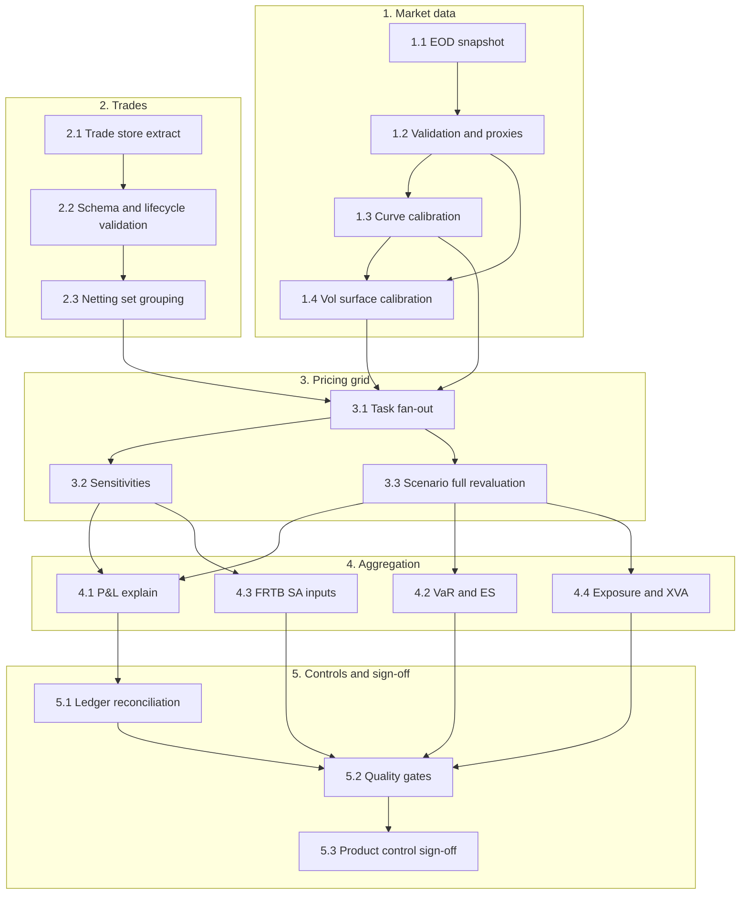
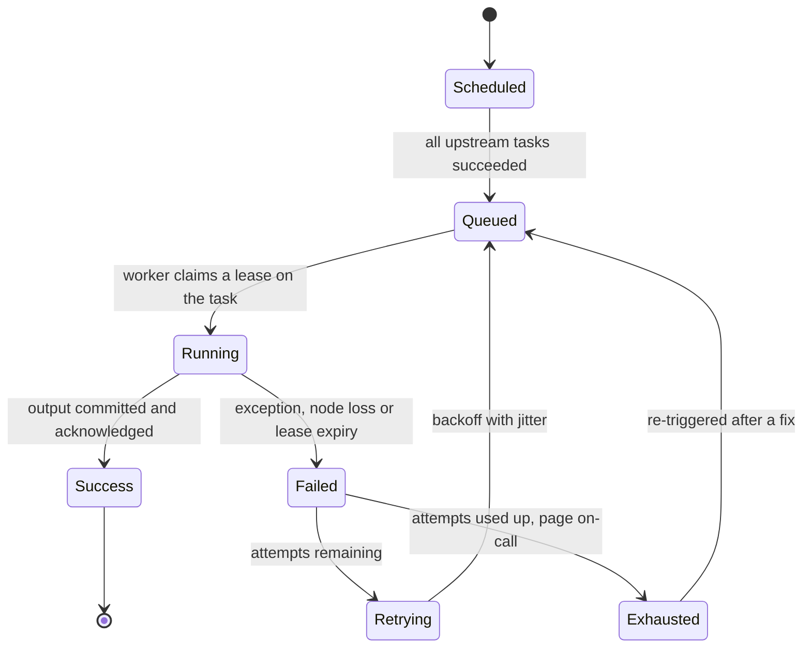
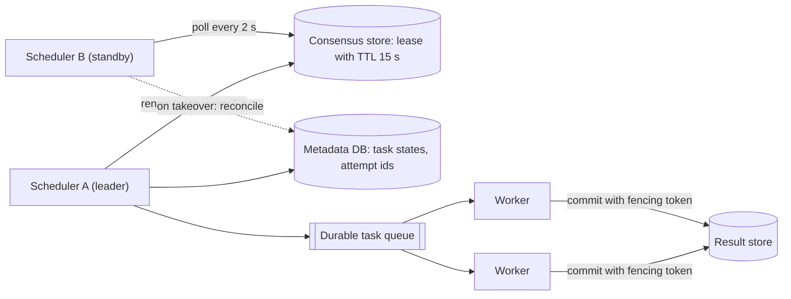
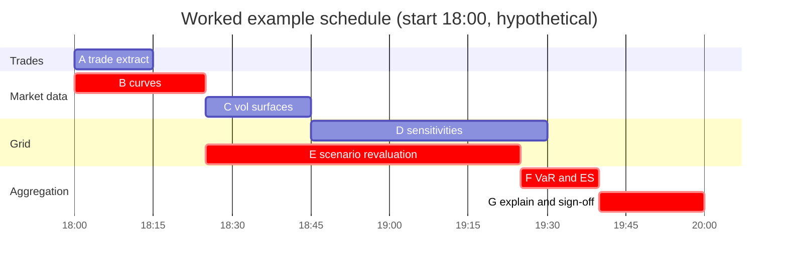
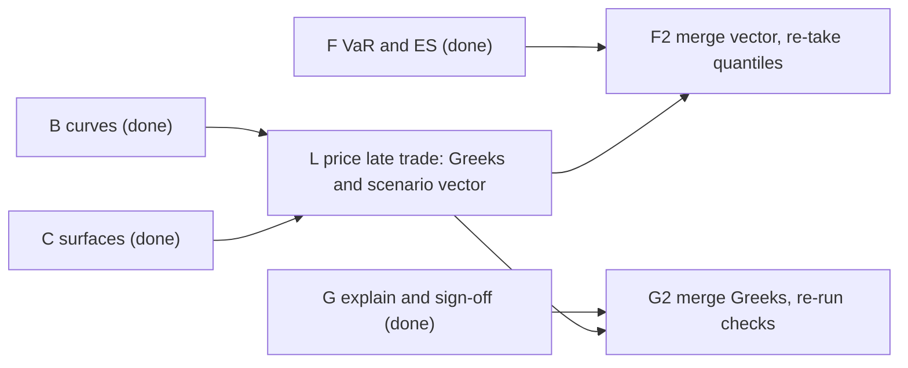

# The EOD Risk Batch

## TL;DR

- The end-of-day (EOD) risk batch turns the day's trades and a closing market snapshot into official P&L, sensitivities, VaR/ES and capital inputs; it is a directed acyclic graph (DAG) of tasks run on a compute grid against a sign-off deadline.
- The critical path method (CPM) finds the longest path through the DAG: its length is the minimum runtime, and only tasks with zero float shorten the batch when sped up, and only until a second path becomes critical.
- Deterministic CPM is optimistic: with uncertain durations every path keeps its mean length but the expected makespan rises, because the makespan is a maximum over paths.
- Late trades are absorbed by an incremental sub-DAG that prices only the new trade and merges additive vectors (scenario P&L, Greeks); non-additive outputs (VaR, ES, netting-set XVA) are recomputed from the merged vectors, never added.
- Restartability rests on idempotent tasks (keyed upserts or atomic partition swaps) and on lease-based scheduler failover whose time is bounded by the lease TTL, the polling interval and the recovery scan.
- Every number here is computed, printed and asserted by [sys_eod_batch.py](code/sys_eod_batch.py); all durations and settings are hypothetical teaching inputs.

## Learning objectives

- Design an enterprise EOD risk batch pipeline modeled as a Directed Acyclic Graph (DAG) with explicit dependency barriers.
- Apply the Critical Path Method (CPM) to calculate early/late start times, task slack (float), and batch duration.
- Explain why crashing a critical task has diminishing returns and why deterministic CPM understates the expected makespan.
- Implement task-level idempotency and atomic partition exchange patterns to guarantee restartability without duplicate records.
- Architect dynamic sub-DAG invalidation and backfill workflows to process late trade amendments in minutes rather than hours, and state which outputs may be merged additively.
- Design high-availability scheduler failover protocols using distributed consensus leases and persistent task queues, and bound the failover time.
- Construct automated quality gates enforcing data integrity thresholds prior to downstream regulatory and financial ledger publication.

## Core concepts

### 1. What the batch produces and why it has a deadline

The batch starts from two cut-offs: a trade population (everything booked by the cut-off, with its lifecycle events) and an official closing market snapshot.
It produces the official books and records: end-of-day P&L and its explain, sensitivities, VaR and ES, FRTB inputs, counterparty exposures and the feeds for finance and regulatory reporting.
The deadline is set by the consumers: the trading desks need signed-off P&L and risk before the next open, finance needs ledger feeds, and supervisors expect timely risk reports.
BCBS 239 makes timeliness an explicit principle (Principle 5: risk data aggregation must be timely while meeting accuracy, integrity, completeness and adaptability), and Principle 3 requires the aggregation to be largely automated to minimise errors.
A global bank runs one batch per region, each triggered by its own market close, then a consolidated run once the last region signs off; for US equities the trigger is the NYSE close at 16:00 ET (core session 9:30 a.m. to 4:00 p.m. ET, nyse.com as of 2026-10).

### 2. The batch as a DAG

The vol surfaces depend on the curves (forwards and discounting enter the implied-vol inversion), which is why the worked example below has the surface task after the curve task.
A scheduler executes the graph in topological order: a task becomes runnable when all its predecessors succeeded, which is Kahn's algorithm run online.
A cycle in the declared dependencies is a configuration error and must be rejected at load time, not discovered at 2 a.m.

### 3. Critical path method

For task $i$ with duration $d_i$, predecessors $P(i)$, successors $S(i)$ and an optional release time $r_i$ (the earliest moment its input exists):

$$ES_i = \max\Big(r_i, \max_{j \in P(i)} EF_j\Big), \qquad EF_i = ES_i + d_i,$$

$$T = \max_i EF_i, \qquad LF_i = \min_{k \in S(i)} LS_k \;(\text{or } T \text{ for a sink}), \qquad LS_i = LF_i - d_i,$$

$$\text{Float}_i = LS_i - ES_i = LF_i - EF_i.$$

Without release times, $T$ is the length of the longest source-to-sink path and $\text{Float}_i = T - (\text{longest path through } i)$; the forward pass is the longest-path dynamic programme on a DAG, $O(V + E)$ after a topological sort.
The critical path is the set of zero-float tasks.
Two consequences matter for capacity planning:

- Speeding up a task with float does not move $T$ at all.
- Speeding up a critical task moves $T$ one for one only until another path catches up; past that point the two paths must be crashed together.

### 4. Uncertain durations: why the plan is optimistic

Task durations vary night to night (market moves change calibration iterations, trade counts change grid size, nodes straggle).
If each duration is multiplied by a mean-one noise factor, the expected length of every individual path is unchanged, but

$$\mathbb{E}\big[\max(L_1, \dots, L_m)\big] \ge \max\big(\mathbb{E}[L_1], \dots, \mathbb{E}[L_m]\big)$$

by Jensen's inequality, because the maximum is convex.
The more near-critical paths a DAG has, the larger the gap, so an SLA plan must budget for the distribution of the makespan (a high percentile), not for the deterministic CPM number.

### 5. Task states, retries and idempotency

Distributed task execution gives at-least-once semantics: a worker can commit its output and die before the acknowledgement, so the scheduler re-runs a task that already wrote.
The task is safe to retry only if its effect is idempotent: running it twice with the same inputs leaves the same state as running it once.
Two standard implementations:

- Keyed upsert: every output row carries a natural key such as (business date, book, risk factor, run id), and the write is an upsert on that key (`INSERT ... ON CONFLICT ... DO UPDATE` in PostgreSQL); the Idempotent Receiver pattern of Hohpe and Woolf is the messaging form of the same idea.
- Atomic partition swap: the task writes a complete staging table and the publish step swaps it in as the partition for that business date (`ALTER TABLE ... EXCHANGE PARTITION` in Oracle); readers see the old partition or the new one, never a half-written one.

### 6. Scheduler high availability with a lease

Only the lease holder may schedule.
If the leader dies, the standby can take over only after the lease expires, so detection takes at least the TTL minus the renewal interval and at most the TTL.
A dead leader blocks the batch for that detection time plus up to one standby polling interval plus the takeover reconciliation (Example 5).
A lease is not safe by itself: a leader paused by a long GC or a network partition may wake up after its lease expired and still act.
The fix is a fencing token (a number that increases with every lease grant) attached to every write; the result store rejects writes carrying an older token (Kleppmann, chapter 8).
Workers keep running through a scheduler failover because they pull from a durable queue; the new leader reconciles the metadata DB and re-queues only the tasks whose workers are gone.

## Worked examples

### Example 1: critical path of a fixed income batch

Hypothetical durations in minutes:

| Task | Description | Predecessors | Duration |
| :--- | :--- | :--- | ---: |
| A | Trade extract and normalisation | none | 15 |
| B | Market snapshot and curve calibration | none | 25 |
| C | Vol surface calibration | B | 20 |
| D | Sensitivity grid | A, B, C | 45 |
| E | Scenario full revaluation | A, B | 60 |
| F | VaR and ES aggregation | E | 15 |
| G | P&L explain and sign-off | D, F | 20 |

Forward pass: $EF_A = 15$, $EF_B = 25$, $C$ runs 25 to 45, $D$ waits for $\max(15, 25, 45) = 45$ and ends at 90, $E$ waits for $\max(15, 25) = 25$ and ends at 85, $F$ runs 85 to 100, and $G$ waits for $\max(90, 100) = 100$ and ends at $T = 120$ minutes.

Backward pass from $LF_G = 120$:

| Task | ES | EF | LS | LF | Float |
| :--- | ---: | ---: | ---: | ---: | ---: |
| A | 0 | 15 | 10 | 25 | 10 |
| B | 0 | 25 | 0 | 25 | 0 |
| C | 25 | 45 | 35 | 55 | 10 |
| D | 45 | 90 | 55 | 100 | 10 |
| E | 25 | 85 | 25 | 85 | 0 |
| F | 85 | 100 | 85 | 100 | 0 |
| G | 100 | 120 | 100 | 120 | 0 |

The critical path is B, E, F, G.
The script confirms this by brute force: it enumerates all 5 source-to-sink paths, finds B-E-F-G as the only path of length 120, and recovers every float as 120 minus the longest path through the task.

### Example 2: where to spend compute

Halving D (doubling its cores) leaves the makespan at 120 minutes: D has 10 minutes of float.
Crashing E pays one for one at first: E at 55 minutes gives 115.
But the next-longest path B-C-D-G is 110 minutes, so E at 50 gives 110 and E at 40 or 30 still gives 110.
At E = 50 every task except A is critical (B, C, D, E, F and G all have zero float), so further gains need D or C crashed as well.
In an interview, say it as: "Find the critical path, crash it until the second path appears, then re-run CPM; the marginal value of cores is the float structure, not the task size."

### Example 3: SLA headroom and the PERT bias

The batch starts at 18:00 and sign-off is due at 20:30, a 150-minute window, so the deterministic plan has 30 minutes of headroom.
Now let every duration vary night to night by an independent lognormal factor with mean 1 and log-volatility 0.25.
Over 200,000 simulated nights (seed 2026) the critical path B-E-F-G keeps its mean length of 120.0 minutes, but the mean makespan is 124.0 minutes, the 95th percentile is 153.0 minutes and the batch misses the 150-minute window on 6.6% of nights.
A zero-noise control run reproduces the deterministic 120 minutes exactly, so the gap comes from the noise acting through the maximum over paths, not from any path getting longer on average.
The planning lesson: quote and monitor a percentile of the makespan against the SLA, and treat near-critical paths as risk even when CPM says they have float.

### Example 4: a late trade

A trade executed before the cut-off is booked late and arrives 95 minutes into the batch (19:35), while F is running.

- Full rerun: every task restarts at 95 and the batch completes at 215 minutes (21:35), a breach.
- Incremental sub-DAG: one task L prices the trade alone against the already-calibrated curves and surfaces (needs B and C) and produces its sensitivities and its scenario P&L vector in 45 s, finishing at 95.75 minutes.
  F2 adds the trade's scenario vector to the portfolio vector and re-takes the VaR and ES quantiles (1 minute, after F and L); G2 merges the trade's Greeks into the P&L explain and re-runs the sign-off checks (1.5 minutes, after G and L).
  The batch now completes at 121.5 minutes: the late trade costs 1.5 minutes and leaves 28.5 minutes of headroom.

The merge is valid only for additive quantities.
Scenario P&L, PVs and sensitivities add across trades; VaR, ES and exposure profiles of a netting set (with collateral and netting) do not, so they must be recomputed from the merged vectors.
In the script's illustration the late trade is a partial hedge: the VaR of the book plus the trade is smaller than the VaR of the book alone, so adding a standalone "VaR increment" would have moved the number in the wrong direction.

### Example 5: how long a scheduler failover takes

Settings (hypothetical): lease TTL 15 s, the leader renews every 5 s, the standby polls every 2 s, and reconciling the metadata DB takes 8 s.
If the leader crashes just before a renewal, the lease expires 10 s later; if just after, 15 s later.
The standby then waits up to one polling interval and spends 8 s reconciling.
Best case $10 + 0 + 8 = 18$ s, worst case $15 + 2 + 8 = 25$ s, and with a uniformly random crash phase the mean is $12.5 + 1 + 8 = 21.5$ s.
The script simulates 100,000 crashes with independent leader and standby clocks and reproduces the bounds and a mean of 21.49 s.
Shortening the TTL speeds failover but raises the risk of false failovers during GC pauses or network blips, which is why fencing tokens, not short TTLs, provide safety.

### Example 6: why retries need idempotency

A task writes three DV01 rows for a book (1,500, -700 and 2,200 dollars per basis point, total 3,000), commits, and dies before acknowledging, so the scheduler re-runs it.
With an append-only table the book now shows 6,000: risk doubled silently.
With an upsert keyed on (business date, book, risk factor) the second run overwrites the same three rows and the book still shows 3,000.

## Pitfalls

- **Sleep-based waiting:** `sleep(1800)` before reading market data fails when the feed is early or late; use event sensors on the snapshot's completion marker.
- **Non-idempotent appends:** retries after a commit-then-crash duplicate rows and double reported risk (Example 6).
- **Over-eager invalidation:** a reactive DAG that invalidates everything downstream of a minor curve change can cancel hours of Monte Carlo; invalidation should follow true data dependencies and be throttled during the batch.
- **Thundering reads of shared inputs:** thousands of workers reading the same snapshot file from one NFS volume saturate it; stage inputs to object storage or local caches before fan-out.
- **Quality gates that only warn:** a gate that logs instead of failing lets a zero-filled sensitivity file reach regulators; gates must block publication and quarantine the run.
- **Adding non-additive numbers:** merging a late trade by adding its standalone VaR or its standalone netting-set exposure instead of recomputing from vectors.
- **Planning to the deterministic critical path:** the expected and high-percentile makespans exceed it (Example 3).

## Interview questions

> [!question]- sys-13-01 | What is the Critical Path in an EOD risk batch and why is it essential for infrastructure capacity planning?
> The longest source-to-sink path through the task DAG; its tasks have zero float and its length is the minimum batch runtime.
> Only speeding up critical tasks shortens the batch, and only until another path becomes critical, so compute should be bought for the critical path and re-planned after each change.

> [!question]- sys-13-02 | What does it mean for a batch calculation task to be idempotent?
> Running it twice with the same inputs leaves the same persisted state as running it once.
> It matters because distributed execution is at-least-once: a task can commit and die before acknowledging, and the retry must not duplicate rows or double count risk.

> [!question]- sys-13-03 | How do modern orchestrators handle late-arriving trades without rerunning the entire batch?
> They add a small sub-DAG: price only the new trade against the already-built market data, then merge its additive outputs (scenario P&L vector, PV, Greeks) into the existing aggregates and re-run only the downstream steps.
> Non-additive results (VaR, ES, netting-set exposure) are recomputed from the merged vectors, never added; in the worked example this costs 1.5 minutes, while a full rerun from the arrival time would finish at 215 minutes instead of 120.

> [!question]- sys-13-04 | What is the difference between Early Start ($ES$) and Late Start ($LS$) in the Critical Path Method?
> $ES$ is the earliest a task can start, once all predecessors (and its release time) allow; $LS = LF - d$ is the latest it can start without delaying the batch.
> Their difference $LS - ES$ is the task's total float.

> [!question]- sys-13-05 | What is an automated Quality Gate in an EOD batch pipeline?
> A blocking check on batch outputs before publication: completeness (every book and risk factor present), validity (no NaN or zero-filled vectors), reconciliation (trade counts and PVs against source systems and the ledger) and plausibility (day-on-day changes within thresholds the firm calibrates).
> A failure quarantines the run and stops downstream publication until someone signs off a fix or an override.

> [!question]- sys-13-06 | How does a distributed scheduler prevent duplicate task execution across worker nodes?
> A worker claims a task atomically before running it (for example a row lock with `SELECT ... FOR UPDATE SKIP LOCKED`, or a lease in a consensus store such as etcd or ZooKeeper).
> Claims can still overlap after a pause or partition, so outputs must also be idempotent or fenced with a monotonically increasing token that the result store checks.

> [!question]- sys-13-07 | What is the "Follow-the-Sun" batch architecture?
> Each region runs its own EOD batch triggered by its own market close and signs it off locally, so batches are staggered around the clock.
> Regional results then feed a consolidated firm-wide run; the hard part is a consistent cut-off and snapshot policy for books traded in several regions.

> [!question]- sys-13-08 | What causes the "thundering herd" problem in distributed risk grids and how is it resolved?
> Many workers hit the same resource at once: a shared input file at fan-out, the result store at fan-in, or a recovered service after a synchronised retry.
> Fixes: stage inputs to caches before fan-out, aggregate hierarchically, apply backpressure, and retry with exponential backoff plus random jitter so retries de-synchronise.

> [!question]- sys-13-09 | What is the purpose of checkpointing in long-running Monte Carlo batch tasks?
> To persist completed work (for example finished path blocks with their seeds or counters) so a replacement worker resumes from the last checkpoint instead of path zero.
> With counter-based random numbers the resumed result is identical to an uninterrupted run, which keeps reruns reproducible.

> [!question]- sys-13-10 | Why are atomic partition swaps preferred over row-by-row updates in enterprise risk data warehouses?
> The task loads a complete staging table and the publish step swaps it in as the business-date partition in one metadata operation, so readers see either the old or the new data, never a mix.
> Row-by-row updates hold locks for longer, generate more log volume and expose half-written states if the task dies, and a retry of a swap is naturally idempotent.

> [!question]- sys-13-11 | In the worked example (critical path B-E-F-G of 120 minutes, next path B-C-D-G of 110), what makespan do you get if E is cut from 60 to 40 minutes, and why?
> $110$ minutes, not 100.
> Cutting E by 20 shortens B-E-F-G to 100, but B-C-D-G at 110 becomes the critical path; only the first 10 minutes of crashing E pay off.

> [!question]- sys-13-12 | Every task's duration gets mean-one noise. Does the expected batch makespan stay at the deterministic CPM value?
> No, it rises: each path keeps its mean length, but the makespan is the maximum over paths and $\mathbb{E}[\max] \ge \max \mathbb{E}$ by Jensen's inequality.
> In the worked example with log-volatility 0.25 the mean makespan is 124.0 minutes against 120, and the 95th percentile is 153.0 minutes.

> [!question]- sys-13-13 | Why is a lease alone not enough to stop two schedulers acting as leader, and what fixes it?
> A leader can pause (GC, VM stall, partition) past its lease expiry and resume believing it still leads, while the standby has taken over.
> Each lease grant carries a fencing token that increases monotonically; every write includes it and storage rejects writes with an older token.

> [!question]- sys-13-14 | Lease TTL 15 s, renewal every 5 s, standby polls every 2 s, takeover reconciliation 8 s: what are the best and worst failover times?
> $18$ s and $25$ s.
> Detection takes 10 s (crash just before a renewal) to 15 s (just after), plus 0 to 2 s of polling, plus 8 s of reconciliation.

> [!question]- sys-13-15 | Which batch outputs can be updated for a late trade by adding the trade's contribution, and which cannot?
> Additive: PV, P&L, sensitivities and the per-scenario P&L vector, because they are sums over trades.
> Not additive: VaR, ES and other quantiles, netting-set exposures and XVA under netting and collateral, and capital formulas with square roots or floors; recompute these from the merged vectors.

> [!question]- sys-13-16 | A task wrote its rows, committed, then crashed before acknowledging. What happens to reported DV01 on retry with an append-only table versus a keyed upsert?
> Append-only doubles it (3,000 becomes 6,000 dollars per basis point in the example); a keyed upsert leaves it at 3,000.
> At-least-once execution makes this retry normal, so the write path, not the scheduler, must guarantee correctness.

> [!question]- sys-13-17 | Which BCBS 239 principles bear directly on the EOD batch design?
> Principle 3 (accuracy and integrity, with aggregation largely automated) and Principle 5 (timeliness), with Principle 6 (adaptability) for ad hoc and stress requests.
> They push towards automated, reconciled, restartable pipelines with predictable completion times rather than manual workarounds.

## In this repo and SDE-Interview-Prep

- `code/sys_eod_batch.py` computes, prints and asserts every number on this page: the CPM passes with a brute-force path check, crashing, the stochastic makespan, the late-trade sub-DAG, failover bounds with a simulation, and the retry example.
- [Regulatory Reporting Pipeline](12-Regulatory-Reporting-Pipeline.md) for the consumers of the batch, [Risk Engine Architecture](07-Risk-Engine.md) for the computations inside it, and [Storage and Compute](14-Storage-and-Compute.md) for where its outputs live.
- SDE-Interview-Prep: [Idempotency and Delivery](https://github.com/shreejitverma/SDE-Interview-Prep/blob/main/04-System-Design/00-Concepts/Idempotency-and-Delivery.md), [Consensus and Failure Detection](https://github.com/shreejitverma/SDE-Interview-Prep/blob/main/04-System-Design/00-Concepts/Consensus-and-Failure-Detection.md), [MapReduce Architecture](https://github.com/shreejitverma/SDE-Interview-Prep/blob/main/04-System-Design/00-Concepts/MapReduce-Architecture.md).

## Further reading

- Basel Committee on Banking Supervision. *Principles for effective risk data aggregation and risk reporting* (BCBS 239). January 2013.
- Cormen, Leiserson, Rivest and Stein. *Introduction to Algorithms*, 4th edition, MIT Press, 2022: chapter 20 (topological sort) and chapter 22 (shortest paths in directed acyclic graphs; the longest path is the same algorithm with signs flipped).
- Kleppmann, Martin. *Designing Data-Intensive Applications*. O'Reilly, 2017: chapter 8 (leases, process pauses and fencing tokens) and chapter 10 (batch processing).
- Hohpe, Gregor and Woolf, Bobby. *Enterprise Integration Patterns*. Addison-Wesley, 2003: Idempotent Receiver and Guaranteed Delivery.
