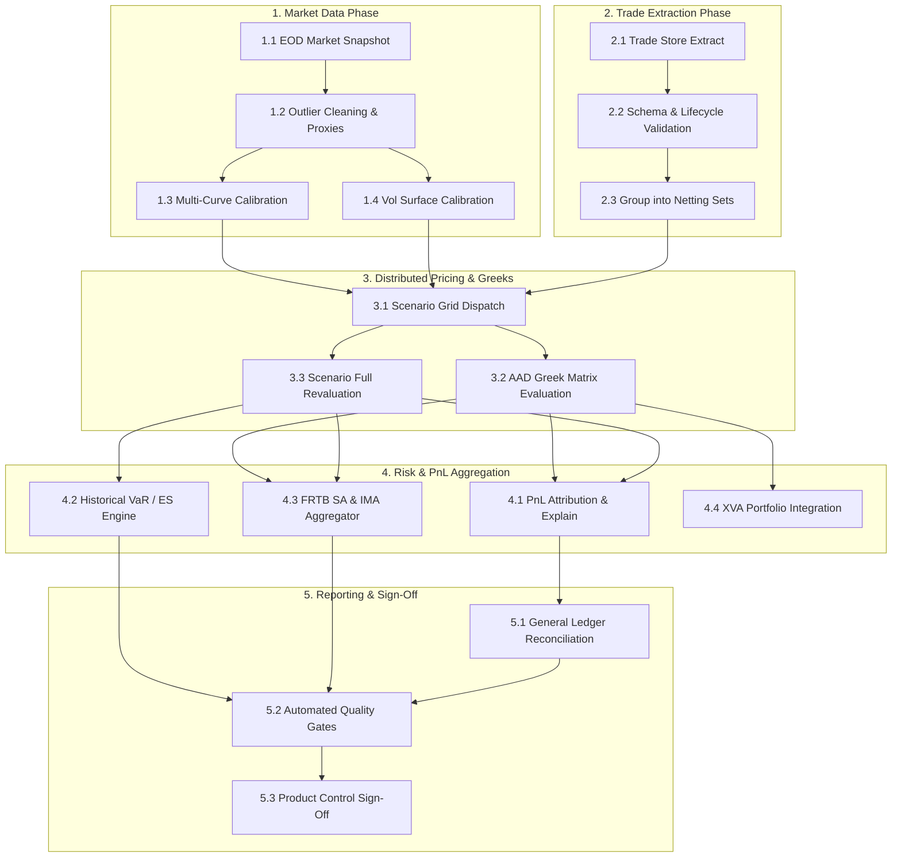
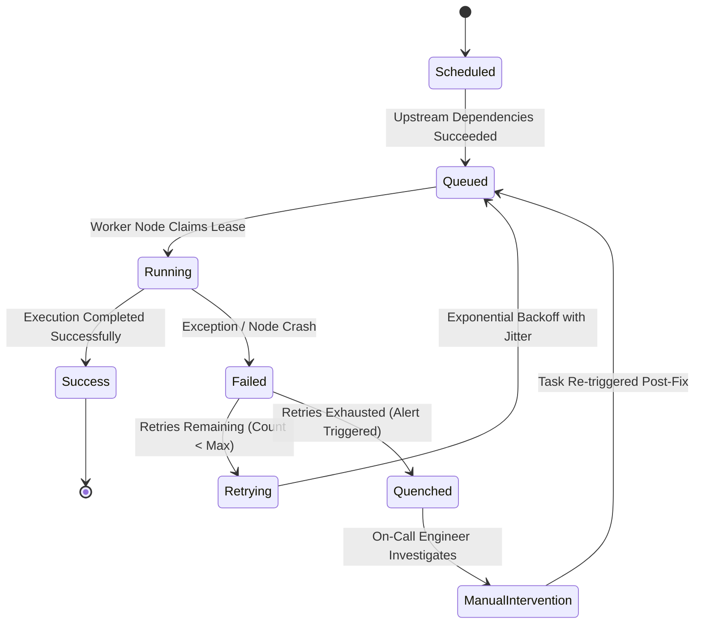

# The EOD Risk Batch

## TL;DR

- The End-of-Day (EOD) risk batch is the central operational pipeline of capital markets technology, processing millions of positions and market scenarios overnight to generate official P&L, risk sensitivities, and regulatory capital figures.
- The batch is organized as a Directed Acyclic Graph (DAG) of interdependent tasks executed across distributed compute clusters and orchestrated by enterprise schedulers (such as Apache Airflow, Dagster, or proprietary platforms like Goldman Sachs SecDB and J.P. Morgan Athena).
- Execution timelines strictly follow regional market closes across a follow-the-sun architecture: Asia close by 18:00 JST, EMEA close by 20:00 GMT, and Americas close by 21:00 EST, culminating in global consolidated capital sign-off by 03:00 EST.
- Critical Path Method (CPM) forward and backward passes identify zero-float tasks ($Float = 0$), directing compute infrastructure investments to tasks that directly dictate end-to-end batch duration.
- Operational resiliency requires task-level idempotency, atomic partition swapping, automated checkpointing, and dynamic sub-DAG invalidation to backfill late-booked trades without restarting the entire multi-hour batch.
- All numerical figures in this note are verified by [sys_eod_batch.py](file:///Users/shreejitverma/.treehouse/The-Quant-Prep-106fe7/5/The-Quant-Prep/18-Pricing-and-Risk-Systems/code/sys_eod_batch.py).

## Learning objectives

- Design an enterprise EOD risk batch pipeline modeled as a Directed Acyclic Graph (DAG) with explicit dependency barriers.
- Apply the Critical Path Method (CPM) to calculate early/late start times, task slack (float), and batch duration.
- Implement task-level idempotency and atomic partition exchange patterns to guarantee restartability without duplicate records.
- Architect dynamic sub-DAG invalidation and backfill workflows to process late trade amendments in minutes rather than hours.
- Design high-availability scheduler failover protocols using distributed consensus leases and persistent task queues.
- Construct automated quality gates enforcing data integrity thresholds prior to downstream regulatory and financial ledger publication.

## Core concepts

### 1. The Global Follow-the-Sun Batch Timeline

Global investment banks operate trading hubs across three regional windows, leading to a coordinated chain of batch executions:

### 2. The EOD Risk Batch Dependency Graph (DAG)

Tasks execute according to topological dependency ordering:

### 3. Critical Path Method (CPM) Analysis

In any task dependency graph, the **Critical Path** is the longest path of sequential dependencies from batch start to completion:
- **Early Start ($ES$):** Earliest time a task can begin once all predecessors complete.
- **Early Finish ($EF$):** $EF = ES + \text{Duration}$.
- **Late Finish ($LF$):** Latest time a task can complete without delaying the downstream project delivery deadline.
- **Late Start ($LS$):** $LS = LF - \text{Duration}$.
- **Total Float (Slack):** $\text{Float} = LS - ES = LF - EF$.
Tasks on the critical path have strictly **$\text{Float} = 0$**. Any execution delay in a critical path task directly delays the entire EOD batch and threatens regulatory reporting SLAs.

### 4. Task State Machine and Idempotent Retry Logic

- **Idempotency Mandate:** A batch task must produce identical system state regardless of how many times it executes with the same inputs:

$$\text{Task}(S) = \text{Task}(\text{Task}(S))$$

Database operations must use atomic partition swaps (`ALTER TABLE ... EXCHANGE PARTITION`) or upserts (`INSERT ... ON CONFLICT DO UPDATE`) to avoid inserting duplicate records during retries.

## Worked examples

### Example 1: Critical Path Analysis for a Fixed Income Risk Batch

A risk engineering team analyzes an Americas EOD fixed income batch consisting of seven primary task blocks:

| Task Code | Task Description | Predecessors | Duration ($D_i$) |
| :--- | :--- | :--- | :--- |
| **A** | Trade Ingestion & Normalization | None | $15\text{ minutes}$ |
| **B** | Market Snapshot & Curve Calibration | None | $25\text{ minutes}$ |
| **C** | Surface Calibration & SABR Fitting | Task B | $20\text{ minutes}$ |
| **D** | Greek Sensitivity Grid Dispatch | Task A, Task B, Task C | $45\text{ minutes}$ |
| **E** | Full Revaluation Scenario Simulation | Task A, Task B | $60\text{ minutes}$ |
| **F** | VaR & Expected Shortfall Aggregation | Task E | $15\text{ minutes}$ |
| **G** | PnL Explain & Product Control Sign-Off | Task D, Task F | $20\text{ minutes}$ |

#### Step 1: Forward Pass (Early Start and Early Finish)
- Task A: $ES = 0$, $EF = 0 + 15 = 15\text{ min}$.
- Task B: $ES = 0$, $EF = 0 + 25 = 25\text{ min}$.
- Task C: $ES = EF(B) = 25$, $EF = 25 + 20 = 45\text{ min}$.
- Task D: $ES = \max(EF(A), EF(B), EF(C)) = \max(15, 25, 45) = 45$, $EF = 45 + 45 = 90\text{ min}$.
- Task E: $ES = \max(EF(A), EF(B)) = \max(15, 25) = 25$, $EF = 25 + 60 = 85\text{ min}$.
- Task F: $ES = EF(E) = 85$, $EF = 85 + 15 = 100\text{ min}$.
- Task G: $ES = \max(EF(D), EF(F)) = \max(90, 100) = 100$, $EF = 100 + 20 = 120\text{ min}$.

Total minimum batch execution duration: **$120\text{ minutes}$ ($2.0\text{ hours}$)**.

#### Step 2: Backward Pass (Late Start, Late Finish, and Float)
Setting target completion $LF(G) = 120\text{ min}$:
- Task G: $LF = 120$, $LS = 120 - 20 = 100\text{ min} \implies \text{Float} = 100 - 100 = 0$.
- Task F: $LF = LS(G) = 100$, $LS = 100 - 15 = 85\text{ min} \implies \text{Float} = 85 - 85 = 0$.
- Task E: $LF = LS(F) = 85$, $LS = 85 - 60 = 25\text{ min} \implies \text{Float} = 25 - 25 = 0$.
- Task D: $LF = LS(G) = 100$, $LS = 100 - 45 = 55\text{ min} \implies \text{Float} = 55 - 45 = 10\text{ minutes}$.
- Task C: $LF = LS(D) = 55$, $LS = 55 - 20 = 35\text{ min} \implies \text{Float} = 35 - 25 = 10\text{ minutes}$.
- Task B: $LF = \min(LS(C), LS(D), LS(E)) = \min(35, 55, 25) = 25$, $LS = 25 - 25 = 0\text{ min} \implies \text{Float} = 0$.
- Task A: $LF = \min(LS(D), LS(E)) = \min(55, 25) = 25$, $LS = 25 - 15 = 10\text{ min} \implies \text{Float} = 10\text{ minutes}$.

Critical Path Identification and Resource Allocation:
- The zero-float critical path is **$\text{B} \to \text{E} \to \text{F} \to \text{G}$**.
- Allocating additional cluster cores to Task D (Greeks) yields zero runtime benefit because it possesses $10\text{ minutes}$ of slack float.
- Adding compute nodes to Task E (Full Revaluation, taking $60\text{ minutes}$ on the critical path) directly reduces total batch duration.

### Example 2: Handling Late Trade Bookings via Sub-DAG Invalidation

At 22:30 EST, after the EOD risk batch has completed Task E and reached Task F (VaR calculation), a trader books a missing $\$500,000,000$ 10-year interest rate swap executed at 16:15 EST but omitted from the initial extract:
- Rerunning the full batch from Task A would require another $120\text{ minutes}$, violating the 23:30 regulatory SLA.
- Incremental sub-DAG resolution:
  $1$. The orchestrator detects that Market Data (Tasks B and C) is unaffected.
  $2$. An incremental extractor pulls only the missing trade.
  $3$. The trade is routed to a high-priority worker node to evaluate its standalone sensitivity vector and scenario PnL vector ($45\text{ seconds}$).
  $4$. The orchestrator invalidates only downstream aggregation tasks (Tasks F and G).
  $5$. The trade's scenario vector is added directly into the pre-aggregated portfolio cube:

$$\mathbf{P}_{\text{new\_portfolio}} = \mathbf{P}_{\text{existing\_cube}} + \mathbf{P}_{\text{late\_trade}}$$

  $6$. Tasks F and G re-execute across pre-aggregated vectors in $2.5\text{ minutes}$.
- Total recovery latency: $45\text{ s} / 60 + 2.5\text{ min} = 3.25\text{ minutes}$, avoiding the $120\text{ minute}$ full rerun and preserving the SLA.

### Example 3: Disaster Recovery via Active-Passive Scheduler Failover

During the execution of Task E, the primary orchestrator host experiences a hardware kernel panic:
- Schedulers operate in an active-passive cluster sharing a managed database and an etcd consensus distributed lock.
- Compute worker nodes consume tasks independently from a persistent message queue.
- Failover sequence:
  $1$. Primary scheduler heartbeats cease.
  $2$. After $15\text{ seconds}$ without heartbeat renewal, etcd releases the master lease.
  $3$. The passive backup scheduler claims the lease and assumes master status.
  $4$. The backup scheduler inspects the metadata database: tasks marked `Running` on healthy compute nodes continue execution uninterrupted.
  $5$. Only tasks assigned to dead worker nodes are transitioned to `Retrying` and re-queued.
  $6$. Total failover completes in $28\text{ seconds}$ without terminating ongoing grid simulations.

## Pitfalls

- **Sleep-Based Polling:** Using hardcoded sleep delays (such as `sleep(1800)`) to await market data ensures failure when feeds arrive early or late; orchestrators must use deterministic event sensors.
- **Non-Idempotent Database Appends:** Appending calculation rows directly to tables without transaction rollback ensures that retried tasks insert duplicate records, doubling reported risk and capital.
- **Cascading Invalidation Deadlocks:** Updating a minor reference curve in a reactive DAG can inadvertently trigger an invalidation cascade that cancels hours of active Monte Carlo compute runs.
- **Storage Bottlenecks on Shared Drives:** Having 5,000 distributed compute nodes read the same 50GB market snapshot simultaneously from a single NFS volume causes storage I/O collapse; use distributed object stores (S3) or localized SSD caches.
- **Silent Quality Gate Bypasses:** Configuring data quality checks to emit warnings rather than hard task failures allows corrupted, zero-filled risk reports to be published automatically to regulators.

## Interview questions

> [!question]- sys-13-01 | What is the Critical Path in an EOD risk batch and why is it essential for infrastructure capacity planning?
> The Critical Path is the sequence of dependent tasks with zero float that requires the longest total time to complete from start to finish.
> It determines the minimum possible batch runtime; optimizing non-critical tasks yields zero SLA improvement, so infrastructure investments must target critical path bottlenecks.

> [!question]- sys-13-02 | What does it mean for a batch calculation task to be idempotent?
> An idempotent task produces the exact same system state and output regardless of whether it is executed once or multiple times with the same inputs: $f(x) = f(f(x))$.
> Idempotency prevents duplicate records, double-counted risk, or corrupted balances when tasks fail and are retried.

> [!question]- sys-13-03 | How do modern orchestrators handle late-arriving trades without rerunning the entire batch?
> They leverage incremental DAG evaluation: only the late trades are extracted and priced, and their resulting risk/PnL vectors are merged into the pre-calculated aggregation cubes.
> Only downstream aggregation tasks (VaR, PnL explain, sign-off) are invalidated and rerun, completing in minutes rather than hours.

> [!question]- sys-13-04 | What is the difference between Early Start ($ES$) and Late Start ($LS$) in the Critical Path Method?
> Early Start is the earliest possible time a task can begin once all predecessor tasks finish.
> Late Start is the latest time a task can begin without delaying the final project completion date.
> The difference ($LS - ES$) is the task's slack or float.

> [!question]- sys-13-05 | What is an automated Quality Gate in an EOD batch pipeline?
> A quality gate is an automated validation step that tests output data against pre-defined statistical rules (e.g., zero missing values, unexplained PnL $< 5\%$, risk changes within $3\sigma$ of historical moves).
> If a gate fails, the batch is quarantined and prevented from publishing official reports until investigated.

> [!question]- sys-13-06 | How does a distributed scheduler prevent duplicate task execution across worker nodes?
> Schedulers use distributed consensus locks (such as ZooKeeper, etcd, or database row-level locking via `SELECT FOR UPDATE SKIP LOCKED`).
> A worker claims an exclusive lease on a task before execution, ensuring only one worker processes the job.

> [!question]- sys-13-07 | What is the "Follow-the-Sun" batch architecture?
> Global banks execute localized EOD risk batches aligned with the market close of each successive time zone (Tokyo/Hong Kong, London/Frankfurt, New York).
> Regional results are signed off locally and rolled up sequentially into a consolidated global capital report overnight.

> [!question]- sys-13-08 | What causes the "thundering herd" problem in distributed risk grids and how is it resolved?
> It occurs when thousands of worker tasks finish simultaneously and attempt to write results or query the master database at the exact same millisecond, overwhelming network and database connections.
> It is resolved by adding randomized jitter to retry intervals, using message queues with backpressure, and applying hierarchical tree reductions.

> [!question]- sys-13-09 | What is the purpose of checkpointing in long-running Monte Carlo batch tasks?
> Checkpointing periodically serializes the state of a multi-hour simulation (e.g., completed path blocks) to durable storage.
> If a compute node crashes halfway through, the replacement node resumes execution from the latest checkpoint rather than restarting from path zero.

> [!question]- sys-13-10 | Why are atomic partition swaps preferred over row-by-row updates in enterprise risk data warehouses?
> Row-by-row updates generate heavy database transaction locking, high write-ahead log (WAL) overhead, and leave tables in inconsistent states if aborted.
> Atomic partition swaps write batch results to a temporary table and swap metadata pointers instantaneously (`ALTER TABLE ... EXCHANGE PARTITION`), ensuring atomic visibility.

## Further reading

- Kleppmann, Martin. *Designing Data-Intensive Applications*. O'Reilly Media, 2017.
- Basel Committee on Banking Supervision. *Principles for effective risk data aggregation and risk reporting*. BCBS 239, 2013.
- Cormen, Thomas H., Leiserson, Charles E., Rivest, Ronald L., and Stein, Clifford. *Introduction to Algorithms*. 4th Edition, MIT Press, 2022.
- Hohpe, Gregor and Woolf, Bobby. *Enterprise Integration Patterns*. Addison-Wesley, 2003.
