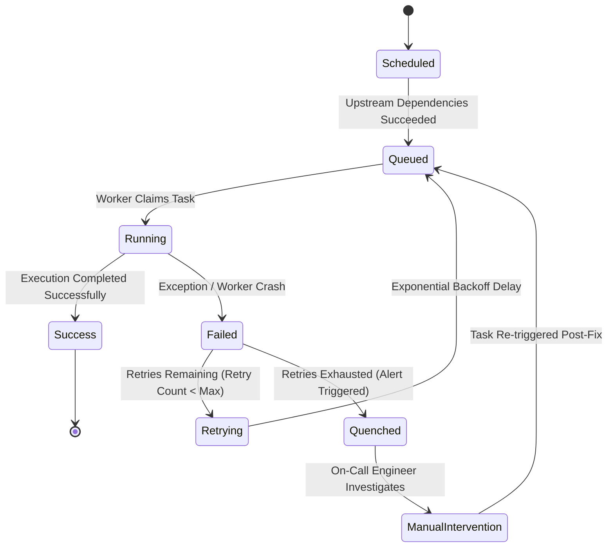

# The EOD Risk Batch

## TL;DR

The End-of-Day (EOD) risk batch is the central operational pipeline of capital markets technology, processing millions of trades and market scenarios overnight to generate official PnL, risk sensitivities, and regulatory capital figures.
The batch is organized as a complex Directed Acyclic Graph (DAG) of interdependent tasks executed across distributed compute clusters and orchestrated by enterprise schedulers (such as Apache Airflow, Dagster, or bespoke platforms like Goldman Sachs' SecDB and J.P. Morgan's Athena).
The pipeline must strictly satisfy tight Service Level Agreements (SLAs) across global timezones: Asia close by 18:00 JST, EMEA close by 20:00 GMT, and Americas close by 21:00 EST, culminating in a global consolidated capital sign-off by 03:00 EST.
Operational excellence requires critical path optimization, strict task idempotency, automated checkpointing, and dynamic sub-DAG reruns to recover from partial worker failures or late-arriving trade corrections without restarting the entire multi-hour batch.

## Learning objectives

- Design an enterprise EOD risk batch pipeline modeled as a Directed Acyclic Graph (DAG) with explicit task dependencies.
- Apply the Critical Path Method (CPM) to identify execution bottlenecks, calculate schedule float, and optimize cluster resource allocation.
- Implement task-level idempotency and checkpointing to guarantee that partial reruns do not corrupt downstream databases.
- Architect dynamic sub-DAG invalidation and backfill workflows to process late trade amendments seamlessly.
- Design automated sign-off gates enforcing data quality thresholds before releasing official risk metrics to Product Control and the board.
- Construct Mermaid DAG graphs, container architectures, and task state machines capturing batch lifecycles.

## Core concepts

### 1. The Global Follow-the-Sun Batch Timeline

Global investment banks operate trading hubs across three regional windows, leading to an interrelated chain of batch executions:

```mermaid
gantt
    title Global EOD Batch Execution Windows (UTC)
    dateFormat HH:mm
    axisFormat %H:%M

    section Asia-Pacific (Tokyo / HK / SG)
    Market Close & Snapshot      :done, a1, 06:00, 07:00
    Asia Curve Calibration       :done, a2, 07:00, 08:00
    Asia Desk Pricing & PnL      :done, a3, 08:00, 10:30
    Asia Risk Sign-off           :done, a4, 10:30, 11:30

    section EMEA (London / Frankfurt)
    Market Close & Snapshot      :done, e1, 16:30, 17:30
    EMEA Curve & Surface Calib   :done, e2, 17:30, 18:30
    EMEA Pricing & VaR Grid      :active, e3, 18:30, 21:30
    EMEA Product Control Sign-off:e4, 21:30, 22:30

    section Americas (New York)
    Market Close & Snapshot      :m1, 21:00, 22:00
    US Curve Calibration         :m2, 22:00, 23:00
    US Pricing & Sensitivities   :m3, 23:00, 02:00
    Global Consolidated Roll-up  :m4, 02:00, 03:30
    Executive & Regulatory Sign-off:m5, 03:30, 04:30
```

### 2. The EOD Risk Batch Dependency Graph (DAG)

Tasks cannot execute arbitrarily; each phase requires verified upstream inputs:

### 3. Critical Path Method (CPM) Analysis

In any complex DAG, the **Critical Path** is the longest sequence of dependent tasks from start to finish.
It determines the minimum total execution time of the batch:
- **Early Start ($ES$):** Earliest time a task can begin once all predecessors complete.
- **Early Finish ($EF$):** $EF = ES + \text{Duration}$.
- **Late Finish ($LF$):** Latest time a task can finish without delaying the overall batch completion deadline.
- **Late Start ($LS$):** $LS = LF - \text{Duration}$.
- **Total Float (Slack):** $\text{Float} = LS - ES = LF - EF$.
  Tasks on the critical path have strictly **$\text{Float} = 0$**. Any delay in a critical path task directly breaches the downstream SLA.

### 4. Task State Machine and Idempotent Retry Logic

- **Idempotency Requirement:** A batch task must produce identical state regardless of whether it executes once or five times:
  $$\text{Task}(S) = \text{Task}(\text{Task}(S))$$
  Database writes must use upserts (`INSERT ... ON CONFLICT DO UPDATE`) or atomic partition overwrites, preventing duplicate trade entries during retries.

## Worked examples

### Example 1: Critical Path Analysis (CPM) for a Fixed Income Risk Batch

A risk engineering team analyzes an Americas EOD fixed income batch consisting of seven primary task blocks:

| Task Code | Task Description | Dependencies | Duration ($D_i$) |
| :--- | :--- | :--- | :--- |
| **A** | Trade Ingestion & Normalization | None | $15\text{ minutes}$ |
| **B** | Market Snapshot & Curve Calibration | None | $25\text{ minutes}$ |
| **C** | Surface Calibration & SABR Fitting | Task B | $20\text{ minutes}$ |
| **D** | Greek Sensitivity Grid Dispatch | Task A, Task B, Task C | $45\text{ minutes}$ |
| **E** | Full Revaluation Scenario Simulation | Task A, Task B | $60\text{ minutes}$ |
| **F** | VaR & Expected Shortfall Aggregation | Task E | $15\text{ minutes}$ |
| **G** | PnL Explain & Product Control Sign-Off | Task D, Task F | $20\text{ minutes}$ |

#### Step 1: Forward Pass (Calculate Early Start and Early Finish):
- Task A: $ES = 0$, $EF = 0 + 15 = 15\text{ min}$.
- Task B: $ES = 0$, $EF = 0 + 25 = 25\text{ min}$.
- Task C: $ES = EF(B) = 25$, $EF = 25 + 20 = 45\text{ min}$.
- Task D: $ES = \max(EF(A), EF(B), EF(C)) = \max(15, 25, 45) = 45$, $EF = 45 + 45 = 90\text{ min}$.
- Task E: $ES = \max(EF(A), EF(B)) = \max(15, 25) = 25$, $EF = 25 + 60 = 85\text{ min}$.
- Task F: $ES = EF(E) = 85$, $EF = 85 + 15 = 100\text{ min}$.
- Task G: $ES = \max(EF(D), EF(F)) = \max(90, 100) = 100$, $EF = 100 + 20 = 120\text{ min}$.

Total Minimum Batch Duration: $120\text{ minutes}$ ($2.0\text{ hours}$).

#### Step 2: Backward Pass (Calculate Late Start, Late Finish, and Float):
Set target completion $LF(G) = 120\text{ min}$:
- Task G: $LF = 120$, $LS = 120 - 20 = 100\text{ min}$. $\text{Float} = 100 - 100 = 0$.
- Task F: $LF = LS(G) = 100$, $LS = 100 - 15 = 85\text{ min}$. $\text{Float} = 85 - 85 = 0$.
- Task E: $LF = LS(F) = 85$, $LS = 85 - 60 = 25\text{ min}$. $\text{Float} = 25 - 25 = 0$.
- Task D: $LF = LS(G) = 100$, $LS = 100 - 45 = 55\text{ min}$. $\text{Float} = 55 - 45 = 10\text{ minutes}$.
- Task C: $LF = LS(D) = 55$, $LS = 55 - 20 = 35\text{ min}$. $\text{Float} = 35 - 25 = 10\text{ minutes}$.
- Task B: $LF = \min(LS(C), LS(D), LS(E)) = \min(35, 55, 25) = 25$, $LS = 25 - 25 = 0\text{ min}$. $\text{Float} = 0$.
- Task A: $LF = \min(LS(D), LS(E)) = \min(55, 25) = 25$, $LS = 25 - 15 = 10\text{ min}$. $\text{Float} = 10\text{ minutes}$.

Critical Path Identification:
- The tasks with zero float are: **$\text{B} \to \text{E} \to \text{F} \to \text{G}$**.
- Management Insight:
  - Optimizing Task D (Greeks) will **not** speed up the batch, because it has $10\text{ minutes}$ of slack.
  - Adding compute grid cores to Task E (Full Revaluation, taking 60 minutes on the critical path) directly accelerates the entire EOD batch.

### Example 2: Handling Late Trade Bookings via Sub-DAG Invalidation

At 22:30 EST, after the EOD risk batch has progressed to Task F (VaR calculation), a rates trader books a missing $\$500,000,000$ 10-year swap that was executed at 16:15 EST but omitted from the original 17:00 extract:
- Problem: Rerunning the entire batch from Task A would take another 2 hours, missing the 23:30 regulatory deadline.
- Sub-DAG Incremental Solution:
  1. The orchestrator identifies that Market Data (Tasks B and C) is unaffected.
  2. An incremental extract pulls only the missing trade (`SWAP-9012`).
  3. The trade is dispatched to a dedicated high-priority worker node to calculate its standalone sensitivity vector and scenario PnL vector (Duration: $45\text{ seconds}$).
  4. The orchestrator invalidates only the downstream aggregation nodes (Tasks F and G).
  5. The new trade's vectors are added to the pre-aggregated portfolio cube using vector addition:
     $$\mathbf{P}_{\text{new\_portfolio}} = \mathbf{P}_{\text{existing\_cube}} + \mathbf{P}_{\text{trade}}$$
  6. Tasks F and G re-execute in $2.5\text{ minutes}$.
- Total Recovery Latency: $3.5\text{ minutes}$ (instead of $120\text{ minutes}$), preserving the SLA.

### Example 3: Disaster Recovery: Orchestrator Active-Passive Failover

During the peak execution of Task E, the primary Airflow/Dagster scheduler host suffers a catastrophic hardware crash:
- High-Availability Setup:
  - Schedulers operate in an active-passive cluster sharing a distributed PostgreSQL state database (Amazon Aurora Multi-AZ) and an etcd consensus distributed lock.
  - Compute workers poll jobs independently via a persistent distributed queue (RabbitMQ / Amazon SQS).
- Recovery Sequence:
  1. Primary host heartbeats cease. After 15 seconds without a heartbeat, etcd releases the scheduler master lease.
  2. The passive backup scheduler claims the lease and initiates recovery.
  3. The backup scheduler queries the metadata database: tasks currently marked `Running` on healthy compute nodes continue uninterrupted.
  4. Only tasks assigned to dead worker nodes are transitioned to `Retrying` and re-queued.
  5. Failover completes in 28 seconds without terminating the ongoing multi-thousand-core grid run.

## Pitfalls

- **Hardcoding Task Sleep Delays Instead of Event-Driven Triggers:** Configuring a task to "sleep 30 minutes" waiting for market data ensures failure when feeds are early or late. Tasks must use deterministic file/event sensors.
- **Non-Idempotent Database Appends on Task Retry:** If a task appends 100,000 rows to a risk database and crashes on step 99, retrying without atomic transaction rollbacks inserts duplicate rows, doubling reported risk.
- **Cascading Invalidation Deadlocks:** In poorly designed reactive graphs, updating a single minor reference curve can trigger a cascade that invalidates and cancels hours of running Monte Carlo compute nodes.
- **Ignoring Resource Contention on Shared Storage:** Dispatching 5,000 worker tasks simultaneously that all attempt to read the same 50GB market snapshot file from a single NFS drive saturates storage I/O, freezing the cluster. Use distributed object storage (S3) or pre-distributed local SSD caches.
- **Permitting Silent Failures in Quality Gates:** Configuring quality checks that log warnings rather than throwing errors allows corrupted or zero-filled risk reports to be published automatically to regulators.

## Interview questions

> [!question]- sys-13-01 | What is the Critical Path in an EOD risk batch and why is it essential for infrastructure capacity planning?
> The Critical Path is the sequence of dependent tasks with zero float that requires the longest total time to complete from start to finish.
> It determines the minimum possible batch runtime; optimizing non-critical tasks yields zero SLA improvement, so infrastructure investments must target critical path bottlenecks.

> [!question]- sys-13-02 | What does it mean for a batch calculation task to be idempotent?
> An idempotent task produces the exact same system state and output regardless of whether it is executed once or multiple times with the same inputs: $f(x) = f(f(x))$.
> Idempotency prevents duplicate records, double-counted risk, or corrupted balances when tasks fail and are retried.

> [!question]- sys-13-03 | How do modern orchestrators handle late-arriving trades without rerunning the entire batch?
> They leverage incremental DAG evaluation: only the late trades are extracted and priced, and their resulting risk/PnL vectors are merged into the pre-calculated aggregation cubes.
> Only downstream aggregation tasks (VaR, PnL explain, sign-off) are invalidated and rerun, completing in minutes rather than hours.

> [!question]- sys-13-04 | What is the difference between Early Start ($ES$) and Late Start ($LS$) in the Critical Path Method?
> Early Start is the earliest possible time a task can begin once all predecessor tasks finish.
> Late Start is the latest time a task can begin without delaying the final project completion date.
> The difference ($LS - ES$) is the task's slack or float.

> [!question]- sys-13-05 | What is an automated Quality Gate in an EOD batch pipeline?
> A quality gate is an automated validation step that tests output data against pre-defined statistical rules (e.g., zero missing values, unexplained PnL $< 5\%$, risk changes within $3\sigma$ of historical moves).
> If a gate fails, the batch is quarantined and prevented from publishing official reports until investigated.

> [!question]- sys-13-06 | How does a distributed scheduler prevent duplicate task execution across worker nodes?
> Schedulers use distributed consensus locks (e.g., ZooKeeper, etcd, or database row-level locking via `SELECT FOR UPDATE SKIP LOCKED`).
> A worker claims an exclusive lease on a task before execution, ensuring only one worker processes the job.

> [!question]- sys-13-07 | What is the "Follow-the-Sun" batch architecture?
> Global banks execute localized EOD risk batches aligned with the market close of each successive time zone (Tokyo/Hong Kong, London/Frankfurt, New York).
> Regional results are signed off locally and rolled up sequentially into a consolidated global capital report overnight.

> [!question]- sys-13-08 | What causes the "thundering herd" problem in distributed risk grids and how is it resolved?
> It occurs when thousands of worker tasks finish simultaneously and attempt to write results or query the master database at the exact same millisecond, overwhelming the network and database connections.
> It is resolved by adding randomized jitter to retry intervals, using message queues with backpressure, and applying hierarchical tree reductions.

> [!question]- sys-13-09 | What is the purpose of checkpointing in long-running Monte Carlo batch tasks?
> Checkpointing periodically serializes the state of a multi-hour simulation (e.g., completed path blocks) to durable storage.
> If a compute node crashes halfway through, the replacement node resumes execution from the latest checkpoint rather than restarting from path zero.

> [!question]- sys-13-10 | Why are atomic partition swaps preferred over row-by-row updates in enterprise risk data warehouses?
> Row-by-row updates generate heavy database transaction locking, high write-ahead log (WAL) overhead, and leave tables in inconsistent states if aborted.
> Atomic partition swaps write batch results to a temporary table and swap metadata pointers instantaneously (`ALTER TABLE ... EXCHANGE PARTITION`), ensuring atomic visibility.

## Further reading

- Kleppmann, Martin. *Designing Data-Intensive Applications*. O'Reilly Media, 2017.
- Basel Committee on Banking Supervision. *Principles for effective risk data aggregation and risk reporting*. BCBS 239, 2013.
- Cormen, Thomas H., Leiserson, Charles E., et al. *Introduction to Algorithms: Section on Directed Acyclic Graphs and Topological Sort*. MIT Press, 2022.
- Apache Airflow Project. *Architecture and Best Practices for Production DAGs*. Apache Software Foundation.
