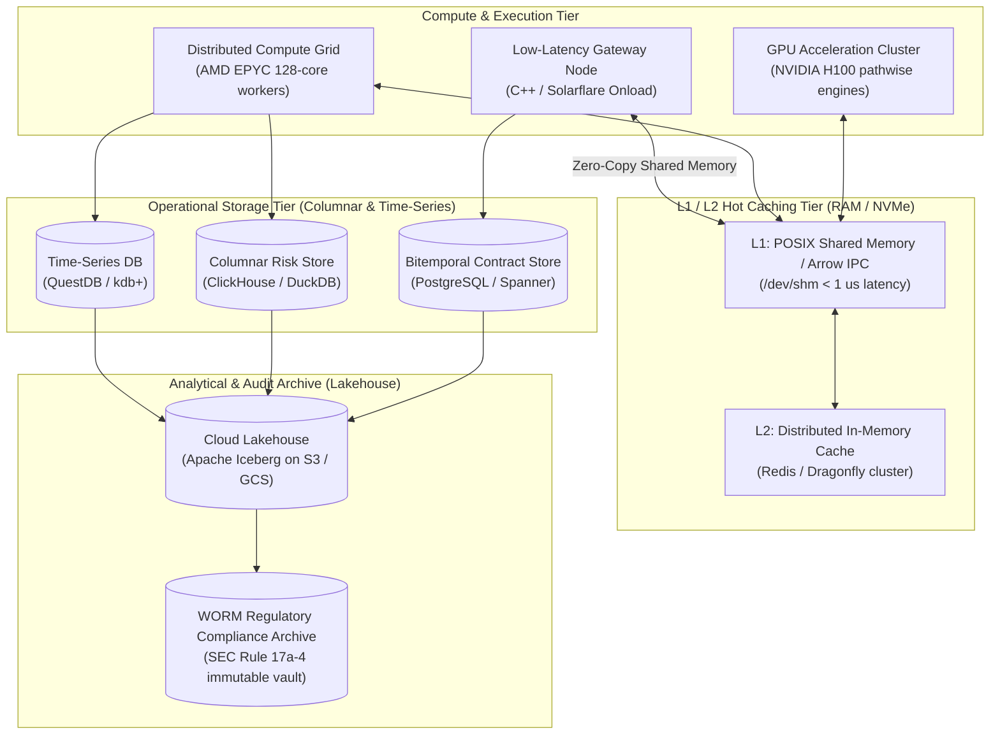

# Storage and Compute for Quantitative Systems

## TL;DR

- Capital markets platforms generate and consume massive volumes of heterogeneous data with widely differing access patterns: microsecond tick streams, transactional trade lifecycles, multi-dimensional risk cubes, and long-term regulatory WORM audit archives.
- No single database engine satisfies all these operational demands, necessitating polyglot persistence across time-series engines (kdb+, QuestDB), distributed event backbones (Apache Kafka), bitemporal relational stores (PostgreSQL), and columnar OLAP formats (ClickHouse, DuckDB, Apache Parquet on Apache Iceberg).
- In high-speed time-series systems, Gorilla floating-point XOR encoding and double-delta timestamp compression reduce raw telemetry footprints by over $78\%$, enabling multi-million-tick streaming in memory.
- Columnar storage formats drastically outperform row-oriented relational tables for risk analytics by pruning unrequested columns from disk reads and vectorizing aggregations via CPU SIMD instructions.
- Apache Arrow standardized shared-memory buffers (`/dev/shm`) eliminate serialization overhead between high-performance C++ pricing grids and analytical Python/Pandas environments.
- All numerical figures in this note are verified by [sys_storage_compute.py](code/sys_storage_compute.py).

## Learning objectives

- Design a polyglot persistence architecture aligning database technologies to specific capital markets access patterns.
- Implement the Gorilla compression algorithm for financial time series, including double-delta timestamps and IEEE 754 XOR encoding.
- Evaluate the computational mechanics of columnar storage (Parquet / Arrow / ClickHouse) and explain its superior I/O throughput for OLAP risk cubes.
- Construct zero-copy IPC data pipelines between analytical Python environments and high-performance C++ pricing engines using Apache Arrow.
- Quantify enterprise storage footprints, compression ratios, and I/O budgets across hot, warm, and cold storage tiers.

## Core concepts

### 1. The Polyglot Storage Architecture

Capital markets systems partition data across specialized storage technologies:

| Data Domain | Primary Database Engine | Key Access Pattern | Storage Tier |
| :--- | :--- | :--- | :--- |
| **Market Tick Data** | Time-Series Engine (kdb+/q, QuestDB) | Append-only sequential time-series reads | Hot / Warm (RAM & NVMe) |
| **Trade Lifecycle Events** | Distributed Event Log (Apache Kafka / Pulsar) | Immutable event sourcing, partitioned by trade ID | Hot (Distributed Disks) |
| **Contract Master Store** | Bitemporal Relational (PostgreSQL, CockroachDB) | Point-in-time relational querying | Warm (Transactional SSD) |
| **Risk Cubes (OLAP)** | Columnar Engine (ClickHouse, DuckDB) | Multi-dimensional aggregation and drill-downs | Warm (Columnar Memory/NVMe) |
| **Real-Time Market Marks** | In-Memory Key-Value (Redis, Dragonfly, POSIX shm) | Sub-microsecond key lookups | Hot (RAM) |
| **Historical Lakehouse** | Object Storage (S3, GCS) with Apache Iceberg | Large-scale regulatory audit and model backtesting | Cold (Cloud Object WORM) |

### 2. Enterprise Storage & Compute Topology



### 3. Columnar vs. Row-Oriented Storage for Risk Analytics

In a row-oriented relational database (such as PostgreSQL):
- Data is stored tuple-by-tuple: `[TradeID, Desk, Currency, Tenor, Notional, PV, Delta, Vega]`.
- An analytical query computing `SUM(Delta)` across 1,000,000 trades must read all attributes into memory, saturating disk I/O bandwidth with unused columns.
In a columnar store (such as ClickHouse, DuckDB, or Apache Parquet):
- Values of each column are stored contiguously in dedicated data blocks.
- The query `SUM(Delta)` reads **only** the `Delta` column block directly from disk, reducing I/O volume by $10\times$ to $50\times$.
- SIMD vector instructions (AVX-512) sum 8 double-precision floats in a single CPU clock cycle directly from contiguous cache lines.

### 4. Gorilla Floating-Point XOR Compression

Financial time series contain sequences of floating-point prices that change gradually from tick to tick:
1. **Timestamp Compression (Double-Delta):**
   - Store the second difference: $D = (t_i - t_{i-1}) - (t_{i-1} - t_{i-2})$.
   - When ticks arrive at regular intervals, $D = 0$, encoded as a single bit `0`.
2. **Floating-Point Value Compression (XOR Encoding):**
   - Compute the bitwise XOR between consecutive IEEE 754 64-bit floats: $X_i = V_i \oplus V_{i-1}$.
   - If $X_i = 0$ (price unchanged), write a single bit `0`.
   - If $X_i \ne 0$, write bit `1`:
     - If the number of leading and trailing zero bits in $X_i$ matches the previous XOR result, write control bit `0` followed by the meaningful bits.
     - Otherwise, write control bit `1`, encode the leading zero count (5 bits), length of meaningful bits (6 bits), and the meaningful bits.

## Worked examples

### Example 1: Gorilla Floating-Point XOR Compression Walkthrough

Two consecutive 64-bit double-precision floating-point price observations arrive for an equity security:
- Price 1 ($V_0$): $100.00$.
  - IEEE 754 64-bit representation: `01000000 01011001 00000000 00000000 00000000 00000000 00000000 00000000`.
- Price 2 ($V_1$): $100.125$.
  - IEEE 754 64-bit representation: `01000000 01011001 00001000 00000000 00000000 00000000 00000000 00000000`.

XOR Bitwise Calculation ($X_1 = V_0 \oplus V_1$):
```
V_0: 01000000 01011001 00000000 00000000 00000000 00000000 00000000 00000000
V_1: 01000000 01011001 00001000 00000000 00000000 00000000 00000000 00000000
XOR: 00000000 00000000 00001000 00000000 00000000 00000000 00000000 00000000
```
- Number of leading zero bits: $20$.
- Number of trailing zero bits: $43$.
- Meaningful payload length: $64 - 20 - 43 = 1\text{ bit}$ (`1` at bit index 20).

Bit Stream Serialization:
- Control bit 1: `1` (indicates non-zero XOR).
- Control bit 2: `1` (indicates new leading/trailing zero window).
- 5 bits for leading zero count: `10100` ($20$ in binary).
- 6 bits for meaningful payload length: `000001` ($1$ in binary).
- 1 bit for meaningful payload: `1`.
- Total bits written: $1 + 1 + 5 + 6 + 1 = 14\text{ bits}$.
- Compression efficiency: Storing 14 bits instead of 64 bits achieves a **$78.1\%$ bit savings**.

### Example 2: Sizing an Enterprise Columnar Risk Cube Store

An investment bank sizes its storage tier for 10 years of daily EOD historical sensitivity cubes:
- Daily evaluated positions: $200,000\text{ positions/day}$.
- Sensitivity columns stored per position:
  - 10 categorical attributes (Desk, Book, Counterparty, Currency, Rating, etc.): dictionary-encoded 32-bit integers ($4\text{ bytes each}$) $= 40\text{ bytes}$.
  - 45 numerical sensitivity metrics (PV, DV01, CS01, 10 Vega tenors, etc.): 64-bit floats ($8\text{ bytes each}$) $= 360\text{ bytes}$.
  - Total uncompressed row width: $40 + 360 = 400\text{ bytes}$.
- Daily uncompressed volume:

$$\text{Daily Volume} = 200,000 \times 400\text{ bytes} = 80,000,000\text{ bytes} = 80.0\text{ MB/day}$$

Columnar Parquet Compression ($5:1$ ratio with ZSTD):
- Compressed daily volume: $80\text{ MB} / 5 = 16.0\text{ MB/day}$.
- Annual volume across 252 business days: $16\text{ MB} \times 252 = 4,032\text{ MB} = 4.03\text{ GB/year}$.
- 10-year historical sensitivity archive: $4.03\text{ GB} \times 10 = 40.3\text{ GB}$.

Full Historical Scenario Grid (1,000 scenarios per trade):
- Uncompressed scenario data: $200,000 \times 1,000 \times 8\text{ bytes} = 1,600,000,000\text{ bytes} = 1.6\text{ GB/day}$.
- Compressed scenario data ($3:1$ ratio): $1,600\text{ MB} / 3 = 533.3\text{ MB/day}$.
- Annual compressed volume: $533.3\text{ MB} \times 252 = 134.4\text{ GB/year}$.
- 10-year scenario archive: $134.4\text{ GB} \times 10 = 1.34\text{ TB}$.

An entire decade of full historical scenario cubes fits in $1.34\text{ TB}$, easily hosted inside a cloud data lakehouse (S3 + DuckDB/ClickHouse) at minimal infrastructure expense.

### Example 3: Zero-Copy Data Transfer via Apache Arrow Shared Memory

A pricing engine written in C++ produces a matrix of $10,000,000$ simulation paths.
A quantitative researcher analyzes the results in Python:
- Traditional JSON / CSV serialization:
  - C++ converts doubles to ASCII strings.
  - Python reads strings and parses them into Python float objects.
  - Serialization overhead: $15\text{ seconds}$; Memory overhead: $3\times$ duplication.
- Apache Arrow Zero-Copy IPC:
  - C++ writes floating-point arrays directly into a shared-memory buffer (`/dev/shm` via POSIX `shm_open`).
  - Python maps the shared memory segment using `pyarrow.ipc.open_stream(buffer)`.
  - Python's NumPy/Pandas array views the same shared backing memory; each process may map it at a different virtual address.
  - The shared-memory setup, mapping, and buffer access take nonzero time, while avoiding a second copy of the array payload.

## Pitfalls

- **Using Key-Value Stores for Aggregation Queries:** Using Redis to compute `SUM(Delta)` across millions of trades requires fetching millions of keys over the network, exhausting bandwidth; columnar stores must handle aggregations.
- **Neglecting Parquet Row-Group Sizing:** Setting Parquet row groups too small ($< 10,000\text{ rows}$) destroys compression and metadata efficiency; setting them too large ($> 10,000,000\text{ rows}$) prevents effective filter pushdown.
- **Allowing Unbounded In-Memory Cache Growth:** Configuring Redis or in-memory caches without Least Recently Used (LRU) eviction policies or memory limits causes Out-Of-Memory (OOM) kernel panics that kill critical trading processes.
- **Ignoring Write Amplification in LSM Trees:** High-frequency tick databases using Log-Structured Merge (LSM) trees (like RocksDB) suffer high write amplification during background compaction, consuming disk I/O and creating latency spikes.
- **Failing to Enforce WORM Policies on Regulatory Archives:** Regulatory bodies (SEC Rule 17a-4, FINRA) mandate that historical trade archives be Write-Once-Read-Many (WORM) compliant; storing audit logs on mutable cloud buckets violates legal standards.

## Interview questions

> [!question]- sys-14-01 | Why do columnar databases (ClickHouse, DuckDB) vastly outperform relational databases (PostgreSQL) for risk aggregation queries?
> Columnar databases store each column contiguously on disk.
> An aggregation query like `SUM(DV01)` reads only the contiguous DV01 column bytes, bypassing all other attributes, reducing disk I/O by over 90% and allowing CPU SIMD vectorization.

> [!question]- sys-14-02 | How does Apache Arrow eliminate serialization overhead in quantitative analytics?
> Apache Arrow defines a standardized, language-independent columnar memory layout for flat and hierarchical data.
> Systems written in different languages (C++, Python, Java, Rust) can access shared-memory buffers through process-local mappings, avoiding payload copies or serialization when their data layouts are compatible.

> [!question]- sys-14-03 | What is double-delta compression and why is it effective for financial timestamps?
> Double-delta compression stores the second difference of timestamps: $D = (t_i - t_{i-1}) - (t_{i-1} - t_{i-2})$.
> Because financial transactions arrive with predictable intervals, the second difference is frequently zero, allowing it to be compressed into a single bit.

> [!question]- sys-14-04 | What is the difference between kdb+/q and a standard relational database?
> kdb+ is an in-memory, column-oriented time-series database with an expressive vector language (q).
> It treats ordered arrays and time series as first-class primitives, executing temporal joins (as-of joins) across billions of ticks orders of magnitude faster than SQL engines.

> [!question]- sys-14-05 | What is an As-Of Join (AJ) in time-series databases?
> An as-of join matches two time series based on the most recent prior observation rather than an exact timestamp match.
> For example, it matches each trade execution with the prevailing bid-ask quote immediately prior to the execution timestamp.

> [!question]- sys-14-06 | What is the trade-off between write amplification and read performance in LSM-Tree databases?
> Log-Structured Merge (LSM) trees optimize write throughput by appending incoming writes sequentially to a write-ahead log and in-memory memtable.
> However, maintaining fast reads requires background merging and compaction across hierarchical SSTable files, causing write amplification that consumes disk I/O.

> [!question]- sys-14-07 | How does POSIX shared memory (`/dev/shm`) improve IPC latency between trading services?
> POSIX shared memory maps the same shared backing region into multiple process address spaces, potentially at different virtual addresses, avoiding payload copying while still incurring setup, mapping, and access time.
> Processes communicate at memory bus speeds ($< 100\text{ nanoseconds}$) without passing through operating system socket buffers or network protocol stacks.

> [!question]- sys-14-08 | What is an Apache Iceberg table format and how does it benefit financial data lakes?
> Iceberg is an open table format for massive analytic datasets that brings ACID transactions, partition evolution, schema evolution, and time-travel querying to cloud object storage (S3/GCS).
> It allows risk engines to query the exact historical state of a data lake at any previous snapshot timestamp.

> [!question]- sys-14-09 | What is the purpose of dictionary encoding in columnar compression?
> Dictionary encoding replaces repetitive string values (such as currency codes "USD", "EUR", or desk names) with small integer surrogate keys (e.g., 1, 2).
> The unique strings are stored once in a dictionary table, shrinking storage and accelerating equality filters.

> [!question]- sys-14-10 | Why must financial tick databases implement out-of-order data handling?
> Network latency variations and multi-venue connectivity cause ticks to arrive out of chronological sequence.
> Time-series databases must maintain an in-memory buffering window that sorts late-arriving packets before flushing blocks immutably to columnar disk files.

## Further reading

- Kleppmann, Martin. *Designing Data-Intensive Applications*. O'Reilly Media, 2017.
- Pelkonen, Tuomas, et al. *Gorilla: A Fast, Scalable, In-Memory Time Series Database*. Proceedings of the VLDB Endowment, Vol. 8, No. 12, August 2015.
- Stonebraker, Michael and Abadi, Daniel. *The Architecture of Next-Generation Data Systems*. Foundations and Trends in Databases, 2018.
- Apache Arrow Project. *Apache Arrow Columnar Format Specification*. Apache Software Foundation, 2023.
