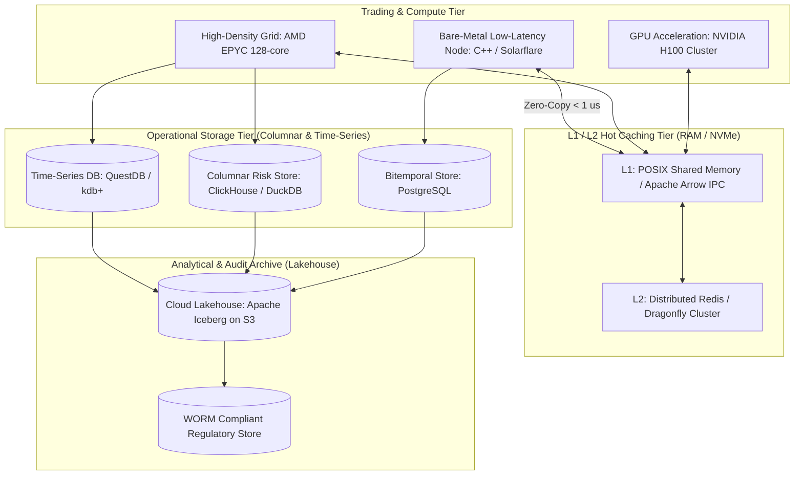

# Storage and Compute for Quantitative Systems

## TL;DR

Capital markets platforms generate and consume massive volumes of heterogeneous data with widely differing access patterns: microsecond tick data, transactional trade lifecycles, massive multi-dimensional risk cubes, and long-term regulatory audit archives.
No single database engine satisfies all these requirements.
Modern enterprise architectures deploy polyglot persistence: time-series engines (kdb+, QuestDB) optimized for financial tick streams; distributed event logs (Apache Kafka) for immutable event-sourced trade capture; relational stores (PostgreSQL, CockroachDB) for bitemporal contract definitions; and columnar OLAP formats (ClickHouse, DuckDB, Apache Parquet on Apache Iceberg) for high-performance risk aggregations.
On the compute side, zero-copy in-memory specifications (Apache Arrow) eliminate serialization bottlenecks between Python analytics and C++ pricing grids.
Hardware tiering combines bare-metal kernel-bypass nodes for flow execution, high-density multi-core CPUs for scenario grids, and GPU clusters for pathwise Monte Carlo simulations.

## Learning objectives

- Design a polyglot persistence architecture matching database technologies to specific capital markets workloads.
- Formulate compression algorithms for financial time series, including Gorilla floating-point XOR encoding and double-delta timestamps.
- Evaluate the columnar storage layout (Parquet / Arrow) and explain why it outperforms row-based formats for multi-dimensional risk roll-ups.
- Implement zero-copy data sharing between analytical Python environments and high-performance C++ pricing engines using Apache Arrow.
- Quantify storage footprint, compression ratios, and I/O throughput across hot, warm, and cold storage tiers.
- Construct comprehensive Mermaid topology diagrams, schema designs, and storage sizing tables.

## Core concepts

### 1. The Polyglot Storage Architecture

```
+----------------------------------------------------------------------------------------------------+
| Data Domain          | Primary Database Technology                | Primary Access Pattern         |
+----------------------------------------------------------------------------------------------------+
| Market Tick Data     | Time-Series Engine (kdb+/q, QuestDB)       | Append-only high-frequency ticks|
| Trade Lifecycle      | Distributed Event Log (Kafka / Pulsar)     | Immutable event sourcing       |
| Contract Master      | Bitemporal Relational (PostgreSQL, Spanner)| Point-in-time relational lookup|
| Risk Cubes (OLAP)    | Columnar Engine (ClickHouse, DuckDB)       | Multi-dimensional slice & dice |
| Real-Time Quotes     | In-Memory Cache (Redis, Dragonfly, shm)    | Sub-millisecond key-value read |
| Historical Archive   | Object Store (S3, GCS) with Apache Iceberg | Long-term WORM compliance      |
+----------------------------------------------------------------------------------------------------+
```

### 2. Enterprise Storage & Compute Topology



### 3. Columnar vs. Row-Oriented Storage for Risk Analytics

In a row-oriented relational database (PostgreSQL):
- Data is stored tuple-by-tuple: `[TradeID, Desk, Currency, Tenor, Notional, PV, Delta, Vega]`.
- A query aggregating `SUM(Delta)` across 1,000,000 trades must read all attributes into memory, saturating disk I/O bandwidth with unused columns.
In a columnar store (ClickHouse / Parquet / DuckDB):
- Values of each column are stored contiguously in separate blocks.
- The query `SUM(Delta)` reads **only** the `Delta` column block directly from disk, achieving a $10\times$ to $50\times$ reduction in I/O volume.
- SIMD vector instructions (AVX-512) can sum 8 double-precision floats in a single CPU clock cycle directly from contiguous cache lines.

### 4. Gorilla Floating-Point XOR Compression

Financial time series contain sequences of floating-point prices that change gradually.
Developed by Facebook/Meta for high-speed time series, **Gorilla compression** achieves over $80\%$ compression:
1. **Timestamp Compression (Double-Delta):**
   - Store the second difference: $D = (t_i - t_{i-1}) - (t_{i-1} - t_{i-2})$.
   - If ticks arrive at regular intervals, $D = 0$, encoded as a single bit `0`.
2. **Floating-Point Value Compression (XOR Encoding):**
   - Compute the XOR of the IEEE 754 64-bit float with the previous float: $X_i = V_i \oplus V_{i-1}$.
   - If $X_i = 0$ (identical price), write a single bit `0`.
   - If $X_i \neq 0$, write bit `1`:
     - If the number of leading and trailing zero bits in $X_i$ matches the previous XOR result, write control bit `0` followed by the meaningful bits.
     - Otherwise, write control bit `1`, encode the leading zero count (5 bits), length of meaningful bits (6 bits), and the meaningful bits.

## Worked examples

### Example 1: Gorilla Floating-Point XOR Compression Walkthrough

Consider two consecutive 64-bit double-precision floating-point price observations for a stock:
- Price 1 ($V_0$): $100.00$
  - IEEE 754 binary: `01000000 01011001 00000000 00000000 00000000 00000000 00000000 00000000`
- Price 2 ($V_1$): $100.125$
  - IEEE 754 binary: `01000000 01011001 00001000 00000000 00000000 00000000 00000000 00000000`

XOR Calculation ($X_1 = V_0 \oplus V_1$):
```
V_0: 01000000 01011001 00000000 00000000 00000000 00000000 00000000 00000000
V_1: 01000000 01011001 00001000 00000000 00000000 00000000 00000000 00000000
XOR: 00000000 00000000 00001000 00000000 00000000 00000000 00000000 00000000
```
- Number of leading zero bits: $20$
- Number of trailing zero bits: $43$
- Meaningful bits: exactly $1$ bit (`1`) at index 20.

Encoding Result:
- Bit 1: `1` (indicates non-zero XOR).
- Bit 2: `1` (new leading/trailing zero length).
- 5 bits for leading zero count: `10100` ($20$ in binary).
- 6 bits for meaningful length: `000001` ($1$ in binary).
- 1 bit for payload: `1`.
- Total bits written: $1 + 1 + 5 + 6 + 1 = 14\text{ bits}$.
- Compression: Instead of storing all 64 bits, the value is compressed into 14 bits, achieving a **$78.1\%$ space savings**.

### Example 2: Sizing an Enterprise Columnar Risk Cube Store

A dealer stores 10 years of daily EOD historical sensitivity cubes for risk and backtesting:
- Daily positions evaluated: $P = 200,000\text{ positions/day}$.
- Sensitivity columns stored per position:
  - 10 categorical attributes (Desk, Book, Counterparty, Currency, Rating, etc.): dictionary-encoded integers (4 bytes each) $= 40\text{ bytes}$.
  - 45 numerical sensitivity metrics (PV, DV01, CS01, 10 Vega tenors, etc.): 64-bit floats (8 bytes each) $= 360\text{ bytes}$.
  - Total uncompressed row width: $400\text{ bytes}$.
- Daily uncompressed data volume:

$$\text{Daily Volume} = 200,000 \times 400\text{ bytes} = 80,000,000\text{ bytes} = 80\text{ MB/day}$$

- In an OLAP columnar format (Apache Parquet with ZSTD compression):
  - Columnar grouping brings compression ratios to approximately $5:1$.
  - Compressed daily volume: $\frac{80\text{ MB}}{5} = 16\text{ MB/day}$.
- Annual volume (252 business days):
  $$16\text{ MB} \times 252 \approx 4,032\text{ MB} \approx 4.03\text{ GB/year}$$
- 10-Year Historical Archive:
  $$4.03\text{ GB} \times 10 = 40.3\text{ GB}$$

Scenario Grid Expansion (Full Historical Revaluations):
- If the bank also stores full scenario PnL vectors ($S = 1,000\text{ scenarios}$ per trade):
  - $200,000\text{ trades} \times 1,000\text{ floats} \times 8\text{ bytes} = 1.6\text{ GB/day uncompressed}$.
  - Compressed ($3:1$ ratio): $533\text{ MB/day} \implies 134.3\text{ GB/year} \implies 1.34\text{ TB for 10 years}$.
- Conclusion:
  Even a decade of daily multi-scenario risk cubes requires under $2\text{ TB}$, easily hosted inside a cloud data lakehouse (S3 + DuckDB/ClickHouse) at minimal infrastructure expense.

### Example 3: Zero-Copy Data Transfer via Apache Arrow Shared Memory

A pricing engine written in C++ produces a matrix of $10,000,000$ simulation paths.
A quantitative researcher analyzes the results in Python:
- Traditional JSON / CSV serialization:
  - C++ converts doubles to ASCII strings.
  - Python reads strings and parses them into Python float objects.
  - Serialization overhead: $15\text{ seconds}$; Memory overhead: $3\times$ duplication.
- Apache Arrow Zero-Copy IPC:
  - C++ writes floating-point arrays directly into a shared-memory buffer (`/dev/shm` via POSIX `shm_open`).
  - Python maps the shared memory segment using `pyarrow.ipc.open_stream(buffer)`.
  - Python's NumPy/Pandas array views the same shared backing memory; each process may map it at a different virtual address.
  - The shared-memory setup, mapping, and buffer access take nonzero time, while avoiding a second copy of the array payload.

## Pitfalls

- **Using Key-Value Stores for Aggregation Queries:** Using Redis to compute `SUM(Delta)` across millions of trades requires fetching millions of keys over the network, exhausting bandwidth. Columnar stores must handle aggregations.
- **Neglecting Parquet Row-Group Sizing:** Setting Parquet row groups too small ($< 10,000\text{ rows}$) destroys compression and metadata efficiency; setting them too large ($> 10,000,000\text{ rows}$) prevents effective filter pushdown. Target 100,000 to 1,000,000 rows per group.
- **Allowing Unbounded In-Memory Cache Growth:** Configuring Redis or in-memory caches without Least Recently Used (LRU) eviction policies or memory limits causes Out-Of-Memory (OOM) kernel panics that kill critical trading processes.
- **Ignoring Write Amplification in LSM Trees:** High-frequency tick databases using Log-Structured Merge (LSM) trees (like RocksDB) suffer high write amplification during background compaction, consuming disk I/O and creating latency spikes.
- **Failing to Enforce WORM Policies on Regulatory Archives:** Regulatory bodies (SEC Rule 17a-4, FINRA) mandate that historical trade archives be Write-Once-Read-Many (WORM) compliant; storing audit logs on mutable cloud buckets violates legal standards.

## Interview questions

> [!question]- sys-14-01 | Why do columnar databases (ClickHouse, DuckDB) vastly outperform relational databases (PostgreSQL) for risk aggregation queries?
> Columnar databases store each column contiguously on disk.
> An aggregation query like `SUM(DV01)` reads only the contiguous DV01 column bytes, bypassing all other attributes, reducing disk I/O by over 90% and allowing CPU SIMD vectorization.

> [!question]- sys-14-02 | How does Apache Arrow eliminate serialization overhead in quantitative analytics?
> Apache Arrow defines a standardized, language-independent columnar memory layout for flat and hierarchical data.
> Systems written in different languages (C++, Python, Java, Rust) can access shared-memory buffers through process-local mappings, avoiding payload copies or serialization when their data layouts are compatible.

> [!question]- sys-14-03 | What is double-delta compression and why is it effective for financial timestamps?
> Double-delta compression stores the second difference of timestamps: $D = (t_i - t_{i-1}) - (t_{i-1} - t_{i-2})$.
> Because financial transactions arrive with predictable intervals, the second difference is frequently zero, allowing it to be compressed into a single bit.

> [!question]- sys-14-04 | What is the difference between kdb+/q and a standard relational database?
> kdb+ is an in-memory, column-oriented time-series database with an expressive vector language (q).
> It treats ordered arrays and time series as first-class primitives, executing temporal joins (as-of joins) across billions of ticks orders of magnitude faster than SQL engines.

> [!question]- sys-14-05 | What is an As-Of Join (AJ) in time-series databases?
> An as-of join matches two time series based on the most recent prior observation rather than an exact timestamp match.
> For example, it matches each trade execution with the prevailing bid-ask quote immediately prior to the execution timestamp.

> [!question]- sys-14-06 | What is the trade-off between write amplification and read performance in LSM-Tree databases?
> Log-Structured Merge (LSM) trees optimize write throughput by appending incoming writes sequentially to a write-ahead log and in-memory memtable.
> However, maintaining fast reads requires background merging and compaction across hierarchical SSTable files, causing write amplification that consumes disk I/O.

> [!question]- sys-14-07 | How does POSIX shared memory (`/dev/shm`) improve IPC latency between trading services?
> POSIX shared memory maps the same shared backing region into multiple process address spaces, potentially at different virtual addresses, avoiding payload copying while still incurring setup, mapping, and access time.
> Processes communicate at memory bus speeds ($< 100\text{ nanoseconds}$) without passing through operating system socket buffers or network protocol stacks.

> [!question]- sys-14-08 | What is an Apache Iceberg table format and how does it benefit financial data lakes?
> Iceberg is an open table format for massive analytic datasets that brings ACID transactions, partition evolution, schema evolution, and time-travel querying to cloud object storage (S3/GCS).
> It allows risk engines to query the exact historical state of a data lake at any previous snapshot timestamp.

> [!question]- sys-14-09 | What is the purpose of dictionary encoding in columnar compression?
> Dictionary encoding replaces repetitive string values (such as currency codes "USD", "EUR", or desk names) with small integer surrogate keys (e.g., 1, 2).
> The unique strings are stored once in a dictionary table, shrinking storage and accelerating equality filters.

> [!question]- sys-14-10 | Why must financial tick databases implement out-of-order data handling?
> Network latency variations and multi-venue connectivity cause ticks to arrive out of chronological sequence.
> Time-series databases must maintain an in-memory buffering window that sorts late-arriving packets before flushing blocks immutably to columnar disk files.

## Further reading

- Kleppmann, Martin. *Designing Data-Intensive Applications*. O'Reilly Media, 2017.
- Pelkonen, Tuomas et al. *Gorilla: A Fast, Scalable, In-Memory Time Series Database*. Proceedings of the VLDB Endowment, 2015.
- Apache Arrow. *Apache Arrow In-Memory Format Specification*. Apache Software Foundation, 2023.
- Abadi, Daniel et al. *The Design and Implementation of Modern Column-Oriented Database Systems*. Foundations and Trends in Databases, 2013.
