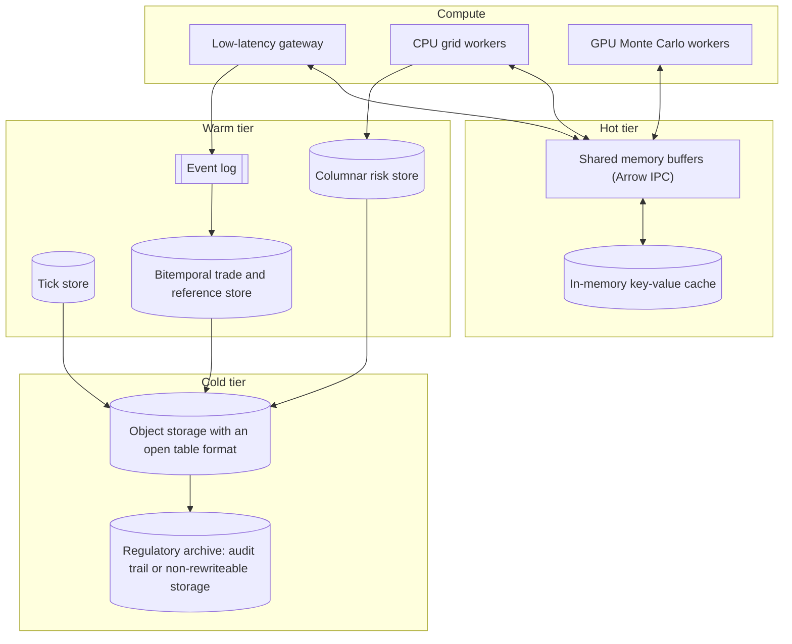

# Storage and Compute for Quantitative Systems

## TL;DR

- Trading and risk data have different access patterns (append-heavy ticks, versioned trades, scan-heavy risk cubes, immutable audit records), so platforms use several stores, each chosen for its access pattern rather than for fashion.
- Column stores win aggregations because a query reads only the columns it touches: for the 400-byte rows in this note, `SUM(dv01)` scans 50 times fewer bytes than a row store.
- Gorilla's XOR float encoding is excellent when consecutive values share bits (integers, binary fractions, unchanged values) and poor on decimal prices: 12.8 bits per value on a 1/256 grid but 51.0 on a 0.01 grid, where integer ticks with delta varints need 8.0.
- High-entropy float mantissas barely compress: byte-split float64 scenario P&L has about 56 bits of order-0 entropy per value (ratio 1.14), and rounding to whole dollars is what makes it compressible (3.15); compression ratios in sizing must be justified, not assumed.
- Zero-copy interchange (Apache Arrow buffers in shared memory) removes serialization and payload copies, not the cost of mapping and touching memory.
- Every number here is computed, printed and asserted by [sys_storage_compute.py](code/sys_storage_compute.py); schemas, volumes and ratios are labelled hypothetical inputs.

## Learning objectives

- Design a polyglot persistence architecture aligning database technologies to specific capital markets access patterns.
- Implement the Gorilla compression algorithm for financial time series, including double-delta timestamps and IEEE 754 XOR encoding, and predict when it works.
- Evaluate the computational mechanics of columnar storage (Parquet / Arrow / ClickHouse) and explain its superior I/O throughput for OLAP risk cubes.
- Construct zero-copy IPC data pipelines between analytical Python environments and high-performance C++ pricing engines using Apache Arrow.
- Quantify enterprise storage footprints, compression ratios, and I/O budgets across hot, warm, and cold storage tiers, and test a compression assumption against the data's entropy.

## Core concepts

### 1. Matching stores to access patterns

| Data | Dominant access pattern | Typical store type | Tier |
| :--- | :--- | :--- | :--- |
| Market ticks and quotes | append in time order; range scans and as-of joins by instrument | time-series or columnar engine | hot (memory, NVMe) then warm |
| Trade lifecycle events | append-only, replay by trade id, exactly-once consumers | partitioned event log | hot, retained for replay |
| Trades and reference data | point-in-time lookup "as known at time t" | relational store with a bitemporal schema | warm |
| Risk cubes (sensitivities, scenario P&L) | scans and group-bys over few columns | columnar files or columnar OLAP engine | warm, then cold |
| Live marks and limits | key lookup at high rate | in-memory key-value store or shared memory | hot |
| History for audit and research | rare, large scans of past snapshots | object storage with an open table format | cold |

Bitemporal means every row carries a valid-time interval (when the fact is true in the world) and a transaction-time interval (when the database believed it), so a report can be reproduced "as of" any past run even after back-dated amendments.

### 2. Row versus column layout

A row store keeps each tuple contiguous; a column store keeps each column contiguous (Abadi et al. 2013 survey the design space).
For a scan that touches $k$ of the row's bytes out of a row width $w$, the column store reads about $k/w$ of the bytes, before compression, plus metadata.
Contiguous same-typed values also compress better (dictionary, run-length, delta and bit-packing all exploit within-column redundancy) and feed SIMD loops: one AVX-512 instruction operates on 8 doubles.
The price is writes and point lookups: inserting one row touches every column file, which is why columnar systems batch writes into large immutable chunks.

Parquet organises a file into row groups, each holding one column chunk per column, divided into pages; readers skip row groups using per-chunk statistics.
The Parquet documentation recommends large row groups (512 MB to 1 GB) and 8 KB data pages (parquet.apache.org, retrieved 2026-10); tiny row groups waste metadata and compression context, while one giant row group defeats skipping and parallel reads.

### 3. Gorilla compression (Pelkonen et al. 2015, section 4.1)

Timestamps use delta-of-delta: with $D = (t_n - t_{n-1}) - (t_{n-1} - t_{n-2})$, store `0` if $D = 0$, `10` plus 7 bits if $D \in [-63, 64]$, `110` plus 9 bits if $D \in [-255, 256]$, `1110` plus 12 bits if $D \in [-2047, 2048]$, else `1111` plus 32 bits.
Values: the first value of a block is stored raw; each later value is XORed with its predecessor.

- XOR zero (value unchanged): store a single `0`.
- Otherwise store `1`, then either:
  - control bit `0` if the meaningful bits fall inside the previous window (at least as many leading zeros and at least as many trailing zeros as the previous stored window): store only the bits inside that window;
  - control bit `1` otherwise: 5 bits of leading-zero count, 6 bits of meaningful-bit length, then the meaningful bits; this becomes the new window.

The paper reports that on Facebook's monitoring data the scheme brings 16-byte points (64-bit timestamp, 64-bit value) to an average of 1.37 bytes, a 12x reduction, and notes that many of those series store integers.
That workload is the reason it works: integers and slowly varying values share sign, exponent and leading mantissa bits.

### 4. When float compression fails

A decimal price such as 100.01 has no exact binary representation, so its mantissa is a long pseudo-random tail; two neighbouring decimal prices XOR to a wide meaningful block.
The fix in market data stores is to store prices as integer ticks (price divided by the tick size) and encode deltas, then convert at the edge.
The same logic applies to risk outputs: Monte Carlo or scenario P&L in float64 has close to full-entropy low mantissa bytes, so no lossless codec can do much; quantising (to cents, to dollars, or to float32 where the precision budget allows) is a modelling decision that buys the compression.
Parquet's BYTE_STREAM_SPLIT encoding separates the $K$ bytes of each value into $K$ streams so that the low-entropy high bytes (sign and exponent) compress well; it "does not reduce the size of the data but can lead to a significantly better compression ratio" (Parquet encodings documentation, retrieved 2026-10).

### 5. Zero-copy interchange

Apache Arrow specifies a language-independent columnar memory layout (validity bitmap, offsets and contiguous value buffers), so a C++ producer and a Python consumer can read the same buffers without converting them.
With the IPC file format in a memory-mapped file or a shared-memory segment, `pyarrow.memory_map` plus `pyarrow.ipc.open_file` reads record batches whose buffers point into the mapping, and `Array.to_numpy(zero_copy_only=True)` returns a NumPy view for primitive types without nulls.
Each process may map the segment at a different virtual address; what disappears is serialization and payload copying, while page faults, cache misses and the work of reading the data remain.

### 6. Write-optimised stores

Log-structured merge trees (O'Neil et al. 1996) absorb writes in memory, flush sorted immutable runs and merge them in the background.
Writes are sequential and fast, but each record is rewritten several times as runs merge (write amplification), and reads may consult several runs, so compaction schedules show up as latency spikes in tick capture if they are not throttled.

### 7. Retention and immutability for broker-dealer records

SEC Rule 17a-4 sets retention periods by record type: not less than six years for the records in 17a-3(a)(1) to (3), (5), (21) and (22), and not less than three years for many others, the first two years in an easily accessible place (17 CFR 240.17a-4(a) and (b), retrieved 2026-10).
Since the 2022 amendments (Exchange Act Release No. 96034 of 12 October 2022; compliance date 3 May 2023 per the SEC staff FAQ), an electronic recordkeeping system may either keep a complete time-stamped audit trail that permits re-creation of the original record, or preserve records exclusively in non-rewriteable, non-erasable (WORM) form (17a-4(f)(2)(i)(A) and (B)).
So "must be WORM" is out of date; "must be either WORM or fully audit-trailed" is the current rule for broker-dealers, and other regimes have their own retention rules.

## Worked examples

### Example 1: Gorilla on one value

$100.0$ is `0x4059000000000000` and $100.125 = 100 + 2^{-3}$ is `0x4059080000000000`: they differ in one mantissa bit.
The XOR has 20 leading zeros, 43 trailing zeros and 1 meaningful bit.
There is no previous window yet, so the encoder writes `1`, control `1`, 5 bits for 20, 6 bits for length 1, and the bit itself: 14 bits instead of 64, a 78.1% saving on that value.
If the next value goes back to 100.0, the XOR is the same single bit, it fits the stored window, and it costs `1`, `0` and one bit: 3 bits.
The script decodes both streams and recovers the inputs bit for bit.

### Example 2: bits per value on synthetic price series

Three 10,000-tick random walks (seed 42), each step -2, -1, +1 or +2 ticks:

| Series | Gorilla bits per value |
| :--- | ---: |
| Price on a binary grid, $100 + k/256$ | 12.8 |
| Price on a decimal grid, $(10000 + k)/100$ | 51.0 |
| Decimal grid with 70% of ticks unchanged | 16.1 |

The same moves stored as integer tick deltas with zigzag varints take 8.0 bits per value.
For timestamps, a regular 1-second series costs 1.0 bit per point, but irregular nanosecond tick times (exponential gaps with a 2 ms mean) cost 36.0 bits per point, because almost every delta-of-delta falls in the 32-bit case.
Interview summary: Gorilla is a monitoring-data codec; for exchange ticks, store integer ticks and integer nanoseconds and delta-encode them.

### Example 3: how much a column store saves

Hypothetical risk-cube schema: 10 dictionary-encoded attributes at 4 bytes and 45 float64 measures at 8 bytes, so a row is 400 bytes.
`SUM(dv01)` reads 8 of those 400 bytes: a 50x reduction in bytes scanned.
`SUM(dv01) GROUP BY desk, currency` reads 16 bytes: 25x.
These are pre-compression ratios; real gains also depend on page granularity and how well each column compresses.

### Example 4: is a 3:1 compression assumption credible?

Take 100,000 float64 scenario P&L values with a standard deviation of 100,000 dollars (seed 2026) and split each value into its eight bytes.
The order-0 Shannon entropy summed over the eight byte streams is about 56 bits per value, so an entropy coder working byte stream by byte stream can reach only about 1.14:1.
Rounded to whole dollars, the same data has 20.3 bits per value (3.15:1), because the low mantissa bytes become zeros.
Lesson: a 3:1 ratio on raw doubles needs a justification (quantisation, float32 or structure across scenarios); otherwise size for close to 1:1.
This is an order-0 estimate per stream, not the output of a particular codec.

### Example 5: ten-year sizing (hypothetical inputs, decimal units)

- Sensitivity cube: 200,000 positions times 400 bytes is 80.0 MB per day; at an assumed 5:1 it is 16.0 MB per day, 4.03 GB per 252-day year, 40.3 GB over ten years.
- Scenario P&L: 200,000 positions times 1,000 scenarios times 8 bytes is 1.6 GB per day, 4.03 TB over ten years uncompressed, 1.34 TB at an assumed 3:1, and 3.54 TB at the 1.14:1 order-0 estimate of Example 4.

Either way the archive fits comfortably in object storage; the design questions are partitioning (by business date and desk), the table format's snapshot retention, and how fast an auditor's "reproduce run X" query can find the right files.

## Pitfalls

- **Aggregating in a key-value store:** summing a measure over millions of keys means millions of network round trips; aggregate in a columnar engine and cache the results.
- **Row-group sizing by accident:** writers that flush tiny row groups (for example one per micro-batch) bloat metadata and lose compression; compact them.
- **Unbounded caches:** an in-memory cache with no memory limit or eviction policy invites the operating system's out-of-memory killer, which terminates processes, often the wrong ones.
- **Ignoring LSM write amplification:** background compaction competes with ingest for disk bandwidth and shows up as tail-latency spikes.
- **Assuming compression ratios:** sizing with a vendor-style "10:1" on random-looking doubles; measure on the real data or estimate entropy first (Example 4).
- **Floating-point prices in tick stores:** decimal prices as doubles defeat XOR codecs and invite equality bugs; store integer ticks.
- **Out-of-date archive rules:** treating WORM as the only compliant format for broker-dealer records, or assuming one retention period for every record type.

## Interview questions

> [!question]- sys-14-01 | Why do columnar databases (ClickHouse, DuckDB) vastly outperform relational databases (PostgreSQL) for risk aggregation queries?
> They read only the columns a query touches, so `SUM(dv01)` over 400-byte rows scans 8 bytes per row instead of 400 (50x fewer bytes before compression).
> Same-typed contiguous values also compress better and run through vectorised (SIMD) loops; the cost is slower single-row writes and lookups.

> [!question]- sys-14-02 | How does Apache Arrow eliminate serialization overhead in quantitative analytics?
> Arrow fixes a language-independent columnar memory layout, so producer and consumer can share the same buffers (for example an IPC file in shared memory or a memory-mapped file) instead of encoding and decoding.
> It removes serialization and payload copies; mapping, page faults and actually reading the data still cost time.

> [!question]- sys-14-03 | What is double-delta compression and why is it effective for financial timestamps?
> It stores $D = (t_n - t_{n-1}) - (t_{n-1} - t_{n-2})$ with a variable-length code: one bit when $D = 0$.
> It is effective for regularly sampled series (1.0 bit per point at a 1-second interval) but not for irregular nanosecond tick times, which cost about 36 bits per point in the note's example; for ticks, delta-encode integer nanoseconds instead.

> [!question]- sys-14-04 | What is the difference between kdb+/q and a standard relational database?
> kdb+ is a column-oriented time-series database with an array language (q) in which ordered vectors and time are first-class, including as-of joins (`aj`).
> A general relational database is row-oriented by default and set-based, so ordered, time-aligned operations are more awkward and scan more data.

> [!question]- sys-14-05 | What is an As-Of Join (AJ) in time-series databases?
> For each row of the left table, take the most recent row of the right table at or before its timestamp (per key, such as symbol).
> Typical use: attach the prevailing quote to each trade for spread or markout analysis; an exact-time join would almost never match.

> [!question]- sys-14-06 | What is the trade-off between write amplification and read performance in LSM-Tree databases?
> LSM trees buffer writes in memory and flush sorted immutable runs, so ingest is sequential and fast.
> Keeping reads fast requires merging runs (compaction), which rewrites data several times (write amplification) and consumes I/O; less compaction means reads must check more runs.

> [!question]- sys-14-07 | How does POSIX shared memory (`/dev/shm`) improve IPC latency between trading services?
> Processes map the same physical pages, so a producer writes once and the consumer reads in place, with no system call or kernel copy per message after setup.
> The remaining costs are cache-line transfers between cores and the synchronisation protocol (for example a ring buffer with sequence numbers), which is why layout and false sharing matter.

> [!question]- sys-14-08 | What is an Apache Iceberg table format and how does it benefit financial data lakes?
> An open table format over files in object storage that tracks table snapshots in metadata, giving atomic commits, schema evolution, hidden partitioning and time travel to a past snapshot.
> For risk data it means "rerun last March's report on exactly the data it used" is a snapshot query, not a restore.

> [!question]- sys-14-09 | What is the purpose of dictionary encoding in columnar compression?
> Repeated values (currency, desk, book) are replaced by small integer codes with a dictionary stored once per chunk.
> Columns shrink, equality filters and group-bys run on integers, and the codes compress further with run-length and bit-packing.

> [!question]- sys-14-10 | Why must financial tick databases implement out-of-order data handling?
> Feeds from several venues and lines arrive with different latencies and occasional retransmissions, so arrival order is not event order.
> Stores either buffer and sort within a bounded window before sealing a block, or accept late writes into separate runs merged later; analytics must say which timestamp (exchange, receive) they order by.

> [!question]- sys-14-11 | Gorilla encodes 100.0 followed by 100.125. How many bits does the second value take and why?
> $14$ bits.
> The XOR has one meaningful bit with 20 leading and 43 trailing zeros; with no previous window the encoding is `1`, control `1`, 5 bits for 20, 6 bits for length 1, and the bit: $1 + 1 + 5 + 6 + 1$.

> [!question]- sys-14-12 | Why does Gorilla compress prices on a 1/256 grid far better than prices on a 0.01 grid?
> Binary fractions are exact in IEEE 754, so neighbouring prices share almost all bits (12.8 bits per value in the note's walk); decimal prices have long pseudo-random mantissa tails and XOR to wide blocks (51.0 bits per value).
> Storing integer ticks and delta-encoding them (8.0 bits per value) beats both.

> [!question]- sys-14-13 | A capacity plan assumes 3:1 lossless compression on float64 scenario P&L. How do you challenge it?
> Estimate the entropy: byte-split float64 P&L in the note has about 56 bits per value of order-0 entropy, so about 1.14:1 is all an entropy coder can do per stream.
> Higher ratios need a justified quantisation (cents, dollars, float32) or structure across scenarios; size for close to 1:1 otherwise.

> [!question]- sys-14-14 | What does Parquet's BYTE_STREAM_SPLIT encoding do and when does it help?
> It writes byte 0 of every value, then byte 1, and so on, as separate streams, without changing the size.
> It helps a following compressor on floating-point columns, because the sign and exponent bytes are highly repetitive while the low mantissa bytes are not.

> [!question]- sys-14-15 | Does SEC Rule 17a-4 still require broker-dealers to keep electronic records on WORM media?
> No, not exclusively: since the October 2022 amendments a broker-dealer may use an electronic recordkeeping system with a complete time-stamped audit trail that allows re-creation of the original record, or non-rewriteable non-erasable storage.
> Retention periods differ by record type (six years for some, three years for others, the first two easily accessible).

> [!question]- sys-14-16 | When is a key-value cache the wrong store for risk data?
> When the workload is aggregation or ad hoc slicing: summing over millions of keys becomes millions of lookups and network transfers.
> Key-value stores fit point lookups of hot state (live marks, limits); aggregations belong in columnar engines, with results cached if needed.

## In this repo and SDE-Interview-Prep

- `code/sys_storage_compute.py` computes, prints and asserts every number on this page: a Gorilla encoder and decoder with round-trip checks, the synthetic series, scan ratios, byte-stream entropy and archive sizing.
- [The EOD Risk Batch](13-EOD-Risk-Batch.md) for what writes these stores, [Market and Reference Data Platform](03-Market-and-Reference-Data-Platform.md) for tick and snapshot capture, and [Non-Functional Design](16-Non-Functional-Design.md) for replication and recovery.
- SDE-Interview-Prep: [Indexing and Access Paths](https://github.com/shreejitverma/SDE-Interview-Prep/blob/main/04-System-Design/00-Concepts/Indexing-and-Access-Paths.md), [RDBMS vs NoSQL](https://github.com/shreejitverma/SDE-Interview-Prep/blob/main/04-System-Design/00-Concepts/RDBMS-vs-NoSQL.md), [Partitioning and Sharding](https://github.com/shreejitverma/SDE-Interview-Prep/blob/main/04-System-Design/00-Concepts/Partitioning-and-Sharding.md).

## Further reading

- Pelkonen, T., Franklin, S., Teller, J., Cavallaro, P., Huang, Q., Meza, J. and Veeraraghavan, K. "Gorilla: A Fast, Scalable, In-Memory Time Series Database." *Proceedings of the VLDB Endowment* 8(12), 2015, pp. 1816-1827, section 4.1.
- Abadi, D., Boncz, P., Harizopoulos, S., Idreos, S. and Madden, S. "The Design and Implementation of Modern Column-Oriented Database Systems." *Foundations and Trends in Databases* 5(3), 2013.
- O'Neil, P., Cheng, E., Gawlick, D. and O'Neil, E. "The Log-Structured Merge-Tree (LSM-Tree)." *Acta Informatica* 33(4), 1996.
- Kleppmann, Martin. *Designing Data-Intensive Applications*. O'Reilly, 2017, chapter 3 (storage and retrieval, column-oriented storage).
- Apache Parquet documentation: file format configurations and encodings; Apache Arrow Columnar Format specification; Apache Iceberg documentation (all retrieved 2026-10).
- 17 CFR 240.17a-4 as amended by SEC Exchange Act Release No. 96034 (12 October 2022), 87 FR 66412; effective 3 January 2023, compliance date 3 May 2023 (SEC staff FAQ, retrieved 2026-10).
