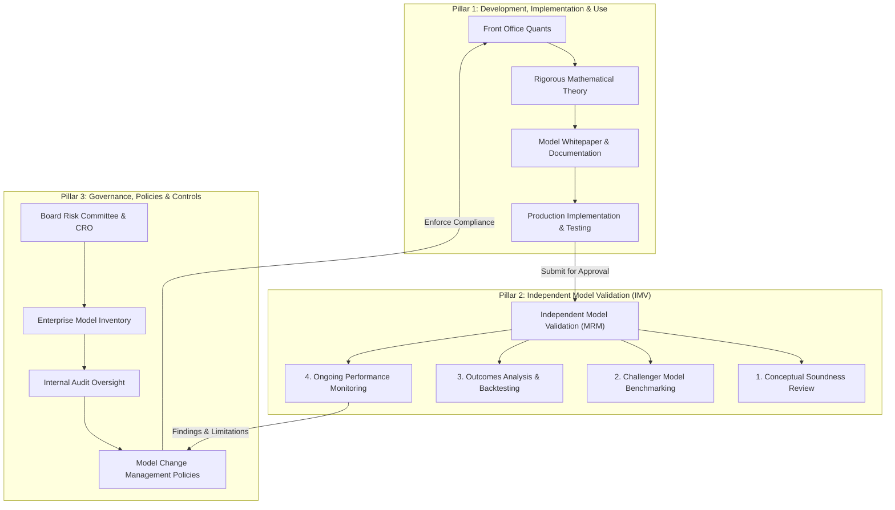
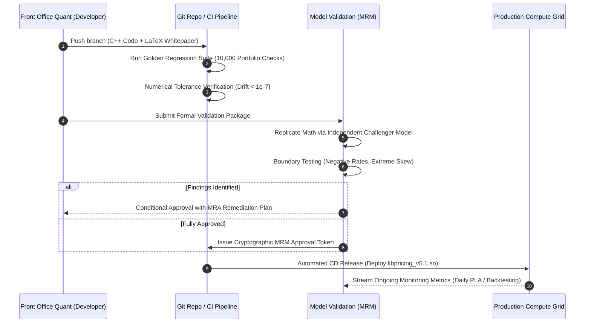

# Model Governance and SR 11-7 Lifecycle

## TL;DR

- Quantitative financial models are simplified mathematical representations of complex economic realities; utilizing them creates inherent **model risk**-the potential for financial loss, mispricing, or regulatory penalties arising from conceptual flaws, implementation bugs, or out-of-scope usage.
- In the United States, Federal Reserve SR 11-7 and OCC Bulletin 2011-12 (along with European ECB TRIM and UK PRA SS1/23) define global regulatory standards for enterprise Model Risk Management (MRM).
- SR 11-7 mandates strict organizational, operational, and financial independence between model developers (Front Office Quants) and Model Validation (Independent Model Validation - IMV).
- All quantitative models must reside in an enterprise Model Inventory classified into materiality tiers: Tier 1 (High Materiality), Tier 2 (Medium Materiality), and Tier 3 (Low Materiality).
- Deploying a model to production requires passing multi-phase gates: conceptual soundness review, challenger model benchmarking, automated golden regression testing, and cryptographic approval tokens.
- All numerical figures in this note are verified by [sys_model_governance.py](code/sys_model_governance.py).

## Learning objectives

- Formulate the legal and regulatory definition of a quantitative model under Federal Reserve SR 11-7 and OCC 2011-12.
- Map the three pillars of Model Risk Management: Development/Implementation/Use, Independent Model Validation, and Governance/Controls.
- Implement an enterprise model materiality tiering matrix evaluating financial exposure, complexity, regulatory scrutiny, and client impact.
- Design independent validation workflows including conceptual soundness checks, boundary condition stress testing, and challenger model benchmarking.
- Construct an automated Model CI/CD deployment pipeline enforcing golden regression tests, version pinning, and cryptographic MRM sign-off.
- Analyze the operational root causes of the 2012 JPMorgan London Whale collapse and extract mandatory model governance safeguards.

## Core concepts

### 1. Regulatory Definition of a Model (SR 11-7)

Under Federal Reserve SR 11-7, a model is defined as:
> "A quantitative method, system, or approach that applies statistical, economic, financial, or mathematical theories, techniques, and assumptions to process input data into quantitative estimates."

Every model comprises three distinct functional components:
1. **Information Input:** Market price feeds, historical tick data, macroeconomic indicators, and trade contract terms.
2. **Processing Component:** The mathematical formulation, stochastic processes, calibration algorithms, and numerical solvers.
3. **Reporting Component:** Quantitative outputs: fair value mark-to-market prices, Greek sensitivities, VaR/ES figures, or regulatory capital.

### 2. The Three Pillars of SR 11-7

### 3. Model Materiality Tiering Matrix

Models are scored and assigned to materiality tiers based on multi-factor risk exposure:

$$\text{Materiality Score} = \sum_{i=1}^4 w_i S_i = w_1 S_1 + w_2 S_2 + w_3 S_3 + w_4 S_4$$

Where $S_1$ to $S_4$ represent scores from 1 (lowest) to 5 (highest) across four evaluation dimensions:
- $S_1$ (Financial Exposure): Total portfolio notional and daily P&L swing potential ($w_1 = 0.35$).
- $S_2$ (Model Complexity): Stochastic dimensions, early exercise boundaries, numerical solvers ($w_2 = 0.25$).
- $S_3$ (Regulatory Scrutiny): Impact on Pillar 1/Pillar 2 capital, FRTB IMA, or CCAR stress testing ($w_3 = 0.25$).
- $S_4$ (Client Impact): External quotation versus internal indicative monitoring ($w_4 = 0.15$).

Tier Classification:
- **Tier 1 (High Materiality, Score $\ge 3.75$):**
  Core derivatives pricing libraries, firm-wide VaR/ES engines, FRTB IMA models, and CECL/IFRS 9 credit models.
  Requires independent code re-implementation, challenger model benchmarking, annual re-validation, and quarterly Board reporting.
- **Tier 2 (Medium Materiality, $2.50 \le \text{Score} < 3.75$):**
  Standard vanilla flow pricing (Black-Scholes swaptions, equity index options) and pre-trade margin proxies.
  Requires biennial re-validation and semi-annual monitoring.
- **Tier 3 (Low Materiality, $\text{Score} < 2.50$):**
  Internal volume/operational estimators and simple heuristic scorecards.
  Requires triennial re-validation.

### 4. The Model Deployment Lifecycle (How a Model Ships)

## Worked examples

### Example 1: Model Materiality Tiering for a Bermudan Swaption Engine

An investment bank assesses the model tier for a new multi-currency Hull-White 2-Factor Bermudan Swaption engine:
- **Financial Exposure ($S_1$):**
  Average portfolio notional is $\$18\text{ billion}$ with daily P&L swings exceeding $\$10\text{ million}$. Score: $5 / 5$.
- **Model Complexity ($S_2$):**
  Multi-factor interest rate dynamics, American Monte Carlo Least-Squares regression, and state-dependent early exercise boundary. Score: $4 / 5$.
- **Regulatory Scrutiny ($S_3$):**
  Contributes directly to FRTB IMA trading book capital and supervisory stress testing. Score: $5 / 5$.
- **Client Impact ($S_4$):**
  Used for live client quoting and firm risk limits. Score: $4 / 5$.

Weighted Score Calculation ($w = [0.35, 0.25, 0.25, 0.15]$):
- Financial Exposure component: $0.35 \times 5 = 1.75$.
- Complexity component: $0.25 \times 4 = 1.00$.
- Regulatory component: $0.25 \times 5 = 1.25$.
- Client Impact component: $0.15 \times 4 = 0.60$.
- **Total Composite Score:**

$$\text{Composite Score} = 1.75 + 1.00 + 1.25 + 0.60 = 4.60$$

Because $4.60 \ge 3.75$, the model is classified as **Tier 1 (High Materiality)**, requiring mandatory independent code re-implementation, challenger model benchmarking, and full Board audit notification.

### Example 2: Challenger Model Benchmarking: Finite Difference PDE vs. American Monte Carlo

During independent validation of a candidate Hull-White 1-Factor Bermudan Swaption pricing engine:
- The Quant Developer implemented an **American Monte Carlo (AMC)** engine using Longstaff-Schwartz polynomial regression ($100,000\text{ paths}$).
- The Model Validation Quant builds an independent **Finite Difference Crank-Nicolson PDE** challenger solver on an identical calibrated zero curve.
- Benchmark Contract: 5-year Bermudan swaption on a 10-year swap, annual exercise dates, notional $\$100,000,000$.

Numerical Results:
- Challenger Model (Finite Difference PDE, $500\text{ spot steps} \times 1,000\text{ time steps}$):
  $$\text{PV}_{\text{PDE}} = \$4,215,800$$
- Candidate Production Model (American Monte Carlo, 100k paths):
  $$\text{PV}_{\text{AMC}} = \$4,208,450 \pm \$8,200\text{ (95\% Monte Carlo Confidence Interval)}$$
- Tracking Discrepancy:
  $$\Delta = \text{PV}_{\text{AMC}} - \text{PV}_{\text{PDE}} = \$4,208,450 - \$4,215,800 = -\$7,350\text{ (-0.17\%)}$$

Validation Assessment:
- The absolute difference ($|-\$7,350|$) is strictly smaller than the Monte Carlo sampling confidence interval ($\pm \$8,200$).
- The challenger model confirms the absence of systematic pricing bias, granting conceptual soundness approval.

### Example 3: Model Risk Post-Mortem: The JPMorgan "London Whale" Collapse (2012)

- **Context:** The Chief Investment Office (CIO) of JPMorgan Chase in London traded a massive credit derivatives portfolio (Synthetic Credit Portfolio - SCP), trading CDX and iTraxx credit tranches.
- **The Model Breakdown:**
  In early 2012, to curb escalating regulatory Value-at-Risk figures, the CIO deployed a new internal VaR model.
  The model was developed and implemented not in a governed C++ framework, but within a series of **uncontrolled Microsoft Excel spreadsheets**.
- **Critical Flaws Identified in Post-Mortem:**
  $1$. **Mathematical Formulation Error:** The spreadsheet formula divided by the sum of net assets instead of their arithmetic average, artificially muting price volatility estimates.
  $2$. **Manual Copy-Pasting:** The operational workflow involved copying raw market data across multiple spreadsheets manually, introducing severe transcription errors.
  $3$. **Bypassing Validation:** The model was deployed to production without independent validation sign-off from Model Risk Management.
- **Financial Consequence:**
  The flawed model understated reported VaR by **$50\%$**, masking massive accumulating losses and allowing traders to double down on illiquid positions.
  Cumulative realized losses reached **$\$6.2\text{ billion}$**, triggering regulatory fines of $\$1.0\text{ billion}$ and forcing the complete overhaul of bank-wide model governance.

## Pitfalls

- **Deploying Code Fixes as "Configuration Changes":** Altering mathematical formulas or curve parameters inside configuration scripts to bypass formal MRM review violates SR 11-7 and triggers supervisory sanctions.
- **Permitting Spreadsheets as Production Models:** Using desktop Excel workbooks for high-materiality valuation or risk aggregation lacks version control, automated regression testing, and immutable audit logs.
- **Neglecting Negative Rate and Zero Boundary Tests:** Validating models only under historical positive-yield regimes causes system failure when interest rates turn negative.
- **Failing to Document Model Limitations in the Inventory:** Every model has boundaries (such as "valid only for European exercise"); omitting limitations allows desks to apply models to out-of-scope exotic trades.
- **Treating Model Validation as a One-Time Event:** Approving a model once and neglecting ongoing performance monitoring allows model drift to accumulate unnoticed as market regimes shift.

## Interview questions

> [!question]- sys-15-01 | What is the core mandate of Federal Reserve SR 11-7?
> SR 11-7 establishes supervisory expectations for Model Risk Management across large financial institutions.
> It requires a formal model risk framework, an enterprise model inventory, strict organizational independence between developers and validators, rigorous conceptual validation, and ongoing performance monitoring.

> [!question]- sys-15-02 | What constitutes "independence" in Model Validation?
> Model validators must be organizationally, operationally, and financially independent of front-office trading desks and model developers.
> They must report through a separate reporting line to the Chief Risk Officer (CRO) and have the authority to reject models, impose capital add-ons, or enforce trading limits.

> [!question]- sys-15-03 | What is a "Challenger Model" and why is it used during independent validation?
> A challenger model is an independently developed mathematical model designed to solve the same valuation problem using an alternative numerical scheme (e.g., Finite Difference vs Monte Carlo).
> It provides an unbiased benchmark to identify coding errors, calibration instabilities, or numerical convergence failures in the candidate production engine.

> [!question]- sys-15-04 | What is a "Matter Requiring Attention" (MRA) in model governance?
> An MRA is a formal supervisory or internal audit finding identifying a material deficiency in model design, implementation, or governance that the bank is legally required to remediate within a specified timeline.

> [!question]- sys-15-05 | What caused the 2012 JPMorgan London Whale model failure?
> The CIO deployed a new credit VaR model implemented in manual spreadsheets that contained a calculation error (dividing by a sum rather than an average) and operational copy-paste mistakes.
> The model had not undergone independent validation, artificially halving reported VaR and concealing a $\$6.2\text{ billion}$ trading loss.

> [!question]- sys-15-06 | What is "Outcomes Analysis" under SR 11-7?
> Outcomes analysis compares model predictions against actual realized market outcomes.
> It includes backtesting (e.g., counting VaR exceptions against actual PnL) and benchmarking against external market prices to ensure ongoing empirical accuracy.

> [!question]- sys-15-07 | How does a model governance pipeline enforce compliance within Git CI/CD workflows?
> Production deployment branches are protected; merging requires automated golden regression test passes and a cryptographic MRM approval token signed by an authorized model validator in the commit metadata.

> [!question]- sys-15-08 | What is the difference between a Model and an End-User Computing (EUC) tool?
> A model processes input data into quantitative estimates using mathematical or statistical theories under SR 11-7.
> An EUC is a user-developed tool (like a simple spreadsheet macro) that performs basic arithmetic, formatting, or data aggregation without complex mathematical modeling.

> [!question]- sys-15-09 | What are the three materiality tiers in a Model Inventory and how do their validation requirements differ?
> Tier 1 (High): Core pricing and capital models; requires annual validation, full re-implementation, and board reporting.
> Tier 2 (Medium): Vanilla flow pricing and secondary risk checks; biennial review.
> Tier 3 (Low): Internal volume/operational estimators; triennial review.

> [!question]- sys-15-10 | Why must model validation include extreme boundary testing?
> Financial models often break down at extreme values (e.g., zero interest rates, negative asset prices, infinite volatility, or zero liquidity).
> Boundary testing verifies that algorithms fail safely (e.g., throwing clean exceptions or switching to Bachelier models) rather than producing NaN values or silent corrupted marks.

## Further reading

- Federal Reserve Board and Office of the Comptroller of the Currency. *Supervisory Guidance on Model Risk Management*. SR Letter 11-7 / OCC Bulletin 2011-12, April 2011.
- European Central Bank. *ECB Guide to internal models: General topics chapter*. ECB Banking Supervision, October 2019.
- Bank of England Prudential Regulation Authority. *Model risk management principles for banks*. PRA Supervisory Statement SS1/23, May 2023.
- JPMorgan Chase & Co. *Report of the Special Committee of the Board of Directors on the 2012 CIO Losses*. SEC Filing, January 16, 2013.
