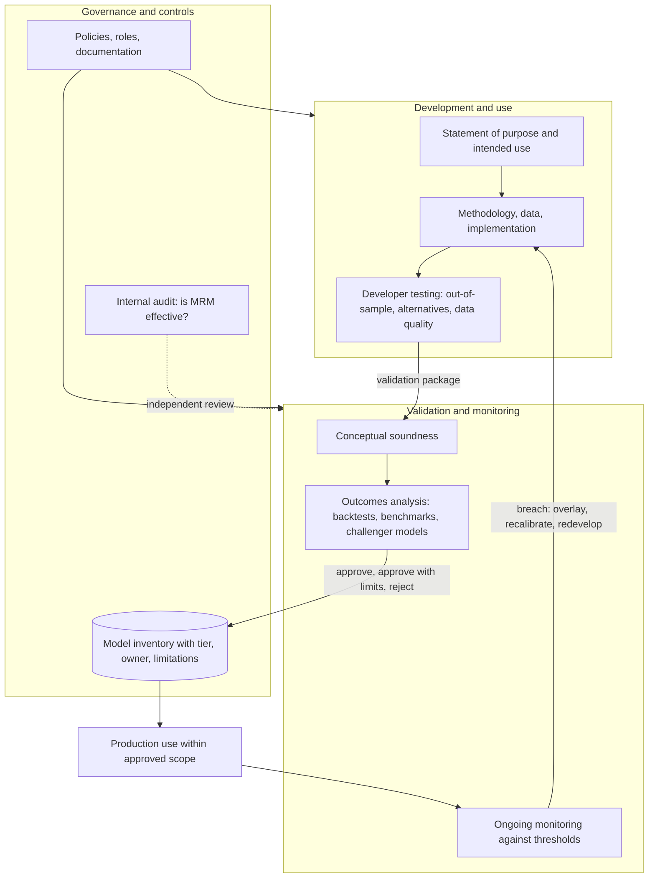
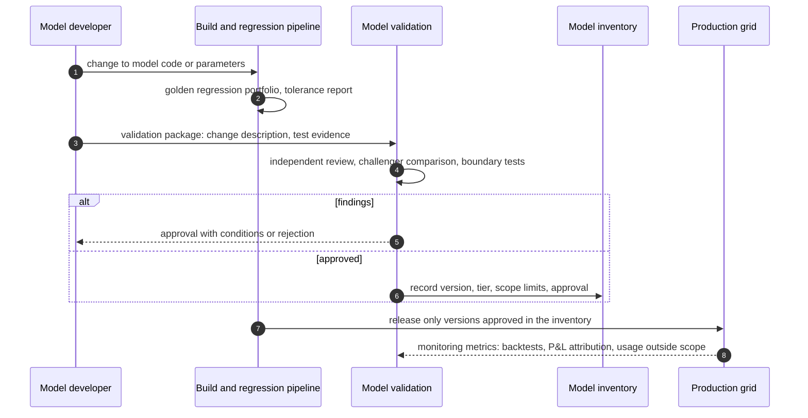

# Model Governance and Model Risk Management

## TL;DR

- Model risk is the potential for adverse consequences from decisions based on models that are wrong or misused; US guidance (SR 26-2, which superseded SR 11-7 on 17 April 2026) sizes it as a model's inherent risk in the context of its materiality (exposure and purpose).
- The organising idea, unchanged since SR 11-7, is effective challenge: critical analysis by people with the expertise, independence and standing to force changes.
- Validation has three parts: conceptual soundness, outcomes analysis (backtesting, benchmarking) and ongoing monitoring; a challenger model is only useful if the comparison accounts for Monte Carlo error and the challenger's own discretisation error.
- The UK PRA's SS1/23 is more prescriptive than SR 26-2: five principles, firm-wide tiering by materiality and complexity, an accountable senior manager and governed post-model adjustments.
- The 2012 JPMorgan CIO case is the standard failure story: a new VaR model, run in spreadsheets and approved under time pressure, cut reported VaR from $132 million to $66 million, partly through a formula that divided by a sum instead of an average.
- Every number here is computed, printed and asserted by [sys_model_governance.py](code/sys_model_governance.py), or is a quoted figure from the cited reports.

## Learning objectives

- Formulate the regulatory definition of a model under the current US guidance (SR 26-2, which replaced SR 11-7 and OCC 2011-12) and the PRA's SS1/23, and explain how the definitions differ.
- Map the pillars of Model Risk Management: development and use, validation and monitoring, and governance and controls, including vendor models.
- Implement an enterprise model materiality tiering matrix evaluating financial exposure, complexity, regulatory scrutiny, and client impact, and recognise it as firm policy rather than regulation.
- Design independent validation workflows including conceptual soundness checks, boundary condition stress testing, and challenger model benchmarking with a statistically sound acceptance test.
- Construct an automated Model CI/CD deployment pipeline enforcing golden regression tests, version pinning, and MRM sign-off.
- Analyze the operational root causes of the 2012 JPMorgan CIO losses and extract mandatory model governance safeguards.

## Core concepts

### 1. What counts as a model

| Source | Definition (quoted) | Notable scope points |
| :--- | :--- | :--- |
| SR 11-7 (2011, superseded) | "a quantitative method, system, or approach that applies statistical, economic, financial, or mathematical theories, techniques, and assumptions to process input data into quantitative estimates" | model = information input, processing and reporting components |
| SR 26-2 (17 April 2026) | "a complex quantitative method, system, or approach that applies statistical, economic, or financial theories to process input data into quantitative estimates" | excludes "simple arithmetic calculations, such as those found within spreadsheets, as well as deterministic rule-based processes"; generative and agentic AI are outside its scope |
| PRA SS1/23, Principle 1.1 | "a quantitative method, system, or approach that applies statistical, economic, financial, or mathematical theories, techniques, and assumptions to process input data into output" | includes qualitative or expert-judgement inputs and qualitative outputs; firms should consider applying MRM to material, complex deterministic methods |

The practical question in an inventory review is classification: a pricing library, a VaR engine and a PD model are models; a spreadsheet that sums desk P&L is not under SR 26-2, but it is still an end-user computing tool that needs controls.

### 2. Sizing model risk

SR 26-2 separates three ideas:

- Inherent risk: assumptions, complexity, input quality and data constraints.
- Exposure: how much business depends on the output (for example portfolio size).
- Purpose: regulatory or risk-management use is generally riskier than other use; purpose and exposure together give materiality.

The overall magnitude is inherent risk "in the context of model materiality", and model risk should be assessed individually and in aggregate (shared assumptions, data or methods can fail together).
SS1/23 turns this into a requirement: a firm-wide tiering approach assigning each model a materiality rating (quantitative size and qualitative purpose) and a complexity rating (Principle 1.3).
Neither document prescribes weights, scores or tier thresholds; those are firm policy.

### 3. The model lifecycle and who does what

Development, validation and use are separate roles because their incentives differ.
SR 26-2 phrases independence in terms of effective challenge: challengers need "the appropriate expertise", "sufficient independence to maintain objectivity" and "the organizational standing and influence to effect any change", and roles should address conflicts such as "misalignment of incentives between different reporting lines, such as model development and validation groups".
Internal audit does not re-validate models; it checks whether model risk management is rigorous and effective.
Vendor models stay in scope: banks are expected to understand the vendor model's conceptual soundness, design, development data and performance, and to monitor it, even when the code is proprietary.

### 4. Validation in practice

- Conceptual soundness: is the method right for the product and use (dynamics, calibration instruments, numerical scheme, limits of applicability)?
- Outcomes analysis: compare outputs with realised outcomes or with an independent benchmark; backtesting VaR exceptions and P&L attribution are outcomes analysis.
- Ongoing monitoring: track performance against thresholds set at approval, with escalation when breached.
- Timing: SR 11-7 asked for a periodic review "at least annually but more frequently if warranted"; SR 26-2 drops the fixed frequency and ties the timing, nature and frequency of validation to purpose, methodology, changes and data limitations, while expecting validation generally before first use.
  SS1/23 asks for periodic revalidation "with a frequency that is consistent with the model tier" (Principle 4.5).

A challenger model is an independent implementation, ideally by a different method, of the same valuation problem.
A fair comparison has three error sources: the candidate's sampling error, the challenger's discretisation error, and genuine model or code differences; only the last should drive a finding.

### 5. How the regimes differ

| Aspect | SR 26-2 (US, 2026) | PRA SS1/23 (UK) | ECB (euro area) |
| :--- | :--- | :--- | :--- |
| Status | supervisory guidance; "does not set forth enforceable standards"; most relevant to banking organisations over $30 billion in assets | supervisory statement; firms with internal model approval for credit (IRB), market (IMA) or counterparty (IMM) risk | Guide to internal models (revised July 2025), applied in supervision of internal models |
| Structure | development and use; validation and monitoring; governance; vendor models | five principles: identification and classification, governance, development and use, independent validation, risk mitigants | overarching principles chapter (MRM framework, data governance, machine learning) plus risk-type chapters |
| Tiering | materiality from exposure and purpose; tailoring expected | mandatory firm-wide tiering by materiality and complexity | MRM policy with model categorisation |
| Accountability | clear roles and responsibilities | an accountable senior manager function (SMF) for the MRM framework | management body oversight |

The ECB's Targeted Review of Internal Models (TRIM), started in 2016, ran 200 on-site investigations at 65 significant banks, identified over 5,000 findings and raised risk-weighted assets by about 12% (about 275 billion euros), per the ECB's 19 April 2021 press release.

### 6. Shipping a model change

The control that matters is the link between the release pipeline and the inventory: production refuses a model version that the inventory does not show as approved for that use.
Parameter changes that alter outputs (calibration settings, proxies, numerical tolerances) are model changes, whatever file they live in.

## Worked examples

### Example 1: an illustrative tiering score

A firm's policy (hypothetical, not regulatory) scores four factors from 1 to 5 with weights 0.35 (exposure), 0.25 (complexity), 0.25 (purpose) and 0.15 (client impact); Tier 1 is a score of at least 3.75, Tier 2 at least 2.50.
A Bermudan swaption pricing and risk engine scores 5, 4, 5 and 4: $0.35 \times 5 + 0.25 \times 4 + 0.25 \times 5 + 0.15 \times 4 = 1.75 + 1.00 + 1.25 + 0.60 = 4.60$, so Tier 1.
If its purpose score were 3 instead of 5, the score would be 4.10, still Tier 1, so the tier is driven by exposure and complexity.
Enumerating all 625 score combinations shows how the thresholds partition them: 17.1% land in Tier 1, 57.9% in Tier 2 and 25.0% in Tier 3.
A validator reviewing such a scheme asks whether those proportions match the firm's intent, whether the weights were calibrated or invented, and whether a single extreme factor (say exposure 5) should override the average.

### Example 2: a challenger that confirms, and one that catches a bug

Contract: a one-year Bermudan put, strike 100, spot 100, exercisable at each of 12 monthly dates; market: rate 5%, volatility 20%, Black-Scholes dynamics (all hypothetical).

- The challenger is a Cox-Ross-Rubinstein tree.
  Before trusting it, check it on a closed form: the tree's European put with 1,200 steps is 5.572 against Black-Scholes 5.574.
  Its Bermudan price is 6.042 at both 1,200 and 2,400 steps (the change is 0.0001), so discretisation error is negligible at this precision.
- The candidate is Longstaff-Schwartz Monte Carlo (cubic polynomial in $S/K$ on in-the-money paths), with exercise rules fitted on 100,000 paths and the price computed on an independent 100,000 paths, giving 6.038 with a standard error of 0.023.
  Pricing on independent paths makes the estimate a lower bound in expectation (any exercise rule is sub-optimal), so a candidate far above the tree is suspicious.
- The difference is $(6.038 - 6.042)/0.023$, about -0.2 standard errors: consistent.
- A planted bug (cash flows not discounted between exercise dates) gives 6.220, 7.3 standard errors above the tree: the comparison flags it.

The acceptance test is "difference within a few standard errors plus the challenger's discretisation error", stated before running, not "the numbers look close".

### Example 3: the 2012 JPMorgan CIO VaR model

Facts from the primary reports:

- The Synthetic Credit Portfolio's VaR was computed by a new model that the Model Review Group authorised on 30 January 2012 for use from 27 January, with formal approval on 1 February (Task Force report, p. 126).
- The Task Force found the model "operated through a series of Excel spreadsheets, which had to be completed manually, by a process of copying and pasting data from one spreadsheet to another" (p. 124), that the reviewers performed only limited back-testing, and that pressure to approve quickly may have made them "more willing to overlook the operational flaws".
- After the model was withdrawn, reviewers found that in computing relative changes in hazard rates and correlations, "after subtracting the old rate from the new rate, the spreadsheet divided by their sum instead of their average", which "likely had the effect of muting volatility by a factor of two and of lowering the VaR" (p. 128).
- The Senate Permanent Subcommittee on Investigations reported that the new model "immediately reduced the CIO's VaR by 50%, from $132 million to $66 million" (staff report, p. 177).
- Losses: about $5.8 billion through 30 June 2012 (Task Force, p. 7) and at least $6.2 billion by the end of 2012 (PSI report, p. 5).
- Penalties: about $920 million to the SEC, Federal Reserve, OCC and UK FCA (SEC press release 2013-187, 19 September 2013) plus $100 million to the CFTC (release 6737-13, 16 October 2013), about $1,020 million in total.

The arithmetic of the error: for hazard rates moving from 0.0200 to 0.0220 the intended relative change is $0.002/0.021 = 0.0952$ and the implemented one $0.002/0.042 = 0.0476$, exactly half for every observation.
Because historical-simulation VaR of a linear position scales with the size of the simulated changes, halving every change halves that VaR; the script confirms the ratio 0.50 on a hypothetical history.
The 50% fall in reported VaR has several causes (the model change itself and the error), and the Task Force says it is "unclear by exactly what amount" the error lowered VaR, so do not attribute the whole fall to the bug.
Governance lessons: a model whose approval would end a limit breach needs more scrutiny, not less; spreadsheet implementations need the same testing as code; a VaR limit set under the old model should have been re-based when the model changed.

## Pitfalls

- **Model changes disguised as configuration:** recalibration settings, proxy choices or tolerances changed outside model change control alter outputs as surely as code does.
- **Uncontrolled spreadsheets in material processes:** SR 26-2 excludes simple spreadsheet arithmetic from the model definition, but a spreadsheet that implements a model is a model, and the CIO case shows what manual copy-and-paste does.
- **Validating only in calm regimes:** boundary tests (zero and negative rates, extreme skew, illiquid inputs) belong in validation, not in production incidents.
- **Missing limitations in the inventory:** a model approved for European exercise gets used for Bermudans unless its scope is recorded and enforced.
- **Treating approval as the end:** without ongoing monitoring against thresholds set at approval, drift goes unnoticed as markets change.
- **Challenger comparisons without error bars:** declaring agreement or disagreement without accounting for Monte Carlo standard error and the benchmark's own discretisation error.
- **Citing superseded guidance:** SR 11-7 and OCC 2011-12 were replaced on 17 April 2026; interview answers should name SR 26-2 and say what changed.

## Interview questions

> [!question]- sys-15-01 | What is the core mandate of Federal Reserve SR 11-7?
> SR 11-7 (2011) set US supervisory expectations for model risk management: sound development and use, validation by parties providing effective challenge, and governance with a model inventory, policies and documentation.
> On 17 April 2026 it was superseded by SR 26-2 (with OCC Bulletin 2026-13), which keeps that structure but narrows the model definition, drops fixed review frequencies, adds a vendor section and states that it sets no enforceable standards.

> [!question]- sys-15-02 | What constitutes "independence" in Model Validation?
> Independence means validators have the objectivity, expertise and standing to challenge effectively: separate incentives and reporting from development and use, technical competence, and enough influence to force changes or limits.
> SR 26-2 frames it as effective challenge and asks firms to address conflicts between development and validation reporting lines; it judges validation by its rigour rather than by a particular organisational chart.

> [!question]- sys-15-03 | What is a "Challenger Model" and why is it used during independent validation?
> An independently built model for the same problem, ideally using a different method (for example a tree or PDE against Monte Carlo), used to detect implementation errors, numerical problems and model-choice sensitivity.
> Its result is compared with the candidate allowing for the candidate's standard error and the challenger's discretisation error; in the note, a 7.3 standard-error gap exposes a planted discounting bug while a 0.2 standard-error gap is consistent.

> [!question]- sys-15-04 | What is a "Matter Requiring Attention" (MRA) in model governance?
> An MRA is a supervisory finding communicated by the Federal Reserve that a bank must remediate within a set timeframe; SR 13-13 (June 2013) defines MRAs and the more urgent MRIAs.
> Validation or internal audit findings are internal issues tracked to closure; they are not MRAs, although unresolved ones often become MRAs.

> [!question]- sys-15-05 | What caused the 2012 JPMorgan London Whale model failure?
> A new VaR model for the CIO's Synthetic Credit Portfolio, run through manually linked Excel spreadsheets and approved quickly while the CIO was breaching its VaR limit, cut reported VaR from $132 million to $66 million.
> Reviewers later found a formula that divided rate changes by the sum instead of the average of the old and new rates, muting volatility by a factor of two; the model had been approved by the Model Review Group, but with limited back-testing and under pressure.

> [!question]- sys-15-06 | What is "Outcomes Analysis" under SR 11-7?
> Comparing model outputs with real-world outcomes to judge performance against the model's objectives, for example VaR backtesting, P&L attribution or default-rate backtests.
> SR 26-2 keeps it as a core validation component, together with conceptual soundness and ongoing monitoring, and expects adjustment, recalibration or redevelopment when deviations persist beyond thresholds.

> [!question]- sys-15-07 | How does a model governance pipeline enforce compliance within Git CI/CD workflows?
> Releases are gated on two things: the regression suite (golden portfolio within tolerances) and the model inventory, which must show this exact version approved for this use.
> The approval record (who, when, scope, conditions) lives in the inventory, and the deployment step checks it, so an unapproved version cannot reach production even if the code merges.

> [!question]- sys-15-08 | What is the difference between a Model and an End-User Computing (EUC) tool?
> A model applies statistical, economic or financial theory to turn inputs into estimates; under SR 26-2 simple arithmetic such as spreadsheet sums and deterministic rule-based processes are expressly not models.
> An EUC is a user-built tool such as a spreadsheet; it may contain a model (then it is in MRM scope) or just arithmetic (then it needs EUC controls such as versioning, access and reconciliation, not validation).

> [!question]- sys-15-09 | What are the three materiality tiers in a Model Inventory and how do their validation requirements differ?
> Tier counts and thresholds are firm policy, not regulation: neither SR 26-2 nor SS1/23 prescribes them, though SS1/23 requires a firm-wide tiering by materiality and complexity.
> A typical three-tier policy gives Tier 1 models the deepest validation (often an independent replication or challenger) and the most frequent revalidation, and lighter, less frequent reviews to lower tiers.

> [!question]- sys-15-10 | Why must model validation include extreme boundary testing?
> Models fail at the edges of their inputs: zero or negative rates, very short or long expiries, extreme vol or skew, illiquid or missing quotes.
> Boundary tests check that the model either stays accurate or fails loudly (a clean error or a documented fallback such as a normal-vol model) instead of returning NaN or a silently wrong mark.

> [!question]- sys-15-11 | How does the SR 26-2 definition of a model differ from SR 11-7's?
> SR 26-2 says "a complex quantitative method, system, or approach that applies statistical, economic, or financial theories", dropping "mathematical" and the "techniques, and assumptions" wording, and expressly excludes simple spreadsheet arithmetic and deterministic rule-based processes.
> It also puts generative and agentic AI outside its scope, while keeping traditional statistical models and non-generative AI in scope.

> [!question]- sys-15-12 | What are the five principles of the PRA's SS1/23?
> $1$. Model identification and model risk classification.
> $2$. Governance.
> $3$. Model development, implementation and use.
> $4$. Independent model validation.
> $5$. Model risk mitigants (including governed post-model adjustments).

> [!question]- sys-15-13 | A Monte Carlo candidate prices a Bermudan at 6.038 with standard error 0.023; a converged tree gives 6.042. Pass or fail, and what if the candidate were 6.220?
> Pass: the gap is about -0.2 standard errors, well within sampling noise once the tree's discretisation error (0.0001 on doubling the steps) is negligible.
> At 6.220 the gap is 7.3 standard errors and above a price that out-of-sample Longstaff-Schwartz should only approach from below, so it is a finding; in the note it is a missing discount factor.

> [!question]- sys-15-14 | Why price Longstaff-Schwartz on paths independent of those used to fit the exercise rule?
> With independent paths the estimator applies a fixed, sub-optimal exercise rule, so it is biased low; reusing the fitting paths lets the regression peek at the future and can bias the price up.
> A low-biased estimator gives the validator a one-sided check: a price clearly above a converged benchmark points to an error.

> [!question]- sys-15-15 | An intended relative change $(b - a)/((a + b)/2)$ was coded as $(b - a)/(a + b)$. What does that do to historical-simulation VaR of a linear position?
> It halves every simulated change, so it halves that VaR exactly: quantiles scale with the size of the changes.
> This is the CIO spreadsheet error; the Task Force said it likely muted volatility by a factor of two but that the exact effect on reported VaR was unclear.

> [!question]- sys-15-16 | How should a bank treat a vendor pricing or risk model whose code it cannot see?
> As a model in full: understand its conceptual soundness, design, development data and performance, validate it (benchmarks, outcomes analysis, sensitivity tests) and monitor it; SR 26-2 has a section saying the principles still apply.
> Customisations made for the bank must be documented, justified and validated, and contracts should secure the documentation and test access validators need.

> [!question]- sys-15-17 | What did the ECB's TRIM exercise find, in numbers?
> Per the ECB's 19 April 2021 press release: 200 on-site investigations at 65 significant banks, over 5,000 findings, and about a 12% (about 275 billion euros) increase in risk-weighted assets.
> Banks could keep using internal models provided they remediated the findings by the deadlines set.

## In this repo and SDE-Interview-Prep

- `code/sys_model_governance.py` computes, prints and asserts every computed number on this page: the tiering enumeration, the tree and Longstaff-Schwartz challenger comparison including the planted bug, and the CIO arithmetic from the cited figures.
- [Risk Engine Architecture](07-Risk-Engine.md) and [FRTB Engine Architecture](10-FRTB-Engine.md) for the models being governed, [Pricing Library Architecture](05-Pricing-Library-Architecture.md) for regression testing of pricers, and [Non-Functional Design](16-Non-Functional-Design.md) for reproducibility.
- SDE-Interview-Prep: [SLOs and Observability](https://github.com/shreejitverma/SDE-Interview-Prep/blob/main/04-System-Design/00-Concepts/SLOs-and-Observability.md), [Schema Evolution and Migration](https://github.com/shreejitverma/SDE-Interview-Prep/blob/main/04-System-Design/00-Concepts/Schema-Evolution-and-Migration.md).

## Further reading

- Board of Governors of the Federal Reserve System, FDIC and OCC. *Supervisory Guidance on Model Risk Management*, attachment to SR 26-2 and OCC Bulletin 2026-13, 17 April 2026 (supersedes SR 11-7, SR 21-8, OCC Bulletins 2011-12, 2021-19 and 1997-24).
- Board of Governors of the Federal Reserve System and OCC. *Supervisory Guidance on Model Risk Management*, attachment to SR 11-7, 4 April 2011 (superseded; still the reference for most published commentary).
- Prudential Regulation Authority. *SS1/23 Model risk management principles for banks*, published 17 May 2023, effective 17 May 2024, updated 23 April 2026.
- European Central Bank. *ECB guide to internal models*, July 2025; press release on the TRIM project report, 19 April 2021.
- JPMorgan Chase & Co. *Report of JPMorgan Chase & Co. Management Task Force Regarding 2012 CIO Losses*, 16 January 2013, Appendix A (VaR modeling).
- US Senate Permanent Subcommittee on Investigations. *JPMorgan Chase Whale Trades: A Case History of Derivatives Risks and Abuses*, majority and minority staff report, 15 March 2013.
- Longstaff, F. A. and Schwartz, E. S. "Valuing American Options by Simulation: A Simple Least-Squares Approach." *Review of Financial Studies* 14(1), 2001.
- Morini, Massimo. *Understanding and Managing Model Risk: A Practical Guide for Quants, Traders and Validators*. Wiley, 2011.
