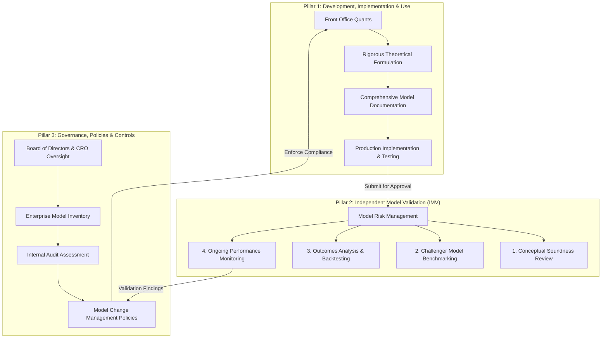
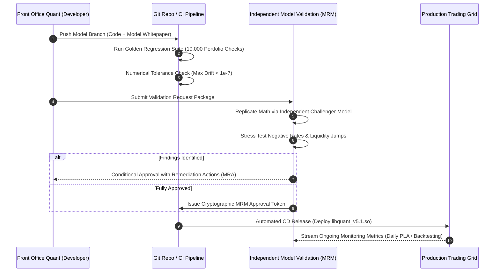

# Model Governance and SR 11-7 Lifecycle

## TL;DR

Quantitative financial models are approximations of complex economic realities; using them introduces inherent **model risk**-the potential for adverse financial loss or regulatory sanctions arising from model flaws or misuse.
In the United States, Federal Reserve SR 11-7 (and its European counterparts, ECB TRIM and PRA SS1/23) establishes the global gold standard for Model Risk Management (MRM).
SR 11-7 mandates strict organizational separation between model developers (Front Office Quants) and Model Validation (Independent Model Validation - IMV).
All models must reside in an enterprise Model Inventory categorized by materiality tier (Tier 1 High, Tier 2 Medium, Tier 3 Low).
Shipping a model change to production requires a rigorous, auditable delivery pipeline: mathematical conceptual soundness verification, challenger model benchmarking, automated golden regression tests, and formal MRM sign-off.

## Learning objectives

- Formulate the legal and regulatory definition of a "model" under Federal Reserve SR 11-7 and OCC 2011-12.
- Map the three pillars of Model Risk Management: Development/Use, Independent Validation, and Governance/Controls.
- Implement an enterprise model materiality tiering matrix evaluating PnL impact, balance sheet size, and model complexity.
- Design independent validation workflows including conceptual soundness checks, boundary stress testing, and challenger model benchmarking.
- Architect an automated Model CI/CD deployment pipeline that enforces golden regressions, version pinning, and cryptographic MRM tokens.
- Analyze the architectural breakdown of the 2012 JPMorgan London Whale disaster and extract mandatory model governance controls.

## Core concepts

### 1. Regulatory Definition of a Model (SR 11-7)

Under SR 11-7, a model is defined as:
> "A quantitative method, system, or approach that applies statistical, economic, financial, or mathematical theories, techniques, and assumptions to process input data into quantitative estimates."

A model consists of three interconnected components:
1. **Information Input:** Market prices, historical tick feeds, macroeconomic indicators, and trade terms.
2. **Processing Component:** The mathematical engine, stochastic equations, calibration algorithms, and numerical solvers.
3. **Reporting Component:** The quantitative output: fair value PV, Greek sensitivities, VaR, Expected Shortfall, or regulatory capital.

### 2. The Three Pillars of SR 11-7

### 3. Model Materiality Tiering Matrix

Models are categorized into three tiers based on risk exposure:

$$\text{Materiality Score} = w_1 S_1 + w_2 S_2 + w_3 S_3 + w_4 S_4$$

where $S_1$ through $S_4$ are the 1-to-5 scores for Financial Exposure, Model Complexity, Regulatory Scrutiny, and Client Impact, respectively, and the weights sum to 1.

- **Tier 1 (High Materiality):**
  Exotic derivatives pricing, firm-wide VaR/ES engines, FRTB IMA models, and CECL/IFRS 9 credit reserve models.
  Requires full independent re-implementation, challenger model testing, annual full re-validation, and quarterly monitoring reports to the Board Risk Committee.
- **Tier 2 (Medium Materiality):**
  Standard vanilla flow pricing (Black-Scholes swaptions, vanilla equity options), pre-trade margin approximations.
  Requires biennial validation review and semi-annual monitoring.
- **Tier 3 (Low Materiality):**
  Internal operational volume estimators, simple heuristic scorecards.
  Triennial validation review.

### 4. The Model Deployment Lifecycle (How a Model Ships)

## Worked examples

### Example 1: Model Materiality Tiering Calculation for a Bermudan Swaption Engine

A bank evaluates the model tier for a new multi-currency Hull-White 2-Factor Bermudan Swaption pricing engine:
- Scoring Criteria (1 to 5 scale):
  1. Financial Exposure ($S_1$): Average portfolio notional $\$18\text{ billion}$, daily PnL swing potential $>\$10\text{ million}$. Score: $5 / 5$.
  2. Model Complexity ($S_2$): Multi-factor interest rate dynamics, American Monte Carlo Least-Squares regression, state-dependent early exercise boundary. Score: $4 / 5$.
  3. Regulatory Scrutiny ($S_3$): Positions contribute directly to FRTB IMA trading book capital and Pillar 2 stress tests. Score: $5 / 5$.
  4. Client Impact ($S_4$): External corporate client quotation. Score: $4 / 5$.
- Weights: $w = [0.35, 0.25, 0.25, 0.15]$.
- Composite Score:

$$\text{Score} = (0.35 \times 5) + (0.25 \times 4) + (0.25 \times 5) + (0.15 \times 4)$$
$$\text{Score} = 1.75 + 1.00 + 1.25 + 0.60 = 4.60$$

- Thresholds:
  - Score $\ge 3.75 \implies$ **Tier 1 (High Materiality)**
  - $2.50 \le \text{Score} < 3.75 \implies$ Tier 2
  - $\text{Score} < 2.50 \implies$ Tier 3
- Result: The model is classified as **Tier 1**, requiring mandatory independent code re-implementation, challenger model benchmarking, and full Board audit notification.

### Example 2: Challenger Model Benchmarking: Finite Difference PDE vs. American Monte Carlo

During independent validation of the Hull-White 1-Factor Bermudan Swaption engine:
- The Quant Developer implemented an **American Monte Carlo (AMC)** engine using Longstaff-Schwartz polynomial regression ($100,000\text{ paths}$).
- The Model Validation Quant builds an independent **Finite Difference Crank-Nicolson PDE** challenger solver on an identical calibrated zero curve:
- Benchmark Contract: 5-year Bermudan swaption on a 10-year swap, annual exercise dates, notional $\$100,000,000$.

Results:
- Challenger Model (Finite Difference PDE, $500\text{ spot steps} \times 1,000\text{ time steps}$):
  $$\text{PV}_{\text{PDE}} = \$4,215,800$$
- Candidate Production Model (American Monte Carlo, 100k paths):
  $$\text{PV}_{\text{AMC}} = \$4,208,450 \pm \$8,200\text{ (95\% Monte Carlo Confidence Interval)}$$
- Tracking Discrepancy:
  $$\Delta = \text{PV}_{\text{AMC}} - \text{PV}_{\text{PDE}} = \$4,208,450 - \$4,215,800 = -\$7,350\text{ (-0.17\%)}$$
- Validation Verdict:
  The difference ($-\$7,350$) falls strictly within the Monte Carlo standard error band ($\pm \$8,200$).
  The challenger model confirms the numerical correctness and absence of systematic bias in the candidate engine, granting conceptual soundness approval.

### Example 3: Model Risk Post-Mortem: The JPMorgan "London Whale" Collapse (2012)

- **Context:** The Chief Investment Office (CIO) of JPMorgan Chase in London held a massive credit derivatives portfolio (Synthetic Credit Portfolio - SCP), trading CDX and iTraxx tranches.
- **The Model Breakdown:**
  In early 2012, to curb escalating Value-at-Risk figures, the CIO deployed a new internal VaR model.
  The model was developed and implemented not in a governed C++ framework, but within a series of **uncontrolled Microsoft Excel spreadsheets**.
- **Critical Flaws Identified in Post-Mortem:**
  1. **Mathematical Error:** The model formula divided by the sum of net assets instead of their average, artificially muting price volatility estimates.
  2. **Manual Spreadsheet Copy-Pasting:** Calculation involved copying raw data across multiple spreadsheets manually, introducing transcription errors.
  3. **Bypassing Validation:** The model was deployed to production without independent validation sign-off from Model Risk Management.
- **The Consequence:**
  The flawed model understated reported VaR by **$50\%$**, masking massive accumulating losses and allowing traders to double down on illiquid CDS positions.
  Cumulative realized losses reached **$\$6.2\text{ billion}$**, triggering regulatory fines of $\$1\text{ billion}$ and forcing the complete overhaul of bank-wide model governance.

## Pitfalls

- **Deploying Code Fixes as "Configuration Changes":** Re-parameterizing or altering mathematical formulas inside config scripts to bypass formal MRM review violates SR 11-7 and triggers immediate supervisory sanctions.
- **Permitting Spreadsheets to Function as Production Models:** Using desktop Excel workbooks for high-materiality valuation or risk aggregation lacks version control, automated unit testing, and immutable audit logs.
- **Neglecting Negative Rate and Zero Boundary Tests:** Validating models only under historical positive-yield regimes causes immediate system failure when interest rates drop to zero or turn negative.
- **Failing to Track Model Limitations in the Inventory:** Every model has boundaries (e.g., "valid only for European exercise" or "invalid for extreme volatility skew"). Failing to document limitations allows trading desks to deploy models to out-of-scope exotic trades.
- **Treating Model Validation as a One-Time Event:** Approving a model once and never conducting ongoing performance monitoring allows model drift to accumulate unnoticed as market regimes shift.

## Interview questions

> [!question]- sys-15-01 | What is the core mandate of Federal Reserve SR 11-7?
> SR 11-7 establishes supervisory expectations for Model Risk Management across large financial institutions.
> It requires a formal model risk framework, an enterprise model inventory, strict organizational independence between developers and validators, rigorous conceptual validation, and ongoing performance monitoring.

> [!question]- sys-15-02 | What constitutes "independence" in Model Validation?
> Model validators must be organizationally, operationally, and financially independent of front-office trading desks and model developers.
> They must report through a separate reporting line to the Chief Risk Officer (CRO) and have the authority to reject models, impose capital add-ons, or enforce trading limits.

> [!question]- sys-15-03 | What is a "Challenger Model" and why is it used during independent validation?
> A challenger model is an independently developed mathematical model designed to solve the same valuation problem using an alternative numerical scheme (e.g., Finite Difference vs Monte Carlo).
> It provides an unbiased benchmark to identify coding errors, calibration instabilities, or numerical convergence failures in the candidate production engine.

> [!question]- sys-15-04 | What is a "Matter Requiring Attention" (MRA) in model governance?
> An MRA is a formal supervisory or internal audit finding identifying a material deficiency in model design, implementation, or governance that the bank is legally required to remediate within a specified timeline.

> [!question]- sys-15-05 | What caused the 2012 JPMorgan London Whale model failure?
> The CIO deployed a new credit VaR model implemented in manual spreadsheets that contained a calculation error (dividing by a sum rather than an average) and operational copy-paste mistakes.
> The model had not undergone independent validation, artificially halving reported VaR and concealing a $\$6.2\text{ billion}$ trading loss.

> [!question]- sys-15-06 | What is "Outcomes Analysis" under SR 11-7?
> Outcomes analysis compares model predictions against actual realized market outcomes.
> It includes backtesting (e.g., counting VaR exceptions against actual PnL) and benchmarking against external market prices to ensure ongoing empirical accuracy.

> [!question]- sys-15-07 | How does a model governance pipeline enforce compliance within Git CI/CD workflows?
> Production deployment branches are protected; merging requires automated golden regression test passes and a cryptographic MRM approval token signed by an authorized model validator in the commit metadata.

> [!question]- sys-15-08 | What is the difference between a Model and an End-User Computing (EUC) tool?
> A model processes input data into quantitative estimates using mathematical or statistical theories under SR 11-7.
> An EUC is a user-developed tool (like a simple spreadsheet macro) that performs basic arithmetic, formatting, or data aggregation without complex mathematical modeling.

> [!question]- sys-15-09 | What are the three materiality tiers in a Model Inventory and how do their validation requirements differ?
> Tier 1 (High): Core pricing and capital models; requires annual validation, full re-implementation, and board reporting.
> Tier 2 (Medium): Vanilla flow pricing and secondary risk checks; biennial review.
> Tier 3 (Low): Internal volume/operational estimators; triennial review.

> [!question]- sys-15-10 | Why must model validation include extreme boundary testing?
> Financial models often break down at extreme values (e.g., zero interest rates, negative asset prices, infinite volatility, or zero liquidity).
> Boundary testing verifies that algorithms fail safely (e.g., throwing clean exceptions or switching to Bachelier models) rather than producing NaN values or silent corrupted marks.

## Further reading

- Federal Reserve Board & Office of the Comptroller of the Currency. *Supervisory Guidance on Model Risk Management*. SR Letter 11-7 / OCC Bulletin 2011-12, 2011.
- European Central Bank. *ECB Guide to internal models: General topics chapter*. ECB Banking Supervision, 2019.
- JPMorgan Chase & Co. *Report of the Special Committee of the Board of Directors on the 2012 CIO Losses*. SEC Filing, 2013.
- Morini, Massimo. *Understanding and Managing Model Risk: A Practical Guide for Quants, Traders and Validators*. Wiley, 2011.
