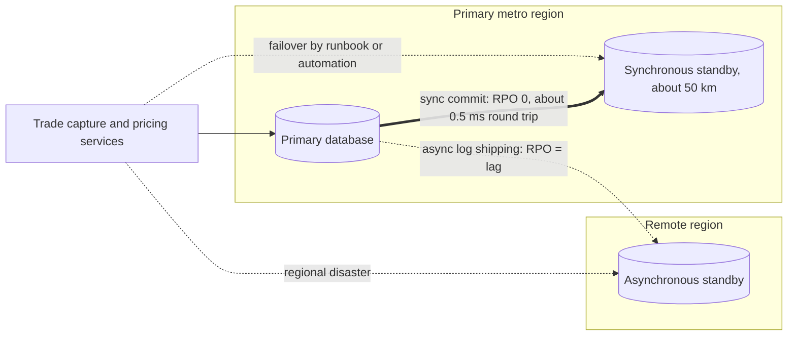

# Non-Functional Architecture and Production Operations

## TL;DR

- Non-functional requirements (reproducibility, latency, availability, recoverability, security, cost) decide whether a correct pricing and risk platform is usable; each has arithmetic that interviews test.
- Floating-point addition is not associative, so parallel sums depend on scheduling: fix the reduction order (fixed blocks and a fixed tree), use compensated or exact summation where needed, and control compiler contraction (FMA) and fast-math.
- Monte Carlo is reproducible across any number of workers only if each path owns its random stream (counter-based generators keyed by path), not if workers share one sequential stream.
- Latency percentiles do not add and do not bound: two stages with a p99 of 1 ms each can give a request p99 of 101 ms, and a fan-out to 100 leaves sees a leaf's 1% tail on 63.4% of requests.
- Availability multiplies in series and complements multiply in parallel (under independence); RPO is set by how data reaches the other site, RTO by detection, decision and promotion; synchronous replication over 1,300 km of fibre costs at least 12.75 ms per commit.
- Every number here is computed, printed and asserted by [sys_non_functional.py](code/sys_non_functional.py); prices, sizes and settings are hypothetical teaching inputs.

## Learning objectives

- Guarantee bit-exact floating-point reproducibility across distributed multi-threaded CPU and GPU grids, and say which compiler settings break it.
- Implement Kahan compensated summation to eliminate truncation error accumulation during multi-million-position portfolio roll-ups.
- Construct counter-based pseudo-random number generator (PRNG) pipelines ensuring pathwise Monte Carlo determinism, and distinguish them from leapfrogging and block splitting.
- Budget tail latency correctly for chained and fanned-out services.
- Compute availability, recovery point and recovery time objectives for a design, and explain the physics that limits synchronous replication distance.
- Design disaster recovery architectures that achieve $\text{RPO} = 0$ for trade capture with a bounded RTO across data centres.
- Implement Attribute-Based Access Control (ABAC) and information barriers isolating public-side trading from private-side advisory data.
- Formulate cost models comparing owned capacity with on-demand and spot cloud capacity by break-even utilisation.

## Core concepts

### 1. The non-functional checklist for a pricing and risk platform

| Dimension | What to specify | Typical failure | Reference |
| :--- | :--- | :--- | :--- |
| Reproducibility | same inputs and version give the same bits | reruns differ, golden tests flake, P&L explain breaks | Goldberg 1991; Higham 2002 |
| Bitemporal lineage | valid time and transaction time on every fact | a past report cannot be reproduced after back-dated amendments | BCBS 239 Principle 3 |
| Latency | percentile targets per path, end to end | p99 budgets summed per stage, tail amplification ignored | Dean and Barroso 2013 |
| Availability and recovery | availability target, RPO, RTO per service | single points of failure, untested failover | SR 20-24 sound practices |
| Information barriers | who may see which data, enforced in code | private-side information reaching public-side desks | Exchange Act Section 15(g) |
| Observability | traces, metrics, logs with correlation ids | stalls and tail spikes found by users first | SRE book |
| Cost | unit cost (per scenario, per path, per report) | idle owned capacity or uncontrolled cloud bursts | firm policy |

Section 15(g) of the Securities Exchange Act requires every registered broker or dealer to "establish, maintain, and enforce written policies and procedures reasonably designed ... to prevent the misuse ... of material, nonpublic information"; information barriers are how a platform implements that in entitlements, data stores and networks.
SR 20-24 (the interagency sound-practices paper on operational resilience, November 2020, revised June 2026) frames resilience around critical operations, tolerances for disruption, mapped dependencies, testing and recovery.

### 2. Floating-point reproducibility

IEEE 754 addition is correctly rounded but not associative: $(a + b) + c$ and $a + (b + c)$ can differ in the last bits.
A parallel reduction that combines partial sums in the order workers finish therefore produces run-to-run differences.
In double precision the differences are tiny in money (Example 1 finds millionths of a dollar on a billion-dollar total), but they break bit-exact regression tests, checksums of risk files and "did anything change?" comparisons, and they can flip threshold decisions.
Controls:

1. Fix the reduction: partition by position into fixed blocks, sum each block in a fixed order, and combine block sums in a fixed tree, so the worker count and completion order cannot matter.
2. Use compensated (Kahan) or exactly rounded summation (for example Python's `math.fsum`) where a correctly rounded total matters.
3. Control the compiler: `-ffast-math` permits reassociation and assumes no NaNs or infinities; fused multiply-add contraction changes results between machines with and without FMA.
   GCC's default is `-ffp-contract=fast` except for C in a strict standards mode, and Clang's default `-ffp-model=precise` still enables contraction (`-ffp-contract=on`); pass `-ffp-contract=off` when results must match across architectures.
4. Pin library versions: vendor math libraries (exp, log, BLAS) may change results between releases.

Kahan summation carries the rounding error of each addition in a compensation term; Higham (chapter 4) shows the error bound is $2u \sum |x_i|$ plus a term of order $n u^2 \sum |x_i|$, so to first order it does not grow with $n$, unlike naive summation's $n u \sum |x_i|$ bound.

### 3. Parallel random numbers

Three ways to give $W$ workers random numbers from one generator:

- Block splitting (skip-ahead): worker $w$ takes a contiguous block of the stream, which needs a cheap jump-ahead.
- Leapfrogging: worker $w$ takes draws $w, w + W, w + 2W, \dots$; results depend on $W$.
- Counter-based generation (Salmon et al. 2011, the Philox and Threefry families): the output is a keyed bijection of a counter, $x = f_{\text{key}}(\text{counter})$, so any draw is computable directly.

For Monte Carlo pricing the robust pattern is one stream per path: key (or counter block) derived from (run seed, path index), so path $p$ sees the same numbers whichever worker runs it and in whatever order, a single path can be replayed alone for debugging, and the result is identical for 1 or 50,000 workers once the reduction order is also fixed.

### 4. Tail latency arithmetic

Percentiles are quantiles, and quantiles are not additive: $\text{p99}(A + B)$ can be smaller than $\text{p99}(A) + \text{p99}(B)$ (independent, light tails) or larger (rare large delays, as in Example 3).
So an end-to-end latency budget cannot be built by summing per-stage p99s; budget the end-to-end distribution (by measurement or simulation) and attribute per stage with tracing.
Fan-out makes it worse: if a request waits for the slowest of $n$ independent leaves, the chance it hits at least one leaf's 1% tail is $1 - 0.99^n$ (Dean and Barroso 2013 use the 100-leaf case), so leaves need a much higher percentile target, or the request needs hedged requests, tied requests or partial results.
Queueing adds the other half: by Little's law $L = \lambda W$, the number in system equals throughput times time in system, which sizes buffers, connection pools and in-flight commits.

### 5. Availability, RPO and RTO

- Availability $A$ is the fraction of time the service meets its objective; downtime per year is $(1 - A) \times 525{,}960$ minutes (365.25 days).
- Components in series multiply: $A = \prod A_i$.
- Independent redundant components in parallel: $A = 1 - \prod (1 - A_i)$; correlated failures (shared power, software, configuration pushes) break this, and a single shared component caps the whole chain.
- Recovery point objective (RPO): how much committed data may be lost; it equals the replication lag or the interval between copies at the moment of failure.
- Recovery time objective (RTO): how long until service is back; it is the sum of detection, the decision to fail over, promotion of the standby and client reconnection.

The common pattern is synchronous replication inside a metro area (RPO 0 at a small latency cost) plus asynchronous replication to a distant region (protection against a regional event, with a small RPO), because synchronous commits over long distances pay the speed of light on every transaction.

### 6. Owned versus cloud capacity

Owned capacity costs the same whether busy or idle; cloud capacity costs per hour used.
The break-even utilisation is the owned cost per vCPU-hour at full utilisation divided by the cloud price per vCPU-hour: below it, renting is cheaper.
Spot capacity is cheaper but can be reclaimed: AWS issues an interruption notice two minutes before stopping or terminating a Spot Instance (EC2 User Guide, retrieved 2026-10), so spot workers need small checkpointed tasks and a fallback when a batch deadline is at risk.

## Worked examples

### Example 1: same data, different totals

One million position P&Ls of mixed magnitude (from fractions of a cent to about 5 million dollars, both signs, seed 2026) sum to $-1{,}012.773$ million dollars.
Summing forward, backward, by ascending magnitude and in a shuffled order gives four different float64 totals, spread over 23 millionths of a dollar, which is 190 units in the last place of the total.
Kahan summation lands exactly on the correctly rounded total from `math.fsum`.
Combining 4,096-value block sums in completion order gives 10 distinct totals over 20 simulated runs; filing the same partials under their block index and combining them in a fixed pairwise tree gives one total in all 20 runs.

### Example 2: float32 and Kahan

In float32 the spacing between representable numbers near 100,000 is 0.0078125, so adding 0.0001 (stored as the float32 nearest to it) to 100,000 rounds straight back: one million naive additions leave 100,000.00.
Kahan summation carries the lost low-order part and returns 100,100.00.
The exact sum of the float32 addends is 100,099.999997 (the float32 value of 0.0001 is slightly below 0.0001), whose nearest float32 is 100,100.00, so Kahan returns the correctly rounded answer here; "exact" would overstate it.

### Example 3: a p99 budget that lies

Each of two independent stages takes 1 ms, except 0.8% of the time when it takes 100 ms.
Each stage's p99 is 1 ms, so summing gives a budget of 2 ms.
But the request is slow whenever either stage is slow: probability $1 - 0.992^2 = 1.59\%$, above 1%, so the request's p99 is 101 ms.
The script confirms by exact enumeration and by a million-sample simulation.
With fan-out the effect compounds: the share of requests touching some leaf's 1% tail is 1.00% for one leaf, 9.56% for 10 and 63.40% for 100, and a fan-out-100 request p99 needs every leaf at about its 99.990th percentile.

### Example 4: availability of a chain

Downtime per year is 525.96 minutes at 99.9%, 52.60 at 99.99% and 5.26 at 99.999%.
Three 99.9% components in series give 99.7003%, about 26.27 hours down a year.
Two independent 99.9% replicas in parallel give 99.9999%, about 0.53 minutes a year, but put that pair behind a single 99.99% load balancer and the chain is 99.9899%: the single point of failure dominates.

### Example 5: synchronous replication New York to Chicago

City-centre coordinates give a great-circle distance of 1,144 km.
Light in vacuum needs 7.63 ms for the round trip; in fibre (group index about 1.47) along the great circle, 11.22 ms; on a hypothetical 1,300 km fibre route, 12.75 ms.
So a synchronous commit across that link costs at least 12.75 ms before any disk or software time, and a claim of a 7.8 ms fibre round trip on this route would be physically impossible.
At 4,500 commits per second, Little's law gives about 57.4 commits in flight, so the database needs at least that many concurrent sessions (group commit batches their log flushes).
The log stream itself is small: 4,500 commits of 1.8 KB is 8.1 MB/s or 64.8 Mbit/s, 194.4 Mbit/s with a 3x burst allowance.
Over 50 km of metro fibre the round trip is 0.49 ms, which is why synchronous replication is a metro design.

### Example 6: RPO and RTO for a trade store

Hypothetical settings: hourly snapshots alone give a worst-case RPO of 60 minutes; adding log shipping every 5 minutes cuts it to 5 minutes; asynchronous streaming with a 2-second lag at 4,500 transactions per second leaves about 9,000 transactions at risk, which is why trade capture uses synchronous replication within the metro.
RTO: detection 60 s, a human decision 300 s, promotion 120 s and client reconnection 180 s give 11.0 minutes; automating the decision gives 6.0 minutes, at the cost of a policy for when automation may fail over.

### Example 7: own or rent for a one-hour daily burst

Hypothetical prices: a 128-vCPU server costs 30,000 dollars, lasts 4 years and costs 40% of its price a year to run, so owned capacity costs about 0.0174 dollars per vCPU-hour at full utilisation.
Against an on-demand price of 0.045 dollars per vCPU-hour, owning wins only above 38.6% utilisation; against a spot price of 0.015 the break-even is 115.9%, so spot is cheaper at any utilisation, interruptions aside.
A one-hour burst each business day is 2.87% utilisation: owning 50,000 vCPUs for it costs about 7.62 million dollars a year against 0.57 million on demand.
The answer flips for a 24-hour grid running near full load, which is why many banks own the base load and rent the peaks.

## Pitfalls

- **Fast-math or FMA differences in production pricers:** reassociation and contraction change Greeks between builds and machines; pin the flags and test reproducibility across target hardware.
- **Summing p99s per stage:** neither a valid budget nor an upper bound (Example 3).
- **Multi-zone mistaken for disaster recovery:** zones in one region share regional dependencies; a regional event needs a second region, with the RPO of asynchronous replication.
- **Synchronous replication over long distance:** every commit pays the round trip (Example 5); keep synchronous pairs within a metro area.
- **Shared random streams:** results depend on scheduling, and one path cannot be replayed; give each path its own counter-based stream.
- **Untested failover:** an RTO that has never been measured in a drill is a guess.
- **Information barriers enforced only by convention:** a shared data lake with private-side deal data and public-side positions needs enforced entitlements and audit, not folder names.
- **Spot capacity on the critical path without a fallback:** a two-minute interruption notice is too short to rescue a long task without checkpoints.

## Interview questions

> [!question]- sys-16-01 | Why is floating-point arithmetic non-associative, and how does it threaten risk determinism?
> Each addition rounds to the nearest representable number (53-bit significand in double), so the rounding depends on the order: $(a + b) + c \ne a + (b + c)$ in general.
> Parallel reductions that combine partial results in completion order therefore change the last bits from run to run, which breaks bit-exact regression tests and file comparisons even when the dollar differences are tiny.

> [!question]- sys-16-02 | What is Kahan Compensated Summation?
> A summation that carries each addition's rounding error in a compensation variable and feeds it back into the next addition.
> Its error bound is about $2u \sum |x_i|$ to first order, independent of $n$, against $n u \sum |x_i|$ for naive summation (Higham, chapter 4); in the note's float32 example it returns 100,100.00 where naive summation returns 100,000.00.

> [!question]- sys-16-03 | What is the difference between Recovery Point Objective (RPO) and Recovery Time Objective (RTO)?
> RPO is the maximum acceptable data loss, measured as time (or transactions) of committed data that may be lost; it is set by how data reaches the recovery site.
> RTO is the maximum acceptable time to restore service; it is the sum of detection, decision, promotion and reconnection.

> [!question]- sys-16-04 | How does synchronous replication achieve $\text{RPO} = 0$ and what is its performance penalty?
> The primary acknowledges a commit only after the standby has durably received the log record, so no acknowledged transaction can be lost if the primary fails.
> Every commit pays at least the network round trip: about 0.49 ms over 50 km of fibre but at least 12.75 ms over a 1,300 km New York to Chicago route, which is why synchronous pairs stay within a metro area.

> [!question]- sys-16-05 | What is a "Chinese Wall" in capital markets technology?
> An information barrier that keeps material non-public information held by private-side functions (M&A advisory, underwriting) away from public-side functions (sales, trading, research).
> Broker-dealers must have written policies to prevent misuse of such information (Exchange Act Section 15(g)); platforms enforce barriers with entitlements, separate stores, wall-crossing workflows and audit trails.

> [!question]- sys-16-06 | What is the difference between Role-Based Access Control (RBAC) and Attribute-Based Access Control (ABAC)?
> RBAC grants permissions to roles that users hold ("trader", "risk manager").
> ABAC evaluates policies over attributes of the user, the resource and the context (desk, legal entity, data classification, wall-crossed status, location), which expresses rules like "public-side users may not read deals on the watch list" without a role per combination.

> [!question]- sys-16-07 | How does leapfrogging enable deterministic random number generation across parallel threads?
> Leapfrogging gives worker $w$ draws $w, w + W, w + 2W, \dots$ of one stream, so it is deterministic only for a fixed worker count $W$.
> For results that are identical across any number of workers, give each path its own stream from a counter-based generator keyed by (seed, path): path $p$'s numbers no longer depend on who runs it, and in the note's test changing the schedule changes 0.0% of path results against 99.9% with a shared stream.

> [!question]- sys-16-08 | What is OpenTelemetry and how is it used in capital markets observability?
> A vendor-neutral set of APIs, SDKs and a wire protocol for traces, metrics and logs.
> A request carries a trace context across services (gateway, pre-trade risk, pricing, booking), so per-stage latency and failures can be attributed end to end instead of guessed from per-service averages.

> [!question]- sys-16-09 | What is Cloud FinOps and why is it critical for quantitative analytics?
> The practice of managing cloud spend with unit economics (cost per scenario, per path, per report), allocation to desks and continuous optimisation.
> For risk grids the key numbers are break-even utilisation against owned capacity and the interruption risk of spot capacity; in the note a one-hour daily burst is 2.87% utilisation, far below the 38.6% break-even against on-demand prices.

> [!question]- sys-16-10 | Why must regulatory audit stores enforce Write-Once-Read-Many (WORM) storage?
> They must preserve records so they cannot be silently altered or deleted for the retention period; for US broker-dealers, SEC Rule 17a-4 allows either WORM storage or, since the 2022 amendments, a system with a complete time-stamped audit trail that allows re-creation of the original.
> Retention depends on record type (for example six years for some records and three years for others, the first two easily accessible).

> [!question]- sys-16-11 | Two independent stages each have a p99 of 1 ms; can the request's p99 be 101 ms?
> Yes, if each stage takes 100 ms with probability 0.8%: each stage's p99 is still 1 ms, but the request is slow with probability $1 - 0.992^2 = 1.59\%$, so its p99 is 101 ms.
> Percentiles neither add nor bound; budget end-to-end distributions.

> [!question]- sys-16-12 | A request fans out to 100 leaves and waits for all. What share of requests touch some leaf's 1% tail?
> $63.4\%$, from $1 - 0.99^{100}$.
> To get a request-level p99 from the leaves alone, each leaf needs to be at its 99.990th percentile; otherwise use hedged requests or accept partial results.

> [!question]- sys-16-13 | Three 99.9% services in series and two 99.9% replicas in parallel: what availability do you get?
> Series: $0.999^3 = 99.7003\%$, about 26.27 hours down a year.
> Parallel: $1 - 0.001^2 = 99.9999\%$ if failures are independent; correlated failures and any shared component (a 99.99% load balancer gives 99.9899% for the chain) dominate in practice.

> [!question]- sys-16-14 | What is the minimum round trip New York to Chicago, and what does it imply for synchronous replication?
> At least 7.63 ms in vacuum over the 1,144 km great circle and 11.22 ms in fibre along it; a realistic fibre route is longer (12.75 ms at 1,300 km).
> Every synchronous commit pays that, so long-distance links use asynchronous replication with a nonzero RPO, and RPO 0 comes from a metro-distance synchronous standby.

> [!question]- sys-16-15 | Which compiler settings break bit-for-bit reproducibility of a C++ pricer across machines?
> `-ffast-math` (reassociation, no-NaN assumptions) and fused multiply-add contraction: GCC defaults to `-ffp-contract=fast` outside strict C modes, and Clang's default `-ffp-model=precise` still allows contraction.
> Use `-ffp-contract=off`, no fast-math, fixed reduction orders and pinned math libraries when results must match.

> [!question]- sys-16-16 | Synchronous commits take 12.75 ms and the system must sustain 4,500 commits per second. How many commits are in flight?
> About 57.4, by Little's law $L = \lambda W = 4{,}500 \times 0.01275$.
> The database needs at least that many concurrent sessions; group commit lets one log flush acknowledge many of them.

> [!question]- sys-16-17 | When is renting cloud capacity cheaper than owning it?
> When utilisation is below the break-even: owned cost per vCPU-hour at full use divided by the rental price (38.6% against on-demand in the note's hypothetical prices).
> Bursty workloads (a 2.87% daily burst) favour renting; steady base load favours owning; spot is cheaper still but needs checkpointing because of two-minute interruption notices.

## In this repo and SDE-Interview-Prep

- `code/sys_non_functional.py` computes, prints and asserts every number on this page: order-dependent sums and the fixed-tree fix, float32 Kahan, counter-based streams, percentile and fan-out arithmetic, availability, replication physics, RPO and RTO, and the cost break-even.
- [Pricing at Scale](06-Pricing-at-Scale.md) for grid design, [The EOD Risk Batch](13-EOD-Risk-Batch.md) for failover and retries, and [Storage and Compute](14-Storage-and-Compute.md) for the stores being replicated.
- SDE-Interview-Prep: [Backpressure and Tail Latency](https://github.com/shreejitverma/SDE-Interview-Prep/blob/main/04-System-Design/00-Concepts/Backpressure-and-Tail-Latency.md), [Replication and Quorums](https://github.com/shreejitverma/SDE-Interview-Prep/blob/main/04-System-Design/00-Concepts/Replication-and-Quorums.md), [Multi-Region Active-Active](https://github.com/shreejitverma/SDE-Interview-Prep/blob/main/04-System-Design/00-Concepts/Multi-Region-Active-Active.md), [SLOs and Observability](https://github.com/shreejitverma/SDE-Interview-Prep/blob/main/04-System-Design/00-Concepts/SLOs-and-Observability.md).

## Further reading

- Goldberg, David. "What Every Computer Scientist Should Know About Floating-Point Arithmetic." *ACM Computing Surveys* 23(1), 1991.
- Higham, Nicholas J. *Accuracy and Stability of Numerical Algorithms*, 2nd edition. SIAM, 2002, chapter 4 (summation).
- Kahan, William. "Further remarks on reducing truncation errors." *Communications of the ACM* 8(1), 1965.
- Salmon, J. K., Moraes, M. A., Dror, R. O. and Shaw, D. E. "Parallel Random Numbers: As Easy as 1, 2, 3." *Proceedings of SC11*, 2011.
- Dean, Jeffrey and Barroso, Luiz Andre. "The Tail at Scale." *Communications of the ACM* 56(2), 2013.
- Little, John D. C. "A Proof for the Queuing Formula: L = lambda W." *Operations Research* 9(3), 1961.
- Beyer, B., Jones, C., Petoff, J. and Murphy, N. R. *Site Reliability Engineering: How Google Runs Production Systems*. O'Reilly, 2016.
- Board of Governors of the Federal Reserve System, FDIC and OCC. *Interagency Paper on Sound Practices to Strengthen Operational Resilience*, SR 20-24, 2 November 2020 (revised 2 June 2026).
