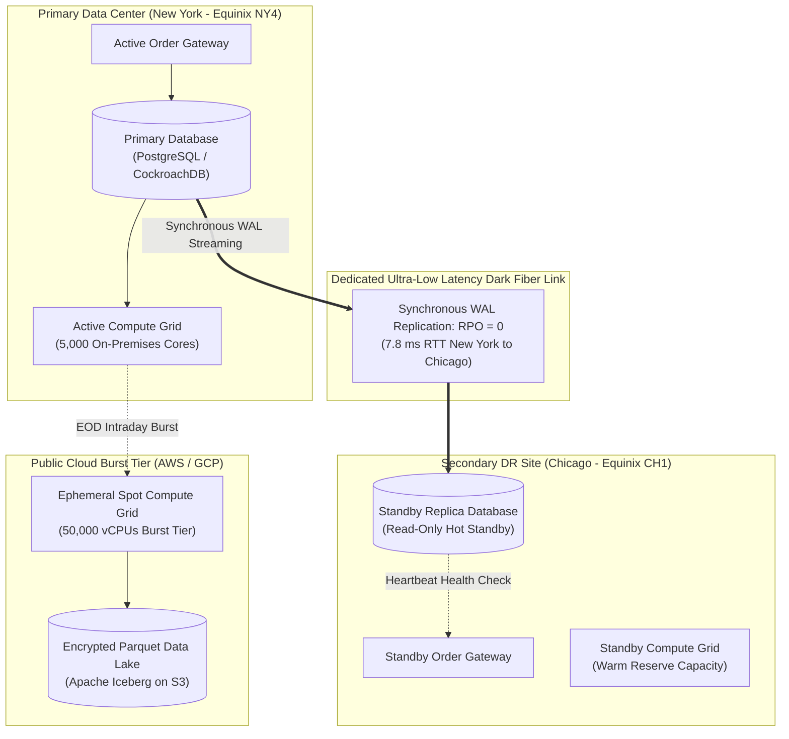

# Non-Functional Architecture and Production Operations

## TL;DR

- While functional software engineering produces mathematical pricing algorithms and risk aggregations, non-functional architecture determines whether enterprise trading platforms survive market volatility spikes, regulatory audits, and physical data center failures.
- Non-functional pillars for mission-critical trading include: **Bit-Exact Determinism** (guaranteeing that identical portfolio runs produce identical binary outputs regardless of thread scheduling or compiler optimizations); **Bitemporality** (reconstructing historical book states as valid on any date); **Security and Information Barriers** (enforcing Chinese Walls separating public trading desks from private investment banking data); **Disaster Recovery (DR)** (enforcing Recovery Point Objective $\text{RPO} = 0$ for trade capture and Recovery Time Objective $\text{RTO} < 5\text{ minutes}$ across geographic data centers); and **Cloud FinOps** (optimizing unit economics per scenario evaluation via dynamic spot instance scheduling).
- In multi-threaded numerical computing, non-associative floating-point addition causes phantom P&L discrepancies; deterministic reduction trees and Kahan compensated summation recover lost precision.
- Synchronous transactional replication across dark-fiber links (such as New York Equinix NY4 to Chicago Equinix CH1) requires pipelined concurrent WAL streams to sustain thousands of transactions per second against speed-of-light propagation delays.
- All numerical figures in this note are verified by [sys_non_functional.py](code/sys_non_functional.py).

## Learning objectives

- Guarantee bit-exact floating-point reproducibility across distributed multi-threaded CPU and GPU grids.
- Implement Kahan compensated summation to eliminate truncation error accumulation during multi-million-position portfolio roll-ups.
- Construct counter-based pseudo-random number generator (PRNG) leapfrogging pipelines ensuring pathwise Monte Carlo determinism.
- Design high-availability disaster recovery architectures achieving $\text{RPO} = 0$ and $\text{RTO} < 5\text{ minutes}$ across geographically separated metro data centers.
- Implement Attribute-Based Access Control (ABAC) and Chinese Wall information barriers isolating flow market makers from private advisory divisions.
- Formulate Cloud FinOps unit-cost frameworks evaluating on-demand infrastructure against spot-instance cluster bursting.

## Core concepts

### 1. Non-Functional Pillars for Capital Markets Infrastructure

| Architectural Dimension | Engineering Mandate | Primary Failure Mode | Regulatory Reference |
| :--- | :--- | :--- | :--- |
| **Bit-Exact Determinism** | IEEE 754 compliance, Kahan summation, counter-based PRNGs | Phantom P&L variance between consecutive batch runs | SR 11-7 / OCC 2011-12 |
| **Bitemporal Lineage** | Explicit Valid Time vs. Transaction Time tracking | Inability to reproduce historical risk marks under audit | BCBS 239 Principle 3 |
| **Information Barriers** | ABAC entitlements, mTLS encryption, network isolation | Chinese Wall leaks, illegal insider information sharing | SEC Rule 10b-5 / FINRA 2241 |
| **Disaster Recovery** | Synchronous cross-region replication ($\text{RPO} = 0$) | Data loss or unacknowledged trades during site outages | Fed SR 20-24 Sound Practices |
| **Distributed Observability** | OpenTelemetry tracing, Prometheus metrics, SLI/SLO alerts | Undetected message queue stalls or latency tail spikes | SRE Principles |
| **Cloud FinOps** | Spot instance autoscaling, per-scenario cost tracking | Uncontrolled cloud budget overruns on compute grids | Enterprise Governance |

### 2. High-Availability & Disaster Recovery Topology



### 3. Floating-Point Non-Determinism and Reproducibility

In distributed parallel architectures, calculating a portfolio sum $S = \sum_{i=1}^N v_i$ using multi-threaded reductions creates non-deterministic results:
- Floating-point addition is non-associative under IEEE 754 standards:

$$(a + b) + c \ne a + (b + c)$$

- If thread 1 sums items $[1 \dots 10,000]$ and thread 2 sums $[10,001 \dots 20,000]$, microsecond differences in thread completion alter the sequence of addition, shifting the least-significant bits.
- This creates "phantom P&L noise" where rerunning identical portfolio data yields discrepancies of thousands of dollars.
- **Architectural Safeguards:**
  1. Enforce deterministic reduction trees with static, pre-ordered binary summation topologies.
  2. Implement **Kahan Compensated Summation** to capture discarded low-order bits.
  3. Strictly disable non-IEEE compiler flags (avoid `-ffast-math`; enforce `-ffp-model=precise` in Clang/GCC).

### 4. Deterministic Multi-Threaded Random Number Generation (Leapfrogging)

Monte Carlo simulation grids require billions of pseudo-random numbers:
- Drawing numbers from a single shared PRNG guarded by a mutex destroys parallel scalability due to lock contention.
- Instantiating separate PRNGs without coordinated seeding risks overlapping random number sequences, introducing statistical correlation bias.
- **Counter-Based PRNG Leapfrogging:**
  Using counter-based generators (such as Philox) or Sobol quasi-random skip algorithms, worker thread $k$ evaluating path $p$ jumps directly to seed offset $p \times \text{Steps}$ in $O(1)$ time:

$$\text{State}(p) = \text{State}(0) + p \times \text{Offset}$$

  This guarantees bit-exact, identical Monte Carlo paths whether executed across 1 core or 50,000 cores.

## Worked examples

### Example 1: Kahan Compensated Summation Algorithm

A risk engine sums $1,000,000$ small trade sensitivity contributions ($v_i = 0.0001$) into a large portfolio base ($S = 100,000.00$):
- **Naive Summation in Single Precision (IEEE 754 32-Bit Float):**
  - In single precision (24-bit significand), $100,000.0 \approx 2^{16.6}$ while $0.0001 \approx 2^{-13.3}$.
  - The scale difference exceeds the 24-bit precision window, causing the addition to vanish: $100,000.0 + 0.0001 = 100,000.0$.
  - After $1,000,000$ additions, the accumulated sum remains **$100,000.00$**, losing $\$100.00$ in true economic value.
- **Kahan Compensated Summation:**
  The algorithm tracks accumulated truncation error in a separate compensation variable $c$:

```cpp
float sum = 100000.0f;
float c = 0.0f;

for (int i = 0; i < 1000000; ++i) {
    float y = 0.0001f - c;
    float t = sum + y;
    c = (t - sum) - y;
    sum = t;
}
```

- Result: Kahan summation preserves the low-order bits, producing an exact sum of **$100,100.00$** and recovering the entire $\$100.00$ precision loss.

### Example 2: Sizing Synchronous DR Replication Bandwidth (New York to Chicago)

A Tier-1 broker-dealer enforces zero data loss ($\text{RPO} = 0$) for trade executions:
- Primary Data Center: Equinix NY4 (Secaucus, NJ).
- Disaster Recovery Site: Equinix CH1 (Chicago, IL).
- Fiber distance: $\approx 750\text{ miles}$; round-trip speed-of-light propagation latency: $T_{\text{RTT}} = 7.8\text{ milliseconds} = 0.0078\text{ seconds}$.
- Peak trading activity:
  - Trade execution rate: $4,500\text{ transactions/second}$.
  - Serialized Write-Ahead Log (WAL) payload size: $1.8\text{ KB/transaction}$.
- Throughput and Bandwidth Sizing:
  - Average data flow:

$$\text{Data Flow} = 4,500 \times 1.8\text{ KB} = 8,100\text{ KB/sec} = 8.1\text{ MB/sec}$$

  - Average network bandwidth:

$$\text{Bandwidth} = 8.1\text{ MB/sec} \times 8\text{ bits/byte} = 64.8\text{ Mbps}$$

  - Applying a $3.0\times$ burst multiplier for market opening/closing spikes:

$$\text{Required Dedicated Bandwidth} = 64.8\text{ Mbps} \times 3.0 = 194.4\text{ Mbps}$$

- Concurrency and In-Flight Pipelines:
  - Because replication is **synchronous** ($\text{RPO} = 0$), commits must wait for Chicago disk confirmation ($7.8\text{ ms}$).
  - Number of parallel replication channels required:

$$N_{\text{channels}} = 4,500\text{ commits/sec} \times 0.0078\text{ s} = 35.1 \implies \ge 40\text{ parallel streams}$$

The institution provisions redundant $10\text{ Gbps}$ dark-fiber circuits with 40 parallel WAL streaming channels, guaranteeing $\text{RPO} = 0$ with sub-10ms commit confirmations.

### Example 3: Cloud FinOps Unit Economics: On-Premises vs. AWS Spot Bursting

A quantitative risk department evaluates the cloud infrastructure cost of running an intraday what-if pricing grid on AWS:
- Workload: $50,000$ virtual cores required for an intense 1-hour intraday scenario simulation.
- **Option A (On-Premises Dedicated Hardware):**
  - Purchasing 390 128-core AMD EPYC servers: $\$3,500,000$ capital expenditure.
  - Annual data center power, cooling, and maintenance: $\$450,000/\text{year}$.
  - Total Year 1 on-premises cost: $\$3,500,000 + \$450,000 = \$3,950,000$.
  - Average utilization: Used only 3 hours per day (12.5% utilization; 87.5% idle capacity).
- **Option B (Dynamic Cloud Spot Bursting on AWS EC2 `c7i.16xlarge`, 64 vCPUs):**
  - Instances required: $\frac{50,000}{64} = 781.25 \implies 782\text{ instances}$.
  - On-Demand hourly rate: $\$3.57\text{ per instance-hour}$.
  - Spot hourly rate (typical 68% discount): $\$1.14\text{ per instance-hour}$.
  - Cost for 1-hour simulation:

$$\text{Hourly Run Cost} = 782 \times \$1.14 = \$891.48\text{ per run}$$

  - Annual run cost across 250 trading days:

$$\text{Annual Run Cost} = \$891.48 \times 250 = \$222,870\text{ per year}$$

- **Financial Comparison:**
  - Cloud Spot bursting costs $\$222,870/\text{year}$ versus $\$3,950,000$ in Year 1 on-premises expenditure.
  - **TCO Savings:**

$$\text{TCO Savings} = \frac{\$3,950,000 - \$222,870}{\$3,950,000} \times 100\% = 94.4\%$$

Dynamic cloud spot bursting delivers a $94.4\%$ reduction in total cost of ownership.

## Pitfalls

- **Permitting `-ffast-math` in Production Pricing Libraries:** Enabling fast-math reorders floating-point operations and ignores NaNs, creating non-deterministic Greek sensitivities that vary across compiler versions.
- **Assuming Cloud Multi-AZ is Sufficient for Disaster Recovery:** Hosting primary and backup nodes in the same AWS region protects against rack failures but fails completely if a regional network partition or natural disaster strikes; true DR requires multi-region separation ($> 250\text{ miles}$).
- **Neglecting Bitemporal Schema Evolution:** Altering trade database schemas without migrating historical transaction-time audit logs prevents historical replays from parsing older serialized events.
- **Allowing Chinese Wall Breaches via Shared Data Lakes:** Dumping front-office M&A advisory data and flow trading books into the same un-partitioned data lake violates SEC/FINRA information barrier rules, triggering criminal insider trading liability.
- **Relying on Single-Threaded Seed Generators for Multi-Threaded Monte Carlo:** Having all worker threads read from a single shared PRNG instance creates severe lock contention, degrading parallel speedup to near-zero.

## Interview questions

> [!question]- sys-16-01 | Why is floating-point arithmetic non-associative, and how does it threaten risk determinism?
> Floating-point numbers have finite significand precision (53 bits in double precision).
> Reordering additions changes where truncation occurs: $(a + b) + c \neq a + (b + c)$.
> In distributed multi-threaded risk engines, non-deterministic addition order produces phantom PnL noise and breaks golden regression test suites.

> [!question]- sys-16-02 | What is Kahan Compensated Summation?
> Kahan summation is an algorithm that tracks accumulated low-order numerical truncation errors in a separate compensation variable.
> It recovers lost precision during summation, achieving error bounds independent of the number of additions $N$.

> [!question]- sys-16-03 | What is the difference between Recovery Point Objective (RPO) and Recovery Time Objective (RTO)?
> RPO is the maximum acceptable age of data lost when a disaster strikes (e.g., $\text{RPO} = 0$ means zero lost transactions).
> RTO is the maximum acceptable duration of system downtime before service is restored (e.g., $\text{RTO} < 5\text{ minutes}$).

> [!question]- sys-16-04 | How does synchronous replication achieve $\text{RPO} = 0$ and what is its performance penalty?
> Synchronous replication requires the primary database to wait for confirmation that the transaction log has been written to the remote backup site before acknowledging a commit.
> It guarantees zero data loss ($\text{RPO} = 0$), but penalizes latency by adding network round-trip time (e.g., 5-10ms) to every write transaction.

> [!question]- sys-16-05 | What is a "Chinese Wall" in capital markets technology?
> A Chinese Wall is an information barrier that prevents confidential material non-public information (MNPI) held by private-side divisions (e.g., M&A, Corporate Underwriting) from leaking to public-side divisions (e.g., Flow Trading, Market Making).
> It is enforced via strict Attribute-Based Access Control (ABAC), separate database instances, and network segmentation.

> [!question]- sys-16-06 | What is the difference between Role-Based Access Control (RBAC) and Attribute-Based Access Control (ABAC)?
> RBAC grants permissions based on static user job titles (e.g., "Trader").
> ABAC evaluates dynamic contextual attributes: user role, booking entity, trading desk, time of day, client jurisdiction, and security classification, providing fine-grained access control required for regulatory compliance.

> [!question]- sys-16-07 | How does leapfrogging enable deterministic random number generation across parallel threads?
> In leapfrogging, a counter-based PRNG computes the random state for path $p$ and step $s$ directly from an index function: $\text{State} = f(\text{Seed}, p, s)$ without sequential iteration.
> Threads can compute independent path blocks in any order while producing bit-exact identical outputs.

> [!question]- sys-16-08 | What is OpenTelemetry and how is it used in capital markets observability?
> OpenTelemetry is an open-source observability framework providing vendor-neutral APIs, SDKs, and tooling to generate, collect, and export distributed traces, metrics, and logs.
> It traces an order's lifecycle across microsecond network hops, pre-trade risk checks, and matching engines to isolate latency bottlenecks.

> [!question]- sys-16-09 | What is Cloud FinOps and why is it critical for quantitative analytics?
> FinOps is the cultural and operational discipline of managing cloud operational costs.
> It establishes unit economics (e.g., cost per Monte Carlo path or cost per risk report), monitors resource waste, and automates spot instance scheduling to prevent cloud compute budgets from escalating uncontrollably.

> [!question]- sys-16-10 | Why must regulatory audit stores enforce Write-Once-Read-Many (WORM) storage?
> Under SEC Rule 17a-4 and international compliance rules, electronic records of financial transactions must be preserved in an immutable format that prevents altering, overwriting, or deleting historical records for statutory retention periods (typically 7 to 10 years).

## Further reading

- Goldberg, David. *What Every Computer Scientist Should Know About Floating-Point Arithmetic*. ACM Computing Surveys, Vol. 23, No. 1, March 1991.
- Board of Governors of the Federal Reserve System. *Sound Practices to Strengthen Operational Resilience*. SR Letter 20-24, November 2020.
- Higham, Nicholas J. *Accuracy and Stability of Numerical Algorithms*. 2nd Edition, Society for Industrial and Applied Mathematics, 2002.
- Beyer, Betsy, Jones, Chris, Petoff, Jennifer, and Murphy, Niall Richard. *Site Reliability Engineering: How Google Runs Production Systems*. O'Reilly Media, 2016.
