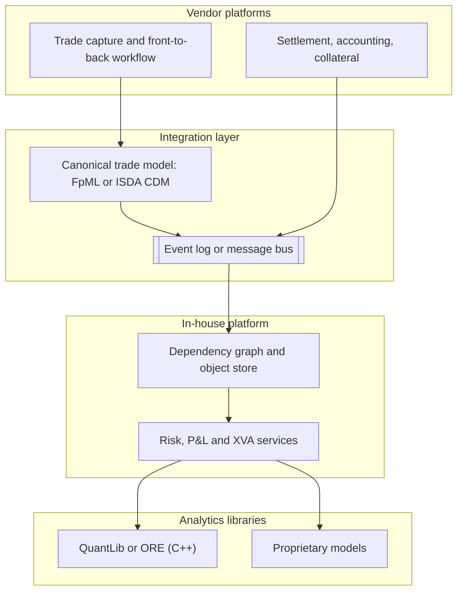

# Industry Landscape: Vendor Platforms and Open Source

## TL;DR

- Banks run pricing and risk on three kinds of software: vendor platforms (for example Murex MX.3 and Calypso, now part of Nasdaq), in-house platforms (Goldman Sachs' SecDB, JPMorgan's Athena, Bank of America's Quartz), and open-source libraries (QuantLib, the Open Source Risk Engine ORE, OpenGamma Strata), usually combined.
- Ownership changes are frequent and matter for vendor risk: Calypso became part of Nasdaq when Nasdaq completed its acquisition of Adenza on 1 November 2023, and Beacon Platform became part of Clearwater Analytics in 2025; check the current owner before citing a product.
- Buy versus build is a cash-flow profile question (vendors front-load licence and implementation, builds carry larger recurring payroll) plus strategic questions (differentiation, control, key-person and vendor lock-in risk).
- In the hypothetical cost example the vendor is cheaper by 9.0 million nominal and 3.96 million in present value at 8%, and the ranking flips only above a 16.99% discount rate or below about 41.7 in-house engineers.
- Open source supplies analytics, not a platform: entitlements, trade and market data stores, scheduling, lineage and controls still have to be built.
- Every number here is computed, printed and asserted by [sys_industry_landscape.py](code/sys_industry_landscape.py); costs and timings are hypothetical, and no vendor price or performance figure is quoted.

## Learning objectives

- Contrast the architectural designs, strengths, and failure modes of vendor platforms (such as Murex MX.3, Calypso, Numerix Oneview) versus in-house platforms (SecDB, Athena, Quartz), using only what their owners publish.
- Evaluate open-source enterprise frameworks including QuantLib, the Open Source Risk Engine (ORE), and OpenGamma Strata.
- Formulate a quantitative 5-year Total Cost of Ownership (TCO) model comparing commercial vendor licensing against in-house software development.
- Evaluate discounted cash flow (NPV) dynamics across capital expenditures, recurring software maintenance, and developer compensation, including the break-even discount rate.
- Analyze the cost-efficiency and agility of modern hybrid architectures combining vendor back-office platforms with open-source pricing engines.
- Design integration middleware connecting external vendor trade capture systems to internal cloud-native risk engines via standardized protocols (FpML, ISDA CDM, FIX).
- Analyze the strategic inflection points that trigger multi-year legacy vendor replacement programs.
- Construct comparative feature matrices, system context diagrams, and deployment topologies across the industry landscape.

## Core concepts

### 1. The landscape, sourced and dated

| Category | Example | What its owner or project publishes (retrieved 2026-10 unless dated) |
| :--- | :--- | :--- |
| Vendor platform | Murex MX.3 | Murex describes itself as "a global leader in cross-asset trading, risk management and post-trade processing solutions for capital markets", serving capital markets "since 1986", and calls MX.3 "the integrating capital markets platform"; it states more than 60,000 daily users in over 60 countries |
| Vendor platform | Calypso (Nasdaq) | Nasdaq completed its acquisition of Adenza from Thoma Bravo on 1 November 2023; its Capital Markets Technology unit "will combine Nasdaq's Marketplace Technology and Calypso's Capital Markets solutions" |
| Analytics vendor | Numerix Oneview | product lines named Oneview for Market Risk, XVA, Trading and Counterparty Credit Risk |
| Platform company | Beacon Platform | Clearwater Analytics agreed to acquire Beacon Platform Incorporated on 11 March 2025 (Form 8-K) and announced completion on 30 April 2025 |
| In-house | Goldman Sachs SecDB | "a platform to price trades and assess risk for trading positions", conceived for J. Aron's foreign exchange business and "first launched on November 24, 1992", later extended so that risk across the firm "could be aggregated and measured in an integrated manner" |
| In-house | JPMorgan Athena | a 2018 PyData London talk describes "how JPMorgan has scaled its Athena Python trading and risk analytics platform over 10 years" |
| In-house | Bank of America Quartz | a 2018 PyGotham talk describes Bank of America Merrill Lynch's plan "to realign its sales and trading systems around the Python-based Quartz platform" |
| Open source | QuantLib | C++ library under a modified BSD licence, "exported to different languages such as C#, Java, Python, and R"; born at StatPro (now Confluence); release 1.44 on 13 October 2026 |
| Open source | ORE (Open Source Risk Engine) | "based on QuantLib" and extends it "in terms of simulation models, financial instruments and pricing engines", providing risk analytics and XVA with XML and API interfaces; modified BSD licence; sponsored by Post Trade Solutions (formerly Acadia), an LSEG business; release 1.8.17.0 on 15 September 2026 |
| Open source | OpenGamma Strata | Java "analytics and market risk library", Apache 2.0 licence; data objects are Joda-Beans and "always immutable"; release v2.12.77 on 5 October 2026 |

Anything beyond these statements (market shares, client lists, internal architecture of in-house systems, who built what) is folklore unless a primary source says it, and an interviewer will respect "I have not seen that published" more than a confident guess.

### 2. How the pieces fit in a bank



The integration layer is where most programmes succeed or fail: a canonical trade representation, reconciliation between systems of record, and event-driven feeds rather than nightly file drops.

### 3. Buy, build or combine

| Question | Favours buying | Favours building |
| :--- | :--- | :--- |
| Is it a source of differentiation? | no (settlement, confirmations, standard regulatory returns) | yes (pricing of the products you make money on, risk you hedge in real time) |
| How fast does it change? | slowly, driven by industry standards | quickly, driven by your desks |
| Who must maintain it for regulation? | the vendor, across many clients | you, for your own book |
| Cash-flow profile | large upfront licence and implementation, smaller run cost | smaller upfront, larger permanent payroll |
| Main risks | lock-in, slow customisation, upgrade programmes, vendor ownership changes | key-person risk, under-investment after launch, reinventing commodity functions |

Hybrids are common: a vendor system for commodity workflows and an in-house layer on open-source analytics for differentiated pricing and risk.

### 4. What open-source analytics still leave you to build

QuantLib, ORE and Strata provide instruments, models, curve building, pricing engines and (for ORE) exposure simulation and XVA.
A production platform also needs: trade and market data stores with bitemporal history, entitlements, scheduling and restartability, distributed compute, lineage and reproducibility, model governance hooks, monitoring, and support.
Library design also differs: QuantLib's term structures and instruments notify dependents through its Observer and Observable classes, so objects are mutable and linked, while Strata's data objects are immutable Joda-Beans, which suits concurrent services.

## Worked examples

### Example 1: five-year cost of buy versus build (hypothetical)

Upfront costs fall at $t = 0$ and recurring costs at the end of years 1 to 5 (millions of dollars; engineers at 0.3 million a year fully loaded):

| Option | Upfront | Recurring per year | Five-year nominal | Present value at 8% |
| :--- | ---: | ---: | ---: | ---: |
| Vendor: licence 12, implementation 18; maintenance 4.5, 15 engineers, infrastructure 1.5 | 30.0 | 10.5 | 82.5 | 71.92 |
| In-house: build 14; 45 engineers, infrastructure 2.0 | 14.0 | 15.5 | 91.5 | 75.89 |
| Hybrid: front-office build 5; back-office licence 1.2, 24 engineers, infrastructure 1.2 | 5.0 | 9.6 | 53.0 | 43.33 |

The in-house option costs 9.0 more in nominal terms but only 3.96 more in present value at 8%, because its extra cost comes later (5.0 a year) while the vendor's extra cost is upfront (16.0).
Solving for the discount rate at which the two present values are equal gives 16.99%: below it the vendor is cheaper.
At 8%, an in-house team of about 41.7 engineers instead of 45 would match the vendor's cost, so the decision is sensitive to headcount assumptions.
The hybrid is cheapest by construction (29.5 below the vendor nominally) because it buys less and builds less; the real question is whether its scope covers what the desks need.

### Example 2: sizing a Monte Carlo XVA run (hypothetical)

5,000 trades in 12 netting sets, 10,000 paths and 80 exposure dates require 4.0 billion trade valuations.
At a hypothetical 50 microseconds per valuation that is 200,000 core-seconds (55.6 core-hours): 26.0 minutes on 128 cores, 3.3 minutes on 1,024 if the work splits perfectly.
A netting-set exposure cube (12 x 80 x 10,000 doubles) is 76.8 MB (73.2 MiB), but a trade-level cube is 32.0 GB, which is why engines aggregate to netting sets during simulation and keep trade-level data only for allocation runs.

### Example 3: what an ORE trade looks like

ORE reads portfolios as XML; this is the start of the fixed leg of a swap in the project's own example `Examples/Exposure/Input/portfolio_swap.xml` (master branch, retrieved 2026-10):

```xml
<Trade id="Swap_20">
  <TradeType>Swap</TradeType>
  <Envelope>
    <CounterParty>CPTY_A</CounterParty>
    <NettingSetId>CPTY_A</NettingSetId>
    <AdditionalFields/>
  </Envelope>
  <SwapData>
    <LegData>
      <LegType>Fixed</LegType>
      <Payer>false</Payer>
      <Currency>EUR</Currency>
      <Notionals>
        <Notional>10000000.000000</Notional>
      </Notionals>
      <DayCounter>30/360</DayCounter>
      <PaymentConvention>F</PaymentConvention>
      <FixedLegData>
        <Rates>
          <Rate>0.009851</Rate>
        </Rates>
      </FixedLegData>
```

The envelope carries the counterparty and netting set used for exposure aggregation; schedule data and the floating leg follow in the file.
Mapping a vendor's trade export into such a schema, and reconciling PVs between the two, is the bulk of an integration project.

## Pitfalls

- **Citing folklore as fact:** origin stories, market shares and "who built what" for in-house systems are rarely published; say what the owner publishes and stop there.
- **Stale ownership:** product owners change (Calypso to Nasdaq in 2023, Beacon to Clearwater in 2025); vendor risk assessments must track the current owner and roadmap.
- **Underestimating upgrades:** major vendor version upgrades are projects in their own right, with regression testing of every customisation and interface.
- **Building commodity functions:** in-house settlement or message parsers consume engineers who could work on differentiated pricing and risk.
- **Unmaintained in-house islands:** a platform with one expert and no documentation is key-person risk, whatever its quality.
- **Treating open source as a platform:** libraries do not come with entitlements, data stores, scheduling, lineage or support.
- **Batch file integration between vendor and in-house systems:** it defeats intraday risk and creates reconciliation breaks; prefer event feeds with a canonical model.

## Interview questions

> [!question]- sys-17-01 | What is Goldman Sachs' SecDB, and what architectural idea made it influential?
> Goldman describes SecDB as "a platform to price trades and assess risk for trading positions", first launched on 24 November 1992 for J. Aron's FX business and then extended so risk across the firm could be aggregated and measured in an integrated manner.
> The idea interviewers mean is one firm-wide model of trades, market data and risk with shared pricing code, rather than per-desk systems; specific claims about its role in particular crises are anecdote, not something the firm's description establishes.

> [!question]- sys-17-02 | What is the relationship between QuantLib and Open Risk Engine (ORE)?
> ORE (Open Source Risk Engine) is built on QuantLib and extends it with simulation models, instruments and pricing engines for risk analytics and XVA, driven by XML configuration and an API.
> QuantLib is the pricing library; ORE adds portfolio-level exposure simulation and analytics on top.

> [!question]- sys-17-03 | What are the primary trade-offs in the "Buy vs. Build" decision for capital markets software?
> Buying gives proven workflows, shared regulatory maintenance and faster start, at the cost of licence and implementation spend, lock-in, slower customisation and exposure to the vendor's ownership and roadmap.
> Building gives control and differentiation where it matters, at the cost of permanent payroll, key-person risk and the temptation to rebuild commodity functions; most banks buy commodity workflows and build differentiated pricing and risk.

> [!question]- sys-17-04 | Why did J.P. Morgan build Athena in Python rather than pure C++?
> Public sources (a 2018 PyData talk) say Athena is a Python trading and risk analytics platform but not why Python was chosen, so answer with the general pattern: Python for the object model, workflows and scripting where developer speed matters, with numerically heavy kernels in compiled libraries.
> The trade-offs are runtime speed and the global interpreter lock for pure-Python code, managed by pushing hot loops into native code and scaling out across processes.

> [!question]- sys-17-05 | What is Beacon Platform and how does it relate to SecDB and Athena?
> Beacon Platform Inc. is described in Clearwater Analytics' 30 April 2025 press release as a provider of enterprise risk analytics and developer infrastructure; Clearwater agreed to acquire it on 11 March 2025 and completed the purchase in April 2025.
> The relationship interviewers usually mean is architectural: a commercial platform built on the same graph-platform pattern as SecDB-style in-house systems (shared object model, dependency graph, Python over native libraries); none of the sources cited here documents a code or team lineage, so do not assert one.

> [!question]- sys-17-06 | What is the role of Murex MX.3 in Tier-1 investment banking?
> MX.3 is Murex's cross-asset platform for trading, risk management and post-trade processing; Murex calls it "the integrating capital markets platform" and states more than 60,000 daily users in over 60 countries (murex.com, retrieved 2026-10).
> Banks typically use such a platform for front-to-back workflow (capture, pricing, risk, collateral, settlement, accounting) and integrate it with in-house analytics where they need differentiation.

> [!question]- sys-17-07 | How does OpenGamma Strata differ architecturally from QuantLib?
> QuantLib is C++ with mutable objects linked by an Observer and Observable mechanism, so changing a quote notifies dependent curves and instruments.
> Strata is Java with immutable Joda-Bean data objects ("always immutable, helping to ensure thread safety"), so recalculation means building new inputs rather than mutating linked objects, which fits stateless concurrent services.

> [!question]- sys-17-08 | Why do vendor migrations frequently run years over schedule?
> The work is in data and integration: mapping historical trades and static data, rebuilding interfaces to many upstream and downstream systems, re-creating customisations, and reconciling PVs and risk between old and new systems product by product.
> Parallel running, exotic edge cases and moving regulatory requirements extend it; plans that size only the vendor installation miss most of the effort.

> [!question]- sys-17-09 | What is a monorepo and what are its trade-offs for a bank-wide pricing platform?
> A single repository for all platform code, so every team builds against the same versions and cross-cutting changes are atomic.
> It needs build tooling that scales (incremental builds, ownership rules, fast tests) and discipline about releases; the alternative, many repositories, trades that for version skew and dependency conflicts.

> [!question]- sys-17-10 | How do modern investment banks prevent vendor lock-in?
> Keep a canonical trade and market data model under your control (FpML or ISDA CDM based), integrate through events and adapters rather than the vendor's internal schema, and keep differentiated analytics outside the vendor.
> Contractual and operational exit plans (data export, parallel-run capability) matter as much as architecture.

> [!question]- sys-17-11 | In the note's buy-versus-build example, why does discounting shrink the cost gap from 9.0 to 3.96 million?
> The vendor's extra cost is upfront (16.0 more at $t = 0$) while the build's extra cost is recurring (5.0 more a year), and discounting reduces later cash flows more than earlier ones.
> The two options cost the same at a 16.99% discount rate.

> [!question]- sys-17-12 | A Monte Carlo XVA run has 5,000 trades, 10,000 paths and 80 dates at 50 microseconds per valuation. How long does it take on 1,024 cores?
> About 3.3 minutes: $5{,}000 \times 10{,}000 \times 80 = 4 \times 10^9$ valuations, times 50 microseconds, is 200,000 core-seconds, divided by 1,024 cores.
> That assumes perfect scaling; scheduling overhead, stragglers and the serial aggregation step add to it.

> [!question]- sys-17-13 | Why do XVA engines aggregate exposures to netting sets during simulation instead of storing trade-level cubes?
> Memory: 12 netting sets x 80 dates x 10,000 paths of doubles is 76.8 MB, but 5,000 trades at the same resolution is 32.0 GB.
> XVA needs netted exposures; trade-level paths are kept only when needed for allocation (for example incremental or Euler allocation runs).

> [!question]- sys-17-14 | Which parts of a production risk platform do QuantLib or ORE not provide?
> Trade and market data stores with bitemporal history, entitlements, job scheduling and restartability, distributed compute, lineage and reproducibility controls, model inventory and approval hooks, monitoring and support.
> They are analytics engines; the platform around them is the larger build.

> [!question]- sys-17-15 | How would you check a claim such as "vendor X is the market leader with N clients" before using it in a design document?
> Look for a dated primary source (the vendor's own statement, a filing or a regulator's document), quote it with the date and attribute it, and treat secondary rankings and hearsay as unverified.
> Also check the current owner: ownership changes (for example Calypso to Nasdaq in 2023) change roadmaps and contracts.

## In this repo and SDE-Interview-Prep

- `code/sys_industry_landscape.py` computes, prints and asserts every number on this page: the cost table, present values, the break-even discount rate and headcount by bisection with a re-discounting check, and the XVA sizing.
- [Pricing Library Architecture](05-Pricing-Library-Architecture.md) for library design, [Pricing at Scale](06-Pricing-at-Scale.md) for graph platforms, [XVA Engine Architecture](11-XVA-Engine.md) for the exposure engine, and [Trade Representation and Lifecycle](02-Trade-Representation-and-Lifecycle.md) for FpML and the ISDA CDM.
- SDE-Interview-Prep: [Technology Comparison Matrix](https://github.com/shreejitverma/SDE-Interview-Prep/blob/main/04-System-Design/00-Concepts/Technology-Comparison-Matrix.md), [Capacity Estimation](https://github.com/shreejitverma/SDE-Interview-Prep/blob/main/04-System-Design/00-Concepts/Capacity-Estimation.md).

## Further reading

- Goldman Sachs. "With SecDB, a Groundbreaking Risk Management Platform is Born." Firm history, goldmansachs.com (retrieved 2026-10).
- Nasdaq. "Nasdaq Completes Acquisition of Adenza." Press release, 1 November 2023 (exhibit 99.1 to Form 8-K).
- Clearwater Analytics Holdings. Form 8-K filed 12 March 2025 (Agreement and Plan of Merger and Reorganization with Beacon Platform Incorporated).
- Ballabio, Luigi. *Implementing QuantLib: Quantitative finance in C++, an inside look at the architecture of the QuantLib library*. Leanpub.
- QuantLib (quantlib.org), Open Source Risk Engine (opensourcerisk.org) and OpenGamma Strata (strata.opengamma.io) project documentation, retrieved 2026-10.
