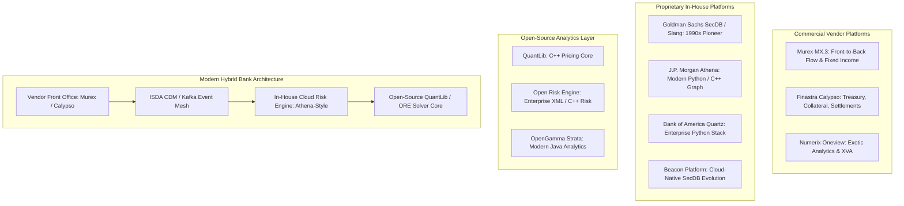

# Industry Landscape: Vendor Platforms and Open Source

## TL;DR

Capital markets technology is split across three competing paradigms: monolithic vendor platforms (Murex MX.3, Finastra Calypso, Numerix Oneview, FIS Adaptiv); open-source quantitative frameworks (QuantLib, Open Risk Engine - ORE, OpenGamma Strata); and iconic proprietary in-house titans (Goldman Sachs' SecDB, J.P. Morgan's Athena, Bank of America's Quartz, and Beacon Platform).
Every tier-1 investment bank faces the strategic **Buy vs. Build** dilemma.
Commodity workflows (post-trade clearing, SWIFT settlement, standard regulatory returns) favor battle-tested vendor solutions that outsource regulatory maintenance.
Conversely, proprietary alpha generation, complex structured derivatives, dynamic real-time risk, and cross-asset XVA macro hedging demand in-house platforms to achieve microsecond execution edges and tailored financial engineering.
Modern hybrid architectures combine open-source quantitative cores (QuantLib/ORE) with proprietary cloud-native dependency graphs to maximize agility while controlling total cost of ownership.

## Learning objectives

- Contrast the architectural designs, strengths, and failure modes of major vendor platforms (Murex, Calypso, Numerix) versus proprietary titans (SecDB, Athena, Quartz).
- Evaluate open-source enterprise frameworks including QuantLib, Open Risk Engine (ORE), and OpenGamma Strata.
- Formulate a quantitative 5-year Total Cost of Ownership (TCO) model comparing commercial vendor licensing against in-house software development.
- Design integration middleware connecting external vendor trade capture systems to internal cloud-native risk engines via standardized protocols (FpML, ISDA CDM, FIX).
- Analyze the strategic inflection points that trigger multi-year legacy vendor replacement programs.
- Construct comparative feature matrices, system context diagrams, and deployment topologies across the industry landscape.

## Core concepts

### 1. Landscape Classification Matrix

```
+----------------------------------------------------------------------------------------------------+
| Platform Category   | Representative Systems                     | Core Strengths                  | Primary Limitations            |
+----------------------------------------------------------------------------------------------------+
| Tier-1 Commercial   | Murex MX.3, Finastra Calypso,              | Out-of-the-box regulatory       | Astronomical license fees,     |
| Vendors             | Numerix Oneview, FIS Front Arena           | compliance, broad asset coverage| black-box models, slow releases|
+---------------------+--------------------------------------------+---------------------------------+--------------------------------+
| In-House Titans     | Goldman Sachs SecDB, JPM Athena,           | Unmatched customizability,      | Enormous ongoing engineering   |
| (Proprietary)       | BofA Quartz, Beacon Platform               | real-time graph reactivity      | payroll, key-person risk       |
+---------------------+--------------------------------------------+---------------------------------+--------------------------------+
| Open-Source         | QuantLib (C++), Open Risk Engine (ORE),    | Free licensing, auditable math, | Requires in-house enterprise   |
| Frameworks          | OpenGamma Strata (Java)                    | active academic community       | infrastructure wrapper         |
+----------------------------------------------------------------------------------------------------+
```

### 2. Industry Architecture Comparison



### 3. Deep Dive: The In-House Giants

#### Goldman Sachs SecDB (Securities Database)
- **Genesis:** Built in the early 1990s by Armen Avanessians, Fischer Black, and Kevin Ingram.
- **Language:** Written in a proprietary, dynamically typed interpreted language called **Slang**.
- **Architecture:** A globally replicated, single-state dependency graph. Every trade, market rate, curve, and risk position is a node. When an interest rate ticks, Slang invalidates all dependent pricing nodes across the firm.
- **Impact:** Enabled Goldman Sachs to see its net subprime mortgage exposure in real time during the 2007-2008 subprime crisis, allowing senior management to hedge mortgage risk and avoid the insolvency that destroyed Lehman Brothers and Bear Stearns.

#### J.P. Morgan Athena
- **Genesis:** Initiated in 2007 led by Kirat Singh and former SecDB architects.
- **Language:** Standard Python with performance-critical kernels in modern C++.
- **Architecture:** Object-oriented reactive graph backed by a distributed object store (Cassandra / in-memory cache) and a centralized git monorepo.
- **Impact:** Replaced dozens of fragmented legacy trading silos across J.P. Morgan into a unified cross-asset platform handling global trading, real-time risk, and electronic market making.

#### Bank of America Quartz
- **Genesis:** Launched in 2008 post-Merrill Lynch merger.
- **Architecture:** Built on Python, C++, and a global bitemporal transaction database ("SecStore"). It unified legacy Merrill Lynch and BofA systems under a single enterprise risk and pricing engine.

### 4. The Open-Source Landscape

- **QuantLib:** The benchmark quantitative finance library, created in 2000 by Luigi Ballabio, Ferdinando Ametrano, and peers. Written in C++ with SWIG bindings for Python, Java, and C#. It provides comprehensive term structures, instruments, and numerical solvers.
- **Open Risk Engine (ORE):** Developed by Quaternion Risk Management (now Acadia), ORE wraps QuantLib into an enterprise-ready risk platform. It reads trade portfolios and market curves from standard XML/JSON schemas, evaluates full-revaluation scenario grids, computes Basel capital (SA-CCR, FRTB), and models complex XVA.
- **OpenGamma Strata:** Built by OpenGamma as an open-source Java framework for market risk, SIMM margining, and curve calibration. Strata emphasizes modern software engineering (immutability, functional programming, thread safety).

## Worked examples

### Example 1: 5-Year Total Cost of Ownership (TCO) Model: Vendor vs. In-House Build

A Tier-2 investment bank with 400 trading users evaluates replacing its aging rates and FX platform:

```
+----------------------------------------------------------------------------------------------------+
| Cost Category                   | Option A: Commercial Vendor (Murex MX.3)| Option B: In-House Build (Athena-Style)|
+----------------------------------------------------------------------------------------------------+
| Year 1 Upfront License / Capex  | $12,000,000 (Base + Modules)            | $0 (Open-Source Core: ORE/QuantLib)    |
| Implementation & Integration    | $18,000,000 (3rd-party system integrators)| $14,000,000 (Core Engineering Team)  |
| Annual Maintenance / License    | $4,500,000 / year                       | $0                                     |
| In-House Engineering Staff      | 15 engineers @ $300k = $4.5M / year     | 45 engineers @ $300k = $13.5M / year   |
| Cloud Compute / Hardware        | $1,500,000 / year                       | $2,000,000 / year                      |
+----------------------------------------------------------------------------------------------------+
```

#### 5-Year Cumulative Financial TCO Calculation:

**Option A (Commercial Vendor):**
- Year 1: $12\text{M} + 18\text{M} + 4.5\text{M} + 4.5\text{M} + 1.5\text{M} = \$40,500,000$.
- Years 2 to 5 (Annual ongoing: $4.5\text{M} \text{ license} + 4.5\text{M} \text{ staff} + 1.5\text{M} \text{ infra} = \$10,500,000/\text{year}$):
  $$\text{Years 2-5 Cost} = 4 \times \$10,500,000 = \$42,000,000$$
- Total 5-Year Vendor TCO:

$$\text{TCO}_{\text{Vendor}} = \$40,500,000 + \$42,000,000 = \$82,500,000$$

**Option B (In-House Build with Open-Source Core):**
- Year 1: $14\text{M} \text{ build staff} + 13.5\text{M} \text{ engineers} + 2.0\text{M} \text{ infra} = \$29,500,000$.
- Years 2 to 5 (Annual ongoing: $13.5\text{M} \text{ staff} + 2.0\text{M} \text{ infra} = \$15,500,000/\text{year}$):
  $$\text{Years 2-5 Cost} = 4 \times \$15,500,000 = \$62,000,000$$
- Total 5-Year In-House TCO:

$$\text{TCO}_{\text{In-House}} = \$29,500,000 + \$62,000,000 = \$91,500,000$$

Strategic Analysis:
- On a pure 5-year accounting basis, the Vendor option is approximately $\$9\text{ million}$ ($9.8\%$) cheaper due to lower permanent engineering headcount.
- However, the In-House option provides complete proprietary control, rapid time-to-market for novel derivative structures, zero vendor upgrade lock-in, and proprietary algorithmic trading advantages.
- Large dealers with scale ($>\$1\text{B}$ revenue) choose In-House; regional and Tier-2 banks choose Vendor packages.

### Example 2: Open Risk Engine (ORE) XML Workflow for Portfolio XVA

ORE standardizes portfolio simulation through structured XML contracts:
1. `portfolio.xml`: Encapsulates trade representations:
   ```xml
   <Trade id="SWAP_USD_10Y">
     <TradeType>Swap</TradeType>
     <Envelope>
       <Counterparty>BANK_CPTY_A</Counterparty>
       <NettingSetId>NET_SET_01</NettingSetId>
     </Envelope>
     <SwapData>
       <LegData>
         <LegType>Fixed</LegType>
         <Payer>true</Payer>
         <Currency>USD</Currency>
         <Notionals><Notional>100000000</Notional></Notionals>
         <FixedRateLegData><Rates><Rate>0.045</Rate></Rates></FixedRateLegData>
       </LegData>
     </SwapData>
   </Trade>
   ```
2. `simulation.xml`: Specifies Monte Carlo paths ($10,000$), grid timesteps (80 points), and Hull-White interest rate calibration parameters.
3. Execution: ORE instantiates QuantLib yield curves, runs pathwise pricing, models CSA collateral thresholds, and generates CSV reports for CVA, DVA, FVA, and regulatory SA-CCR.

## Pitfalls

- **Underestimating the Cost of Vendor Version Upgrades:** Signing a vendor contract assuming low maintenance ignores major version upgrades (e.g., Murex 2.11 to 3.1). These multi-year migrations often cost tens of millions of dollars in consulting fees.
- **Building Commodity Back-Office Functions In-House:** Spending engineering budget building proprietary settlement engines or SWIFT message parsers diverts capital from alpha-generating pricing and risk systems.
- **Creating an Unmaintained In-House "Island of Code":** Allowing small quant teams to build un-documented in-house platforms in obscure languages creates severe key-person risk when the lead architect departs.
- **Assuming Open-Source Code is Production-Ready Out-of-the-Box:** QuantLib and ORE provide excellent mathematical foundations, but lack enterprise clustering, user entitlement controls, distributed caching, and bitemporal transaction stores, which must be engineered internally.
- **Ignoring Integration Latency Across Hybrid Architectures:** Combining a vendor trade booking engine with an in-house risk engine via slow batch file transfers destroys intraday real-time risk visibility.

## Interview questions

> [!question]- sys-17-01 | What was the key architectural advantage of Goldman Sachs' SecDB during the 2008 financial crisis?
> SecDB provided a unified, firm-wide reactive dependency graph that mapped all mortgage positions, derivatives, and hedges into a single real-time model.
> While competitors took weeks to manually aggregate Lehman or mortgage exposures across siloed databases, Goldman Sachs observed its firm-wide risk continuously and macro-hedged its subprime risk.

> [!question]- sys-17-02 | What is the relationship between QuantLib and Open Risk Engine (ORE)?
> QuantLib is a foundational quantitative pricing library providing mathematical models, instruments, and numerical solvers.
> Open Risk Engine (ORE) builds on top of QuantLib, adding enterprise capabilities: multi-asset portfolio simulation, netting set modeling, CSA collateral rules, XVA, and regulatory capital calculations (SA-CCR, FRTB) driven by XML/JSON schemas.

> [!question]- sys-17-03 | What are the primary trade-offs in the "Buy vs. Build" decision for capital markets software?
> Buying commercial vendors (Murex, Calypso) provides out-of-the-box regulatory compliance, outsourced maintenance, and proven back-office processing, but introduces high licensing costs, vendor lock-in, and slow customization.
> Building in-house (Athena, Quartz) provides complete architectural control, rapid pricing innovation, and real-time execution edges, but requires massive permanent engineering payroll and carries key-person risk.

> [!question]- sys-17-04 | Why did J.P. Morgan build Athena in Python rather than pure C++?
> Python provides extreme developer productivity, rapid prototyping, and clean object-oriented syntax for high-level trade modeling, risk graphs, and scriptable analytics.
> Performance-critical mathematical algorithms (Monte Carlo loops, PDE solvers, curve calibrations) are implemented in C++ and exposed to Python via bindings, achieving the optimal balance between speed-of-development and raw execution performance.

> [!question]- sys-17-05 | What is Beacon Platform and how does it relate to SecDB and Athena?
> Beacon Platform is a commercial enterprise cloud software platform founded by former senior architects of Goldman Sachs' SecDB and J.P. Morgan's Athena.
> It commercializes the reactive dependency graph and developer environment principles of SecDB/Athena, delivering cloud-native risk and analytics on AWS and Azure for institutions that lack the budget to build a proprietary system from scratch.

> [!question]- sys-17-06 | What is the role of Murex MX.3 in Tier-1 investment banking?
> Murex MX.3 is the dominant commercial vendor platform for fixed income, rates, and FX derivatives.
> It provides an integrated front-to-back solution covering trade capture, live pricing, real-time risk, limit management, collateral, clearing, and accounting.

> [!question]- sys-17-07 | How does OpenGamma Strata differ architecturally from QuantLib?
> QuantLib is written in C++ using object-oriented pointer hierarchies and mutable observer states.
> OpenGamma Strata is written in modern Java, emphasizing immutability, pure functional calculations, explicit dependency injection, and modern thread-safety, making it highly robust for distributed microservice architectures.

> [!question]- sys-17-08 | Why do vendor migrations frequently run years over schedule?
> Vendor systems require massive data schema mapping, custom interface development for hundreds of legacy internal feeds, complex workflow customizations, and reconciliations of pricing models against historical books.
> Scope creep and unforeseen edge cases in exotic derivative bookings frequently stall multi-year implementations.

> [!question]- sys-17-09 | What is a "monorepo" and why was it adopted by Athena and Quartz?
> A monorepo is a single, centralized version control repository containing the entire codebase across trading desks, risk engines, middle office, and infrastructure.
> It ensures that all teams develop against the same synchronized library versions, eliminates dependency version conflicts, and allows firm-wide atomic refactoring.

> [!question]- sys-17-10 | How do modern investment banks prevent vendor lock-in?
> Banks prevent lock-in by enforcing open industry data standards (such as ISDA Common Domain Model and FpML) and building abstraction middleware between trading desks and vendor engines.
> This ensures that underlying pricing engines or clearing gateways can be swapped without rewriting front-office applications.

## Further reading

- Quaternion Risk Management. *Open Risk Engine (ORE) Architectural Overview and User Guide*. Acadia, 2022.
- Ballabio, Luigi. *Implementing QuantLib: Quantitative Finance in C++*. Leanpub, 2017.
- OpenGamma. *Strata Documentation: Modern Open Source Analytics and Market Risk*. OpenGamma, 2021.
- Avanessians, Armen et al. *SecDB: Reflections on 30 Years of Financial Engineering Architecture at Goldman Sachs*. Industry Retrospective, 2020.
