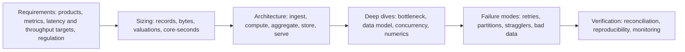
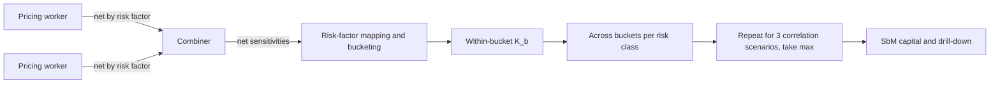

# Systems Design Problem Set: Quantitative Financial Infrastructure

## TL;DR

- Six end-to-end cases, each solved the way an interviewer expects: state the assumptions, size the data and compute, find the bottleneck, then defend the design against failure modes.
- FRTB SbM sizing is dominated by data movement and netting, not by the aggregation algebra: across-bucket correlation applies within a risk class (MAR21.4(5)), so the across-bucket work is $\sum_c B_c^2$ per scenario and measure, not $(\sum_c B_c)^2$.
- Pre-deal exposure proxies built from a mean shift are accurate deep in the money but fail near the money when the trade also changes the netting set's volatility; a second-order proxy in both mean and volatility fixes most of it.
- Late trades should be scheduled as a sub-DAG with release times; their delay depends on where they land relative to the critical path, not on the sum of their task durations.
- Lock choice matters only near saturation of the contended cache line; queueing delay explodes as utilisation approaches one, and Amdahl's law and the longest task bound grid speedups.
- Every number here is computed, printed and asserted by [sys_problem_set.py](code/sys_problem_set.py), which reuses the CPM engine of [sys_eod_batch.py](code/sys_eod_batch.py); volumes and timings are hypothetical, Basel bucket counts are cited.

## Learning objectives

- Formulate end-to-end system designs for complex capital markets pricing and risk infrastructure.
- Establish architectural boundaries, latency budgets, data schemas, and compute scaling strategies.
- Design low-latency pre-deal analytics pipelines delivering incremental portfolio Greek and XVA quotes in microseconds, and quantify the error of their proxies.
- Apply queueing theory ($M/M/1$, $M/D/1$) to calculate average and tail ($p99$) latencies in high-throughput electronic gateways.
- Architect enterprise-scale batch orchestration engines capable of self-healing from node crashes and data anomalies using Critical Path Method analysis.
- Analyze trade-offs between accuracy, compute cost, memory footprint, and network serialization overhead.
- Master senior-level quantitative software architecture interview questions and design presentations.

## Core concepts

### 1. A framework for a systems design answer

1. Requirements: what is computed, for whom, how fresh, how fast (p50 and p99), how many, and which rules apply (for example MAR21 for FRTB SA, BCBS 239 for risk data).
2. Sizing: write the numbers down before drawing boxes; most designs are decided by bytes moved and valuations performed.
3. Architecture: data flow first, then services.
4. Deep dives: the one or two components that dominate cost or risk.
5. Failure modes and verification: what happens on retry, partition, straggler or bad input, and how you would know.

### 2. Rules of thumb that the cases rely on

- Data that can be netted should be netted as early as possible (combiners before the network).
- Additive quantities (PVs, sensitivities, scenario P&L) can be merged incrementally; quantiles, square-root aggregations and netting-set exposures cannot.
- Utilisation drives queueing delay: for M/M/1 the mean time in system is $1/(\mu - \lambda)$, so latency grows without bound as $\rho = \lambda/\mu \to 1$.
- Speedup is capped by serial work (Amdahl) and by the longest indivisible task.

## Worked examples

### Case 1: FRTB SbM sensitivity pipeline

Hypothetical scale: 500,000 positions, 40 delta and vega sensitivities each, so 20.0 million sensitivity records per run.

- Record layout: int64 trade id, float64 value, int32 risk-factor id, int16 bucket, uint16 flags is 24 bytes with natural alignment and no packing (declaring the fields as int64, int32, int16, double, uint16 would force padding before the double).
- Payload: 480.0 MB; at a 10 Gbit/s line rate that is at least 0.384 s on the wire, before protocol overhead.
- Netting: MAR21.4(2) nets sensitivities to the same risk factor across instruments, so workers should net before sending.
  If each of 500 workers ends up with 20,000 distinct risk factors (16-byte factor id and value), the combined payload is 160.0 MB.
- Aggregation: within a bucket $K_b = \sqrt{\max(0, \sum_k WS_k^2 + \sum_{k \ne l} \rho_{kl} WS_k WS_l)}$; across buckets within a risk class $\sqrt{\sum_b K_b^2 + \sum_{b \ne c} \gamma_{bc} S_b S_c}$ (MAR21.4(4) and (5)); risk classes are simply summed (MAR21.7), and the whole calculation is repeated for the medium, high and low correlation scenarios (MAR21.6) with the maximum taken.
- Across-bucket work: with the fixed bucket counts of MAR21 (CSR non-securitisation 18, CTP 16, non-CTP securitisation 25, equity 13, commodity 11) and, hypothetically, 10 GIRR currencies and 10 FX pairs, $\sum_c B_c^2 = 1{,}695$, so $3 \times 3 \times 1{,}695 = 15{,}255$ terms for three scenarios and three measures (delta, vega, curvature).
  Treating all 103 buckets as one correlated block would give 95,481 terms and would be wrong, because there is no cross-class correlation in SbM.
- Conclusion: the algebra is trivial in compute; the design effort goes into netting, risk-factor mapping, bucket assignment and reconciliation of sensitivities with the pricing system.

### Case 2: pre-deal exposure proxy

Overnight simulation gives a netting set's value at a future date as approximately normal with mean $\mu$ and standard deviation $\sigma$; expected positive exposure at that date is

$$EE(\mu, \sigma) = \mathbb{E}[\max(V, 0)] = \mu \, \Phi(\mu/\sigma) + \sigma \, \phi(\mu/\sigma).$$

The script checks this closed form by numerical integration.
Its derivatives are $\partial EE/\partial \mu = \Phi(z)$, $\partial EE/\partial \sigma = \phi(z)$, $\partial^2 EE/\partial \mu^2 = \phi(z)/\sigma$, $\partial^2 EE/\partial \mu \partial \sigma = -z \phi(z)/\sigma$ and $\partial^2 EE/\partial \sigma^2 = z^2 \phi(z)/\sigma$ with $z = \mu/\sigma$; the script confirms them by finite differences.

Part (a), deep in the money: $\mu = 15$ million, $\sigma = 8$ million, so $z = 1.875$, $\Phi(z) = 0.969604$, $\phi(z) = 0.068786$ and $EE = 15{,}094{,}345$.
A new trade adds a deterministic 1.5 million to the mean.
Mean-shift Taylor proxy: $0.969604 \times 1{,}500{,}000 = 1{,}454{,}405$ plus $\tfrac12 \times 0.068786 / 8{,}000{,}000 \times 1{,}500{,}000^2 = 9{,}673$, total 1,464,079.
Exact: $EE(16.5\text{m}, 8\text{m}) = 16{,}557{,}360$, an increment of 1,463,015; the proxy is off by 1,063 (0.07%).

Part (b), near the money with a hedge: $\mu = 2$ million, $\sigma = 8$ million, $EE = 4{,}290{,}758$.
The trade adds 1.5 million to the mean but has its own standard deviation of 3 million and correlation $-0.6$ with the netting set, so the new standard deviation is $\sqrt{8^2 + 2(-0.6)(8)(3) + 3^2} = 6{,}648{,}308$.
The exact increment is 470,815.
The mean-shift proxy says 952,435, off by 102.3%, because it ignores the fall in volatility.
A first-order proxy in both mean and volatility gives 375,403 (-20.3%), and the second-order proxy in both gives 457,038 (-2.9%).
Interview point: pre-deal proxies must carry the trade's contribution to the variance (its covariance with the netting set), not just its mean, and must be validated near the money where convexity is largest.
In production the same idea is applied per exposure date and integrated against default probabilities to get incremental CVA.

### Case 3: EOD batch with a late amendment

Hypothetical DAG (minutes): A market data snap 15; B curve calibration 20 (after A); C trade extraction 25; D pricing and Greeks 50 (after B and C); E Monte Carlo VaR and ES 35, F FRTB SbM 20 and G P&L explain 25 (each after D); H ledger sign-off 15 (after E, F and G).

- Forward pass: B ends at 35, C at 25, so D runs 35 to 85; E ends at 120, F at 105, G at 110; H runs 120 to 135.
- Critical path A-B-D-E-H, makespan 135 minutes; floats: C 10, F 15, G 10 (confirmed by enumerating every path); headroom against a 180-minute SLA is 45 minutes.
- 500 amendments arrive at minute 100, while E, F and G are running.
  Sub-DAG: C2 extract them (1 minute, released at 100), D2 price them on a burst queue (3.5, after B and C2, done by 104.5), then merge into the running aggregates: E2 (2.0, after E and D2), F2 (1.0, after F and D2), G2 (1.0, after G and D2); H now waits for E2, F2 and G2.
- New makespan 137 minutes: the amendments cost 2 minutes, because only E2 sits on the critical path; adding up the sub-DAG's durations (7.5 minutes) overstates the delay.
  Headroom falls from 45 to 43 minutes.

### Case 4: curve snapshot reads

A curve service publishes immutable calibrated curves and readers take a snapshot (a pointer plus a reference count, or a reader count on a lock) for each pricing call.
Every acquisition writes one shared cache line, so acquisitions serialise on it; model the line as a single server with a deterministic hypothetical service time of 100 ns (M/D/1, mean wait $\rho t_c / (2(1 - \rho))$).

| Reads per second | Utilisation of the line | Mean extra wait |
| ---: | ---: | ---: |
| 10,000 | 0.001 | 0.05 ns |
| 1,000,000 | 0.100 | 5.6 ns |
| 5,000,000 | 0.500 | 50.0 ns |
| 9,000,000 | 0.900 | 450.0 ns |

The line saturates at 10.0 million acquisitions per second.
So at 10,000 reads per second the choice between a reader-writer lock and an atomic shared pointer is irrelevant to latency; what matters is safe publication (readers never see a half-built curve) and reclamation (old curves freed only when no reader holds them).
At millions of reads per second per process, any scheme that writes shared memory on every read (including copying a `std::shared_ptr`, which increments a shared reference count) becomes the bottleneck; use per-thread cached snapshots validated by a version number, read-copy-update or hazard pointers, which keep the read path free of shared writes.
Note also that `std::atomic<std::shared_ptr<T>>` is not required to be lock-free; check `is_always_lock_free` on the target implementation.

### Case 5: pre-trade gateway queue

Service time 10 microseconds, so $\mu = 100{,}000$ orders per second.

| | $\rho = 0.70$ | $\rho = 0.95$ |
| :--- | ---: | ---: |
| Mean time in system $1/(\mu - \lambda)$ | 33.3 us | 200.0 us |
| Mean wait in queue | 23.3 us | 190.0 us |
| p99 time in system $\ln(100)/(\mu - \lambda)$ | 153.5 us | 921.0 us |
| Mean wait if service were exactly 10 us (M/D/1) | 11.7 us | 95.0 us |

In M/M/1 with first-come first-served service the time in system is exponential with rate $\mu - \lambda$, which gives the p99 formula; the script checks the means and p99s by simulating the Lindley recursion.
A 35.7% increase in flow (70,000 to 95,000 orders per second) multiplies mean latency by 6.0.
Deterministic service halves the queueing delay (Pollaczek-Khinchine), so variability of the risk check matters as much as its mean; keep utilisation well below one at the peak, shed or throttle load beyond it, and measure latency with open-loop load generators so coordinated omission does not hide the queue.

### Case 6: scaling a pricing grid

- Amdahl: with 2% serial work (task fan-out, final aggregation), 128 cores give a speedup of 36.2, 1,024 cores give 47.7, and no number of cores exceeds 50.0.
- Longest task: 999 one-minute tasks plus one 30-minute task (1,029 minutes of work) on 100 workers with longest-processing-time-first scheduling finish at 30 minutes, the length of the long task; splitting it into 30 one-minute pieces brings the makespan to 11 minutes against a lower bound of 10.29.
- Design consequences: split work into many small, similar tasks; schedule long tasks first; speculative re-execution for stragglers; reduce serial stages with hierarchical aggregation.

## Pitfalls

- **Designing without numbers:** an architecture without stated volumes, sizes and latency targets cannot be judged; size first.
- **Happy-path only:** no answer is complete without retries, idempotency, partitions, stragglers and bad-data handling.
- **Durable logs on a microsecond path:** a replicated, disk-backed log is the right tool for durable event streams, not for an in-line pre-trade check with a tens-of-microseconds budget; use in-process or shared-memory queues there and persist asynchronously.
- **Moving raw grids across the cloud boundary:** egress is charged per byte by cloud providers; aggregate (or net) before data leaves the region.
- **Exactly-once assumptions:** distributed queues give at-least-once delivery; deduplicate with idempotency keys.
- **Adding non-additive numbers:** VaR, ES, SbM capital and netting-set exposures are not sums over trades.
- **Summing sub-DAG durations to estimate a delay:** schedule the sub-DAG; only the part on the critical path costs time (Case 3).

## Interview questions

> [!question]- sys-18-01 | How do you size the compute grid for an FRTB Sensitivities-Based Method (SbM) engine?
> Count valuations: base prices plus sensitivities (bump-and-reprice costs about one or two extra valuations per risk factor, adjoint AAD gives all first-order sensitivities of a valuation for a small constant multiple of its cost) plus two curvature revaluations (up and down shocks) per curvature risk factor (MAR21.5).
> Multiply by the cost per valuation, divide by the batch window to get cores, and size the network for the sensitivity records (480.0 MB for 20 million 24-byte records in Case 1), netted before transfer.

> [!question]- sys-18-02 | How can pre-deal incremental XVA ($\Delta\text{XVA}$) be evaluated in under 50 milliseconds?
> Precompute netting-set exposure distributions overnight (per exposure date), then value the new trade's contribution analytically or on cached paths and apply a proxy: the derivatives of expected exposure with respect to the mean and the volatility, integrated against default probabilities.
> The proxy must include the trade's effect on variance: in Case 2 a mean-only proxy is 0.07% off deep in the money but 102.3% off near the money for a hedging trade, while a second-order mean-and-vol proxy is -2.9% off.

> [!question]- sys-18-03 | In a reactive curve service, how do you achieve lock-free thread safety across thousands of reader threads?
> Publish immutable calibrated curves and swap a single pointer atomically, so readers never see a partial update; reclaim old curves only when no reader holds them.
> Copying a `std::shared_ptr` (or using `std::atomic<std::shared_ptr<T>>`, which is not required to be lock-free) writes a shared reference count on every read; at very high read rates use per-thread cached snapshots with a version check, read-copy-update or hazard pointers to keep reads free of shared writes.

> [!question]- sys-18-04 | What is the Critical Path Method (CPM) and how does it prevent EOD risk batch SLA breaches?
> CPM computes earliest and latest start and finish times on the task DAG; zero-float tasks form the critical path, whose length is the batch's minimum runtime.
> It tells you where extra compute shortens the batch (only on the critical path, until another path becomes critical) and how much a late input will cost (schedule it with a release time, as in Case 3).

> [!question]- sys-18-05 | What is the difference between Single-Instruction Multiple-Data (SIMD) and Single-Instruction Multiple-Threads (SIMT)?
> SIMD: one instruction operates on a vector register of several values (for example 8 doubles with AVX-512); the programmer or compiler vectorises loops explicitly.
> SIMT (NVIDIA GPUs): many threads, each with its own registers, are grouped in warps that execute the same instruction; divergent branches within a warp are serialised, so path-dependent payoffs with early exercise need care.

> [!question]- sys-18-06 | How does an event-sourced trade repository recover from corrupted state?
> State is a deterministic fold over an immutable event log, so rebuild it by replaying the log from the last verified snapshot, after correcting or compensating the bad events with new events (the log itself is not edited).
> This also gives point-in-time reconstruction for audits, provided event handlers are versioned so old events replay the same way.

> [!question]- sys-18-07 | Why are Aeron and LMAX Disruptor preferred over RabbitMQ or Kafka in electronic trading gateways?
> They target a different problem: the Disruptor is an in-process ring buffer for passing events between threads without locks or per-message allocation, and Aeron is a messaging library over UDP and shared memory designed for low and predictable latency.
> Brokers such as Kafka provide durable, replicated, replayable logs, which add network hops and disk persistence to every message; use them for durable event streams and keep them off the microsecond hot path.

> [!question]- sys-18-08 | How does an enterprise risk engine handle a network partition during an EOD batch?
> Workers write completed chunks durably under idempotency keys, the scheduler detects lost workers by heartbeat or lease expiry and reassigns their incomplete chunks, and fencing tokens stop a partitioned, stale worker or scheduler from overwriting newer results.
> Completed work survives the partition, and duplicated work is harmless because writes are idempotent.

> [!question]- sys-18-09 | What is the "Straggler Problem" in distributed Monte Carlo pricing, and how is it mitigated?
> A few slow tasks (bad nodes, skewed task sizes) determine the batch's finish time: in Case 6 one 30-minute task holds 100 workers to 30 minutes despite 1,029 minutes of total work.
> Mitigate with small, equal-sized tasks, longest-first scheduling, work stealing and speculative re-execution of laggards.

> [!question]- sys-18-10 | What is the difference between horizontal scaling and vertical scaling in quantitative risk architectures?
> Vertical scaling uses a bigger machine (more cores, memory, faster cores); it suits latency-critical single-threaded paths and workloads that need shared memory.
> Horizontal scaling adds machines; it suits embarrassingly parallel work like scenario revaluation and Monte Carlo paths, limited by serial fractions (Amdahl) and by data movement.

> [!question]- sys-18-11 | Why is data compression essential between the pricing grid and the risk aggregation cube?
> Raw scenario vectors are large: 500,000 positions x 1,000 scenarios x 8 bytes is 4 GB per run.
> The bigger win is usually reducing what is sent (aggregate or net on the worker, send only what the next stage needs); generic compression of full-precision doubles achieves little because their low mantissa bytes are close to random, so quantisation or float32 must be a deliberate precision decision.

> [!question]- sys-18-12 | How do you prevent cache stampedes (thundering herd) when a benchmark yield curve is recalibrated?
> Ensure one recalibration per curve version (single-flight: the first requester computes, others wait for its result), keep serving the previous version until the new one is published, and spread expiries with jitter.
> Better still, push: the curve service recalibrates on market data events and publishes new versions, so readers never trigger calibration.

> [!question]- sys-18-13 | What is the hedge benefit ratio (HBR) in the FRTB standardised default risk charge?
> For each non-securitisation bucket, $HBR = \sum \text{net long JTD} / (\sum \text{net long JTD} + \sum |\text{net short JTD}|)$, using unweighted jump-to-default amounts (MAR22.23).
> The bucket charge is $\max(\sum RW \cdot JTD_{long} - HBR \sum RW \cdot |JTD_{short}|, 0)$ (MAR22.25), so shorts offset longs only in proportion to how long the bucket is, and there is no hedging across buckets (MAR22.26).

> [!question]- sys-18-14 | What is the difference between active-active and active-passive disaster recovery?
> Active-passive: one site serves traffic while the other receives replicated data and is promoted on failure, so RTO includes detection and promotion.
> Active-active: both sites serve traffic, so losing one costs capacity rather than a promotion, but writes need a conflict strategy (partitioned ownership, consensus or synchronous replication) and each site must be sized to carry the load alone; neither design removes the need to test failover.

> [!question]- sys-18-15 | How does bitemporality resolve regulatory audit inquiries regarding past risk reports?
> Each fact carries valid time (when it was true in the world) and transaction time (when the system recorded it); a query "as of valid date V, as known at transaction time T" reproduces what the system believed at T.
> So the risk report produced on 1 October can be reproduced exactly even after trades were amended on 5 October with a back-dated effect.

> [!question]- sys-18-16 | Why is the SbM across-bucket aggregation $\sum_c B_c^2$ terms rather than $(\sum_c B_c)^2$?
> Across-bucket correlation applies only between buckets of the same risk class (MAR21.4(5)); risk-class charges are then summed (MAR21.7).
> With the note's bucket counts that is 1,695 terms per scenario and measure (15,255 for 3 x 3), against 95,481 if all 103 buckets were wrongly treated as one block.

> [!question]- sys-18-17 | Lay out a 24-byte sensitivity record (int64 id, double value, int32 factor, int16 bucket, uint16 flags) so it needs no packing.
> Order fields by decreasing alignment: int64, double, int32, int16, uint16 gives offsets 0, 8, 16, 20 and 22 and a size of 24 with natural alignment.
> Putting the double after the int32 and int16 would need padding (or a packed, misaligned struct, which is slower and not portable).

> [!question]- sys-18-18 | Expected positive exposure of $V \sim N(\mu, \sigma^2)$: give the formula and its derivatives in $\mu$ and $\sigma$.
> $EE = \mu \Phi(z) + \sigma \phi(z)$ with $z = \mu/\sigma$; $\partial EE/\partial \mu = \Phi(z)$ and $\partial EE/\partial \sigma = \phi(z)$.
> It is a call on $V$ struck at zero, so these are its delta and its vega in the normal model; for $\mu = 15$m and $\sigma = 8$m, $EE = 15{,}094{,}345$.

> [!question]- sys-18-19 | 500 amendments arrive 100 minutes into a 135-minute batch; pricing them takes 4.5 minutes and merging takes 1 to 2 minutes per aggregate. Is the delay 7.5 minutes?
> No: scheduled with release times it is 2 minutes, because the amendments are priced by minute 104.5 while the aggregates are still running, and only the 2-minute VaR merge sits on the critical path.
> Summing the sub-DAG's durations assumes it all lies on the critical path.

> [!question]- sys-18-20 | A curve snapshot is acquired 10,000 times a second through one shared cache line that takes 100 ns per update. Does the lock implementation matter?
> Not for latency: utilisation of the line is 0.001 and the mean extra wait is about 0.05 ns.
> It matters near saturation (10 million acquisitions a second here; 450 ns mean wait at 9 million), which is where read paths without shared writes pay off.

> [!question]- sys-18-21 | For an M/M/1 gateway with a 10 microsecond service time, what are the mean and p99 times in system at 70% and 95% utilisation?
> At 70%: mean 33.3 us and p99 153.5 us; at 95%: mean 200.0 us and p99 921.0 us.
> Time in system is exponential with rate $\mu - \lambda$, so mean $1/(\mu - \lambda)$ and p99 $\ln(100)/(\mu - \lambda)$.

> [!question]- sys-18-22 | Why does deterministic service time halve the mean queueing delay compared with exponential service?
> By Pollaczek-Khinchine, the M/G/1 mean wait is $\rho \, \mathbb{E}[S] (1 + c_s^2) / (2(1 - \rho))$ with $c_s$ the coefficient of variation of service; $c_s = 1$ for exponential and 0 for deterministic.
> At 70% utilisation the wait drops from 23.3 to 11.7 us; at 95% from 190.0 to 95.0 us, so reducing the variability of the risk check is as valuable as speeding it up.

> [!question]- sys-18-23 | With 2% serial work, what speedup do 128 and 1,024 cores give?
> $36.2$ and $47.7$, from Amdahl's law $1/(f + (1 - f)/n)$, with a ceiling of $1/f = 50$.
> Beyond a few hundred cores the serial fan-out and aggregation, not the pricing, decide the runtime.

> [!question]- sys-18-24 | Why is coordinated omission a problem when measuring gateway latency?
> A closed-loop load generator waits for each response before sending the next request, so when the system stalls it stops sending and the stall is recorded as one slow sample instead of many queued ones.
> Measured percentiles then understate the tail; use open-loop generators that send on a schedule and measure from the intended send time.

> [!question]- sys-18-25 | A queue guarantees at-least-once delivery. How do you make a risk aggregation exactly-once in effect?
> Give each message or task an idempotency key (for example run id, partition, trade id and version) and make the consumer's write an upsert on that key, or record processed keys atomically with the result.
> Duplicates then overwrite identical values instead of adding twice; transactions or a log with consumer offsets committed with the output are alternatives.

> [!question]- sys-18-26 | Where should you aggregate scenario P&L in a hybrid on-premises and cloud grid, and why?
> Next to the workers, before data leaves the cloud region: net and aggregate to the level the next stage needs (desk or netting set vectors) and transfer those.
> Cloud egress is charged per byte and bandwidth is finite, so shipping raw trade-level grids out is the expensive and slow choice.

> [!question]- sys-18-27 | How would you verify that a new distributed risk engine produces the same numbers as the legacy batch it replaces?
> Run both in parallel on the same frozen inputs, reconcile at trade, risk-factor and aggregate level with tolerances set per measure, and explain every break (data, model, numerical order).
> Make the new engine reproducible first (fixed reduction order, counter-based random streams, pinned versions) so that remaining differences are real.

## In this repo and SDE-Interview-Prep

- `code/sys_problem_set.py` computes, prints and asserts every number on this page and imports the generic critical-path engine from `code/sys_eod_batch.py`.
- [FRTB Engine Architecture](10-FRTB-Engine.md), [XVA Engine Architecture](11-XVA-Engine.md), [The EOD Risk Batch](13-EOD-Risk-Batch.md), [Curve and Surface Service](04-Curve-and-Surface-Service.md), [Intraday Risk and Pre-Trade Limits](08-Intraday-Risk-and-Pre-Trade-Limits.md) and [Non-Functional Design](16-Non-Functional-Design.md) for the underlying topics.
- SDE-Interview-Prep: [Capacity Estimation](https://github.com/shreejitverma/SDE-Interview-Prep/blob/main/04-System-Design/00-Concepts/Capacity-Estimation.md), [Backpressure and Tail Latency](https://github.com/shreejitverma/SDE-Interview-Prep/blob/main/04-System-Design/00-Concepts/Backpressure-and-Tail-Latency.md), [Concurrency, Synchronization and CAS](https://github.com/shreejitverma/SDE-Interview-Prep/blob/main/04-System-Design/00-Concepts/Concurrency-Synchronization-and-CAS.md), [Idempotency and Delivery](https://github.com/shreejitverma/SDE-Interview-Prep/blob/main/04-System-Design/00-Concepts/Idempotency-and-Delivery.md).

## Further reading

- Basel Committee on Banking Supervision. *The Basel Framework*, MAR21 (sensitivities-based method) and MAR22 (default risk capital requirement).
- Kleppmann, Martin. *Designing Data-Intensive Applications*. O'Reilly, 2017.
- Savine, Antoine. *Modern Computational Finance: AAD and Parallel Simulations*. Wiley, 2018.
- Kleinrock, Leonard. *Queueing Systems, Volume 1: Theory*. Wiley, 1975.
- Amdahl, Gene M. "Validity of the single processor approach to achieving large scale computing capabilities." *AFIPS Spring Joint Computer Conference*, 1967.
- Graham, Ronald L. "Bounds on Multiprocessing Timing Anomalies." *SIAM Journal on Applied Mathematics* 17(2), 1969.
- Xu, Alex and Lam, Sahn. *System Design Interview: An Insider's Guide, Volume 2*. ByteByteGo, 2022.
