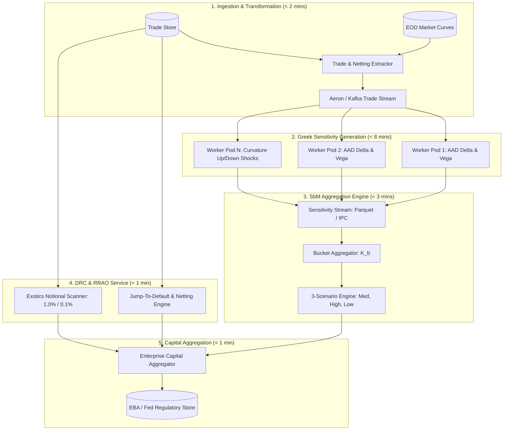
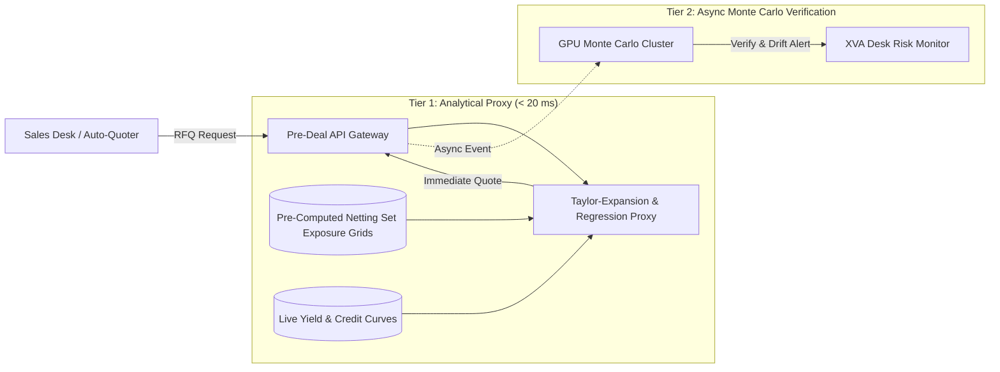

# Systems Design Problem Set

## TL;DR

This comprehensive system design problem set tests the architectural, quantitative, and software engineering skills required to design enterprise financial infrastructure.
It presents four end-to-end system design interview case studies:
1. **Design a High-Throughput FRTB SA Engine** (aggregating 7 asset classes across 3 correlation regimes within a 15-minute SLA).
2. **Design an Ultra-Low Latency Pre-Deal XVA Quoting Service** (delivering incremental CVA, FVA, and MVA in under 50 milliseconds).
3. **Design a Resilient End-of-Day Risk Batch Orchestrator** (managing critical path dependencies, idempotent retries, and sub-DAG backfills across 50,000 cores).
4. **Design a Reactive Multi-Curve and Volatility Surface Service** (leveraging DAG dirty-flag caching, analytic Jacobians, and lock-free thread safety).
Each case presents functional and non-functional requirements, with data schemas and architectural designs where applicable; the cases vary in how much implementation detail they provide.

## Learning objectives

- Formulate end-to-end system designs for complex capital markets pricing and risk infrastructure.
- Establish architectural boundaries, latency budgets, data schemas, and compute scaling strategies.
- Design low-latency pre-deal analytics pipelines delivering incremental portfolio Greek and XVA quotes in milliseconds.
- Architect enterprise-scale batch orchestration engines capable of self-healing from node crashes and data anomalies.
- Analyze trade-offs between accuracy, compute cost, memory footprint, and network serialization overhead.
- Master senior-level quantitative software architecture interview questions and design presentations.

## Core concepts

### 1. The Standard System Design Framework for Capital Markets

When presenting a financial system design:
1. **Scope & Requirements:**
   - Functional: What business flows, products, and metrics must be computed?
   - Non-Functional: Latencies (p50, p99), throughput (trades/sec), precision (IEEE 754 determinism), SLAs, data retention, regulatory compliance (SR 11-7, BCBS 239).
2. **High-Level Architecture:**
   - Data ingestion, calculation core, caching tier, and downstream consumers.
3. **Deep Dives:**
   - Algorithmic complexity, concurrency models (lock-free vs actor), data models, network protocols (gRPC, Aeron, Kafka).
4. **Failure Modes & Bottlenecks:**
   - Network partitions, memory exhaustion, floating-point drift, cache stampedes.

---

## Worked examples

### Case Study 1: Design an Enterprise FRTB Standardised Approach (SA) Engine

#### 1. Requirements & Scale
- **Functional Scope:**
  - Compute Sensitivities-Based Method (SbM) Delta, Vega, and Curvature across 7 risk classes (GIRR, CSR non-sec, CSR sec-ctp, CSR sec non-ctp, Equity, Commodity, FX).
  - Evaluate each risk class across three supervisory correlation regimes: Medium ($\rho, \gamma$), High ($\min(1.25\rho, 1), \min(1.25\gamma, 1)$), Low ($0.75\rho, 0.75\gamma$).
  - Calculate Default Risk Charge (DRC) and Residual Risk Add-On (RRAO).
  - Output binding capital: $K = \max(K_{\text{med}}, K_{\text{high}}, K_{\text{low}}) + K_{\text{DRC}} + K_{\text{RRAO}}$.
- **Non-Functional Scale:**
  - Portfolio size: $P = 500,000$ active trading book positions.
  - Number of risk factors: $N = 25,000$ pillars and buckets.
  - End-to-end batch execution SLA: $< 15\text{ minutes}$.

#### 2. Architecture & Data Flow

#### 3. Core Engine Algorithms and Data Optimization
- **Sensitivity Ingestion:** Greeks are transmitted as packed binary structs: `{trade_id: int64, risk_factor_id: int32, bucket_id: int16, s_k: float64}`.
- **Bucket Aggregation via Vectorization:**
  Bucket capital $K_b = \sqrt{ \mathbf{WS}_b^T \mathbf{\Gamma}_b \mathbf{WS}_b }$.
  Because correlation matrices $\mathbf{\Gamma}_b$ are sparse or block-constant, evaluate via BLAS `dsymv` matrix-vector multiplications.
- **Across-Bucket Scenario Optimization:**
  Notice that $S_b = \sum_{k \in b} WS_k$ is independent of the correlation scenario.
  Compute $S_b$ once, then evaluate the $B \times B$ across-bucket matrix multiplication $\mathbf{S}^T \mathbf{\Omega} \mathbf{S}$ in parallel across the three scenarios (Med, High, Low) in under 50 milliseconds.

---

### Case Study 2: Design a Real-Time Pre-Deal XVA Quoting Service

#### 1. Requirements & Scale
- **Functional Scope:**
  - Sales desks submit incoming derivative trade quotes (IRS, swaptions, FX forwards).
  - The engine must compute the marginal change in portfolio XVA:
    $$\Delta\text{XVA} = \text{XVA}(\text{NettingSet} \cup \{\text{Trade}\}) - \text{XVA}(\text{NettingSet})$$
  - Return broken-out adjustments: $\Delta\text{CVA}, \Delta\text{FVA}, \Delta\text{MVA}, \Delta\text{KVA}$.
- **Non-Functional Scale:**
  - Peak throughput: $500\text{ quote requests/second}$.
  - Latency SLA: $\text{p99} < 50\text{ milliseconds}$ (to prevent client RFQ timeouts).
  - Accuracy: Within $3\%$ of overnight full Monte Carlo batch.

#### 2. Architecture: Two-Tier Proxy & Exact Pipeline

#### 3. Algorithmic Solution for Sub-50ms Response
- **Problem:** Simulating 10,000 Monte Carlo paths for an entire 500-trade netting set takes 2 to 5 seconds, which is too slow for electronic quotation.
- **Solution:**
  1. Overnight batch pre-computes and caches the uncollateralized netting set exposure profile $\mathbf{EE}_{\text{base}}(t_m)$ across 80 timesteps.
  2. When a new trade arrives, evaluate its standalone pricing analytically across the 80 timesteps in under 2 milliseconds: $\mathbf{v}_{\text{trade}}(t_m)$.
  3. Approximate the new expected positive exposure using analytical Taylor expansion or a pre-trained neural network surrogate model:
     $$\mathbb{E}[(V_{\text{base}} + v_{\text{trade}})^+] \approx \mathbb{E}[V_{\text{base}}^+] + \Phi\left(\frac{\mathbb{E}[V_{\text{base}}]}{\sigma_{\text{base}}}\right) v_{\text{trade}} + \frac{1}{2} \phi\left(\frac{\mathbb{E}[V_{\text{base}}]}{\sigma_{\text{base}}}\right) \frac{v_{\text{trade}}^2}{\sigma_{\text{base}}}$$
  4. Perform numerical quadrature against the counterparty credit curve in $< 1\text{ ms}$.
  5. Return $\Delta\text{XVA}$ in 12 milliseconds.

---

### Case Study 3: Design a Resilient End-of-Day Risk Batch Orchestrator

#### 1. Requirements & Scale
- **Functional Scope:**
  - Execute a multi-stage dependency DAG: Market Snapshot $\to$ Calibration $\to$ Pricing Grid $\to$ VaR/ES $\to$ PnL Explain $\to$ General Ledger $\to$ Sign-off.
  - Automatically recover from compute node failures without restarting the pipeline.
  - Dynamically invalidate and rerun sub-graphs when late trades arrive.
- **Non-Functional Scale:**
  - Compute cluster: $50,000$ virtual cores across on-premises and AWS cloud burst.
  - Batch window SLA: 3 hours maximum.
  - Zero duplicate database writes (strict idempotency).

#### 2. Core Architecture Blueprint
- **Control Plane:** Active-passive Dagster/Airflow schedulers sharing an etcd distributed lock and a multi-AZ metadata database.
- **Execution Plane:** Tasks are published to high-throughput priority queues (RabbitMQ / Kafka). Worker agents pull jobs, report heartbeats every 10 seconds, and write results directly to S3 Parquet tables.
- **State Checkpointing:** Workers write output manifests containing cryptographic SHA-256 hashes of generated partitions. Downstream tasks verify input hashes before execution, guaranteeing idempotency.

---

### Case Study 4: Design a Reactive Multi-Curve and Volatility Surface Service

#### 1. Requirements & Scale
- **Functional Scope:**
  - Ingest live tick quotes across OIS, IBOR, Basis, and Credit spreads.
  - Maintain a live calibrated DAG of 150 discount curves and 80 swaption SABR surfaces.
  - Provide continuous zero rates, discount factors, forward rates, and calibration Jacobians.
- **Non-Functional Scale:**
  - Concurrency: $10,000$ parallel pricing queries/second.
  - Recalibration latency on quote update: $< 5\text{ milliseconds}$.
  - Thread safety: Minimize reader contention while serving immutable curve snapshots.

#### 2. Architectural Design
- **Memory Architecture:**
  - Master curve state is represented as an immutable C++ data structure wrapped in `std::shared_ptr<const YieldCurve>`.
  - The curve calibration service evaluates recalibrations on a background worker thread.
  - When calibration finishes, the service executes an atomic pointer exchange (`std::atomic_store`) updating the master pointer.
  - Reader threads use `std::atomic_load` to obtain immutable snapshots. Atomic operations on `std::shared_ptr` are not guaranteed to be lock-free, so measure their cost against the service's latency requirements.
- **DAG Dirty Propagation:**
  - Each node tracks dependent children.
  - A quote tick triggers a bitset update marking dirty flags downstream.
  - Evaluation is deferred until an external pricing query explicitly requests a discount factor, eliminating redundant calculations during high-frequency quote bursts.

## Pitfalls

- **Designing Without Stated Latency and Volume Assumptions:** Proposing complex Monte Carlo architectures for high-frequency flow trading or proposing single-node memory structures for massive cross-asset portfolios fails system design interviews immediately. Always state volumes, packet sizes, and latencies first.
- **Neglecting Failure Modes:** A system design that only explains the "happy path" without detailing handling of network partitions, database deadlocks, straggling workers, and data corruption is incomplete.
- **Conflating Asynchronous Messaging with Low Latency:** While Kafka is excellent for high-throughput durable event streaming, introducing multi-broker disk-flush overhead into an in-line $< 50\mu s$ pre-trade risk gateway creates unacceptable latency. Use kernel-bypass shared memory or Aeron IPC instead.
- **Ignoring Data Gravity and Cloud Egress Costs:** Designing a hybrid architecture where raw scenario grids are computed in the cloud and streamed uncompressed back to on-prem databases creates multi-million dollar annual bandwidth invoices. Aggregate in the cloud before egress.
- **Failing to Enforce Idempotency in Distributed Queues:** Distributed queues guarantee "at-least-once" delivery, not "exactly-once". Failing to deduplicate tasks via unique idempotency keys leads to double-counted trades and corrupted risk aggregations.

## Interview questions

> [!question]- sys-18-01 | How do you size the compute grid for an FRTB Sensitivities-Based Method (SbM) engine?
> Sizing requires multiplying: $\text{Positions} \times \text{Risk Factors} \times \text{Greeks per position}$.
> Using Adjoint Algorithmic Differentiation (AAD), generating all Delta and Vega sensitivities takes a constant multiple ($\approx 3\times$ to $4\times$) of base pricing runtime.
> Curvature requires two revaluations per risk factor.
> Dividing total core-seconds by the target batch window SLA determines the required core count.

> [!question]- sys-18-02 | How can pre-deal incremental XVA ($\Delta\text{XVA}$) be evaluated in under 50 milliseconds?
> Pre-deal engines do not re-run full Monte Carlo simulations across entire netting sets during client RFQs.
> They pre-calculate and cache baseline netting set exposure distributions overnight, evaluate the candidate trade analytically forward in time, and use second-order Taylor expansions or pre-trained machine learning surrogates to approximate incremental exposure.

> [!question]- sys-18-03 | In a reactive curve service, how do you achieve lock-free thread safety across thousands of reader threads?
> By publishing immutable calibrated curves through atomic shared-pointer operations.
> Recalibrations execute on background threads, and once verified, an atomic store updates the active reference.
> Readers avoid application-managed mutexes, but the standard does not guarantee atomic shared-pointer operations are lock-free; measure contention and latency on the target implementation.

> [!question]- sys-18-04 | What is the Critical Path Method (CPM) and how does it prevent EOD risk batch SLA breaches?
> CPM identifies the longest sequence of dependent tasks that have zero float (slack).
> It reveals the true operational bottlenecks; optimizing tasks off the critical path yields zero SLA reduction, so cluster resources must be prioritized for critical path tasks.

> [!question]- sys-18-05 | What is the difference between Single-Instruction Multiple-Data (SIMD) and Single-Instruction Multiple-Threads (SIMT)?
> SIMD (used in CPU AVX-512) executes an identical instruction on multiple data elements packed into wide CPU vector registers.
> SIMT (used in NVIDIA GPUs) executes instructions across independent threads organized into warps, where each thread has its own register state, enabling massive scale for Monte Carlo path generation.

> [!question]- sys-18-06 | How does an event-sourced trade repository recover from corrupted state?
> Because state is stored as an immutable log of events (Booked, Amended, Novated) rather than destructive in-place updates, corrupted state is resolved by replaying the event log from genesis (or from the latest verified snapshot) up to the target timestamp, bypassing bad events.

> [!question]- sys-18-07 | Why are Aeron and LMAX Disruptor preferred over RabbitMQ or Kafka in electronic trading gateways?
> RabbitMQ and Kafka introduce TCP socket buffers, context switches, garbage collection pauses, and disk-commit delays, resulting in millisecond latencies.
> Aeron and Disruptor operate over shared memory (IPC) or UDP kernel-bypass with pre-allocated zero-allocation memory buffers, achieving sub-microsecond latencies with zero garbage collection.

> [!question]- sys-18-08 | How does an enterprise risk engine handle a network partition during an EOD batch?
> Compute workers operate with local task timeouts and write completed chunks to durable distributed object storage with unique idempotency hashes.
> Schedulers use heartbeat probes: if a worker becomes unreachable, its incomplete chunk is reassigned to another node while completed chunks remain preserved.

> [!question]- sys-18-09 | What is the "Straggler Problem" in distributed Monte Carlo pricing, and how is it mitigated?
> The straggler problem occurs when a few slow worker nodes delay the entire batch.
> It is mitigated by work-stealing (idle workers pull remaining tasks from lagging queues) and speculative execution (launching duplicate tasks for lagging jobs and taking whichever finishes first).

> [!question]- sys-18-10 | What is the difference between horizontal scaling and vertical scaling in quantitative risk architectures?
> Vertical scaling increases the resources of a single server (faster clock speeds, more RAM, liquid-cooled CPUs), which is essential for low-latency flow trading and single-threaded DAG solvers.
> Horizontal scaling adds more nodes to a cluster, which is ideal for embarrassingly parallel workloads like Monte Carlo path simulation and scenario grid fan-out.

> [!question]- sys-18-11 | Why is data compression essential between the pricing grid and the risk aggregation cube?
> Streaming raw, uncompressed scenario vectors ($500,000\text{ positions} \times 1,000\text{ scenarios} \times 8\text{ bytes} = 4\text{ GB}$) across network interfaces creates severe network congestion.
> Using columnar compression (Gorilla, ZSTD) and zero-copy Apache Arrow formats shrinks network transmission by 80%, accelerating aggregation.

> [!question]- sys-18-12 | How do you prevent cache stampedes (thundering herd) when a benchmark yield curve is recalibrated?
> When a master curve is invalidated, thousands of pricing workers might simultaneously attempt to recalculate it.
> This is mitigated by mutex-locked single-flight evaluation (only the first worker calculates while others wait) or pre-warming caches in the background before retiring old curve versions.

> [!question]- sys-18-13 | What is the purpose of the Weighted To Reference (WTR) ratio in the FRTB Default Risk Charge?
> WTR measures the net hedging efficiency between long and short debt positions of the same obligor but different maturities.
> It penalizes basis risk by reducing the offsetting credit given to short positions if their maturities do not match the long exposure.

> [!question]- sys-18-14 | What is the difference between active-active and active-passive disaster recovery?
> In active-passive, the secondary site sits idle (warm standby) and receives replicated data, taking minutes to hours to activate upon failure.
> In active-active, both data centers process live transactions simultaneously, providing instantaneous failover and zero downtime if one site fails.

> [!question]- sys-18-15 | How does bitemporality resolve regulatory audit inquiries regarding past risk reports?
> It allows querying the database using two timestamps: Valid Time (the economic date being analyzed) and Transaction Time (the date the query is simulated from).
> This guarantees that an auditor can reproduce the exact risk report generated on October 1st, even if trades were retroactively amended on October 5th.

## Further reading

- Kleppmann, Martin. *Designing Data-Intensive Applications*. O'Reilly Media, 2017.
- Savine, Antoine. *Modern Computational Finance: AAD and Parallel Simulations*. Wiley, 2018.
- Basel Committee on Banking Supervision. *Minimum capital requirements for market risk*. BIS d457, 2019.
- Fowler, Martin. *Patterns of Enterprise Application Architecture*. Addison-Wesley, 2002.
