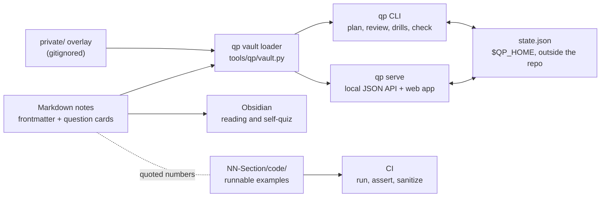

# The Quant Prep

[](https://github.com/shreejitverma/The-Quant-Prep/actions/workflows/ci.yml)

A complete, self-tracking preparation system for quantitative finance interviews and the job after them.
It covers senior **quant trader**, **quant researcher** and **quant developer** roles at proprietary trading firms, market makers, HFT firms and multi-manager hedge funds, and **quant risk and strats** roles at banks: desk quants, market risk and FRTB, counterparty risk and XVA, model validation and risk technology.

One set of Markdown notes serves three surfaces:

- **A syllabus** of interview-depth topics, each with learning objectives, prerequisites, a tier, study hours, worked examples and spaced-repetition question cards.
- **A progress platform**: the `qp` command line and a local web dashboard for readiness by track and by firm, a prerequisite-ordered weekly plan, daily card review, timed drills and an interactive trading lab.
- **An Obsidian vault**: open the folder in Obsidian to read; question cards are collapsible callouts you can quiz yourself on.

## Why trust it

Interview prep material is usually written once and never checked.
This repo treats every note like production code:

- **Computed numbers in syllabus topics are computed, not recalled.** The scripts back notes in the sections with `code/` folders; section 01 derives its numbers in the notes.
- **CI runs the syllabus examples on every change.** Script assertions catch drift in the numbers they check.
  C++ examples build warning-free on GCC and Clang and run under AddressSanitizer, UndefinedBehaviorSanitizer and, for concurrent code, ThreadSanitizer.
- **Rules and papers are cited to the source.** Basel and FRTB parameters cite the Basel Framework paragraph (for example `MAR21.6`), market conventions cite the exchange or regulator, and papers cite authors, venue and year.
- **Changes are reviewed before they merge.** Every pull request passes an automated review and test gate, and the sections rebuilt in October 2026 were re-derived and recomputed by an independent verifier who did not write them.

The full standard is in [How Notes Are Verified](00-Start-Here/How-Notes-Are-Verified.md).

## Quick start

Python 3.10 or later and nothing else; the platform uses only the standard library.

```sh
git clone https://github.com/shreejitverma/The-Quant-Prep.git && cd The-Quant-Prep
./qp profile --tracks quant-trader --hours 12   # your target role(s) and weekly study hours
./qp                                            # readiness, today's reviews, what to study next
./qp serve --open                               # the dashboard at http://127.0.0.1:8765/
```

Then read [Start Here](00-Start-Here/README.md).
Your progress is stored outside the repo (`~/.local/share/quant-prep/`, or `$QP_HOME`), so `git pull` never touches it.

## How it fits together



## Syllabus at a glance

The table below is generated from the notes by `./qp index`, and `./qp check` fails when it is stale, so the counts are always current.

<!-- qp:catalog:start (generated by `./qp index`; edit notes, not this table) -->

Written = topics at `solid` or better.
Tracks: T = trader, R = researcher, D = developer, Q = risk and strats.

| Section | Topics | Written | Hours | Cards | Tracks |
| :--- | ---: | ---: | ---: | ---: | :---: |
| [Probability](01-Probability/README.md) | 15 | 15 | 65 | 264 | TRDQ |
| [Statistics and Econometrics](02-Statistics-and-Econometrics/README.md) | 14 | 14 | 57 | 257 | TRDQ |
| [Linear Algebra and Optimization](03-Linear-Algebra-and-Optimization/README.md) | 11 | 11 | 40 | 217 | TRDQ |
| [Stochastic Calculus](04-Stochastic-Calculus/README.md) | 9 | 9 | 36 | 167 | TRDQ |
| [Derivatives and Volatility](05-Derivatives-and-Volatility/README.md) | 16 | 16 | 66 | 275 | TRDQ |
| [Fixed Income and Asset Classes](06-Fixed-Income-and-Asset-Classes/README.md) | 25 | 25 | 114 | 384 | TRDQ |
| [Market Microstructure](07-Market-Microstructure/README.md) | 12 | 12 | 41 | 200 | TRD |
| [Market Making](08-Market-Making/README.md) | 12 | 12 | 44 | 187 | TRD |
| [Alpha Research and Portfolio Construction](09-Alpha-Research-and-Portfolio/README.md) | 15 | 15 | 57 | 253 | TRDQ |
| [Machine Learning for Finance](10-Machine-Learning-for-Finance/README.md) | 11 | 11 | 38 | 209 | RD |
| [Risk and Trading](11-Risk-and-Trading/README.md) | 17 | 17 | 70 | 329 | TRDQ |
| [Quant Development](12-Quant-Development/README.md) | 15 | 15 | 86 | 347 | RDQ |
| [Interview Playbook](13-Interview-Playbook/README.md) | 12 | 12 | 32 | 208 | TRDQ |
| [Trading and Investing Library](16-Trading-and-Investing/README.md) | 69 | 69 | 223.5 | 2248 | TRDQ |
| [Regulatory Capital, Basel, and FRTB](17-Regulatory-Capital-Basel-and-FRTB/README.md) | 21 | 21 | 99 | 360 | TDQ |
| [Pricing and Risk Systems](18-Pricing-and-Risk-Systems/README.md) | 18 | 18 | 73 | 308 | DQ |

<!-- qp:catalog:end -->

| # | Section | What it covers |
| :--- | :--- | :--- |
| 01 | [Probability](01-Probability/README.md) | Combinatorics to martingales; the most-tested subject in trader and researcher interviews. |
| 02 | [Statistics and Econometrics](02-Statistics-and-Econometrics/README.md) | Estimation, testing, regression and robust inference, Bayesian methods, time series, cointegration, Kalman filters, extreme values. |
| 03 | [Linear Algebra and Optimization](03-Linear-Algebra-and-Optimization/README.md) | Spectral methods, PCA, covariance and PSD repair, convex optimisation and KKT, numerical linear algebra, root finding. |
| 04 | [Stochastic Calculus](04-Stochastic-Calculus/README.md) | Brownian motion, Ito, SDEs, risk-neutral pricing, Girsanov, Feynman-Kac, Black-Scholes, jump processes. |
| 05 | [Derivatives and Volatility](05-Derivatives-and-Volatility/README.md) | Parity, Greeks, hedging P&L, smiles and surfaces, Heston and SABR, PDE and Fourier pricing, exotics, Monte Carlo, dispersion. |
| 06 | [Fixed Income and Asset Classes](06-Fixed-Income-and-Asset-Classes/README.md) | Curves, bonds, swaps and OIS, short-rate and term-structure models, rates options, credit and CDS, Treasury futures, inflation, mortgages, FX, ETFs, commodities, crypto. |
| 07 | [Market Microstructure](07-Market-Microstructure/README.md) | Order books, auctions and fees, spread models, Kyle, impact, optimal execution, Reg NMS routing, latency, microprice. |
| 08 | [Market Making](08-Market-Making/README.md) | Fair value, Avellaneda-Stoikov and Gueant-Lehalle inventory models, quoting, hedging, ETF and futures market making, systems. |
| 09 | [Alpha Research and Portfolio](09-Alpha-Research-and-Portfolio/README.md) | Research process, point-in-time data, factors, stat arb, backtesting, overfitting, covariance shrinkage, portfolio construction, costs. |
| 10 | [Machine Learning for Finance](10-Machine-Learning-for-Finance/README.md) | Leakage-safe validation, labeling, feature importance, online learning, neural nets, reinforcement learning, NLP, production monitoring. |
| 11 | [Risk and Trading](11-Risk-and-Trading/README.md) | Kelly and sizing, VaR and ES, stress testing, drawdowns and limits, P&L attribution, risk factors, scenarios, counterparty risk and XVA, game theory, macro. |
| 12 | [Quant Development](12-Quant-Development/README.md) | Modern C++, low latency, lock-free concurrency, order books, feed handlers, backtesters, pricing libraries, risk checks and order management, testing. |
| 13 | [Interview Playbook](13-Interview-Playbook/README.md) | Formats, mental math, brainteasers, estimation, trading games, coding, take-homes, behavioural, offers, senior expectations. |
| 17 | [Regulatory Capital, Basel, and FRTB](17-Regulatory-Capital-Basel-and-FRTB/README.md) | Capital and RWA, credit SA and IRB, SA-CCR, CVA capital, FRTB standardised and internal models, operational risk, liquidity, IRRBB, stress testing, BCBS 239. |
| 18 | [Pricing and Risk Systems](18-Pricing-and-Risk-Systems/README.md) | Front-to-back architecture, trade and market data, curve and pricing services, risk engines, P&L, FRTB and XVA engines, EOD batch, governance. |
| 16 | [Trading and Investing](16-Trading-and-Investing/README.md) | The [Markets Mastery OS](16-Trading-and-Investing/MARKETS_HUB.md): a practice-first trading and investing curriculum with persona plans, stage gates and the interactive lab. |
| 14 | [Firms](14-Firms/README.md) | One guide per firm: roles, process, what they test, a focused plan. |
| 15 | [Resources](15-Resources/README.md) | Books, papers, datasets and tools. |

[17-CFA](17-CFA/README.md) is a separate CFA Level II study platform inside the vault, outside the `qp` syllabus.
General software engineering (data structures and algorithms, C++, system design) lives in [SDE-Interview-Prep](https://github.com/shreejitverma/SDE-Interview-Prep) and is linked, not copied: see the [SDE Link Map](00-Start-Here/SDE-Link-Map.md).

## Pick your path

| You are aiming for | Start with | Then |
| :--- | :--- | :--- |
| Quant trader (prop, market making, HFT) | Probability, mental math, brainteasers | Derivatives, market making, microstructure, trading games, Kelly sizing |
| Quant researcher (hedge funds, systematic) | Probability, statistics, linear algebra | Alpha research, machine learning, portfolio construction, microstructure |
| Quant developer (trading systems) | Quant development, DSA in SDE-Interview-Prep | Order books, feed handlers, backtesters, pricing libraries, systems design |
| Quant risk and strats (banks) | Probability, stochastic calculus, derivatives | Fixed income, VaR and ES, counterparty risk and XVA, Basel and FRTB, pricing and risk systems |

[Tracks](00-Start-Here/Tracks.md) explains what each role does and what its interviews test, and the [Roadmap](00-Start-Here/Roadmap.md) turns it into phases and a weekly rhythm; `./qp plan` turns that into dated weeks.

## Runnable code

The sections below have `code/` folders whose scripts back their notes; section 01 derives its numbers in the notes.

| Section | Examples |
| :--- | :--- |
| [02 Statistics](02-Statistics-and-Econometrics/code/) | Bayesian inference, cointegration and VAR, extreme value theory, Kalman filtering, robust inference. |
| [03 Linear algebra](03-Linear-Algebra-and-Optimization/code/) | Linear maps, eigendecomposition and SVD, covariance PSD repair and PCA, numerical linear algebra, Taylor expansions, KKT and QP portfolio solvers, root finding and implied volatility. |
| [04 Stochastic calculus](04-Stochastic-Calculus/code/) | Euler-Maruyama, Girsanov and numeraire changes, Feynman-Kac pricing PDEs, Merton, Kou and variance-gamma jump models. |
| [05 Derivatives](05-Derivatives-and-Volatility/code/) | SVI, SSVI and Dupire local vol, Heston and SABR calibration, finite-difference and Fourier pricers, exotics, dispersion and implied correlation. |
| [06 Fixed income](06-Fixed-Income-and-Asset-Classes/code/) | Day counts and schedules, bond pricing and risk, OIS and swap curves, short-rate models, caps and swaptions, CDS, Treasury futures, inflation, mortgages, tranches, FX parity, ETFs, futures curves, crypto perpetuals. |
| [07 Microstructure](07-Market-Microstructure/code/) | Auction uncross and fees, Roll and Glosten-Milgrom, Kyle equilibrium, impact models, Almgren-Chriss, execution algorithms, Reg NMS routing, latency races. |
| [08 Market making](08-Market-Making/code/) | Avellaneda-Stoikov simulator, Gueant-Lehalle-Fernandez-Tapia closed forms and exact solution, ETF and futures market making, market-making system sizing. |
| [09 Alpha research](09-Alpha-Research-and-Portfolio/code/) | Event-driven backtester, point-in-time and survivorship biases, factor models, momentum and carry, stat arb, shrinkage, Black-Litterman, risk parity and HRP, costs, case studies. |
| [10 Machine learning](10-Machine-Learning-for-Finance/code/) | Online linear models, backprop and LSTM in numpy, triple-barrier labels and meta-labeling, feature importance, Q-learning execution, text signals, drift monitoring. |
| [11 Risk](11-Risk-and-Trading/code/) | Stress testing, drawdowns, P&L attribution, risk factors, scenario generation, risk analytics, exposure and XVA, game theory, macro. |
| [12 Quant development](12-Quant-Development/code/) | C++20 order book and matching engine, ITCH 5.0 feed handler, lock-free queues, memory pools, pricing library, pre-trade risk and order management, latency lab, with unit tests; Python backtester, tick storage and numerical-testing examples. |
| [13 Interview playbook](13-Interview-Playbook/code/) | Coding problems tested against brute force, a mini research take-home, offer arithmetic, track-record statistics. |
| [17 Regulatory capital](17-Regulatory-Capital-Basel-and-FRTB/code/) | Basel capital framework, credit SA and IRB, SA-CCR, CVA capital, FRTB sensitivities-based method, DRC and RRAO, FRTB IMA, liquidity and IRRBB, stress testing. |
| [18 Pricing and risk systems](18-Pricing-and-Risk-Systems/code/) | One script per systems note: sizing models, queueing, curve service, AAD, risk and P&L engines, FRTB and XVA engines, EOD batch, storage and compute. |
| [Trading Lab](tools/qp/lab/) | Eleven interactive engines (`./qp lab list`): order book and execution, market-maker quoting, options desk, futures and carry, risk parity, Kelly sizing, event studies, chart replay, overfitting trap, interview games, journal analytics. |

Run every example the way CI does with `python tools/run_examples.py` (needs numpy, pandas and matplotlib; `--list` shows them), or one at a time with `python <file>.py`.
Build a C++ example with `g++ -std=c++20 -O2 -pthread <file>.cpp`; [CONTRIBUTING](CONTRIBUTING.md#code-examples) has the exact CI flags.

## Repository layout

```text
00-Start-Here/          onboarding: tracks, roadmap, platform guide, verification standard, note conventions
01-..13-, 17-, 18-      the syllabus: Markdown notes, with code/ beside the notes that use it
14-Firms/, 15-Resources/  firm guides and the reference library
16-Trading-and-Investing/ the Markets Mastery OS curriculum and a free-form investing library
17-CFA/                 the CFA Level II platform (separate pipeline, not part of the qp syllabus)
Templates/              Obsidian templates for journals, reviews and CFA logs
tools/qp/               the qp CLI, local server, web app and trading lab (standard library only)
tools/run_examples.py   runs every Python example, as CI does
tools/tests/            platform tests
_archive/               pre-2026 material, outside the curriculum
```

## Documentation

| For | Read |
| :--- | :--- |
| Learners | [Start Here](00-Start-Here/README.md), [Tracks](00-Start-Here/Tracks.md), [Roadmap](00-Start-Here/Roadmap.md), [Using the Platform](00-Start-Here/Using-the-Platform.md) |
| Anyone checking the content | [How Notes Are Verified](00-Start-Here/How-Notes-Are-Verified.md) |
| Authors | [CONTRIBUTING](CONTRIBUTING.md), [Note Conventions](00-Start-Here/Note-Conventions.md) |
| Platform developers | [The qp platform](tools/qp/README.md): architecture, data model, API and how to extend it |

## Contributing

Corrections are the most valuable contribution: a wrong number in a public study guide misleads everyone who reads it.
Read [CONTRIBUTING](CONTRIBUTING.md) and run its checks before a pull request.

Maintained by [Shreejit Verma](https://github.com/shreejitverma).
Released under the [MIT licence](LICENSE).
