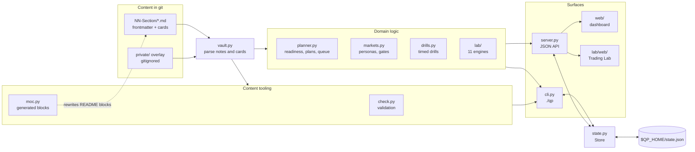

# The qp platform

`qp` turns the Markdown notes of this repo into a study platform: a command line, a local web dashboard, a spaced-repetition scheduler, a planner, timed drills, a content validator and an interactive trading lab.
This page is the developer reference: how it is built, what it stores, what it serves, and how to extend it.
Learners want [Using the Platform](../../00-Start-Here/Using-the-Platform.md) instead.

## Design principles

- **Notes are the source of truth.** Everything is derived from the Markdown files on every run; there is no database of content.
  `vault.py` only reads notes, and `moc.py` is the one module that writes to them, and only between its generated-block markers.
- **Standard library only.** A learner clones the repo and runs `./qp`; there is nothing to install.
  The dashboard loads Markdown, maths and diagram renderers from a pinned CDN and falls back to plain text offline.
- **Progress is private.** Learner state lives in `$QP_HOME`, never in the repo, and every write is atomic and locked.
- **Local only by default.** The server binds to `127.0.0.1`, checks the `Host` header on every request, and refuses cross-site writes.
- **Agent-friendly output.** Commands print compact TOON-style tables, explicit empty states and next-step hints, with stable exit codes.

## Architecture



`./qp` is a small script that puts the repo root on `sys.path` and calls `tools.qp.cli.main`; `python -m tools.qp` does the same.

## Module map

| Module | Responsibility |
| :--- | :--- |
| `vault.py` | Discovers sections, parses frontmatter and question cards into `Note`, `Card`, `Section` and `Vault` dataclasses, merges the private overlay. Never writes. |
| `state.py` | `Store`: the learner state file, SM-2 card scheduling, mastery, drills, lab runs, trade journal, activity; atomic locked writes and schema migration. |
| `planner.py` | Topic, track and firm readiness, next topics, prerequisite-ordered study order, weekly and persona plans, the review queue. |
| `drills.py` | Pure, seeded drill logic: arithmetic sprint, 80-in-8 numerical test, the market-making dice game. No I/O. |
| `check.py` | The content validator behind `./qp check`; CI runs it. |
| `moc.py` | Regenerates the topic table in each section README and the catalog in the root README. |
| `cli.py` | The argparse front end and TOON-style output. |
| `server.py` | `ThreadingHTTPServer` serving the JSON API, the dashboard and the Trading Lab page. |
| `bank.py` | Imports a private question bank (TSV of firm, category, question) into overlay notes. |
| `markets.py` | Markets Mastery OS: 19 tracks, 5 personas, stage gates and the mastery score for `16-Trading-and-Investing`. |
| `mastery.py` | Writes the Markets study board Markdown. |
| `verify_markets.py` | A stricter validator for `16-Trading-and-Investing` (one sentence per line, wikilinks, lab-engine references). |
| `lab/` | The Trading Lab: `base.py` (engine contract), `registry.py`, `cli.py`, `market.py` (synthetic market generator) and one module per engine. |
| `web/`, `lab/web/` | The dashboard single-page app and the Trading Lab page. |

## Content model

### Sections and notes

- A **section** is a top-level folder matching `NN-Name` (`SECTION_RE`).
  Its title is the first `# ` heading of its `README.md`, otherwise the folder name.
- A section whose README frontmatter sets `curriculum: false` is a **library**: only its README is loaded (today, `17-CFA`).
  A README with `index: false` keeps its hand-written content and gets no generated topic table (today, `00-Start-Here`, `15-Resources` and `16-Trading-and-Investing`), but its notes still load and count.
- `16-Trading-and-Investing` loads its curriculum notes and skips its free-form library paths (`Finance/`, `Private/`, `scripts/` and most of `Investing/`); see `is_markets_library`.
- Files inside `code/`, `protocol-specs/`, `_archive/`, `node_modules/`, `__pycache__/` or any dot-folder are never notes.
- **Note id:** the file name without its `NN-` prefix, lower-cased (`01-Probability/04-Expectation-Variance-and-Linearity.md` is `expectation-variance-and-linearity`); a README is `moc:<folder>`.
  Ids, not paths, are what prerequisites, firm focus lists and learner progress refer to.
- **Trackable** notes are those of type `concept`, `problem-set` or `playbook` without `extends`; learners mark their mastery and plans schedule them.

### Frontmatter

The parser is deliberately small:

- The file must start with `---` and the block must close; anything else is a load error.
- One `key: value` per line; nested YAML is rejected.
- `[a, b]` is a list split on commas, with no quoting, which is why list items must never contain commas.
- Integers and decimals become numbers; everything else, including `true` and `false`, stays a string.

Keys with meaning: `type`, `track`, `tier`, `status`, `prereqs`, `est_hours`, `sources`, `focus` (firm guides), `extends` (overlay notes), and in a README `index` and `curriculum`.

### Question cards

```text
> [!question]- <id> | <prompt>
> <answer line>
> <answer line>
```

- The title line must match `^> \[!question\]-?\s+([a-z0-9][a-z0-9-]*)\s*\|\s*(.+?)\s*$`.
- The answer is every following line that starts with `>`.
- Lines inside fenced code blocks are ignored, following CommonMark fence rules, so a card shown as an example inside a fence is not a card.
- A duplicate note id or card id is a load error; the first one wins.

### Private overlay

`$QP_PRIVATE` (default `<repo>/private`) is loaded as a private section with ids `private:<path>`.
A private note with `extends: <topic-id>` appends its cards to that topic, so they count toward its readiness and appear in review; the extending note itself is not trackable.
Generated README tables count public cards only, so they are identical on every machine.

## Learner state

`state.json` lives in `$QP_HOME`, else `$XDG_DATA_HOME/quant-prep`, else `~/.local/share/quant-prep`.
`QP_TODAY=YYYY-MM-DD` overrides today's date, for tests and time travel.

| Key | Shape |
| :--- | :--- |
| `version` | `2` |
| `profile` | `{tracks, hours_per_week, new_cards_per_day}`, defaults: all four tracks, 10, 20 |
| `topics` | `{topic_id: {mastery 0-4, updated, history: [[date, level], ...]}}` |
| `cards` | `{card_id: {ease, interval, reps, lapses, due, last, first}}` |
| `drills` | `[{mode, at, attempts, correct, seconds, score, ...}]` |
| `activity` | `{date: {reviews, marks, drills, journal_trades}}` counters |
| `lab_history` | `[{engine, metrics, at}]`, created on the first lab run |
| `journal_trades` | `[{trade_id, setup, prices, r_multiple, pnl, mae_r, mfe_r, adherence, ...}]`, validated on write |

- **Writes** take an in-process lock and an exclusive `flock` on `state.lock`, reload if another process changed the file, write a temp file, fsync it, copy the old file to `state.json.bak`, and `os.replace` the temp file into place.
  On Windows only the in-process lock applies.
- **Migration:** a version 1 file whose tracks are exactly the old three-track default gains `quant-risk`; it is written as version 2 on the next save.
  Invalid JSON or an unknown version is an error that names the backup.

## Algorithms

### Card scheduling (SM-2 style)

New cards start at ease 2.5; ease never falls below 1.3.

| Grade | Next interval (days) | Ease |
| :--- | :--- | :--- |
| `again` | 0 (due again today); repetitions reset | minus 0.2 |
| `hard` | `max(1, round(interval * 1.2))` | minus 0.15 |
| `good` | 1, then 3, then `max(interval + 1, round(interval * ease))` | unchanged |
| `easy` | 4 on the first review, then `max(interval + 1, round(interval * ease * 1.3))` | plus 0.15 |

The review queue lists due cards first (oldest due date first), then new cards in syllabus order, capped at the profile's new cards per day minus the cards first reviewed today.

### Readiness

- **Topic readiness** is `mastery / 4` for a topic with no cards; otherwise `0.5 * mastery / 4 + 0.5 * maturity`, where maturity is the mean over its cards of `min(interval / 21, 1)`.
- **Track and firm readiness** are means of topic readiness weighted by `max(est_hours, 1)` times a tier weight: core 1.0, advanced 0.6, senior 0.4.
  A firm's topics are its `focus` list, or all topics of its tracks when it has none.
- A topic counts as **mastered** at level 3; remaining hours are `est_hours * max(0, 3 - mastery) / 3`.

### Planning

- A prerequisite **blocks** a topic while its mastery is below 2.
- `next` sorts by blocked, untouched, tier, section and order, so partly studied topics come first.
- `plan` topologically sorts the unlearned topics, pulls in unlearned prerequisites from any track, gives each topic at least half an hour, and fills weeks up to the weekly budget.

## Command line

The full command reference for learners is in [Using the Platform](../../00-Start-Here/Using-the-Platform.md#commands).
Conventions for anyone scripting against it:

- **Tables** print as `name[N]{field1,field2}:` followed by indented CSV rows; a cell with a comma, quote or newline is quoted.
- **Empty results** print `name: 0 results`.
- **Hints** print as a `help[N]:` list of next steps.
- **Errors** go to stderr as `error: ...` with an optional `hint: ...`.
- **Exit codes:** 0 success, 1 failure (including invalid state), 2 usage error, 130 interrupted.
- `review` and `drill` are interactive and refuse to run without a terminal; scripts use `due` and `grade`.
- `qp` with no subcommand runs `status`.
- `check`, `index` and `bank` never open the state file.

## HTTP API

`./qp serve [--host 127.0.0.1] [--port 8765] [--open]` starts a `ThreadingHTTPServer`.

**Security.**

- Every request must carry a `Host` header for the bound host and port, `localhost` or `127.0.0.1` (blocks DNS rebinding).
- Every POST must be `application/json`, under 64 KiB, a JSON object, and not cross-site by `Origin` or `Sec-Fetch-Site`.
- Responses carry a Content Security Policy that allows scripts only from the server and `cdn.jsdelivr.net`, plus `nosniff` and `no-referrer`.
- Each request holds the store lock and reloads state if another process changed it; notes are re-read at most every 2 seconds, so edits show up live.

### Read endpoints

| Route | Returns |
| :--- | :--- |
| `GET /api/summary` | Profile, streak, track readiness, card counts, queue size, next topics, per-section readiness, firm readiness, activity and drill history. |
| `GET /api/catalog` | Every section with its topics (id, title, type, tier, status, tracks, hours, cards, mastery, readiness), mastery labels and track labels. |
| `GET /api/note/<id>` | One note: its row, frontmatter, body, prerequisites with mastery, the topics it unlocks and its card schedules. |
| `GET /api/queue?limit=50` | Today's review cards with prompt and answer. |
| `GET /api/plan?hours=&tiers=core\|no-senior\|all` | A weekly plan. |
| `GET /api/firm/<id>` | A firm guide with its focus topics, weakest first. |
| `GET /api/problems?mode=arith\|optiver&n=200&seed=` | Drill problems with exact answers. |
| `GET /api/lab/catalog` | The Trading Lab engines. |
| `GET /api/journal/stats` | Trade journal analytics and the capital gate. |
| `GET /files/<path>` | A repo file with an allowed extension (images, code, Markdown, text, CSV, notebooks, PDF), confined to the repo root. |

### Write endpoints

| Route | Body | Effect |
| :--- | :--- | :--- |
| `POST /api/mark` | `{id, level}` | Records mastery 0-4 for a trackable topic. |
| `POST /api/grade` | `{card, grade}` | Grades a card `again`, `hard`, `good` or `easy` and returns its new schedule. |
| `POST /api/profile` | `{tracks, hours_per_week}` | Updates the profile. |
| `POST /api/drill` | `{mode, attempts, correct, seconds}` | Records an arithmetic or 80-in-8 result. |
| `POST /api/mm/new`, `POST /api/mm/quote` | `{}`, `{game, bid, ask}` | Plays the market-making game; a finished game is recorded as a drill. |
| `POST /api/lab/run` | `{engine, params}` | Runs a lab engine, records the run and returns its metrics. |
| `POST /api/journal/log` | a trade | Validates and records a journal trade. |

Errors return `{"error": message}` with 400, 403, 404, 413 or 415; an unexpected exception returns 500.

## Web apps

The **dashboard** (`web/`) is a dependency-free single-page app with hash routes:

| Route | Page |
| :--- | :--- |
| `#/` | Dashboard: streak, review queue, mature cards, topics written, track readiness, next up, firms, best drills, sections, activity heatmap. |
| `#/syllabus` | Every section with search, tier, track and written-only filters, and a mastery control per topic. |
| `#/note/<id>` | A rendered note with callouts, folded cards, KaTeX maths, Mermaid diagrams, its prerequisites and what it unlocks. |
| `#/review` | Card review: Space reveals, keys 1 to 4 grade. |
| `#/drills` | Arithmetic sprint, 80-in-8 and the market-making game. |
| `#/plan` | The weekly plan with track and hours settings. |
| `#/firms`, `#/firm/<id>` | Firm readiness and each firm's focus topics. |

Markdown, maths and diagrams use marked, DOMPurify, KaTeX and Mermaid from jsDelivr, each pinned to a version with a Subresource Integrity hash.

The **Trading Lab** page (`/lab/`) lists the eleven engines.
Selecting an engine shows a quick client-side preview; **Run Simulation** calls `POST /api/lab/run`, shows the server's metrics, and records the run for the Markets mastery score.

## Validation

`./qp check` prints one `path:line: [rule] message` per finding and exits 1 if there are any.

| Rule | Checks |
| :--- | :--- |
| `parse` | Frontmatter syntax, duplicate note or card ids, unknown `extends` targets. |
| `schema` | Required `type`, `track`, `tier`, `status`; valid values; trackable notes need `est_hours`. |
| `prereq` | Unknown prerequisite or firm focus ids, and prerequisite cycles. |
| `solid` | A `solid` or `canonical` topic has the required sections and at least 6 cards (15 for a problem set, 3 for a playbook). |
| `card` | Empty answers, and single-line answers that start like a numbered list. |
| `link` | Relative Markdown links resolve. |
| `sde-link` | With `--strict-sde`, links into SDE-Interview-Prep point at files that exist in the local clone. |
| `style` | No em dashes and no emojis. |
| `private` | Nothing under `private/` is tracked by git. |
| `index` | No generated README block is stale. |

`moc.py` owns two kinds of generated block, each between HTML comment markers: the topic table in every indexed section README (`qp:moc`) and the syllabus catalog in the root README (`qp:catalog`).
`./qp index` rewrites them; `./qp check` reports any that would change.

`python3 16-Trading-and-Investing/scripts/verify_markets.py` additionally validates `16-Trading-and-Investing` for one sentence per line, Obsidian-only links, balanced display maths and lab-engine references.

## Markets Mastery OS

`markets.py` adds a second, practice-first model on top of the cards in `16-Trading-and-Investing`:

- **19 tracks** with card prefixes `mkt-<track>-`, and **5 personas** (`holistic`, `quant_trader`, `quant_researcher`, `macro_derivatives_trader`, `retail_algorithmic_trader`) that weight the tracks and name the lab engines they require.
- **Stage gates:** `foundations` and `core` for every track, plus a `capital_gate` on the trading track, each requiring reviewed card ranges, lab runs or journal statistics.
- **Mastery score:** per track `100 * (0.6 * coverage + 0.4 * retention)`; overall `0.5 * cards + 0.3 * lab + 0.2 * gates`, mapped to a readiness level.

`./qp markets [status|gates|mastery] --persona P` reports them, and `python3 16-Trading-and-Investing/scripts/mastery.py` writes the live study board to `$QP_HOME/STUDY_BOARD.md`.

## Trading Lab engines

Every engine subclasses `TradingLabEngine` (`lab/base.py`), declares its parameters as `Param` objects (type, default, bounds, description) and returns a `LabResult` with metrics, a summary and data.
Engines register themselves at import through `lab/registry.py`.

| id | Engine |
| :--- | :--- |
| `event_study` | Historical event case files: abnormal returns, liquidity slippage, pre-mortem hedges. |
| `fut_desk` | Futures, basis and carry: term structures, calendar spreads, roll yield, basis arbitrage. |
| `games` | Interview trading games in the style of dice and card quoting rounds. |
| `journal_stats` | Trade journal analytics: R expectancy, MAE and MFE, setup attribution, tilt detection, the capital gate. |
| `lob_sim` | Limit order book and execution: price-time priority with Poisson flow and Almgren-Chriss benchmarks. |
| `mm_quote` | Two-sided market making: Avellaneda-Stoikov quoting, adverse selection, P&L attribution. |
| `opt_desk` | Options volatility desk: Black-Scholes, Greeks, delta hedging, gamma scalping, earnings vol crush. |
| `overfit_trap` | Backtest overfitting: deflated Sharpe, multiple-testing haircuts, probability of backtest overfitting. |
| `port_alloc` | Multi-asset allocation: risk parity, minimum variance, Euler risk contributions, regime stress. |
| `pos_sizing` | Position sizing: Kelly, growth curves, fat-tailed risk of ruin, time under water. |
| `replay_chart` | Blind chart replay: probability forecasts scored by Brier score and calibration error. |

`./qp lab list`, `./qp lab info <id>` and `./qp lab run <id> key=value ...` drive them from the terminal.

## Testing and CI

`python3 -m unittest discover -s tools/tests -t .` runs the platform tests: vault parsing, scheduling, state concurrency and migration, planning, drills, checks, index generation, the HTTP API and its security rules, the question-bank importer, the Markets model, every lab engine against closed-form or textbook results, the example runner and the secret scanner.
Tests that need Node or gitleaks skip themselves when the tool is missing.

CI (`.github/workflows/ci.yml`) runs on every pull request and on `main`:

| Job | Steps |
| :--- | :--- |
| `content-and-platform` | `./qp check --strict-sde` against a fresh SDE-Interview-Prep clone, the unit tests, ruff, and `tools/run_examples.py` over every curriculum example. |
| `secrets` | gitleaks over the commits the change adds (`tools/scan-secrets.sh`). |
| `cpp-examples` (g++ and clang++) | Every C++ example and unit test built warning-free, then run under ASan and UBSan, and under TSan when it includes `<thread>`. |

`.no-mistakes.yaml` runs the lint (`qp check`, the secret scan, ruff) and the unit tests as the local ship gate; CI adds the strict SDE link check and the examples.

## Extending

- **A check rule:** add it to `check.py` returning `Finding(path, line, rule, message)`, add a test in `tools/tests/test_qp.py` that builds a fixture vault and asserts the finding, and document it in the Validation table above.
- **A command:** add a `cmd_<name>` and its parser entry in `cli.py`, print with the table and help helpers, add it to `NO_STATE` if it never touches progress, and update the command table in Using the Platform.
- **An API route:** add it to `get` or `post` in `server.py`; validate every field of a POST body and raise `ApiError` with the right status; add a test in the `Api` test class.
- **A drill:** add a generator to `drills.py` (pure and seeded), wire it into `GENERATORS`, the CLI and the dashboard.
- **A lab engine:** subclass `TradingLabEngine`, declare `Param`s, implement `run`, call `register` at import, import the module in `lab/__init__.py`, and add a test that checks its maths against an independent result.
- **A track:** add it to `TRACKS`, `TRACK_LABELS` and `TRACK_ABBR` in `vault.py`, add a state migration if existing profiles should gain it, and describe it in `00-Start-Here/Tracks.md`.

## Known limitations

- The dashboard needs network access for its renderers; offline, notes render as escaped plain text.
- The Trading Lab's client-side preview is unseeded and is not recorded; only **Run Simulation** uses the engines and records the run.
- The Trading Lab's **Study Board** link opens the tracked empty template; the live board is the file `mastery.py` writes to `$QP_HOME`.
- `state.json` locking is in-process only on Windows.
- CI tests Python 3.12; the platform targets 3.10 and later.
- `verify_markets.py` is not part of CI.
